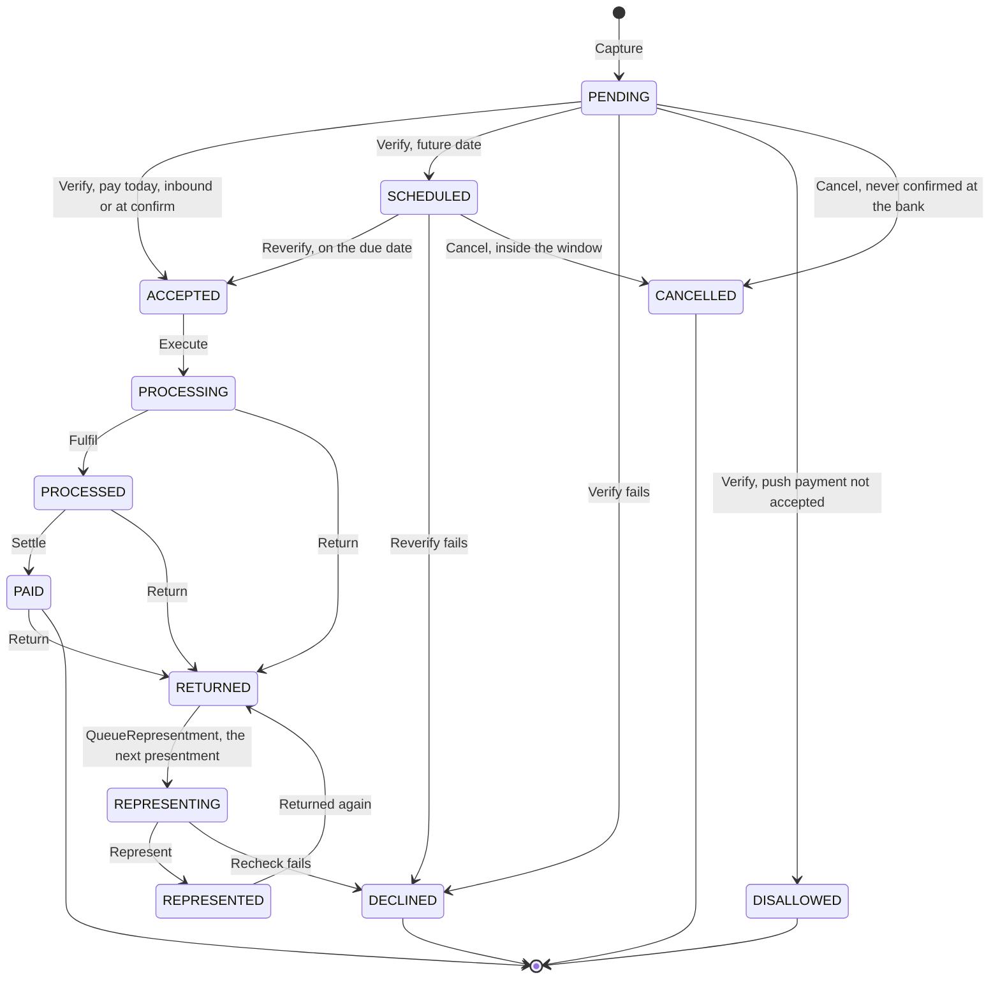
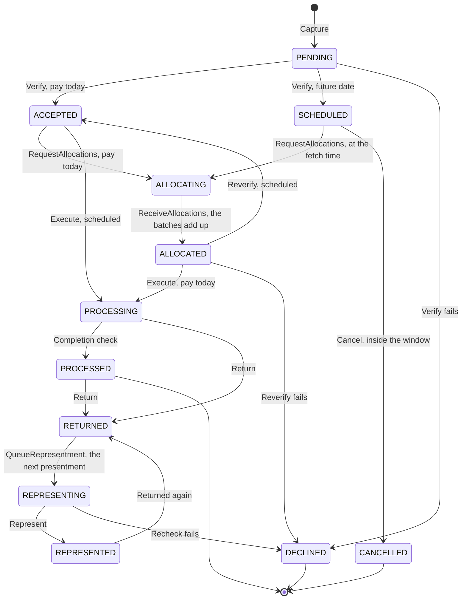

# Billpay Wiki Spec

> The source of truth for the Billpay wiki. It covers the One-Data functions, the Billpay core APIs, the Router, the workflows on the Online and Offline Temporal clusters, the stages, activities and clients they are built from, the dispatchers and governor that pace offline work, market onboarding, and the lifecycle states of payments and refunds. Every page takes its facts from here.

## Table of Contents

1. [Rules every part follows](#rules-every-part-follows)
2. [Billpay API Gateway - One Data Functions](#billpay-api-gateway---one-data-functions)
3. [Billpay APIs](#billpay-apis)
4. [Billpay Workflows (Temporal)](#billpay-workflows-temporal)
5. [Payment Lifecycle States](#payment-lifecycle-states)
6. [Payment Domain Model](#payment-domain-model)
7. [Market Onboarding & Payment Dimensions](#market-onboarding--payment-dimensions)
8. [Core Components in Workflows](#core-components-in-workflows)
9. [Workflow Logic](#workflow-logic)
10. [Periodic Workflows](#periodic-workflows)
11. [Activities](#activities)
12. [Overall Payments View](#overall-payments-view)
13. [Routing and Start Modes](#routing-and-start-modes)
14. [Work Tracker and Inbox](#work-tracker-and-inbox)
15. [Dispatchers and the Governor](#dispatchers-and-the-governor)
16. [Throttling, Priority and Fairness](#throttling-priority-and-fairness)
17. [Corporate Allocations](#corporate-allocations)
18. [Market Onboarding](#market-onboarding)
19. [Platform](#platform)
20. [Sequence and State Diagrams](#sequence-and-state-diagrams)
21. [Open Items](#open-items)

Payments and credit balance refunds are both in scope.

---

## Rules every part follows

When a choice is unclear, these rules decide it.

1. **Oracle is the source of truth.** Every status change is a conditional update that applies only if the status is still what the writer expects. Whoever loses backs off.
2. **Work that waits for a date waits in Oracle,** never in a sleeping workflow or on a Temporal timer.
3. **Nothing calls across clusters.** Oracle is the only hand-off between the Online and Offline clusters.
4. **Every payment workflow starts through the Router.** No API or dispatcher starts one on its own. Control workflows (dispatchers, the governor, provisioning) start from Schedules or their own APIs.
5. **Pace at the door.** Admit only what a cluster and its downstreams can carry. Big bursts wait in Oracle or in One-Data's inbox, not in Temporal.
6. **One workflow per journey.** Stages are the only thing that varies by market behavior. There are no market-specific workflows.
7. **One Oracle commit per stage.** A stage makes its calls first, in parallel where they don't depend on each other; then the state change and the lifecycle timeline entry commit together. Its RTF lifecycle event, and a Raven message where the market's Raven setting tells the customer, go out right after the commit. Fulfil is the exception: `PROCESSED` waits for both.
8. **Pin the plan and the build at start.** A running workflow never has its code or config changed under it.

[^ Top](#table-of-contents)

---

## Billpay API Gateway - One Data Functions

One-Data functions are the versioned contracts that channels and partner systems call. Most front a Billpay core API. The functions and handlers for work nobody waits for (AR intake, inbound payments, returns, settlement and AR posting) keep it in One-Data's inbox instead, and Billpay pulls it through the inbox functions.

### Core

1. [CreatePayment.v3](https://explorer.aexp.com/functions/CreatePayment.v3?method=post): create a payment for today or schedule one for a future date. A payment that needs the customer to confirm their bank details (`requiresBankConfirmation`) comes back `PENDING` with the provider's redirect link, and `ConfirmPendingPayment.v1` starts it once the customer has confirmed.
2. [UpdatePayment.v1](https://explorer.aexp.com/functions/UpdatePayment.v1?method=post): update a `SCHEDULED` payment. Works only inside the market's cancellation window; after that the answer is 409. A corporate payment leaves `SCHEDULED` when its allocations are requested.
3. [DeletePayment.v1](https://explorer.aexp.com/functions/DeletePayment.v1?method=post): cancel a `SCHEDULED` payment. Works only inside the cancellation window; after that the answer is 409. A corporate payment leaves `SCHEDULED` when its allocations are requested.
4. [ReadPayments.v1](https://explorer.aexp.com/functions/ReadPayments.v1): list the payments on a card account.
5. [ReadPaymentEventsById.v1](https://explorer.aexp.com/functions/ReadPaymentEventsById.v1): list the lifecycle states one payment has been through.
6. [CreateCreditBalanceRefund.v1](https://explorer.aexp.com/functions/CreateCreditBalanceRefund.v1?method=post): refund a credit balance on a card account.
7. `CreateInboundPayment.v1`: take a payment pushed by a third party. One-Data stores it in its inbox and replies 202; the inbound dispatcher starts its workflow.
8. `ConfirmPendingPayment.v1`: confirm a payment that waited for the customer's bank. Channels call it with the same payment ID once the customer has confirmed their bank details on the provider's site, and it starts processing the payment.
9. `CreatePaymentAllocations.v1`: the allocations callback for corporate payments. Asynchronous: 202 once the batch is stored and its workflow has started.

### Composite

1. [CreatePaymentInstallment.v1](https://explorer.aexp.com/functions/CreatePaymentInstallment.v1): create a payment and a plan of future installments (Pay & Plan). Channels call it.
2. `CreateBillpayTransactionFromAccountsReceivable.v1`: payments and refunds raised by the Accounts Receivable platform, never a corporate payment. One-Data stores each in its inbox and replies 202; the AR intake dispatcher starts their workflows.

### Event Handlers

Event handlers take events from other platforms. None of them starts or waits on a workflow: they store what arrives in One-Data's inbox, and call Billpay only to find a payment an event doesn't name.

1. `CreateMoneyMovementEventHandler.v1`: money movement events from MR/M3. A return is stored in One-Data's **inbox** for the returns dispatcher. A settlement is recorded in the inbox against its payment and presentment.
2. `CreateAccountsReceivableTransactionEventHandler.v1`: Accounts Receivable (GAR) events. An AR posting is recorded in the inbox against its payment, or leg, and presentment.
3. `CreateOpentoBuyUpdatePaymentEventHandler.v1`: Authorizations (AMP) events, stored by One-Data. Details still to be defined.

The inbox lives in One-Data's Postgres database, not in Billpay's Oracle. For PAID, One-Data marks a row `READY` once it has an AR posting and its settlement, and `ProcessPaidEventsWorkflow` reads only `READY` rows and sets each payment or leg `PAID` (see [Work Tracker and Inbox](#work-tracker-and-inbox)).

- Each handler writes the raw event and upserts the payment's inbox row in one transaction, and acknowledges the sender only after the commit. If the database is down, the sender gets an error and retries.
- There is one row per payment or leg, under the ID the event carries. A leg's ID is `{paymentId}_{seq}`, and its AR posting pairs with the settlement of the payment named before the `_`: a split payment settles once, as a whole, while each leg posts on its own.
- An event without a payment ID is matched through `ReadPayments.v1`, by its account ID. Most events carry the ID, so the lookup is rare. If it finds no single payment, the raw event stays in `billpay_extnl_event` and an alert names it.
- Whichever event arrives second sets the row `READY` in the same transaction. A lock per payment ID makes a payment's settlement and its legs' postings that arrive together see each other, and a repeated event can't set a row twice.
- Handlers never pace anything or run on a schedule.

### Inbox functions

Billpay reaches the inbox through four One-Data functions, never through the database. `ProcessPaidEventsWorkflow` calls the first two, and the AR intake, returns and inbound dispatchers call the other two. `ProcessMissingPaidEventsWorkflow` hands a found event to its One-Data handler, the same way MR/M3 and GAR send events. All four names are **placeholders**.

1. `ReadPaidReadyPayments.v1`: puts `UNMATCHED` rows last tried over an hour ago, and under 48 hours old, back to `READY`, then returns up to 500 of the oldest `READY` rows. It changes nothing else, so a repeat before the status update returns the same rows.
2. `UpdatePaidReadyPayments.v1`: sets the listed rows `DONE` or `UNMATCHED` in one transaction and returns the counts. Setting a status twice does no harm, so a retry is safe.
3. `ReadStartRequests.v1`: returns up to a dispatcher's tick of the oldest `READY` requests for that dispatcher: AR intake (payments and refunds), returns or inbound. It changes nothing, so a repeat returns the same requests.
4. `UpdateStartRequests.v1`: sets the listed requests `DONE` or `REJECTED` in one transaction. Setting a status twice does no harm.

[^ Top](#table-of-contents)

---

## Billpay APIs

Every write API admits the request first, through the Router (see [Routing and Start Modes](#routing-and-start-modes)):

- **422** when the market, account type or API is not live in this environment. Senders do not retry a 422.
- **429** with `Retry-After` when an allocation callback arrives over its traffic class's budget. The allocations manager retries on 429.
- **409** when an update or cancel arrives for a payment that is no longer `SCHEDULED` (a corporate payment leaves it when its allocations are requested), or after the cancellation window has closed; and when a confirm arrives for a payment that is no longer `PENDING`, such as one cancelled when its confirmation window closed.
- **503** with `Retry-After` for an allocation callback or a provisioning request while the Offline cluster is down.

AR intake, returns and inbound payments never reach these APIs. One-Data stores them, and dispatchers pull them at the governor's pace (see [Dispatchers](#dispatchers)).

### Core

| API | What it does | Start mode | Reply |
| --- | --- | --- | --- |
| `POST /payments` | Pays today or schedules for a future date. A payment that needs bank confirmation stops at `PENDING` | Update-With-Start | PENDING, ACCEPTED, SCHEDULED or DECLINED; PENDING with the redirect link when the customer must confirm at their bank. The API waits at most 3 s for a decision, then replies PENDING |
| `PUT /payments/{payment-id}` | Updates a `SCHEDULED` payment inside the cancellation window | Update-With-Start | The new payment's result; 409 outside the window |
| `DELETE /payments/{payment-id}` | Cancels a `SCHEDULED` payment inside the cancellation window | Update-With-Start | CANCELLED; a repeated cancel gets CANCELLED again; 409 otherwise |
| `POST /payments/{payment-id}/confirm` | Confirms a `PENDING` payment once the customer has confirmed their bank details, then executes it | Update-With-Start | ACCEPTED or DECLINED; 409 once the payment is no longer `PENDING` |
| `POST /payments/{payment-id}/allocations` | Takes one batch of allocations for a corporate payment | Stores the batch, then async start | 202 |
| `POST /refunds` | Refunds a credit balance | Update-With-Start | The refund's result |
| `GET /payments/account/{account-id}` | Lists the payments on an account | Reads Oracle | The payments |
| `GET /payments/{payment-id}` | Returns one payment | Reads Oracle | The payment |

AR learns the outcome of a request it sent from the SCHEDULED and DECLINED notifications and lifecycle events, or from `GET /payments/{payment-id}`.

### Composite

| API | What it does | Start mode |
| --- | --- | --- |
| `POST /payment-installments` | Pays today and creates a plan of future installments | Update-With-Start; its children run on the Online cluster |

### Provisioning API

Each environment's app exposes a provisioning API. Only the market-onboarding control plane (billpay-ui's backend) calls it, with its own service identity.

| Path | What it does |
| --- | --- |
| `/provisioning/releases` | Takes a frozen market release, reports its provisioning progress, records a sign-off and rolls a release back |
| `/provisioning/markets/{market}/{account-type}/pause` | Pauses a live market's dispatchers |
| `/provisioning/markets/{market}/{account-type}/resume` | Resumes them |
| `GET /provisioning/capabilities` | Returns the deployed build's capability manifest: every behavior combination the build can run |

Sending a release is idempotent: one provisioning workflow per market, account type, version and environment.

[^ Top](#table-of-contents)

---

## Billpay Workflows (Temporal)

### Two clusters

Billpay runs on two self-hosted Temporal clusters. Each has its own Aurora PostgreSQL database and its own OpenSearch 2 visibility store.

- **Online cluster:** journeys where a caller waits for an answer. Peak 100 TPS.
- **Offline cluster:** work we can pace: scheduled execution, AR intake, corporate allocations, returns, inbound payments, representments, confirmation expiries, periodic jobs and the control workflows.

Separate databases mean offline load can never slow realtime traffic at the Temporal layer. Oracle, the downstream services and the app are shared, and the governor watches online p99 as well as Oracle and the downstreams, so pressure on any of them slows offline work first. The one exception is a SEPA cutoff: when Online would leave a SEPA run too little of a downstream, Online is capped on that downstream until the cutoff ([When the cutoff wins](#when-the-cutoff-wins)).

**Nothing calls across clusters.** A payment accepted or scheduled on the Online cluster, or left waiting for bank confirmation, reaches the Offline cluster as a Work Tracker row in Oracle, written in the same commit as its state change. Self-hosted Nexus cannot bridge the two: it works only inside one cluster or across multi-cluster replication. The governor makes the one control call that crosses: during a cutoff run it sets limits on Online queues through that cluster's API. No payment or workflow ever does.

**Standby.** Each cluster runs active-passive, like the single cluster it replaces: active in us-east-1, with a passive standby in us-west-1 whose database replicates from the east. An operator promotes each standby on its own, and the app reconnects to it.

### One app

One app, billpay-core, runs the core APIs, the Router, the dispatchers, the governor and the workers for both clusters, with a Temporal client for each cluster. Every piece of offline work reaches it at the governor's pace, so online and offline work can share it.

- Offline work has its own Oracle connection pool and a cap on how many offline tasks run at once, so it can never take a whole pod. The governor checks every 15 s and only stops new starts; the cap protects online work in between.
- billpay-core ships and deploys as one app. There is no separate online or offline app: more capacity means more pods of the same app.
- Load-test runs 4 and 6 run on the app, and online p99 must stay unchanged while offline work runs.

### Traffic classes

| Traffic | Volume and rate | Caller waits | Deadline | Cluster |
| --- | --- | --- | --- | --- |
| Pay today, from channels | Peak 100 TPS | Yes, until ACCEPTED, for at most 3 s | Never impacted, except while a SEPA run caps Online | Online |
| Schedule, update, cancel, from channels | Part of realtime traffic; cancel under 2 TPS | Yes | Cancel only inside the cancellation window | Online |
| Bank confirmation, from channels | Part of pay today: the create call, then the confirm | Yes: until `PENDING` with the redirect link, then until `ACCEPTED` | Confirm only inside the market's confirmation window | Online |
| Credit balance refunds | From channels, or raised by AR | Channels: yes. AR: no, pulled with AR intake | None | Online from channels; Offline for AR |
| Scheduled intake, AR batch | 100 TPS sustained (1M in 2.8 h) | No: stored by One-Data, then 202; pulled at the governor's pace | None | Offline |
| Scheduled execution, US | Up to 1M at 00:01 MST (Phoenix time) | No | No cutoff; 50 TPS floor, faster when healthy | Offline |
| Scheduled execution, SEPA | Up to 250K per market (DE, IT) at midnight CET | No | 3 to 4 hour cutoff | Offline |
| Corporate | Up to 50K payments and 500K allocations a day; up to 100K allocations in one payment | Only for pay today, until `ACCEPTED` | The parent clears once `ALLOCATED`: at once for pay today, at the execution time for a scheduled payment | Offline; pay today starts on Online |
| Returns | Bursts of 100 TPS, up to 100K a day | No: stored by One-Data; pulled at the governor's pace | None | Offline |
| Inbound, pushed by a third party | 100 TPS, up to 500K a day, arriving around 8 PM MST | No: stored by One-Data, then 202; pulled at the governor's pace | None | Offline |
| Representments | A share of returns | No | The date market rules set | Offline |
| Confirmation expiry | Only payments the customer never confirms | No | The end of the market's confirmation window | Offline |
| Settlement and AR posting | A settlement per payment and an AR posting per payment or leg, in bursts of up to 1,000 a second; the AR postings, which move payments to `PAID`, arrive in the US early morning. They wait in One-Data's inbox, and Billpay reads one `READY` row per payment, or per leg of a split payment | No | None; paced last of all | Offline |

### Kinds of workflow

- **Core workflows:** one business journey each, such as paying today, executing a scheduled payment or processing a return.
- **Composite workflows:** a parent that runs core workflows as children, sometimes across domains: Pay & Plan (Billpay and GAR), Pay with MR Points (Billpay and Loyalty), multiple instructions. They run on the Online cluster, with their children on the same cluster.
- **Periodic workflows:** jobs started by Temporal Schedules on the Offline cluster.
- **Control workflows:** the dispatchers, the governor and market provisioning. They pace and configure payment work; they are not payment journeys.

### Online cluster

| Workflow | Workflow ID | Notes |
| --- | --- | --- |
| `CreateImmediatePaymentWorkflow` | `{paymentId}-init` | Pay today |
| `CreateScheduledPaymentWorkflow` | `{paymentId}-init` | Scheduled from channels |
| `UpdatePaymentWorkflow` | `{paymentId}-update` | |
| `CancelPaymentWorkflow` | `{paymentId}-cancel` | |
| `ConfirmPaymentWorkflow` | `{paymentId}-confirm` | A payment the customer confirmed at their bank |
| `CreateBalanceRefundWorkflow` | `{paymentId}-init` | Refunds from channels |
| `CreatePaymentWithMultipleInstructionsWorkflow` and Pay & Plan | `{paymentId}-init` | Composites; children on the Online cluster |
| `ExecuteSplitPaymentWorkflow` | `{paymentId}_{seq}-execute` | Consumer split legs of an Online parent run as its children |

### Offline cluster

| Workflow | Workflow ID | Started by |
| --- | --- | --- |
| `CreateScheduledPaymentWorkflow` | `{paymentId}-init` | The AR intake dispatcher |
| `ExecuteScheduledPaymentWorkflow` | `{paymentId}-execute` | The scheduled-payments dispatcher; for a corporate payment, scheduled or paid today, the allocated-payments dispatcher |
| `ExecuteSplitPaymentWorkflow` | `{paymentId}_{seq}-execute` | The leg dispatcher (corporate legs), or the parent (consumer splits) |
| `RequestAllocationsWorkflow` | `{paymentId}-allocations` | The allocation-request dispatcher |
| `ReceiveAllocationsWorkflow` | `{paymentId}-allocations-{batch}` | The allocations callback API |
| `ProcessReturnedPaymentWorkflow` | `{paymentId}-return-{seq}` | The returns dispatcher |
| `ProcessRepresentmentWorkflow` | `{paymentId}-represent-{seq}` | The representment dispatcher |
| `ProcessInboundPaymentWorkflow` | `{paymentId}-init` | The inbound dispatcher |
| `CreateBalanceRefundWorkflow` | `{paymentId}-init` | The AR intake dispatcher, for refunds AR raises |
| `CancelPaymentWorkflow` | `{paymentId}-cancel` | The confirmation-expiry dispatcher, for a payment never confirmed at its bank |
| `ProcessPaidEventsWorkflow`, `ProcessMissingPaidEventsWorkflow`, `PurgeTransactionDataWorkflow` | Their Schedule's ID plus the trigger time | Temporal Schedules |
| Dispatchers (scheduled payments, allocation requests, allocated payments, allocation legs, representments, confirmation expiries, AR intake, returns, inbound) | Their Schedule's ID, such as `dispatch-sched-DE`, plus the trigger time | Temporal Schedules |
| `GovernorWorkflow` | `governor`, plus its Schedule's trigger time | A Schedule that keeps it running |
| `MarketProvisioningWorkflow` | `provision-{market}-{accountType}-v{N}` | The provisioning API |

On returns and representments `{seq}` is the presentment sequence ([Presentments](#presentments)). A return's is the presentment that came back, and a representment's is the new one it sends, so a payment returned twice runs `-return-1`, `-represent-2`, `-return-2` and `-represent-3`.

There are no 2,500-a-minute batches and no executors on timers: dated work waits as Work Tracker rows, work nobody waits for waits in One-Data's inbox, and dispatchers release both at the rate the governor sets.

[^ Top](#table-of-contents)

---

## Payment Lifecycle States

Consumer and corporate payments share one set of states. A corporate payment adds two, `ALLOCATING` and `ALLOCATED`, while its allocations are fetched: after `ACCEPTED` for pay today, after `SCHEDULED` for a scheduled payment. It moves money only once it is `ALLOCATED`. A split payment, consumer or corporate, turns `PAID` leg by leg; its parent stays `PROCESSED`.

| State | Meaning | Terminal? |
| --- | --- | --- |
| `PENDING` | Captured in Billpay, idempotency checked, awaiting validation; or waiting for the customer to confirm their bank details. | No |
| `SCHEDULED` | Validated and waiting in Oracle for its due date, as a Work Tracker row. | No |
| `ACCEPTED` | Validated (on the day, for a scheduled payment) and ready to move money. A corporate payment paid today requests its allocations first. | No |
| `ALLOCATING` | A corporate payment whose allocations have been requested from the allocations manager; batches may be arriving. | No |
| `ALLOCATED` | A corporate payment whose batches add up to its amount, ready to execute: at once for pay today, at its execution time for a scheduled payment. | No |
| `PROCESSING` | Being executed: clearing with the bank, the AR balance reduced, open-to-buy raised. | No |
| `PROCESSED` | Clearing, AR, OTB, accounting, eBNC and risk have all succeeded, and the lifecycle event (RTF) and the customer's message (Raven) have gone out. | No |
| `REPRESENTING` | The next presentment of a returned payment: a new row, numbered one higher, waiting for the date market rules set. | No |
| `PAID` | Settled and posted to Accounts Receivable. | Yes, unless a return arrives |
| `RETURNED` | The presentment did not settle; the customer's bank returned the funds. | Yes. A representment is a new row |
| `REPRESENTED` | The next presentment of a returned payment, sent to the bank. | Yes, unless it is returned again |
| `DECLINED` | Failed validation, or a representment failed its recheck. | Yes |
| `CANCELLED` | Withdrawn while `SCHEDULED`, inside the market's cancellation window; or never confirmed at the customer's bank before the market's confirmation window closed. | Yes |
| `DISALLOWED` | A push payment (an inbound payment a third party sends) that American Express did not accept. Only push payments end here. | Yes |

### Transitions

| From | To | By |
| --- | --- | --- |
| Input | `PENDING` | Capture |
| `PENDING` | `ACCEPTED`, `SCHEDULED` or `DECLINED` | Verify |
| `PENDING` (inbound: a push payment) | `ACCEPTED` or `DISALLOWED` | Verify |
| `PENDING` (bank confirmation) | `ACCEPTED` or `DECLINED` | Verify, once the caller confirms |
| `PENDING` (bank confirmation) | `CANCELLED` | Cancel, once the confirmation window closes unconfirmed |
| `SCHEDULED` | `ACCEPTED` or `DECLINED` | Reverify, on the due date; a corporate payment goes through `ALLOCATED` first |
| `SCHEDULED` | `CANCELLED` | Cancel, inside the cancellation window only |
| `SCHEDULED` (corporate) | `ALLOCATING` | RequestAllocations, at the market's fetch time |
| `ACCEPTED` (corporate, pay today) | `ALLOCATING` | RequestAllocations, at once |
| `ALLOCATING` | `ALLOCATED` | ReceiveAllocations, once the batches add up to the payment amount |
| `ALLOCATED` (scheduled) | `ACCEPTED` or `DECLINED` | Reverify, at the execution time |
| `ALLOCATED` (pay today) | `PROCESSING` | Execute |
| `ACCEPTED` | `PROCESSING` | Execute |
| `PROCESSING` | `PROCESSED` | Fulfil; for a corporate parent, the leg dispatcher's completion check |
| `PROCESSED` | `PAID` | Settle, in `ProcessPaidEventsWorkflow`; for a split payment, each leg, never the parent |
| `PROCESSING`, `PROCESSED` or `PAID` | `RETURNED` | Return |
| `RETURNED` | The next presentment, a new row in `REPRESENTING`; the returned row stays `RETURNED` | QueueRepresentment |
| `REPRESENTING` | `REPRESENTED` or `DECLINED` | Represent |
| `REPRESENTED` | `RETURNED` | Return, when it is returned again |

There is no path from `ACCEPTED` to `CANCELLED`. A payment that has left `SCHEDULED` can no longer be cancelled, and a corporate payment leaves it when its allocations are requested.

### Presentments

Each time a payment goes to the bank is a presentment, numbered by `presentmentSequence` from 1, and each presentment is its own row in `trans_dtl` (`split_trans_dtl` for a leg). A return moves the presentment that came back to `RETURNED`, and that row stays `RETURNED`. If the payment can be represented, QueueRepresentment writes the next presentment as a new row, numbered one higher, in `REPRESENTING`. Its clearing date is the representment date, and Represent sends it to the bank on that date. If that one comes back too, it turns `RETURNED` and the next is numbered 3. If a representment fails its recheck, its own row turns `DECLINED`, and the presentment before it stays `RETURNED`.

| Presentment | Its row's states, for a payment returned twice |
| --- | --- |
| 1 | `PENDING` through `PAID`, then `RETURNED` |
| 2 | `REPRESENTING` → `REPRESENTED` → `RETURNED` |
| 3 | `REPRESENTING` → `REPRESENTED` |

Every presentment keeps the payment's ID and confirmation code.

### Guarded updates

Every status change is a conditional update on the current status, such as `UPDATE trans_dtl SET status = 'CANCELLED' WHERE payment_id = :id AND status = 'SCHEDULED'`. A payment that has been represented has a row per presentment, so Return's guard also names the presentment. When two writers race, one wins and the other sees zero rows updated. At the edge of the cancellation window, either Cancel or Reverify wins; a cancel that loses gets 409, or the earlier result again if the payment is already `CANCELLED`. A corporate payment's allocation request races a cancel the same way: both are guarded on `SCHEDULED`, so only one wins. A confirm races the end of the confirmation window the same way: Verify and the expiry's Cancel are both guarded on `PENDING`, and a confirm that loses gets 409.

### Corporate payments

A corporate payment fetches its allocations before it moves money. Pay today and scheduled payments differ only until they are `ALLOCATED`; from there they take the same steps.

| | Pay today | Scheduled |
| --- | --- | --- |
| Allocations requested | At once, after `ACCEPTED` | At the market's fetch time: on the due date, or a set number of hours or days before it |
| States | `ACCEPTED` → `ALLOCATING` → `ALLOCATED` → `PROCESSING` | `SCHEDULED` → `ALLOCATING` → `ALLOCATED` → `ACCEPTED` → `PROCESSING` |
| Executed | At once, once `ALLOCATED` | At the execution time on the due date, once `ALLOCATED`, after Reverify |

Corporate rules:

- No workflow waits for allocations, and no workflow starts the next step itself. Each step is a Work Tracker row in Oracle that a dispatcher picks up ([Corporate Allocations](#corporate-allocations)).
- The parent clears once, at payment level. If its allocations are late, it waits in `ALLOCATING`, and an alert fires at the market's alert point.
- Legs are written when the parent's Execute commits, from the batches stored in `allocation_batch`. A declined parent never has legs.
- The parent turns `PROCESSED`, by a guarded update, once it has cleared **and** every leg is `PROCESSED` or `PAID`, and its own RTF event and Raven message have gone out.
- Legs turn `PAID` one by one, through Settle: each once the parent has settled and the leg's own AR posting is in. The parent stays `PROCESSED`; `PAID` is set only on legs.
- A leg whose retries run out goes on the exception list, and its parent stays `PROCESSING` until operations resolve it.
- Once its allocations are requested, a corporate payment is no longer `SCHEDULED`, so a cancel or an update gets 409.

[^ Top](#table-of-contents)

---

## Payment Domain Model

The payment model in code is `docs/domainModel/Payment.kt.md`, supplied on 2026-10-16; instruments and payment options are in `Instrument.kt.md` and `PaymentOption.kt.md`. The model turns the lifecycle into types: a payment's class is its state, and a transition is a function from one class to the next.

The model below is the target, agreed on 2026-10-17. It covers the whole lifecycle apart from what [Still open](#still-open) lists, and [Changes the code needs](#changes-the-code-needs) lists what the supplied file doesn't have yet.

### Root types

- `Transaction`: `id` (a `TransactionId`), `account` and `amount`, which may be null. It has two branches, `Payment` and `Refund`.
- `Payment` adds `paymentId` (its `id`), `confirmationCode`, `status`, `source`, `timeline`, `option`, `instrument`, `presentmentSequence`, `hasMoneyMovement` and `planDetailData`.
- `Refund` adds `refundId` (its `id`). It has no concrete types yet.
- Every sealed type serializes with a `type` property holding the class's simple name, such as `"type": "PaidSplitPayment"`.

### The type is the state

Fourteen sealed classes, one per state, each fixing `status`: `PendingPayment`, `ScheduledPayment`, `AcceptedPayment`, `AllocatingPayment`, `AllocatedPayment`, `ProcessingPayment`, `ProcessedPayment`, `PaidPayment`, `ReturnedPayment`, `RepresentingPayment`, `RepresentedPayment`, `CancelledPayment`, `DeclinedPayment` and `DisallowedPayment`. Two traits narrow what a state must hold:

| Trait | Guarantees | On |
| --- | --- | --- |
| `VerifiedPayment` | A `TokenizedAccount`, a non-null `amount`, a `VerifiedPaymentOption`, a `VerifiedInstrument` and an `ExecutableTimeline` | `SCHEDULED` through `REPRESENTED`, `ALLOCATING` and `ALLOCATED` included |
| `RepresentmentPayment` | `returnedInfo` | `RETURNED`, `REPRESENTING` and `REPRESENTED` |

`PENDING`, `CANCELLED`, `DECLINED` and `DISALLOWED` are not verified. `DeclinedPayment` adds a `declineCode`, and a declined payment has no confirmation code. A cancelled payment, like a declined one, may have no amount and only a plain `Timeline`, because a payment cancelled while `PENDING` was never verified.

### Full and split

Two shapes cross the states. `FullPayment` settles as one amount. `SplitPayment` is a leg: it adds `originalPaymentId` (the parent's ID), `sequenceNumber` and a non-null `amount`. A leg's ID is its parent's plus the sequence number, `{paymentId}_{seq}`.

| State | Full | Split |
| --- | --- | --- |
| `PENDING` | `PendingFullPayment` | |
| `SCHEDULED` | `ScheduledFullPayment` | |
| `ACCEPTED` | `AcceptedFullPayment` | `AcceptedSplitPayment` |
| `ALLOCATING` | `AllocatingFullPayment` | |
| `ALLOCATED` | `AllocatedFullPayment` | |
| `PROCESSING` | `ProcessingFullPayment` | `ProcessingSplitPayment` |
| `PROCESSED` | `ProcessedFullPayment` | `ProcessedSplitPayment` |
| `PAID` | `PaidFullPayment` | `PaidSplitPayment` |
| `RETURNED` | `ReturnedFullPayment` | `ReturnedSplitPayment` |
| `REPRESENTING` | `RepresentingFullPayment` | `RepresentingSplitPayment` |
| `REPRESENTED` | `RepresentedFullPayment` | `RepresentedSplitPayment` |
| `CANCELLED` | `CancelledFullPayment` | |
| `DECLINED` | `DeclinedFullPayment` | `DeclinedSplitPayment` |
| `DISALLOWED` | `DisallowedFullPayment` | |

Twenty-two data classes in all. A leg starts at `ACCEPTED`, made from a `SplitSlice`: `sequenceNumber`, `splitAmount`, `splitPaymentId` (the leg's ID) and `account` (the card account the leg pays). So there is no pending, scheduled, allocating or allocated leg. A leg is never cancelled, and is declined only when its representment fails the recheck. Only a corporate payment is ever `ALLOCATING` or `ALLOCATED`, and only a push payment is ever `DISALLOWED`.

### Presentments in the model

`presentmentSequence` numbers a payment's presentments from 1 ([Presentments](#presentments)). A representment doesn't move the returned payment: `toRepresentingFullPayment(representmentDate)` builds the next presentment, a `RepresentingFullPayment` numbered one higher with the representment date as its clearing date, and the `ReturnedFullPayment` it came from stays as it is. Every other move keeps the number.

### Value types

- `ReturnedInfo`: `effectiveDate`, `returnReason`, `returnSource`, `originalPaymentId`, `originalPresentmentSequence` and `originalPaymentDate`. Which fields are required is still to be confirmed.
- `Timeline` holds `captureTimestamp`, `transactionDate` and `transactionTimestamp`. `ExecutableTimeline` adds `clearingDate`, `executionTimestamp`, `cancelCutoffTimestamp` and `frequency` (`ONCE` or `RECURRING`). `InitialTimeline` is the plain one, set at capture; `ImmediateTimeline` is executable with `frequency` `ONCE`; `ScheduledTimeline` adds `scheduleDate`.
- `BankConfirmation`: `providerReference`, the bank-confirmation provider's reference. `PendingFullPayment` holds it as `bankConfirmation`, null unless the payment waits for the customer's bank.
- `PendingFullPayment` checks its amount when built: an amount must be present for a verified option, an other amount or an initial payment amount, and absent for every other option, whose amount is worked out later. Its defaults are `presentmentSequence` 1, `hasMoneyMovement` true, `planDetailData` null and `bankConfirmation` null.

### Transitions

There is no `setStatus`. Each allowed move is an extension function that takes one class and returns the next, 36 in all.

| From | Functions |
| --- | --- |
| `PendingFullPayment` | `toAcceptedFullPayment(account, amount, timeline, option, instrument)`, `toScheduledFullPayment(...)` with a `ScheduledTimeline`, `toDeclinedFullPayment(option, instrument, declineCode)`, `toDisallowedFullPayment(...)` for a push payment only, `toCancelledFullPayment()` when the confirmation window closes unconfirmed |
| `ScheduledFullPayment` | `toAcceptedFullPayment()`, `toDeclinedFullPayment(declineCode)`, `toCancelledFullPayment()`, and for a corporate payment `toAllocatingFullPayment()` at the fetch time |
| `AcceptedFullPayment` | `toProcessingFullPayment()`, `toAcceptedSplitPayment(splitSlice)`, and for a corporate payment paid today `toAllocatingFullPayment()` |
| `AllocatingFullPayment` | `toAllocatedFullPayment()`, once the batches add up |
| `AllocatedFullPayment` | `toProcessingFullPayment()` for pay today; for a scheduled payment, Reverify's `toAcceptedFullPayment()` or `toDeclinedFullPayment(declineCode)` |
| `ProcessingFullPayment` | `toProcessedFullPayment()`, `toAcceptedSplitPayment(splitSlice)`, `toReturnedFullPayment(returnedInfo)` |
| `ProcessedFullPayment` | `toPaidFullPayment()`, `toReturnedFullPayment(returnedInfo)` |
| `PaidFullPayment` | `toReturnedFullPayment(returnedInfo)` |
| `ReturnedFullPayment` | `toRepresentingFullPayment(representmentDate)`, which builds the next presentment, numbered one higher, with the representment date as its clearing date |
| `RepresentingFullPayment` | `toRepresentedFullPayment()`, `toDeclinedFullPayment(declineCode)` when the recheck fails |
| `RepresentedFullPayment` | `toReturnedFullPayment(returnedInfo)` |
| `AcceptedSplitPayment` to `RepresentedSplitPayment` | The same ten moves at leg level: accepted to processing; processing to processed or returned; processed to paid or returned; paid to returned; returned to the next presentment; representing to represented, or declined when the recheck fails; represented to returned |

Verify's results are the arguments of the move out of `PENDING`. A return's `ReturnedInfo` is the argument of every move that records a return, from `PROCESSING`, `PROCESSED`, `PAID` or `REPRESENTED`, so a payment returned twice keeps both returns' details, one on each presentment.

### Changes the code needs

Agreed on 2026-10-17, and not yet in the supplied file:

1. `ProcessingFullPayment.toReturnedFullPayment(returnedInfo)` and `ProcessingSplitPayment.toReturnedSplitPayment(returnedInfo)`.
2. `AllocatingPayment` and `AllocatedPayment`, with `AllocatingFullPayment` and `AllocatedFullPayment`, the six moves into and out of them, and the two status values.
3. `PendingFullPayment.toCancelledFullPayment()`, with `CancelledFullPayment` taking a nullable `amount` and a plain `Timeline`.
4. `bankConfirmation: BankConfirmation?` on `PendingFullPayment`.
5. `DisallowedFullPayment` and `PendingFullPayment.toDisallowedFullPayment(...)`, for push payments only.
6. `RepresentedFullPayment.toReturnedFullPayment(returnedInfo)` and the leg's version take the new return's details. Today they keep the last return's.
7. `ReturnedFullPayment.toRepresentingFullPayment(representmentDate)` and the leg's version build the next presentment: numbered one higher, with the representment date as its clearing date. Today they copy the returned presentment's `presentmentSequence` and timeline.
8. A representment that fails its recheck: `RepresentingFullPayment.toDeclinedFullPayment(declineCode)`, `DeclinedSplitPayment` and `RepresentingSplitPayment.toDeclinedSplitPayment(declineCode)`. The new presentment's row turns `DECLINED`; the one before it is already `RETURNED`. The moves from `REPRESENTING` back to `RETURNED`, for a payment and a leg, go.
9. `SplitSlice` gains `splitPaymentId` and `account`, and `toAcceptedSplitPayment(splitSlice)` takes the leg's ID and card account from it. Today it builds the ID with `paymentId.withSplit(seq)` and copies the parent's account.

### Still open

| Question | The model for now |
| --- | --- |
| Credit balance refunds | Skipped for now. `Refund` has no concrete types, and the refund steps are still to be defined |

[^ Top](#table-of-contents)

---

## Market Onboarding & Payment Dimensions

Markets are onboarded through billpay-ui, the market-onboarding control plane. The process, releases and provisioning are in [Market Onboarding](#market-onboarding).

A market profile is one market and one account type. Onboarding picks the Billpay APIs the profile takes and answers five behavior questions, the payment dimensions:

| Behavior | Values |
| --- | --- |
| `accountType` | `CONSUMER`, `CORPORATE`, `BUSINESS_TRAVEL` |
| `requiresArPosting` | Y, N or BOTH: the processed payment is posted to AR |
| `requiresRealtimeClearing` | Y, N or BOTH: clearing is realtime or batch |
| `requiresMandateAuthorization` | Y, N or BOTH: a mandate is verified before processing |
| `requiresBankConfirmation` | Y, N or BOTH: the customer confirms their bank details on the market's provider's site, such as Plaid in the US or Pay with Bank Transfer in the UK, before the payment is processed |

**BOTH** means required for some journeys and not others. Onboarding stores which journeys get Y, and the Router resolves BOTH to Y or N per journey. For realtime clearing only pay-today payments from channels get Y: every future-dated payment clears in batch, whether it came from a channel or from AR. Future-dated payments never clear in real time. For bank confirmation, BOTH is resolved from the request's payment method: a method that needs the customer to confirm at their bank gets Y. Only consumer payments made today take bank confirmation.

A combination that is not onboarded for a market is rejected with 422 before any workflow starts.

[^ Top](#table-of-contents)

---

## Core Components in Workflows

Four layers handle every journey: **Workflow → Stage → Activity → Client**. Business sequencing belongs in workflows, business steps and every behavior variation in stages, calls to one system in activities, and contract mapping in clients.

| Layer | What it does | May call | Must not call | Location | Naming |
| --- | --- | --- | --- | --- | --- |
| **Workflow** | Runs one journey. No market logic | Stages; child workflows on its own cluster | Activities, clients, external systems, anything on the other cluster | `core/lib/workflows/impl/` | `{Verb}{Object}Workflow`, such as `ExecuteScheduledPaymentWorkflow` |
| **Stage** | One business step: parallel calls, then one Oracle commit. Returns its outcome. The only layer that varies by behavior | Activities; plain helper functions | Workflows, other stages, clients, external systems | `core/lib/stages/impl/`; a market override in `market/{m}/stages/` | A `{Step}Stage` interface; implementations named for the behavior, such as `MandateVerifyStage` |
| **Activity** | The calls to one system, on that system's task queue | Clients | Workflows, stages, other activities, external systems | `core/lib/activities/` and `impl/` | `{System}Activities`, such as `ClearingActivities`; Oracle reads and writes in `PaymentStore` |
| **Client** | Talks to one external system and maps its contract | That one system | Other clients, workflows, stages, activities | `core/lib/clients/` | `{System}Client` |

Nothing calls up or sideways: a stage never calls another stage, an activity never calls another activity, and a client never calls another client.

### Stages

A stage is one business step, named after the journey step it performs. It returns its outcome, so the workflow never chooses between from-to stages. Each stage commits the new state, a timeline entry (with the cluster) and its Work Tracker rows in one guarded `PaymentStore` commit.

After the commit, the workflow calls the stage's announcement: an RTF lifecycle event for every state change, plus a Raven message where the customer is told. Which status changes send a Raven message is a market setting ([Operations settings](#operations-settings)); a status that is switched off sends none, and Fulfil then waits for RTF alone. The workflow waits for it before the next stage, so each payment's events reach RTF in order. Two exceptions:

- On the Online cluster, Capture and Verify commit back to back so the caller's answer isn't held up. Both announcements follow the reply, in order.
- Fulfil sends its event and message before its commit, because `PROCESSED` means they have gone out. Comms go last, after accounting, eBNC and risk.

| Stage | Moves | Varies by |
| --- | --- | --- |
| Capture | Input → `PENDING`, with the idempotency check | Nothing |
| RequestConfirmation | `PENDING`, unchanged: gets the provider's redirect link for the caller, and stores the provider's reference on the payment with its `CONFIRM_EXPIRY` row | Nothing |
| Verify | `PENDING` → `ACCEPTED`, `SCHEDULED` or `DECLINED`; a push payment (inbound) → `ACCEPTED` or `DISALLOWED` | All four behaviors, and bank confirmation |
| Reverify | `SCHEDULED` → `ACCEPTED` or `DECLINED`; a corporate payment from `ALLOCATED` | All four |
| Execute | `ACCEPTED` → `PROCESSING`; a corporate payment paid today from `ALLOCATED`. A corporate parent only clears, once, and releases its legs, which make the AR and open-to-buy calls | Account type, AR posting, realtime clearing |
| Fulfil | `PROCESSING` → `PROCESSED` | Account type |
| RequestAllocations | `SCHEDULED`, or `ACCEPTED` for pay today, → `ALLOCATING` | Nothing |
| ReceiveAllocations | `ALLOCATING` → `ALLOCATED` once the batches add up, with the payment's `ALLOC_EXEC` row; earlier batches change no state | Nothing |
| Cancel | `SCHEDULED` → `CANCELLED`; `PENDING` → `CANCELLED` for a payment never confirmed at its bank | Account type, AR posting |
| Return | `PROCESSING`, `PROCESSED`, `PAID` or `REPRESENTED` → `RETURNED` | Account type |
| QueueRepresentment | Writes the next presentment, a new row numbered one higher, in `REPRESENTING`, with the representment date as its clearing date; the returned row stays `RETURNED` | All four |
| Represent | `REPRESENTING` → `REPRESENTED` or `DECLINED` | All four |
| Settle | `PROCESSED` → `PAID` for each payment or leg in a batch of up to 500 `READY` inbox rows | Nothing |

"All four" means account type, AR posting, realtime clearing and mandate authorization. Bank confirmation is the fifth behavior; it decides whether RequestConfirmation runs, and which Verify implementation confirms the payment.

### Plan keys and stage lookup

- The Router pins a **plan key** at start: the journey, the resolved behaviors and the market's config version.
- A KSP-built index maps each behavior combination to its stage implementations, and the most specific match wins. A market override is a more specific match for that market. The workflow reads its plan key and looks up its stages at runtime; stage objects are never passed into a workflow.
- The same index produces the build's **capability manifest**: every combination the build can run. Provisioning checks each market profile against it.
- Every combination has a default implementation. A combination with no implementation cannot be onboarded, and a request for a combination a market has not onboarded gets 422.
- Payment workflows are pinned to their build with Worker Versioning, so a deploy never changes code under a running payment.

### Rules

- Workflows and stages are never `abstract`: composition over inheritance.
- There is one implementation of each workflow. Workflows are composed from different stage implementations, never copied per market.
- Activities are shared across markets. Pass IDs, not payment objects; activities load what they need.
- Set search attributes once, at start. No signals or queries on the hot path.
- Every HTTP call carries an idempotency key such as `{paymentId}-{step}`. Every Oracle write is insert-if-absent or a conditional update on the current state, because local activities run again if a worker dies mid-task and any activity can be retried after a timeout even when its call went through.

### Retries and timeouts

- **Business failures** found by Verify or Reverify (closed account, insufficient funds) are non-retryable. The payment goes to `DECLINED`, its Work Tracker row to `DONE`, and the workflow stops.
- **429 with Retry-After:** throw `ApplicationFailure.newFailureWithCauseAndDelay(...)` with that delay plus a little jitter. Temporal uses it in place of the retry policy's interval for that attempt.
- **Other errors:** retry from 1 s, doubling, capped at 60 s, within a schedule-to-close limit per activity. After that the Work Tracker row goes to `FAILED` and the payment goes onto the exception list in its last state.
- **RTF and Raven** get a long schedule-to-close, like `PaymentStore`. Both must succeed, so an outage pauses payments where they are instead of sending them to the exception list.
- **Start-to-close** is about 2 to 3 times the call's p99, so a hung call frees its slot fast.
- **No HTTP-client retries** inside activities (for example MicroProfile `@Retry`). One task is one call, so a queue's limit stays the real call rate.

### PaymentStore and Oracle outages

`PaymentStore` is the only code that reaches Oracle, and it runs as a local activity.

- Short blips retry inside the same workflow task.
- Once the wait between retries passes the local retry threshold (3 times the workflow task timeout, 30 s by default in the Java SDK), the SDK schedules a workflow timer and retries in a later task. The payment pauses and resumes when Oracle is back, even across a worker restart.
- `PaymentStore` gets a schedule-to-close timeout of a few hours and a maximum retry interval of about a minute. A Java local activity with neither schedule-to-close nor maximum attempts set is not retried at all.
- On the Online cluster, Capture gets a short deadline so the caller gets a quick error; steps after the reply use the long one.
- During an outage the governor sees Oracle errors and stops dispatching, so only in-flight payments wait.

[^ Top](#table-of-contents)

---

## Workflow Logic

Each journey is one workflow built from stages. Pay today and scheduled execution share the same Execute and Fulfil stages.

### The scheduled payment lifecycle

A scheduled payment is a row in Oracle from intake to its due date. Temporal sees it only while it is checked and while it executes.

1. **Intake.** `CreateScheduledPaymentWorkflow` runs Capture and Verify, calling services in parallel where they don't depend on each other. One Oracle commit writes `SCHEDULED` and the `SCHED_EXEC` Work Tracker row (due at the market's execution time on the due date). A corporate payment gets an `ALLOC_REQUEST` row instead, due at its fetch time; its execution row comes once it is `ALLOCATED`. The caller gets its answer, the `SCHEDULED` event and message go out, and the workflow closes.
2. **Wait.** Nothing runs in Temporal, for up to 30 days. Cancel and update work while the payment is `SCHEDULED`, until the cancellation window closes. A corporate payment leaves `SCHEDULED` when its allocations are requested.
3. **Release.** At the market's execution time its dispatcher claims the row, calls the Router with today's config, and starts `ExecuteScheduledPaymentWorkflow` `{paymentId}-execute`. A corporate payment's `ALLOC_EXEC` row goes to the allocated-payments dispatcher instead.
4. **Execute.** Reverify (`SCHEDULED`, or `ALLOCATED` for a corporate payment, → `ACCEPTED`), Execute (→ `PROCESSING`), Fulfil (→ `PROCESSED`; a corporate parent completes through the leg dispatcher instead). `PAID` follows once One-Data's inbox has both the settlement and the AR posting, and `ProcessPaidEventsWorkflow` picks the payment up. A split payment turns `PAID` leg by leg instead.
5. **Close.** The last commit marks the Work Tracker row `DONE`, which frees an in-flight slot.

### Core workflows

#### 1. CreateImmediatePaymentWorkflow

> `{paymentId}-init` · Online · Update-With-Start from channels

- **Capture:** `PENDING`, with the idempotency check. A repeated request joins the existing workflow (conflict policy `USE_EXISTING`).
- **Verify:** `ACCEPTED` or `DECLINED`, in one guarded commit. The caller's update returns here.
- If `DECLINED`, the workflow sends the `DECLINED` event and message, then ends.
- **Execute:** `PROCESSING`. Clearing, AR and OTB run in parallel, varied by account type, AR posting and realtime clearing.
- **Fulfil:** `PROCESSED`. Accounting, eBNC and risk run in parallel; then the RTF event and the Raven message; then the commit. Comms go last, so the customer hears only once everything else has succeeded.
- **Consumer split:** the parent's commit writes its split legs, and each runs `ExecuteSplitPaymentWorkflow` as a child on the Online cluster.
- **Corporate:** Verify's commit also writes an `ALLOC_REQUEST` row, due at once, and the workflow ends after its announcements, with no Execute or Fulfil. Dispatchers take every later step, the same way as for a scheduled corporate payment (see [Corporate Allocations](#corporate-allocations)).
- **Bank confirmation:** when `requiresBankConfirmation` resolves to Y, **RequestConfirmation** runs after Capture in place of Verify. It asks the market's provider for the customer's redirect link, then commits the provider's reference on the payment and its `CONFIRM_EXPIRY` row, due when the market's confirmation window closes. The caller's update returns `PENDING` with the link, the `PENDING` event goes out, and the workflow ends. Nothing waits in Temporal while the customer is on the provider's site: `ConfirmPaymentWorkflow` takes over when the caller confirms.

#### 2. CreateScheduledPaymentWorkflow

> `{paymentId}-init` · Online from channels (Update-With-Start), Offline from AR (started by the AR intake dispatcher)

- **Capture**, then **Verify**: `SCHEDULED` or `DECLINED`.
- The `SCHEDULED` commit writes the `SCHED_EXEC` row; for a corporate payment, an `ALLOC_REQUEST` row instead, due at its fetch time.
- Reply, send the `SCHEDULED` event and message, then close. Nothing waits in Temporal until the due date.

#### 3. ExecuteScheduledPaymentWorkflow

> `{paymentId}-execute` · Offline · started through the Router, with today's config, by the scheduled-payments dispatcher; for a corporate payment, scheduled or paid today, by the allocated-payments dispatcher

- **Reverify:** `ACCEPTED` or `DECLINED`. Its guard (`SET status = 'ACCEPTED' WHERE status = 'SCHEDULED'`, or `'ALLOCATED'` for a corporate payment) means a cancel and the execution can never both win. A corporate payment paid today skips Reverify: Verify passed it minutes earlier.
- **Execute**, then **Fulfil**, as for pay today.
- **Corporate:** Execute clears once, at payment level, and makes no AR or open-to-buy call; its commit marks the legs released, and the leg dispatcher then writes and starts them. There is no Fulfil.
- The last commit marks its Work Tracker row, `SCHED_EXEC` or `ALLOC_EXEC`, `DONE`, or `FAILED` when retries run out.

#### 4. ExecuteSplitPaymentWorkflow

> `{paymentId}_{seq}-execute` · Offline for corporate legs; the parent's cluster for consumer splits

- **Execute:** AR balance and OTB in parallel. Consumer legs also clear; corporate legs never clear per allocation.
- **Fulfil:** accounting, eBNC and risk, then the leg's RTF event and Raven message, then `PROCESSED`.
- Corporate legs run at priority 2 with the parent's payment ID as fairness key, so one large payment cannot starve the others.

#### 5. RequestAllocationsWorkflow

> `{paymentId}-allocations` · Offline · started by the allocation-request dispatcher at the fetch time, or at once for pay today

- **RequestAllocations:** moves the payment to `ALLOCATING` with a guarded update, from `SCHEDULED` or, for pay today, `ACCEPTED`, then asks the allocations manager for the breakdown and ends. A payment cancelled first gets no request. No workflow waits for the answer.

#### 6. ReceiveAllocationsWorkflow

> `{paymentId}-allocations-{batch}` · Offline · started by the allocations callback API with only the payment ID and batch number

- **ReceiveAllocations:** checks the stored batch and writes no legs: every batch waits in `allocation_batch` until the parent's Execute releases them.
- Once the batches add up to the payment amount, one guarded commit moves the payment to `ALLOCATED` and writes its `ALLOC_EXEC` row: due at once for pay today, or at the execution time on the due date for a scheduled payment (at once, if that time has passed).

#### 7. UpdatePaymentWorkflow

> `{paymentId}-update` · Online · Update-With-Start

- Checks the cancellation window and eligibility with read-only calls.
- Cancels the old payment with the guarded update; 409 if it is no longer `SCHEDULED`. A corporate payment leaves `SCHEDULED` when its allocations are requested.
- Starts the new payment as child `CreateScheduledPaymentWorkflow` `{newId}-init`, with the same confirmation number.
- Maps the old and new payment IDs in `ORIG_TRANS_REFER_MAP`.

#### 8. CancelPaymentWorkflow

> `{paymentId}-cancel` · Online · Update-With-Start; Offline, started by the confirmation-expiry dispatcher

- Checks the window and eligibility with read-only calls.
- **Cancel:** one guarded update to `CANCELLED`. The same commit cancels the payment's Work Tracker rows. The `CANCELLED` event and message go out after the reply.
- Zero rows updated: if the payment is already `CANCELLED`, the API returns that result again; otherwise 409. A corporate payment whose allocations have been requested is no longer `SCHEDULED`, so it gets 409.
- **Expiry:** when a payment waiting for bank confirmation reaches the end of its confirmation window, the confirmation-expiry dispatcher starts this workflow on the Offline cluster. It skips the window check, and Cancel's guard is on `PENDING`, so a payment confirmed first is left alone.

#### 9. ProcessReturnedPaymentWorkflow

> `{paymentId}-return-{seq}` · Offline · started by the returns dispatcher

- Checks the payment (full or split), the presentment that came back, and its status. Eligible statuses: `PROCESSING`, `PROCESSED`, `PAID`, and `REPRESENTED` for a payment returned again.
- **Return:** that presentment's row turns `RETURNED`, with the return's details, and stays `RETURNED`.
- Judges whether the return can be represented under the market's representment rules: which returns are eligible, and how many times a payment can be represented. A return that isn't eligible, or a payment already represented the market's maximum number of times, stays `RETURNED`. Sets the representment date from the same rules: today or later.
- **QueueRepresentment:** in one commit, writes the next presentment as a new row, numbered one higher, in `REPRESENTING`, with the representment date as its clearing date, and its `REPRESENT` Work Tracker row due on that date. Returns never hand off to a representment workflow directly.

#### 10. ProcessRepresentmentWorkflow

> `{paymentId}-represent-{seq}` · Offline · started by the representment dispatcher on the representment date; `{seq}` is the new presentment's

- **Represent:** rechecks eligibility before anything goes to clearing. If the recheck passes, the new presentment goes to the bank and turns `REPRESENTED`; if it fails, nothing is sent and the presentment is `DECLINED`.

#### 11. ProcessInboundPaymentWorkflow

> `{paymentId}-init` · Offline · started by the inbound dispatcher

- An inbound payment is a push payment: a third party sends the money in. It is the only kind Verify can disallow.
- **Capture**, **Verify** (`ACCEPTED` or `DISALLOWED`), **Execute**, **Fulfil**.

#### 12. ConfirmPaymentWorkflow

> `{paymentId}-confirm` · Online · Update-With-Start, from the Confirm API

- The caller confirms with the same payment ID once the customer has confirmed their bank details on the provider's site.
- **Verify:** `ACCEPTED` or `DECLINED`, in one commit guarded on `PENDING` that also cancels the payment's `CONFIRM_EXPIRY` row. The caller's update returns here. The provider does the verification, so Verify doesn't call it. Before it accepts the payment, Verify's bank-confirmation implementation checks the verification token Payment Instruments holds for the payment's instrument, to guard against fraud (agreed 2026-10-17). A payment without a valid token is `DECLINED` (agreed 2026-10-18).
- **Execute**, then **Fulfil**, as for pay today.
- A repeated confirm joins the running workflow (conflict policy `USE_EXISTING`). A confirm for a payment cancelled when its window closed gets 409; Proposed: after the workflow has closed, a repeated confirm gets the payment's current state.

#### 13. CreateBalanceRefundWorkflow

> `{paymentId}-init` · Online from channels (Update-With-Start), Offline for refunds AR raises (started by the AR intake dispatcher)

- Follows the payment path: Capture, Verify, Execute, Fulfil. Detailed steps are still to be defined.

### Composite workflows

> `{paymentId}-init` · Online · Update-With-Start; their children run on the same cluster

1. **Pay & Plan (Create Payment & Installments):** `CreateImmediatePaymentWorkflow` as a child, then the Installments API, then an optional Autopay update.
2. **Multiple instructions** (`CreatePaymentWithMultipleInstructionsWorkflow`): validates the composite payment, then runs one `CreateImmediatePaymentWorkflow` per instruction.

### Sketch

How a payment workflow reads, with the caller's update answered at the decision and no early return, signals or child for allocations. Names other than the stages and `PaymentStore` are illustrative.

```kotlin
@WorkflowInterface
interface CreateImmediatePaymentWorkflow {
    @WorkflowMethod
    fun run(paymentId: String, plan: PlanKey)

    // The caller's Update-With-Start lands here and returns once Verify has decided.
    @UpdateMethod
    fun decision(): PaymentDecision
}

class CreateImmediatePaymentWorkflowImpl : CreateImmediatePaymentWorkflow {
    private var decided: PaymentDecision? = null

    override fun run(paymentId: String, plan: PlanKey) {
        // Stage implementations come from the plan key, looked up at runtime.
        val stages = StageIndex.lookup(plan)

        stages.capture.run(paymentId)                  // PENDING, idempotent
        if (plan.requiresBankConfirmation) {
            // The caller gets the provider's redirect link; the payment waits in Oracle, not here.
            decided = stages.requestConfirmation.run(paymentId)  // still PENDING: the link, and a CONFIRM_EXPIRY row
            stages.capture.announce(paymentId)
            return
        }
        decided = stages.verify.run(paymentId)         // ACCEPTED or DECLINED, one guarded commit
        // The caller's update has its answer here. Announce both changes, in order.
        stages.capture.announce(paymentId)             // the PENDING event to RTF
        stages.verify.announce(paymentId)              // the decision to RTF, and to Raven where the customer is told
        if (decided != PaymentDecision.ACCEPTED) return
        // A corporate payment stops here: Verify's commit wrote its ALLOC_REQUEST row,
        // and dispatchers start every later step.
        if (plan.accountType == AccountType.CORPORATE) return

        stages.execute.run(paymentId)                  // PROCESSING: clearing, AR and OTB in parallel
        stages.execute.announce(paymentId)             // the PROCESSING event
        stages.fulfil.run(paymentId)                   // accounting, eBNC and risk; then RTF and Raven; then PROCESSED
    }

    override fun decision(): PaymentDecision {
        Workflow.await { decided != null }
        return decided!!
    }
}
```

[^ Top](#table-of-contents)

---

## Periodic Workflows

All run on the Offline cluster, started by Temporal Schedules.

#### 1. ProcessPaidEventsWorkflow

Billpay pulls PAID work at its own pace. A Temporal Schedule starts this workflow every 30 seconds with overlap policy SKIP, so only one run is ever active. A run takes batches until the inbox is empty, then ends. Each batch:

1. **Fetch** up to 500 `READY` rows through `ReadPaidReadyPayments.v1`. Fewer than 500 means this is the run's last batch; none ends the run.
2. **Settle** the batch in one `PaymentStore` transaction (see [PaymentStore operations](#paymentstore-operations)). The workflow generates the batch ID with `Workflow.randomUUID()`, so a retried Settle uses the same one.
3. **Announce:** one `LifecycleEventActivities` call sends a `PAID` event to RTF for each payment or leg whose timeline row carries the batch ID.
4. **Mark** the rows through `UpdatePaidReadyPayments.v1`: `DONE` for a payment or leg now `PAID`, `UNMATCHED` for the rest.
5. **Pace:** wait as long as the governor's rate for class `PAID` in `rate_allocation` asks, then fetch again. The run continues-as-new every 20 batches.

- Every step is safe to repeat. Settle changes only rows that still need it, and a retried Settle that committed the first time still finds the payments it moved by their batch ID, so their events go out.
- Mark runs last, so a row is `DONE` only once its payment's event has gone out. RTF consumers already accept a repeated event, because any activity can run twice.
- If RTF is down, the run waits on its batch. Later triggers are skipped, and new rows wait in the inbox.
- A run terminated by hand between Settle and the announcement leaves its payments `PAID` without their event. The batch ID, in the run's history and on their timeline rows, says which payments to re-send.
- An `UNMATCHED` row (no payment or leg, or one not yet `PROCESSED`) comes back an hour later through the fetch. After 48 hours it stays `UNMATCHED` and raises an alert.
- One run settles an estimated 1,000 payments a second, at about half a second a batch; load-test run 1 measures it. More would need lanes: the fetch would take a lane number and count and filter on a hash of the payment ID.
- A split payment, consumer or corporate, turns `PAID` leg by leg: each leg's row is `READY` once the leg has posted and its payment has settled. The parent stays `PROCESSED`. One parent's settlement can make up to 100K legs ready at once; the drain takes them 500 at a time, at the governor's pace.

#### 2. ProcessMissingPaidEventsWorkflow

- Finds payments, and legs of split payments, that have been `PROCESSED` for more than 48 hours without turning `PAID`. Split parents are skipped, since only their legs turn `PAID`.
- Asks MR/M3 and GAR for the payment's current state (for a leg, its payment's settlement and its own posting), and hands any event it finds to its One-Data handler, so events reach the inbox only one way. An event still missing raises an alert; the payment's inbox row shows which one.
- A row already `UNMATCHED` for 48 hours is left for a person. Replaying an event can't bring it back, because the upsert only moves `WAITING` rows, so the alert names it.

#### 3. PurgeTransactionDataWorkflow

- Purges old transactional data. Work Tracker data is removed by dropping daily partitions 15 days after they fall due, so there are no mass `DELETE`s.

[^ Top](#table-of-contents)

---

## Activities

One activity interface per system, each on that system's task queue. Lifecycle events (RTF) and customer messages (Raven) are activities like the rest.

| Interface | System | Task queue | Called by |
| --- | --- | --- | --- |
| `PaymentStore` | Oracle | Local activity | Every stage's commit; Capture's insert-if-absent; the leg writes at release; the guarded cancel; the ID map in Update |
| `InstrumentActivities` | Payment Instruments | The workflow's queue: Payment Instruments has no rate limit | Verify, Reverify, Represent; at confirm, Verify also checks the instrument's verification token |
| `OptionsActivities` | Payment Options | The workflow's queue: Payment Options has no rate limit | Verify, Reverify, Represent |
| `ClearingActivities` | MR/M3 | `ds-clearing` | Execute (payment level, and consumer legs), Represent; `ProcessMissingPaidEventsWorkflow`, for a payment's state |
| `ReceivablesActivities` | Accounts Receivable (GAR) | `ds-receivables` | Execute, except a corporate parent's, and every leg; `ProcessMissingPaidEventsWorkflow`, for a payment's state |
| `AuthorizationActivities` | Authorizations (AMP), open-to-buy | `ds-authorization` | Execute, except a corporate parent's, and every leg |
| `AccountingActivities` | Accounting | `ds-accounting` | Fulfil, and every leg |
| `BalanceControlActivities` | eBNC (Balance & Control) | `ds-ebnc` | Fulfil, and every leg |
| `RiskActivities` | Risk | `ds-risk` | Fulfil, and every leg |
| `AllocationActivities` | Allocations manager | `ds-allocations` | RequestAllocations |
| `BankConfirmationActivities` | The market's bank-confirmation provider, such as Plaid in the US or Pay with Bank Transfer in the UK | The workflow's queue: only the Online cluster calls it | RequestConfirmation, for the redirect link. Verify doesn't call it: the provider verifies the customer's bank details itself |
| `InboxActivities` | One-Data's inbox functions and event handlers | The workflow's own queue: nobody throttles them | `ProcessPaidEventsWorkflow`, to fetch and to mark; `ProcessMissingPaidEventsWorkflow`, to hand a found event to its handler; the AR intake, returns and inbound dispatchers, to fetch and mark their requests |
| `LifecycleEventActivities` | RTF, the lifecycle events other systems consume | The workflow's own queue: RTF has no rate limit | Every stage's announcement; Fulfil and the corporate completion check, before their commit; the `PAID` events after Settle |
| `CommunicationActivities` | Raven, customer messages | `ds-comms` | Announcements the customer is told about; Fulfil and the corporate completion check, before their commit |

### PaymentStore operations

`PaymentStore` is the only code that reads or writes Oracle. Each operation is one transaction:

- **Capture:** insert-if-absent into `trans_dtl`, `trans_lfcyc_event` and the idempotency table. A duplicate means the request was seen before.
- **A stage commit:** the guarded status update, the timeline entry with the cluster, and any Work Tracker rows the step creates or closes.
- **Writing legs:** a batch's split rows in 1,000-row array inserts, each with its `ALLOC_LEG` row, in the transaction that records on the batch when its legs were written, so each batch is written once.
- **Bank confirmation:** the provider's reference and the `CONFIRM_EXPIRY` row, guarded on `PENDING`.
- **Cancel:** the guarded update to `CANCELLED` and the cancellation of the payment's Work Tracker rows.
- **Mapping a replacement:** the old and new payment IDs in `ORIG_TRANS_REFER_MAP`.
- **Settle:** a batch of inbox rows, sent as JDBC batches in one transaction. Each row is a guarded update, `PROCESSED` → `PAID` with `stlmt_ts` and `ar_pstd_ts`: on `trans_dtl` for a payment, or on `split_trans_dtl` for a leg (an ID with `_{seq}`). Wherever the update count is 1, a `PAID` row tagged with the batch ID goes into that table's timeline. Then it reads back the payments and legs whose timeline row carries the batch ID. A row is `UNMATCHED` if its payment or leg isn't `PAID` afterwards.
- **Reads:** loading the fields an activity or stage needs, by ID.

### Where each call runs

| Call | Runs as | Why |
| --- | --- | --- |
| Oracle reads and writes | Local activity (`PaymentStore`) | No task round trip; one marker when the workflow task completes |
| Calls a downstream may throttle | Regular activity on that system's `ds-*` queue | The queue's server-side rate limit is the throttle; priority and fairness apply there |
| Slow calls nobody throttles | Regular activity on the workflow's queue, eager dispatch on | Eager dispatch skips matching and saves writes |

Throttled calls stay off eager dispatch: it hands the task straight back to the worker, which skips the queue's limit. RTF calls fall in the third row, since nobody throttles them. Raven has an agreed rate, so its calls run on `ds-comms`.

On the Online cluster, downstream calls run on `online-wf` with eager dispatch, like calls nobody throttles. While a cutoff run caps Online on a downstream, each new Online payment places that downstream's calls on the Online cluster's own `ds-*` queue instead, so the cap is enforced the same way ([When the cutoff wins](#when-the-cutoff-wins)).

[^ Top](#table-of-contents)

---

## Overall Payments View

> One-Data function → Billpay core API → Billpay Router → workflow → stages → activities → clients

Between the core APIs and the workflows sits the Billpay Router. For every row below except settlement and AR posting, which are not routed, it does the same six steps: **admit, pick the journey, resolve behaviors, pin the plan key, place, start.**

| One-Data function | Core API | Router: journey and start | Workflows | Children and follow-ups |
| --- | --- | --- | --- | --- |
| `CreatePayment.v3` | `POST /payments` | Today, one instruction; Update-With-Start | `CreateImmediatePaymentWorkflow` (Online) | Bank confirmation: none; it stops at `PENDING` with the redirect link, and `ConfirmPaymentWorkflow` follows the caller's confirm. Consumer: `ExecuteSplitPaymentWorkflow` children (Online). Corporate: `RequestAllocationsWorkflow`, `ReceiveAllocationsWorkflow`, `ExecuteScheduledPaymentWorkflow` and one `ExecuteSplitPaymentWorkflow` per leg, each started by a dispatcher (Offline) |
| | | Today, several instructions; Update-With-Start | `CreatePaymentWithMultipleInstructionsWorkflow` (Online) | One `CreateImmediatePaymentWorkflow` per instruction |
| | | Future-dated; Update-With-Start | `CreateScheduledPaymentWorkflow` (Online), then `ExecuteScheduledPaymentWorkflow` on the due date (Offline) | Consumer: as for pay today, on the Offline cluster. Corporate: `RequestAllocationsWorkflow` and `ReceiveAllocationsWorkflow` first, then the execution and one `ExecuteSplitPaymentWorkflow` per leg, each started by a dispatcher |
| `UpdatePayment.v1` | `PUT /payments/{payment-id}` | `SCHEDULED`, inside the window; Update-With-Start | `UpdatePaymentWorkflow` (Online) | Child `CreateScheduledPaymentWorkflow` `{newId}-init` |
| `DeletePayment.v1` | `DELETE /payments/{payment-id}` | `SCHEDULED`, inside the window; Update-With-Start | `CancelPaymentWorkflow` (Online) | |
| `ConfirmPendingPayment.v1` | `POST /payments/{payment-id}/confirm` | `PENDING`, waiting for bank confirmation; Update-With-Start | `ConfirmPaymentWorkflow` (Online) | |
| `CreatePaymentInstallment.v1` | `POST /payment-installments` | Pay & Plan; Update-With-Start | Pay & Plan composite (Online) | `CreateImmediatePaymentWorkflow` |
| `CreateCreditBalanceRefund.v1` | `POST /refunds` | From a channel; Update-With-Start | `CreateBalanceRefundWorkflow` (Online) | |
| `CreateBillpayTransactionFromAccountsReceivable.v1` (payment) | None: stored in One-Data's inbox | Future-dated from AR; the AR intake dispatcher calls the Router | `CreateScheduledPaymentWorkflow` (Offline), then `ExecuteScheduledPaymentWorkflow` on the due date | As for any scheduled payment |
| `CreateBillpayTransactionFromAccountsReceivable.v1` (refund) | None: stored in One-Data's inbox | A refund AR raises; the AR intake dispatcher calls the Router | `CreateBalanceRefundWorkflow` (Offline) | |
| `CreateMoneyMovementEventHandler.v1` (return) | None: stored in One-Data's inbox | A return; the returns dispatcher calls the Router | `ProcessReturnedPaymentWorkflow` (Offline) | A `REPRESENT` row; `ProcessRepresentmentWorkflow` on its date (Offline) |
| `CreateMoneyMovementEventHandler.v1` (settlement), `CreateAccountsReceivableTransactionEventHandler.v1` | None: the events stay in One-Data's inbox | Not routed: One-Data marks a payment's or leg's row `READY` | `ProcessPaidEventsWorkflow` (Offline) reads `READY` rows every 30 s | The `PAID` events to RTF |
| `CreateInboundPayment.v1` | None: stored in One-Data's inbox | Third-party push; the inbound dispatcher calls the Router | `ProcessInboundPaymentWorkflow` (Offline) | |
| `CreatePaymentAllocations.v1` | `POST /payments/{payment-id}/allocations` | A corporate batch; stored, then async start, 202 | `ReceiveAllocationsWorkflow` (Offline) | Once the batches add up: `ExecuteScheduledPaymentWorkflow` from the allocated-payments dispatcher, then one `ExecuteSplitPaymentWorkflow` per leg from the leg dispatcher |
| Representment dispatcher | None | A `REPRESENT` row falls due; the dispatcher calls the Router | `ProcessRepresentmentWorkflow` (Offline) | |
| Confirmation-expiry dispatcher | None | A `CONFIRM_EXPIRY` row falls due; the dispatcher calls the Router | `CancelPaymentWorkflow` (Offline) | |

### Periodic and control workflows

All on the Offline cluster.

| Schedule | Workflow | Runs |
| --- | --- | --- |
| Scheduled payments, one per market | The scheduled-payments dispatcher | At the market's execution time, in its time zone; drains, sweeps stragglers, then ends |
| Allocation requests | The allocation-request dispatcher | Every minute |
| Allocated payments | The allocated-payments dispatcher | Every minute |
| Allocation legs | The leg dispatcher | Every minute |
| Representments, one per market | The representment dispatcher | Every few minutes |
| Confirmation expiries | The confirmation-expiry dispatcher | Every minute |
| AR intake | The AR intake dispatcher | Every minute |
| Returns | The returns dispatcher | Every minute |
| Inbound | The inbound dispatcher | Every minute |
| Governor | `GovernorWorkflow` | Kept running; a check every 15 s |
| Paid events | `ProcessPaidEventsWorkflow` | Every 30 s, overlap SKIP; a run drains the inbox's `READY` rows, then ends |
| Missing paid events | `ProcessMissingPaidEventsWorkflow` | Periodically |
| Purge | `PurgeTransactionDataWorkflow` | Periodically |

[^ Top](#table-of-contents)

---

## Routing and Start Modes

The Billpay Router is a library inside the core APIs and the dispatchers. It decides the journey, the stages and where the work runs, so no channel or market branches that choice by hand.

### The Router's six steps

1. **Admit.** The market, account type and API must be live in this environment; if not, 422, which senders don't retry, and a dispatcher marks a pulled request `REJECTED`. A Work Tracker row is refused only if its market was taken out of service after the row was written: its dispatcher marks it `FAILED`, which raises the retries-exhausted alert. An async start must be inside its traffic class's budget; if not, 429 with `Retry-After`. Dispatchers are already paced by the governor, so their starts never get 429.
2. **Pick the journey** from the routing table.
3. **Resolve behaviors** from the market's active config. A behavior set to BOTH becomes Y or N by the market's journey rule.
4. **Pin the plan key:** the journey, the resolved behaviors and the config version.
5. **Place:** cluster, task queue, priority, fairness key and workflow ID. While a cutoff run caps Online on a downstream, an Online journey's calls to it are placed on the capped queue.
6. **Start** with the journey's start mode.

### Start modes

| When | Start | Reply | Used by |
| --- | --- | --- | --- |
| A caller waits | Update-With-Start, conflict policy `USE_EXISTING` | The update's result: PENDING, ACCEPTED, SCHEDULED, DECLINED or CANCELLED. The API waits at most 3 s; a payment not decided by then is answered PENDING and finishes on its own | Pay today, schedule, composites, confirm, update, cancel, refunds from channels |
| Nobody waits | One-Data stores the request; a dispatcher pulls it from the inbox and starts it through the Router | AR intake and inbound: 202 from One-Data, once stored. A return arrives as an event | AR intake (payments and refunds), returns, inbound |
| An allocation callback | Async start; the workflow exists before we reply | 202; 429 with `Retry-After` over budget | Allocation callbacks |
| Due on a date, or a big fan-out | A Work Tracker row in the producer's commit; a dispatcher starts it through the Router | None | Scheduled execution, allocation requests, corporate execution, corporate legs, representments, confirmation expiries |

- PENDING in a reply means the payment is captured but not yet decided; the caller learns the outcome from notifications, lifecycle events or `GET /payments/{payment-id}`. For a payment that needs bank confirmation, PENDING comes with the provider's redirect link, and the confirm's reply carries the decision.
- Eager workflow start is not used: the server refuses it with Update-With-Start, and online latency comes from Update-With-Start and local activities.
- For pulled work and async starts the workflow ID comes from the request: the payment ID in its idempotency key, or for a return the returned payment and its sequence number. So a repeated request finds the same workflow. A start that fails as already started counts as done, and reuse policy `REJECT_DUPLICATE` stops a second run after it closes.
- The payment ID is a ULID (agreed 2026-10-18). Every workflow ID is the payment ID plus a suffix, such as `{paymentId}-init` or `{paymentId}-execute` (see [Platform](#platform)).

### Routing table

| Trigger | Condition | Workflow | Cluster | Start |
| --- | --- | --- | --- | --- |
| Create payment | Today, one instruction | `CreateImmediatePaymentWorkflow` | Online | Update-With-Start |
| Create payment | Today, several instructions | `CreatePaymentWithMultipleInstructionsWorkflow` | Online | Update-With-Start |
| Create payment | Future-dated | `CreateScheduledPaymentWorkflow`; `ExecuteScheduledPaymentWorkflow` on the due date | Online, then Offline | Update-With-Start; then dispatcher |
| From Accounts Receivable | Future-dated | `CreateScheduledPaymentWorkflow`; `ExecuteScheduledPaymentWorkflow` on the due date | Offline | AR intake dispatcher; then the scheduled-payments dispatcher |
| Update payment | `SCHEDULED`, inside the cancellation window | `UpdatePaymentWorkflow` | Online | Update-With-Start |
| Cancel payment | `SCHEDULED`, inside the cancellation window | `CancelPaymentWorkflow` | Online | Update-With-Start |
| Confirm payment | `PENDING`, waiting for bank confirmation, inside the confirmation window | `ConfirmPaymentWorkflow` | Online | Update-With-Start |
| Credit balance refund | From a channel | `CreateBalanceRefundWorkflow` | Online | Update-With-Start |
| Credit balance refund | Raised by AR | `CreateBalanceRefundWorkflow` | Offline | AR intake dispatcher |
| Money movement event | A return | `ProcessReturnedPaymentWorkflow` | Offline | Returns dispatcher |
| Representment falls due | A `REPRESENT` row | `ProcessRepresentmentWorkflow` | Offline | Dispatcher |
| Confirmation window closes | A `CONFIRM_EXPIRY` row; the payment still `PENDING` | `CancelPaymentWorkflow` | Offline | Confirmation-expiry dispatcher |
| Inbound payment | Initiated by a third party | `ProcessInboundPaymentWorkflow` | Offline | Inbound dispatcher |
| Allocations callback | A corporate payment | `ReceiveAllocationsWorkflow` | Offline | Async start |

A payment that needs bank confirmation takes the pay-today route: `CreateImmediatePaymentWorkflow` stops at `PENDING` with the redirect link, and the caller's confirm starts `ConfirmPaymentWorkflow`.

Consumer split legs run as child workflows on the parent's cluster. Corporate legs start from Work Tracker rows instead, because one payment can have 100K of them. A corporate payment's own execution starts from a Work Tracker row too, once it is `ALLOCATED`, whether it was paid today or scheduled. No child workflow ever crosses clusters.

### Re-routing on the due date

On the due date the dispatcher calls the Router again, so a scheduled payment runs with today's config. The version used at scheduling stays in its timeline for audit. Two guardrails keep replay safe: the plan key carries the resolved behaviors and the config version, and the workflow is pinned to its build.

[^ Top](#table-of-contents)

---

## Work Tracker and Inbox

One narrow Work Tracker table drives all dated work. The **inbox**, where AR intake, returns, inbound payments, settlements and AR postings land, is One-Data's, in its Postgres database. Payment data stays in the domain tables, with a few additions. There is no outbox: lifecycle events and customer messages are activities (see [Activities](#activities)).

### `work_tracker`

| Column | Holds |
| --- | --- |
| `item_id` | Primary key: a deterministic business key such as `exec:{paymentId}`, so a retried insert can't create duplicate work |
| `item_type` | `SCHED_EXEC`, `ALLOC_REQUEST`, `ALLOC_EXEC`, `ALLOC_LEG`, `REPRESENT`, `CONFIRM_EXPIRY` |
| `ref_id` | Payment or leg ID in the domain tables |
| `group_key` | Market, or the parent payment ID for legs |
| `due_at` | Earliest start: execution time, fetch time, the time a leg is written, representment date, or the end of a confirmation window |
| `priority` | Claim order inside a type |
| `status` | See below |
| `run_id`, `claimed_at` | Which dispatcher run claimed it, and when |
| `attempts`, `last_error` | Dispatch retries, and the last failure |
| `trace_parent` | OpenTelemetry context from the producer, for span links |

Workflow IDs are not stored: each is the payment ID plus its suffix.

| Type | One row per | Due at | Started by |
| --- | --- | --- | --- |
| `SCHED_EXEC` | Scheduled payment, other than corporate | The market's execution time on the due date | Scheduled-payments dispatcher |
| `ALLOC_REQUEST` | Corporate payment | Its fetch time; at once for pay today | Allocation-request dispatcher |
| `ALLOC_EXEC` | Corporate payment, written once it is `ALLOCATED` | At once for pay today; the execution time on the due date for a scheduled payment, or at once if that has passed | Allocated-payments dispatcher |
| `ALLOC_LEG` | Allocation leg | When the leg is written, at its parent's release | Leg dispatcher |
| `REPRESENT` | Representment | The date market rules set | Representment dispatcher |
| `CONFIRM_EXPIRY` | Payment waiting for bank confirmation | When the market's confirmation window closes | Confirmation-expiry dispatcher |

### Status

`SCHEDULED → DISPATCHING → DISPATCHED → DONE` or `FAILED`, `DISPATCHING → FAILED` when the Router refuses the row, and `CANCELLED` from `SCHEDULED`. A leg has no waiting status: it is written only at its parent's release, so its row starts `SCHEDULED`.

| Status | Set by |
| --- | --- |
| `SCHEDULED` | The producer, in the same commit as the domain row: for a leg, the leg dispatcher's release |
| `DISPATCHING` | The dispatcher's claim |
| `DISPATCHED` | The dispatcher, after a successful start |
| `DONE` or `FAILED` | The workflow's last commit; or `FAILED` from the dispatcher, when the Router refuses the row |
| `CANCELLED` | `CancelPaymentWorkflow`, in the commit that cancels the payment; for a `CONFIRM_EXPIRY` row, also Verify's commit when the customer confirms in time |

### Inbox: One-Data's Postgres tables

Oracle holds no inbox. The handlers and functions write three tables in One-Data's Postgres, and Billpay sees only rows that are ready. The database is replicated across IPC1 and IPC2, and both sites' handlers write to its one primary, so every event for a payment lands in the same database.

| Table | One row per | Holds |
| --- | --- | --- |
| `billpay_extnl_event` | Event, as received | The raw event, its source, type and idempotency ID: the log to audit or replay from |
| `billpay_paid_ready` | Payment or leg, and presentment: `pymt_id`, `prsnt_seq_no` | `prnt_pymt_id` (the ID before any `_`), `acct_id`, `stlmt_ts`, `ar_pstd_ts`, `sta_cd`, `creat_ts`, `lst_updt_ts` |
| `billpay_start_rqst` | Request to start, by its idempotency key: `rqst_id` | `rqst_type` (AR payment, AR refund, return or inbound), `rqst_body`, `sta_cd`, `creat_ts`, `lst_updt_ts` |

A start request is `READY` as soon as it is stored. Its dispatcher starts the workflow and marks it `DONE`. A request the Router can't admit, because nothing live matches its market, account type or API, is marked `REJECTED` and raises an alert for operations. The sender is not told. A repeated request, with the same idempotency key, is stored once and answered 202 again.

A PAID row is `READY` once it has an AR posting and a settlement: its own, or for a leg, its payment's. Every payment gets both, even where `requiresArPosting` is N. A split payment's own row holds only its settlement, which its legs take.

| `sta_cd` | Meaning |
| --- | --- |
| `WAITING` | A payment or leg still missing an event |
| `READY` | Its posting and its settlement are in; waiting for Billpay |
| `DONE` | Billpay has applied it; or, for a split payment's own row, a leg has taken its settlement |
| `UNMATCHED` | Billpay found nothing ready for it: no payment or leg, or one not yet `PROCESSED`. Tried again an hour later, for up to 48 hours |

Each event is one transaction: a lock on its payment ID, an upsert that sets the event's timestamp only where it is still empty, then the pairing across rows for a leg's posting or a payment's settlement:

```sql
-- the payment's lock: shared for a posting, exclusive for a settlement
select pg_advisory_xact_lock_shared(hashtext(:prnt_pymt_id));   -- a posting
select pg_advisory_xact_lock(hashtext(:prnt_pymt_id));          -- a settlement

insert into bpyevnts.billpay_paid_ready as p
  (pymt_id, prsnt_seq_no, prnt_pymt_id, acct_id, stlmt_ts, ar_pstd_ts, sta_cd)
values
  (:pymt_id, :prsnt_seq_no, :prnt_pymt_id, :acct_id, :stlmt_ts, :ar_pstd_ts, 'WAITING')   -- one of the two is null
on conflict (pymt_id, prsnt_seq_no) do update set
  stlmt_ts    = coalesce(p.stlmt_ts, excluded.stlmt_ts),
  ar_pstd_ts  = coalesce(p.ar_pstd_ts, excluded.ar_pstd_ts),
  sta_cd      = case when p.sta_cd = 'WAITING'
                      and coalesce(p.stlmt_ts, excluded.stlmt_ts) is not null
                      and coalesce(p.ar_pstd_ts, excluded.ar_pstd_ts) is not null
                     then 'READY' else p.sta_cd end,
  lst_updt_ts = now()
where (p.stlmt_ts is null and excluded.stlmt_ts is not null)
   or (p.ar_pstd_ts is null and excluded.ar_pstd_ts is not null);

-- a leg's posting: take its payment's settlement, if it is in
update bpyevnts.billpay_paid_ready l
   set stlmt_ts = p.stlmt_ts, sta_cd = 'READY', lst_updt_ts = now()
  from bpyevnts.billpay_paid_ready p
 where l.pymt_id = :pymt_id and l.prsnt_seq_no = :prsnt_seq_no
   and l.pymt_id <> l.prnt_pymt_id
   and l.sta_cd = 'WAITING' and l.ar_pstd_ts is not null and l.stlmt_ts is null
   and p.pymt_id = l.prnt_pymt_id and p.prsnt_seq_no = l.prsnt_seq_no
   and p.stlmt_ts is not null;

-- a payment's settlement (an ID without "_"): hand it to every leg that has posted
update bpyevnts.billpay_paid_ready
   set stlmt_ts = :stlmt_ts, sta_cd = 'READY', lst_updt_ts = now()
 where prnt_pymt_id = :pymt_id and pymt_id <> prnt_pymt_id
   and prsnt_seq_no = :prsnt_seq_no
   and sta_cd = 'WAITING' and ar_pstd_ts is not null and stlmt_ts is null;

-- run only when a pairing above moved a leg: the payment's own row is done
update bpyevnts.billpay_paid_ready
   set sta_cd = 'DONE', lst_updt_ts = now()
 where pymt_id = :prnt_pymt_id and prsnt_seq_no = :prsnt_seq_no;
```

- When both events of one row arrive at once, Postgres makes the second upsert wait for the first one's row, so it sees both and sets `READY`.
- The payment's lock does the same across rows: a settlement waits for postings already in flight, and a posting that arrives during a settlement waits for it, so a leg and its payment's settlement always meet.
- When a pairing moves a leg, the same transaction sets the payment's own row `DONE` and touches its `lst_updt_ts`, so the purge keeps it while legs still arrive.
- One settlement can hand off to up to 100K legs in one statement; the drain then takes them at the governor's pace.
- Only `WAITING` moves to `READY`, and the `where` clause skips an event the row already has. A repeat changes nothing, not even `lst_updt_ts`, so a `READY` row keeps its place in the fetch order and an `UNMATCHED` row keeps its retry time.
- `billpay_extnl_event` needs no unique index on the idempotency ID: a repeated event leaves the inbox row as it was, and Settle skips a payment that is already `PAID`.
- Partial indexes keep each read small: `READY` rows by `lst_updt_ts` for the fetch, `UNMATCHED` rows by `lst_updt_ts` for the hourly retry, `WAITING` rows by `creat_ts` for the 48-hour view, `WAITING` legs with a posting by `prnt_pymt_id` for a settlement's hand-off, and `READY` start requests by type and `creat_ts` for the dispatchers.
- One-Data deletes `DONE` rows and requests 30 days after their last update, and drops `billpay_extnl_event` partitions on the same schedule.

### Indexes and partitions

- **Claim index:** function-based, on `CASE WHEN status = 'SCHEDULED' THEN … END` for `item_type`, `group_key`, `priority` and `due_at`. Oracle stores no entry when every key is NULL, so the index holds only claimable rows and stays small beside millions of finished ones.
- **In-flight index:** the same trick for `DISPATCHING` and `DISPATCHED` rows, so the in-flight count is a small index scan.
- **Partitions:** daily interval partitions on `due_at`, with row movement on. Purge drops partitions 15 days after they fall due.
- **Settle's indexes:** `trans_lfcyc_event (batch_id)` and `split_trans_lfcyc_event (batch_id)` hold only the `PAID` rows Settle tags, since Oracle stores no entry when every key is NULL.

### Claiming rows

- Open a cursor with `FOR UPDATE SKIP LOCKED`, fetch up to N rows (`BULK COLLECT … LIMIT N`), mark those IDs `DISPATCHING`, and commit.
- Don't use `ROWNUM <= N` with SKIP LOCKED: ROWNUM counts locked rows too, so you can get fewer rows than asked, or none.
- Don't use `FETCH FIRST`: Oracle doesn't allow it together with `FOR UPDATE`.

### Changes to domain tables

| Table | Change | Why |
| --- | --- | --- |
| `trans_dtl` | One row per presentment ([Presentments](#presentments)). Statuses `ALLOCATING` and `ALLOCATED`, and `legs_released_at` on corporate parents. On every payment but a split parent: `stlmt_ts` and `ar_pstd_ts`, set by Settle. The bank-confirmation provider's reference, for a payment waiting for bank confirmation | A representment is a new presentment, so it gets its own row. A corporate payment's allocations are part of its lifecycle, and its legs are written once its Execute releases them. The two timestamps say when the money settled and when AR posted. The reference links the payment to the provider's record |
| `split_trans_dtl` | One row per leg and presentment. `stlmt_ts` and `ar_pstd_ts`, set by Settle when the leg turns `PAID` | A leg is represented on its own; a split payment turns `PAID` leg by leg |
| `trans_lfcyc_event` | One row per status per presentment. Two new columns, set on insert: the cluster that ran the step, and `batch_id` on the `PAID` rows Settle writes | Says which cluster's UI holds each step; lets a retried Settle find the payments it moved |
| `split_trans_lfcyc_event` | The same two columns, set on insert; `batch_id` goes on the `PAID` rows Settle writes for legs | Legs run on both clusters; a retried Settle finds the legs it moved |
| `allocation_batch` (new) | Each callback's allocations, stored before its workflow starts, and when its legs were written | Keeps big batches out of workflow inputs; holds every batch until the parent's Execute releases its legs, and makes sure they are written once |
| `market_config_version`, `market_config_active` (new) | Published market config: immutable versions, and the active one per market and account type | The Router reads it; only `MarketProvisioningWorkflow` writes it |

Every status change in `trans_dtl` and `split_trans_dtl` is a conditional update on the current status. QueueRepresentment changes no status: it inserts the next presentment's row. Their timelines, `trans_lfcyc_event` and `split_trans_lfcyc_event`, are append-only: a step adds a row and never updates one.

### Control tables

| Table | One row per | Used for |
| --- | --- | --- |
| `dispatch_run` | Dispatcher run | Ops view: counts, current rate, paused or not |
| `rate_allocation` | Traffic class, market or corporate payment | The governor writes it; dispatchers read it every few seconds; manual overrides live here |
| `downstream_limit` | Downstream endpoint | Agreed TPS, online margin, current offline share, Online cap and when it ends, last 429 |
| `governor_decision` | Governor check, every 15 s | Inputs and outputs, to explain any rate later |

[^ Top](#table-of-contents)

---

## Dispatchers and the Governor

### Dispatchers

One dispatcher per kind of work releases work into Temporal at the governor's rate, spread evenly: due Work Tracker rows from Oracle, or requests waiting in One-Data's inbox. Each has its own Schedule, control queue and budget, so one kind can't hold up another. Every start goes through the Router.

| Dispatcher | Claims | Runs | Starts |
| --- | --- | --- | --- |
| Scheduled payments, one per market per day | `SCHED_EXEC` due in that market | Schedule at the market's execution time; drains, sweeps stragglers, then ends | `ExecuteScheduledPaymentWorkflow` |
| Allocation requests | `ALLOC_REQUEST` at its fetch time | Schedule every minute | `RequestAllocationsWorkflow` |
| Allocated payments | `ALLOC_EXEC` rows due | Schedule every minute | `ExecuteScheduledPaymentWorkflow` |
| Allocation legs | `ALLOC_LEG` rows, fair across parents | Schedule every minute | `ExecuteSplitPaymentWorkflow` |
| Representments, one per market | `REPRESENT` rows due | Schedule every few minutes | `ProcessRepresentmentWorkflow` |
| Confirmation expiries | `CONFIRM_EXPIRY` rows due | Schedule every minute | `CancelPaymentWorkflow` |
| AR intake | `READY` AR requests in One-Data's inbox, payments and refunds | Schedule every minute | `CreateScheduledPaymentWorkflow`, `CreateBalanceRefundWorkflow` |
| Returns | `READY` returns in One-Data's inbox | Schedule every minute | `ProcessReturnedPaymentWorkflow` |
| Inbound | `READY` inbound payments in One-Data's inbox | Schedule every minute | `ProcessInboundPaymentWorkflow` |

**Schedules.** A market's Schedules take its time zone, so the execution time holds across daylight saving; test the DST weekends. The US market runs on Phoenix time, which has no daylight saving, so its run starts at 00:01 MST all year. Execution runs every day: no market keeps a holiday calendar. Overlap policy SKIP and a 6-hour catch-up window, so a trigger missed in an outage still fires. Each run's workflow ID is its Schedule's ID, such as `dispatch-sched-DE`, plus the trigger time Temporal appends. A minute Schedule starts a short run that drains what is due, continues-as-new while work remains, and ends when a claim comes back empty.

**One tick**

1. Tick size = allowed rate × 20 s; 50 TPS gives 1,000 items.
2. Activity `claimAndStart`, on its dispatcher's control queue: claims up to that many rows as `DISPATCHING` stamped with the run ID; starts one workflow per row through the Router and a token bucket (50 TPS is one start every 20 ms); re-reads the allowed rate and checks in-flight every 50 or so starts; heartbeats its position every 2 to 3 s, also while it waits on the cap or the bucket; marks the rows `DISPATCHED` and returns counts.
3. The workflow adds the counts and loops. An empty claim triggers a sweep of this run's `DISPATCHING` rows, then the run ends.
4. Continue-as-new when the SDK suggests it.

Each start sets the deterministic workflow ID, reuse policy `REJECT_DUPLICATE`, the task queue, priority and fairness keys, and the search attributes.

**Inbox dispatchers.** The AR intake, returns and inbound dispatchers run the same tick against One-Data's inbox: `ReadStartRequests.v1` in place of the claim, then `UpdateStartRequests.v1` marks the requests `DONE` once started, or `REJECTED`. Nothing needs claiming, because each has one run at a time (overlap SKIP) and a repeated start counts as done. The workflow ID comes from the request, as for async starts. They have no in-flight cap, since no Work Tracker row counts their work: the governor's rate paces them, and drops to zero while RTF calls fail or a downstream they call is out.

**Backpressure.** The Work Tracker dispatchers cap in-flight work. In-flight = rate × time per payment. At 50 TPS and 6 s per payment, about 300 are open. If a downstream slows to 30 s, that becomes 1,500 and keeps climbing. A cap makes the activity wait instead, and the real rate settles at cap ÷ time per payment: 1,000 ÷ 30 s ≈ 33 TPS. The execution cap starts at 1,000 and is tuned in the load test.

**Changing the rate.** The activity reads `rate_allocation` every few seconds, so a new rate lands within seconds, with no signals and no extra history. Overrides (pause, resume, a maximum rate) are rows in `rate_allocation`, written through an ops API, and win over the governor. Pausing a Schedule stops new runs too.

**Crash safety.** A worker that dies mid-tick trips the heartbeat timeout (10 s), and the retried activity resumes from its last heartbeat. A repeated start fails as already started and counts as done; `REJECT_DUPLICATE` stops a second execution. Rows claimed but never started are caught by the sweep or by the next run.

**The leg dispatcher's extra jobs.** Release: once a parent's Execute marks it released, it writes the legs of every batch stored for it, 1,000 rows at a time, each with a `SCHEDULED` row, heartbeating its position. Each batch records when its legs were written, so it is written once. Completion: every 60 s it counts legs by status for parents in `PROCESSING`. Once every batch of a parent has its legs and every leg is `PROCESSED` or `PAID`, it sends the parent's RTF event and Raven message, then moves the parent to `PROCESSED`.

**Cost and scale.** About 5 Temporal writes per tick: 1M payments at 50 TPS is about 1,000 ticks, so about 5K writes. One activity can issue a few hundred starts a second. Past that, split into lanes, each owning a hash bucket of `ref_id` at rate ÷ lanes.

### Execution windows

| Window | Starts (UTC, winter) | Starts (local) | Volume | Cutoff | Rate needed |
| --- | --- | --- | --- | --- | --- |
| SEPA (DE, IT) | 23:00 | Midnight CET, 4 PM MST | Up to 500K | 3 to 4 h | 46 TPS for 3 h; the governor aims at about 56 |
| US | 07:01 | 00:01 MST (Phoenix time) | Up to 1M | None | 50 TPS floor (5.6 h); 100 TPS takes 2.8 h |

In summer the SEPA window starts an hour earlier in UTC; the US run doesn't move. AT and other SEPA markets run below DE and IT, in the same window. The windows never overlap, so one Offline cluster serves them in turn and the US window sets its size. SEPA runs during the US evening, so it is the window most likely to cap Online ([When the cutoff wins](#when-the-cutoff-wins)).

### The governor

`GovernorWorkflow` sets every offline rate every 15 s. It raises rates slowly while all signals are healthy, cuts fast when any degrades, and hands out the budget by priority.

**Signals: the worst one wins**

| Signal | Raise if | Hold if | Cut if |
| --- | --- | --- | --- |
| Offline Aurora CPU (Enhanced Monitoring, 1 to 5 s) | Under 50% | 50 to 60% | Over 60% |
| Offline persistence p99 | Under 1.5× baseline | 1.5 to 2× | Over 2× |
| Offline schedule-to-start | Flat | Rising | Rising for a minute |
| Online p99 (`POST /payments`, SLO 500 ms) | Under 70% of SLO | 70 to 90% | Over 90% |
| Oracle commit latency and errors | Near baseline | Rising | Over 2× baseline, or errors |

CPU over 70%, or online p99 over its SLO, halves the budget instead. Persistence p99 is the fastest honest signal; standard per-minute CloudWatch CPU is too slow. The load test sets the final bands: hold sits just below the knee where persistence p99 starts to climb.

**The budget**

- Raise by 5%, but only after two calm checks, because metrics lag about 30 s. Cut ×0.8.
- The budget is in Temporal writes per second, not starts, because the DB is the constraint. Each class is charged its measured cost per workflow: about 45 for execution, 30 for a leg, 20 for a return. The PAID drain costs about 20 per batch of 500; its weight falls on Oracle instead, so its rate is in payments a second and the Oracle signals cut it first.
- The ceiling is the writes/s the load test measured at 60% CPU.

**Handing it out, in order**

1. **Online first.** If online p99 or shared Oracle degrade, every offline class is cut, execution included. One exception: online p99 never cuts a SEPA run below its cutoff floor. The cutoff comes first, and while a run caps Online, Online's p99 rises by design.
2. **SEPA cutoff floor:** remaining ÷ (time left − 30 minutes), for each SEPA market in its window, so the run finishes 30 minutes before its cutoff.
3. **US execution floor:** 50 TPS.
4. **AR intake:** its demand, the requests waiting in One-Data's inbox.
5. **The rest by priority, up to demand:** SEPA and US execution above their floors, then corporate (split evenly across active corporate payments), then inbound, then representments, then confirmation expiries, then returns, then the PAID drain last.

Every class is also capped by its downstreams (see [Throttling, Priority and Fairness](#throttling-priority-and-fairness)). The inbox dispatchers have no in-flight cap, so while RTF calls fail or a downstream they call is out, they get no rate at all.

**Cutoff alert.** Projected finish = now + remaining ÷ current rate. The governor alerts when that passes the cutoff minus 15 minutes, or when the floor no longer fits the budget.

**Cap warning.** Two hours before each SEPA run, the governor compares Online's peak for the run's hours over the last 4 weeks with each downstream's agreed TPS less the run's need, and warns when Online is likely to be capped.

**Guardrails**

- Missing metrics: hold. Still missing after 5 minutes: drop to the floors.
- If the governor itself stops, dispatchers fall back to the floors once `rate_allocation` is 5 minutes stale.
- Manual overrides always win.
- Every decision goes to `governor_decision` with its inputs.

It runs as `governor` on the Offline cluster, and a Schedule with overlap policy SKIP starts it again if it isn't running. One activity per check reads Prometheus and Oracle, then writes `rate_allocation`, downstream queue limits (only when they change; on the Online cluster only while a cap is on) and the decision row. It continues-as-new hourly and costs about 20 writes a minute.

[^ Top](#table-of-contents)

---

## Throttling, Priority and Fairness

Each downstream sees at most its agreed TPS. The two clusters share it by use, not by a fixed split: Offline gets whatever Online isn't using, less a headroom, and when a SEPA run and Online collide, the cutoff comes first (agreed 2026-10-17).

Until each downstream's owner agrees its own number, every downstream is taken at 100 TPS. Payment Instruments and Payment Options have no limit, so their calls run on the workflow's own queue (agreed 2026-10-17).

### Must-succeed calls: clearing, AR, OTB, accounting, eBNC, risk, Raven

- **One choke point.** One activity task queue per downstream endpoint on the Offline cluster: `ds-clearing`, `ds-receivables`, `ds-authorization`, `ds-accounting`, `ds-ebnc`, `ds-risk`, `ds-comms` and `ds-allocations`. Its server-side rate limit is the overall limit for the queue, across all pods. The governor changes it at runtime through the task queue config API.
- **Online's use, measured (Proposed).** Online's calls share one queue, so Temporal can't count them per downstream. Online workers count their calls and 429s per downstream in Prometheus, and the governor reads Online's use as the peak of the last minute.
- **Offline share** = agreed TPS − Online's use − headroom, recomputed every 15 s. There is no fixed split: with an agreed TPS of 100, Online at 25 leaves Offline 65, Online at 80 leaves it 10, and an idle Online leaves it 90.
- **Headroom (Proposed).** Offline reacts up to about 45 s late: one 15 s check plus about 30 s of metric lag. The headroom is the larger of 10% of the agreed TPS and the biggest rise in Online's use within 45 s over the last 4 weeks and in the load test. It is the online margin in `downstream_limit`.
- **Admission.** Across all classes, the sum of start rate × calls per workflow to a downstream stays within its offline share, handed out in priority order. Admitting more only parks tasks in the queue backlog, and that backlog is DB rows.
- **Reaction.** One call waits out `Retry-After`. If the 429 rate passes 1% or p99 doubles, the queue limit drops ×0.7, then probes back up 5% at a time. A 429 on an Online call means Offline took room Online needed, so one halves that downstream's offline share at the next check. Neither ever takes a SEPA run below its need. In an outage the queue trickles at 1 RPS to probe, and admissions for classes that need it pause; only work already in flight waits.
- **Worker slots** ≈ queue limit × call latency: 100 RPS at 1 s needs about 100 slots across pods. More slots won't add throughput.

### When the cutoff wins

A SEPA run's cutoff comes before Online. The US run has no cutoff, so it never caps Online.

- **The need.** During a run with a cutoff, Offline's share of a downstream never drops below the run's need: its cutoff floor ([the governor](#the-governor)) times its calls per payment to that downstream. A full SEPA run needs about 56 RPS of clearing.
- **The cap.** If Online's use would leave less than the need, Online is capped on that downstream at agreed TPS − the run's need, until the run's cutoff. With an agreed TPS of 100 on clearing, that is 44 RPS.
- **Enforcing it.** The Online cluster has a `ds-*` queue for each downstream a cutoff run calls. The governor sets the cap as that queue's rate limit through the Online cluster's task queue config API, and records the cap and its end time in `downstream_limit`. While a cap is on, the Router places that downstream's calls for each new Online payment on the capped queue; otherwise they run on `online-wf` with eager dispatch, as before. Placement is pinned at start, so a running workflow never switches queues.
- **Lifting it.** The cap ends at the run's cutoff. The Router ignores a cap past its end time and the governor clears it, so a stopped governor can't leave Online capped.
- **The cost.** While capped, some Online payments wait for that downstream. A payment not decided before the API stops waiting replies PENDING and finishes afterwards.

### Comms and events

- Raven is a must-succeed call like the rest: `ds-comms` carries its offline share, and a 429 waits out `Retry-After`.
- RTF has no limit to respect: RTF guarantees delivery once it has an event. Its calls run on the workflow's own queue, and each workflow announces one state change at a time, so a payment's events reach RTF in order.
- Both must succeed before `PROCESSED`, so an outage of either holds payments in Fulfil. Their in-flight slots stay taken, and once the cap fills the Work Tracker dispatchers wait, as for any downstream outage; the governor stops the inbox dispatchers.

### Priority and fairness

Priority decides who goes first on a shared downstream queue; fairness splits one priority level between markets and corporate payments. Both are set once at workflow start, and activities inherit them.

| Class | Priority key | Fairness key | Per-key limit |
| --- | --- | --- | --- |
| AR batch intake | 1 | `intake` | None in effect: weight 100 |
| SEPA execution | 1 | Market | None in effect: weight 100 |
| US execution | 1 | Market | None in effect: weight 100 |
| Corporate: parent execution, allocation requests, legs | 2 | Parent payment ID | The queue's default per-key RPS, so one payment can't take the whole queue |
| Inbound | 3 | `inbound` | None in effect: weight 100 |
| Representments | 4 | Market | None in effect: weight 100 |
| Confirmation expiries | 4 | `expiry` | None in effect: weight 100 |
| Returns | 5, the lowest | `returns` | None in effect: weight 100 |

- Priority keys run from 1 (first) to 5.
- Returns sit at the lowest level, so on a shared queue they wait until every higher level drains, even through a whole execution window. That is acceptable for async work; their backlog age is alerted on so a long wait is visible.
- Fairness is switched on in the server's dynamic config (`matching.enableFairness`). The default per-key limit applies to every key on a queue, scaled by the key's weight, so every key except a corporate parent's carries weight 100 and never meets it. Weights only compare keys within one priority level.
- `ProcessPaidEventsWorkflow` uses no shared queue, so it has no priority key. Its calls to One-Data and RTF run on its own queue, Oracle goes through `PaymentStore`, and the governor paces it directly.

[^ Top](#table-of-contents)

---

## Corporate Allocations

A corporate payment fetches its allocations before it moves money, and no workflow waits for them: each step is a Work Tracker row in Oracle that a dispatcher picks up. Pay today and scheduled payments differ only in when the first rows fall due, and from `ALLOCATED` on they take the same path. A corporate payment always comes from a channel, through `CreatePayment.v3`: Accounts Receivable never raises one.

- **Intake.** Verify's commit writes an `ALLOC_REQUEST` row: due at once for pay today (`ACCEPTED`), or at the market's fetch time for a scheduled payment (`SCHEDULED`). Fetch timing is a market setting: on the due date, or a set number of hours or days before it. The intake workflow ends there and starts nothing.
- **Request.** The allocation-request dispatcher starts `RequestAllocationsWorkflow`. It moves the payment to `ALLOCATING` with a guarded update, asks the allocations manager, and ends; no workflow waits for the answer. The guard races a cancel the way Reverify does: one wins, and a payment cancelled first is never asked about. From here a cancel or an update gets 409.
- **Receive.** The allocations manager calls `POST /payments/{payment-id}/allocations` through One-Data (`CreatePaymentAllocations.v1`), once or several times, with batches numbered per payment. The API stores each batch in `allocation_batch`, starts `ReceiveAllocationsWorkflow` with only the payment ID and batch number, and replies 202. The workflow checks the batch and writes no legs. Once the batches add up to the payment amount, one guarded commit moves the payment to `ALLOCATED` and writes its `ALLOC_EXEC` row: due at once for pay today, or at the execution time on the due date for a scheduled payment (at once, if that time has passed).
- **Execute.** The allocated-payments dispatcher starts `ExecuteScheduledPaymentWorkflow` for both kinds. A scheduled payment is reverified first (`ALLOCATED` → `ACCEPTED`, or `DECLINED`); pay today skips Reverify. Execute clears the parent once, at payment level (→ `PROCESSING`), and makes no AR or open-to-buy call: the legs do. Its commit marks the legs released. There is no Fulfil.
- **Release.** The leg dispatcher writes the legs of every stored batch as `{paymentId}_{seq}` in `ACCEPTED`, each with its allocation's card account, in 1,000-row array inserts, each with a `SCHEDULED` `ALLOC_LEG` row. A declined parent is never released, so its batches are never written.
- **Legs.** Each runs `ExecuteSplitPaymentWorkflow`, apart from the parent's clearing: AR balance and OTB in parallel, then accounting, eBNC and risk, then RTF and Raven. Clearing never runs per allocation.
- **Fairness.** Legs run at priority 2 with the parent's ID as fairness key and a per-key limit. At 100 legs a second, a 100K payment takes about 17 minutes without starving other payments.
- **Completion.** The leg dispatcher counts each parent's legs by status every 60 s. The parent turns `PROCESSED`, by a guarded update, once it has cleared, every batch has its legs, and every leg is `PROCESSED` or `PAID`; the check sends the parent's RTF event and Raven message first. Its legs turn `PAID` one by one through Settle, each once the parent has settled and the leg's AR posting is in; the parent stays `PROCESSED`. A leg whose retries run out goes on the exception list, and its parent stays `PROCESSING` until operations resolve it.
- **Late allocations.** A payment still `ALLOCATING` at the market's alert point raises an alert. Nothing clears and no leg runs until the last batch arrives; a scheduled payment already past its execution time then executes at once.
- **Volume.** Up to 50K parents and 500K allocations a day, and 100K in one payment. One workflow per leg handles that, so there is no chunk mode.

[^ Top](#table-of-contents)

---

## Market Onboarding

Onboarding has its own frontend, backend and tables, kept apart from payments. Environments take only frozen releases, through one API, and a workflow in each environment checks, tests and activates them.

- The control plane never reads or writes an environment's Oracle or Temporal, and an environment never reads the authoring tables.
- A release moves through three environments: E1, E2 and E3. E3 is production, where an RFC is required.

### What runs where

| Part | What it is | Lives in |
| --- | --- | --- |
| billpay-ui frontend, the Market Onboarding UI | The onboarding wizard, with an Operations step, BOTH rules, and pause and resume | The control plane |
| billpay-ui backend | The control plane itself: SSO, maker-checker, audit, versioned releases | The control plane, one for all environments |
| Authoring tables | Drafts, revisions, releases, approvals, deployments, audit | The control plane's own schema, outside billpay-core |
| Provisioning API | Takes releases, sign-offs, pause and resume; reports progress and the build's capability manifest | Each environment's app (see [Billpay APIs](#provisioning-api)) |
| `MarketProvisioningWorkflow` | Checks, tests and activates a release | Each environment's Offline cluster |
| Published config | `market_config_version` and `market_config_active` | Each environment's billpay-core database |

### From draft to live

1. **Freeze.** When a release is approved, the backend saves the draft as release vN: the profile's full config as JSON, a checksum, the author and the approver. A release is one profile (a market and account type). It never changes; later edits become vN+1.
2. **Send.** The backend calls E1's provisioning API with vN, using its own service identity. The call is idempotent: one workflow per market, account type, version and environment.
3. **Track.** A deployment row per release and environment follows the workflow: requested, running, waiting for sign-off, active or failed. The readiness screen reads it.
4. **Sign off.** When someone signs off in the UI, the backend sends the sign-off through the same API. In E3 the RFC must pass the ServiceNow check first.
5. **Promote.** Once vN is active and signed off in E1, the same vN goes to E2, then E3.

There are two human checks: approval once, on the content (maker-checker), and sign-off in each environment after its test payments pass.

### MarketProvisioningWorkflow

> `provision-{market}-{accountType}-v{N}` · Offline · started by the provisioning API · control queue `ctl-provision`

1. **Check** vN against the deployed build's capability manifest. A combination the build can't run stops here, marked as needing a build. So does a profile whose cancellation window doesn't close before its execution time (agreed 2026-10-18).
2. **Save** vN as an inactive version, with the Schedules, dispatcher settings, rate rows and fairness settings it needs, also inactive.
3. **Test** with payments against vN. The Router accepts a pinned version for test accounts only.
4. **Wait** for sign-off, and for the RFC in E3.
5. **Activate:** switch `market_config_active` to vN and apply its Schedules and settings. New payments use vN at once; running workflows keep the version in their plan key.

Rollback switches the pointer, and the Schedules and settings, back to the previous version. Pause and resume stop and restart a live market's dispatchers.

### Operations settings

A step in billpay-ui. Each setting drives something at runtime.

| Setting | Used by |
| --- | --- |
| Time zone and execution time | The scheduled-payments dispatcher's Schedule |
| Cancellation window: by default it closes 1 hour before the run, at 11 PM local time, in every market | Cancel and update. It closes before execution starts. A corporate payment leaves `SCHEDULED`, and stops taking cancels and updates, once its allocations are requested |
| Cutoff, if any | The governor's cutoff floor and alert |
| Allocation fetch timing and alert point | When a scheduled payment's `ALLOC_REQUEST` row falls due (on the due date, or a set number of hours or days before it), and when a payment still `ALLOCATING` raises an alert |
| Representment rules: which returns are eligible, how many times a payment can be represented, and the representment date | The return workflow, which decides whether a return is represented and when |
| Raven notifications: which status changes send a Raven message. By default SCHEDULED, DECLINED, CANCELLED, PROCESSED and RETURNED; a market can override the default, and an account type can override its market's (Proposed: the most specific wins) | Every stage's announcement: a status that is switched off sends no Raven message |
| Bank confirmation: provider and confirmation window | Which provider RequestConfirmation asks for the redirect link, and when a payment still waiting for confirmation is cancelled |
| Expected volumes | The governor's floors and budgets |
| BOTH rules, per behavior | The Router: which journeys get Y; for bank confirmation, which payment methods |

A market and an account type can disagree on Raven only when billpay-ui keeps both settings: one for the whole market and one for an account type. For example, the US turns the `SCHEDULED` message off for the whole market, and US Corporate turns it back on. A US corporate payment then follows US Corporate, since the most specific setting wins (Proposed). If billpay-ui keeps the setting only in each profile, a market and account type pair filled in from the default, the two never meet.

### Capability manifest

Every build ships a manifest of the behavior combinations it can run, returned by `GET /provisioning/capabilities`. A profile built only from combinations in the manifest goes live with config alone. A new combination is flagged as needing a build while it is authored, and provisioning stops at step 1 until that build is deployed.

### What changes in today's billpay-ui code

- `promote()` only moves a status in H2 today; it will send vN to the next environment.
- `verifyProfile()`, the sign-off, will send the sign-off to that environment's workflow.
- `recordRfc()` stays, and becomes required before the E3 sign-off.
- `Readiness.kt` is simulated today; the deployment rows replace it.
- Authoring checks each new combination against the manifest.

[^ Top](#table-of-contents)

---

## Platform

### Temporal server

Both clusters run the latest server, at least 1.30.1, so visibility can use OpenSearch 2.

| Setting | Online | Offline | Why |
| --- | --- | --- | --- |
| History shards | 2K | 4K | Fixed when the cluster is created; room for more markets |
| Persistence | Own Aurora PostgreSQL | Own Aurora PostgreSQL | Isolation |
| Visibility | OpenSearch 2 | OpenSearch 2, its own index | Off the main DB; Temporal recommends it at scale |
| Standby | Passive, in us-west-1 | Passive, in us-west-1 | Active-passive; an operator promotes each standby on its own |
| `system.enableActivityEagerExecution` | true | true | Eager activities save writes |
| Eager workflow start | Not used | Not used | The server refuses it with Update-With-Start |
| `matching.enableFairness` | Not needed | true | Fairness keys and per-key limits |
| Namespace retention | 30 days | 30 days | The retention requirement |
| Namespace RPS limits | Well above peak | About 2× the API requests per second at the governor's ceiling | A hard backstop if the governor misbehaves |

All Schedules live on the Offline cluster.

### Online namespace and task queue

The Online namespace has one main task queue, `online-wf`. It carries the workflow tasks and their regular activities, with eager dispatch on. It also has a `ds-*` queue for each downstream a cutoff run calls, used only while a SEPA run caps Online on that downstream ([When the cutoff wins](#when-the-cutoff-wins)). Online workers poll them, with slots sized to the cap.

### Offline namespace and task queues

One Offline namespace serves all markets, with market as a fairness key, so each downstream has one queue and one limit (confirmed 2026-10-17).

| Task queue | Carries | Workers |
| --- | --- | --- |
| `offline-wf` | Workflow tasks, and unthrottled activities run eagerly | Workflow workers |
| `ctl-sched`, `ctl-alloc`, `ctl-allocated`, `ctl-leg`, `ctl-repr`, `ctl-expiry`, `ctl-intake`, `ctl-return`, `ctl-inbound`, `ctl-governor`, `ctl-provision` | One control queue per dispatcher kind, plus the governor and provisioning | Control workers in the app |
| `ds-clearing`, `ds-receivables`, `ds-authorization`, `ds-accounting`, `ds-ebnc`, `ds-risk`, `ds-comms`, `ds-allocations` | One downstream each, rate-limited | A worker per downstream in the app, its slots sized to the queue's limit |

Queue limits are set through the task queue config API, for example:

```bash
temporal task-queue config set --task-queue ds-clearing --task-queue-type activity \
  --queue-rps-limit 120 --queue-rps-limit-reason governor
```

Queues that carry legs also get `--fairness-key-rps-limit-default`. Every other fairness key carries a large weight, so the default limits only corporate parents.

### Java SDK settings

- Caller waits: Update-With-Start, conflict policy `USE_EXISTING`.
- Allocation callbacks: async start, conflict policy `USE_EXISTING`, reuse policy `REJECT_DUPLICATE`; reply only after the start returns.
- Dispatcher starts: reuse policy `REJECT_DUPLICATE`, priority and fairness keys, search attributes.
- `PaymentStore` local activities: schedule-to-close of a few hours, maximum retry interval about a minute. Capture on the Online cluster gets a short deadline.
- Activities per downstream: its task queue, start-to-close about 2 to 3× p99, business errors non-retryable.
- RTF and Raven activities: idempotency keys, and a long schedule-to-close.
- Inbox function activities: idempotent, unlimited retries with backoff, and a start-to-close a little above the function's own time limit.
- A 429 becomes `ApplicationFailure.newFailureWithCauseAndDelay(...)` with the `Retry-After` value.
- Worker Versioning: payment workflows are PINNED; dispatchers and the governor upgrade when they continue-as-new.
- Offline workers in the shared app: their own slot caps (`setMaxConcurrentActivityExecutionSize`, `setMaxConcurrentWorkflowTaskExecutionSize`) and their own Oracle pool, so they can't starve online work.
- OpenTelemetry interceptors on clients and workers. HTTP clients inside activities have their own retries off.

### Sizing

| Item | Online cluster | Offline cluster |
| --- | --- | --- |
| Aurora | 64 vCPU; under 40% at the 100 TPS peak | 64 vCPU to start, up to 192; under 60% |
| History shards | 2K | 4K |
| Visibility | OpenSearch 2 | OpenSearch 2, its own index |
| Retention | 30 days | 30 days |
| Workflow workers | Sticky cache at least the in-flight count | Sticky cache at least the in-flight count (2,000+) |
| Activity workers | Sized for the 100 TPS peak | Per downstream: slots ≈ queue limit × call latency |

### Capacity

Every number here is an estimate from the write model; load-test run 1 measures the real costs and the governor takes them.

**Write model**

- A regular activity costs about 4 writes: scheduled, started, completed, and the next workflow task.
- A group of local activities inside one workflow task costs about 2 writes in total.
- A stage of k parallel regular activities costs about 2k + 3.
- Start and close cost about 4. Visibility writes go to OpenSearch, not Aurora.

| Workflow | Writes per workflow |
| --- | --- |
| Scheduled execution | ≈45 |
| Return | ≈20 |
| Leg | ≈30 |
| AR batch intake | ≈24 |
| PAID drain | ≈20 per batch of 500 payments |

An announcement costs about 4 writes, or about 7 when RTF and Raven go together, so announcements are about 15 of an execution's 45.

| Window | Work | Rate | Offline writes/s |
| --- | --- | --- | --- |
| SEPA, 23:00 to 02:00 UTC | DE and IT execution | 56 TPS | ≈2,500 |
| US, from 07:01 UTC | US execution | 50 to 100 TPS | 2,250 to 4,500 |
| Business hours | AR batch intake | 100 TPS | ≈2,400 |
| Any time | Returns, at the full burst | 100 TPS | ≈2,000 |
| Any time | Corporate legs, paced | 100 a second | ≈3,000 |
| US early morning, last priority | The PAID drain, as AR posting events arrive | Up to about 1,000 payments a second | ≈40 |

- The worst overlap (US at 100 TPS, a returns burst and corporate legs at once) needs about 9,500 writes/s.
- Dispatchers and the governor add under 10 writes/s.
- The PAID drain is light on Temporal and heavy on Oracle: at full speed it adds about 2,000 Oracle writes/s, an update and a timeline insert per payment or leg. That is why the governor gives it budget last and the Oracle signals cut it first.
- 500K legs a day average about 180 writes/s. A 100K payment at 100 legs a second adds about 3,000 writes/s for about 17 minutes.
- **Offline DB size.** Load-test run 2 measures writes/s at 60% CPU on 64 and on 192 vCPU. If 64 vCPU covers the worst overlap, Offline starts there and keeps 192 as headroom.
- **Downstream demand.** Calls per second to a downstream = the sum over classes of rate × calls per workflow to it. US execution at 100 TPS calling clearing once needs 100 RPS of clearing's offline share. During a SEPA run, Online is capped at a downstream's agreed TPS less the run's need, so an agreed TPS that covers Online's evening peak plus the run's need (about 56 RPS of clearing) keeps Online uncapped.

### Workflow IDs and tracing

Any payment can be traced from its ID alone. Workflow IDs are the payment ID plus a suffix, the timeline in `trans_lfcyc_event` names each step's cluster, and OpenTelemetry links tie the traces together.

| Thing | Workflow ID |
| --- | --- |
| Create or schedule | `{paymentId}-init` |
| Scheduled or corporate execution | `{paymentId}-execute` |
| Update, cancel and confirm | `{paymentId}-update`, `{paymentId}-cancel`, `{paymentId}-confirm` |
| Allocation request and received batch | `{paymentId}-allocations`, `{paymentId}-allocations-{batch}` |
| Leg | `{paymentId}_{seq}-execute` |
| Return and representment | `{paymentId}-return-{seq}`, `{paymentId}-represent-{seq}` |
| Dispatcher run | Its Schedule's ID, such as `dispatch-sched-DE`, plus the trigger time |
| Governor | `governor`, plus its Schedule's trigger time |
| Market provisioning | `provision-{market}-{accountType}-v{N}` |

- **Search attributes,** set once at start: `PaymentId`, `Market`, `Journey`, `DueDate`, `ConfigVersion`, and `ParentPaymentId` for legs.
- **Traces.** One trace per workflow, through the SDK's OpenTelemetry interceptors. Execution and leg spans carry a span link to the producer's trace, read from `trace_parent`; a single 30-day trace isn't practical.
- **Finding payment X:** read `trans_lfcyc_event` by payment ID for every step and its cluster; open `{paymentId}-{suffix}` in that cluster's Temporal UI (within 30 days); open the trace for call-level detail.
- **A payment or leg stuck in `PROCESSED`:** its row in One-Data's inbox says which event is missing, or that it is `UNMATCHED`.

### Alerts

| Alert | Fires when | People do |
| --- | --- | --- |
| SEPA cutoff at risk | The projected finish passes the cutoff minus 15 minutes, or the cutoff floor no longer fits the budget | Raise downstream limits or the rate override, or accept the delay |
| Online capped | A SEPA run caps Online on a downstream, or the cap warning says one is likely | Raise that downstream's agreed TPS if it happens often |
| Late allocations | A corporate payment is still `ALLOCATING` at the market's alert point | Chase the allocation source |
| Returns backlog age | The oldest return waiting in One-Data's inbox passes its age threshold | Check whether higher priorities are holding the queue |
| PAID backlog age | The oldest `READY` row in the inbox passes its age threshold | Check whether the governor is holding the drain, or RTF is down |
| Payment not PAID | A payment, other than a split parent, or a leg is still `PROCESSED` after 48 hours, or an inbox row has stayed `UNMATCHED` for 48 hours | Read the inbox row for the missing event, or check the event's IDs against Oracle |
| Event without a payment | An event with no payment ID matches no payment through `ReadPayments.v1`, or more than one | Find the payment and replay the event through its handler |
| Rejected request | A dispatcher marks a pulled request `REJECTED`: nothing live matches its market, account type or API | Fix the market profile. The sender is not told |
| Retries exhausted | A Work Tracker row goes `FAILED`, or a payment lands on the exception list | Review the exception list |
| Downstream outage | A `ds-*` queue drops to its 1 RPS probe | Contact the downstream's owner if it lasts |
| RTF or Raven down | Their calls have failed for 5 minutes, so payments are waiting in Fulfil | Contact the owner; payments resume when they are back |
| Offline DB hot | Offline Aurora CPU stays above the governor's cut band for 15 minutes | Look at what is running and whether the bands need tuning |
| Governor down | `rate_allocation` is 5 minutes stale; dispatchers have fallen back to their floors | Find why the governor stopped, if the Schedule's restart doesn't hold |
| Offline cluster down | The Offline cluster stops answering | Restore the cluster, or promote its standby |
| Release failed provisioning | `MarketProvisioningWorkflow` stops before activation | Fix the profile, or ship the build it needs |

### Failure modes

Most failures need no one: the system slows down, waits, or resumes on its own.

| Failure | What the system does | People do |
| --- | --- | --- |
| Downstream sends 429 | Calls wait out `Retry-After`; the queue limit drops ×0.7, or the offline share halves after an Online 429, never below a SEPA run's need; admissions follow | Nothing |
| Downstream outage | The queue trickles at 1 RPS; dependent admissions pause; in-flight stays capped | Contact the owner if it lasts |
| Raven or RTF outage | Payments wait in Fulfil, short of `PROCESSED`, and other announcements wait in their workflows, the PAID drain's included. Once the in-flight cap fills, the Work Tracker dispatchers stop, and the governor stops the inbox dispatchers, so a SEPA cutoff can be missed | Contact the owner; the cutoff alert fires if the run falls behind |
| Oracle outage or patching | `PaymentStore` retries, then waits on durable timers; dispatchers stop claiming; work resumes when Oracle is back | Nothing, unless it outlasts the schedule-to-close |
| Offline DB runs hot | The governor cuts; a hard breach halves the budget | Look if it lasts over 15 minutes |
| Online p99 near its SLO | Every offline class is cut, execution included, but a SEPA run keeps its cutoff floor | Nothing, unless a cutoff alert follows |
| Online would leave a SEPA run short | Online is capped on that downstream at agreed TPS less the run's need, until the cutoff | Nothing; raise the agreed TPS if it happens often |
| SEPA cutoff at risk | Alert with the projected finish | Raise downstream limits, or accept the delay |
| Governor down or metrics missing | Dispatchers hold their rates, then fall back to the floors after 5 minutes; a Schedule restarts the governor | Look if it keeps failing |
| Worker dies mid-dispatch | Heartbeat timeout; the activity resumes; starts are idempotent | Nothing |
| Online cluster down | Journeys where a caller waits can't start. The Offline cluster carries on, since nothing calls across | Restore the cluster, or promote its standby |
| us-east-1 down, both clusters | Nothing new starts in Temporal: caller journeys fail, allocation callbacks get 503, dated work waits in Oracle and pulled work in One-Data's inbox | Promote both us-west-1 standbys, each on its own, and point the app's Temporal clients at the us-west-1 frontends |
| Offline cluster down | Dated work waits in Oracle and pulled work in One-Data's inbox; allocation callbacks get 503 with `Retry-After` and are retried; running offline payments pause, announcements included, and resume on the restored cluster; the Online cluster keeps serving | Restore the cluster, or promote its standby |
| Cancel at the window's edge | The guarded update lets one side win; a late cancel gets 409 | Nothing |
| Confirm at the window's edge | Verify and the expiry's Cancel are both guarded on `PENDING`, so one wins; a late confirm gets 409 | Nothing |
| The customer never confirms at their bank | The `CONFIRM_EXPIRY` row falls due and the payment is cancelled | Nothing |
| Validation fails | `DECLINED`, with notifications | Nothing |
| Retries run out | Work Tracker row `FAILED`; the payment goes on the exception list in its last state | Review the list |
| Allocations late | The payment waits in `ALLOCATING`: nothing clears and no leg runs until the last batch arrives; an alert fires at the market's alert point | Chase the allocation source |
| A release fails provisioning | The workflow stops before activation; readiness shows the failed step | Fix the profile, or ship the build it needs |
| A burst of AR intake, returns or inbound | Requests wait in One-Data's inbox; their dispatchers take them at the governor's rate | Nothing |
| A pulled request can't be admitted | The dispatcher marks it `REJECTED` and an alert fires; the sender is not told | Fix the market profile |
| billpay-core runs short of capacity | Online p99 climbs while Oracle and the downstreams are healthy, so the governor cuts offline work, execution included | Add billpay-core pods |
| One-Data's inbox database down | One-Data can't store requests or events, so senders retry; the dispatchers' and the drain's fetches retry; nothing new starts from the inbox and nothing turns `PAID` until it is back | Restore it; the dispatchers and PAID catch up on their own |
| A burst of settlements and postings | Events wait in the inbox; the drain takes them at the governor's rate | Nothing |
| An inbox row matches no payment | `UNMATCHED`, tried again hourly; after 48 hours an alert fires | Check the event's IDs |
| An event without a payment ID matches no single payment | The raw event stays in `billpay_extnl_event` and an alert names it | Find the payment and replay the event |

### Load tests

Seven runs show whether the design holds. Runs 1 and 2 measure costs and the DB ceiling, runs 3 to 6 replay each window (with failures injected in run 5), and run 7 proves a market release. Every run uses downstream stubs at the agreed TPS with real latency.

| Run | What | Pass if |
| --- | --- | --- |
| 1. Cost per workflow | Each workflow type alone at 10 TPS | Measured writes within 20% of the model; otherwise the governor's costs are updated |
| 2. DB ceiling | Execution at 25, 50, 100 and 150 TPS, then upward until 60% CPU, on 64, then 192 vCPU | Writes/s at 60% CPU and the persistence-p99 knee are recorded; they become the governor's ceiling and bands |
| 3. US window | 1M executions, governor on | At least 50 TPS throughout; ramps up when healthy; Offline CPU under 60% |
| 4. SEPA window | 500K executions with a 3-hour cutoff, plus synthetic realtime traffic on the Online cluster against the same stubs: below the cap for the first half, above it for the second | Done with 15% of the cutoff to spare; online p99 unchanged on billpay-core in the first half; in the second, Online's calls stay under the cap, and the cap lifts at the cutoff |
| 5. Failures | During run 3: a 429 storm, a downstream outage, worker kills, a governor kill, an Offline Aurora failover, an Oracle restart | No duplicates, no lost items, recovery with no manual step |
| 6. Corporate and intake | One 100K and twenty 10K corporate payments, with allocations arriving by callback in parts, some after the execution time, plus 100 TPS of AR intake and a 10-minute burst of 1,000 settlement and posting events a second, both into One-Data's inbox | Parents clear as soon as they are `ALLOCATED`; legs progress fairly; One-Data stores intake with p99 under 500 ms; the AR intake dispatcher and the PAID drain clear their backlogs at the governor's pace, with online p99 unchanged on billpay-core |
| 7. Market release | Publish, test, activate and roll back a release in E1 while payments run | New payments use the new version; running ones keep theirs; rollback restores the old one |

Runs 4 and 6 prove the app: online p99 must hold on billpay-core while offline work runs, outside a cutoff run's cap, and go-live waits until it does.

After every run, reconcile: Work Tracker rows by status match the completed workflows, and the stubs' ledger matches `PAID` payments and legs with no duplicates.

[^ Top](#table-of-contents)

---

## Sequence and State Diagrams

Pages draw these in Mermaid. Every sequence shows the Router's hops (admit, pin the plan key, place), the start mode, stages as participants, and the RTF and Raven calls after each commit (before it, in Fulfil).

### Sequence diagrams

| # | Flow | Must show |
| --- | --- | --- |
| 1 | Pay today, one instruction | Update-With-Start on Online; the reply at Verify, then the announcements; Execute and Fulfil; RTF and Raven last in Fulfil, before `PROCESSED` |
| 2 | Scheduled payment, created today and executed later | Intake on Online writes `SCHEDULED` and a `SCHED_EXEC` row; on the due date the dispatcher re-routes and starts `ExecuteScheduledPaymentWorkflow` on Offline |
| 3 | Corporate payment, pay today | Update-With-Start on Online to `ACCEPTED`, with an `ALLOC_REQUEST` row due at once; `RequestAllocationsWorkflow` (`ALLOCATING`); the callbacks; `ALLOCATED` with an `ALLOC_EXEC` row; `ExecuteScheduledPaymentWorkflow` from the allocated-payments dispatcher, clearing once; the release and the legs; the completion check |
| 4 | Corporate payment, scheduled | `SCHEDULED` with an `ALLOC_REQUEST` row at the fetch time; `ALLOCATING`, after which a cancel gets 409; the callbacks and `ALLOCATED`, with an `ALLOC_EXEC` row due at the execution time; on the due date, Reverify and Execute in `ExecuteScheduledPaymentWorkflow`; then the release and the legs, as for pay today |
| 5 | Update a scheduled payment | The guarded cancel, then child `CreateScheduledPaymentWorkflow` `{newId}-init`; 409 when late |
| 6 | Cancel a payment | The guarded update; the payment's Work Tracker rows cancelled in the same commit; 409 outside the window, or once a corporate payment's allocations have been requested |
| 7 | Return | One-Data stores the return; the returns dispatcher starts the workflow through the Router; Return moves the presentment that came back to `RETURNED`; QueueRepresentment writes the next presentment, numbered one higher, in `REPRESENTING`, with the representment date as its clearing date and its `REPRESENT` row |
| 8 | Representment | The representment dispatcher on the date; Represent rechecks, then the new presentment is `REPRESENTED` or `DECLINED` |
| 9 | Inbound (push) payment | One-Data stores it and replies 202; the inbound dispatcher starts it through the Router; Verify to `ACCEPTED` or `DISALLOWED` |
| 10 | Paid events | MR/M3 and GAR events recorded in One-Data's inbox, the second one setting the row `READY` (a leg's posting takes its payment's settlement); the Schedule starts `ProcessPaidEventsWorkflow`; fetch up to 500 `READY` rows; Settle in one transaction; the `PAID` events to RTF; the rows marked `DONE` or `UNMATCHED` |
| 11 | Missing paid events | `ProcessMissingPaidEventsWorkflow` finds payments and legs still `PROCESSED` after 48 hours, asks MR/M3 and GAR, and sends any event it finds through One-Data's handler |
| 12 | Pay & Plan | The composite on Online with its children on the same cluster |
| 13 | Allocations callback | One-Data, `POST /payments/{payment-id}/allocations`, the batch stored in `allocation_batch`, async start, 202; `ReceiveAllocationsWorkflow` checks the batch, and the one that completes the amount moves the payment to `ALLOCATED` with its `ALLOC_EXEC` row |
| 14 | Pay by bank: create and confirm | `POST /payments` on Online; Capture, then RequestConfirmation, and the reply `PENDING` with the redirect link and a `CONFIRM_EXPIRY` row; the caller's `POST /payments/{payment-id}/confirm` starts `ConfirmPaymentWorkflow`: Verify guarded on `PENDING`, then Execute and Fulfil; with no confirm, the confirmation-expiry dispatcher starts `CancelPaymentWorkflow` on Offline |

### Payment states



From `REPRESENTING` on, each state belongs to a later presentment, in its own row ([Presentments](#presentments)).

### Corporate payment states



A corporate parent reaches `PROCESSED` through the completion check instead of Fulfil, and stays there while its legs turn `PAID`.

[^ Top](#table-of-contents)

---

## Open Items

These inputs are still assumed. The first changes the numbers most. The other inputs the design assumed were answered on 2026-10-17 and are written into the sections above.

| Item | Assumed for now | Why it matters |
| --- | --- | --- |
| Agreed TPS per downstream | 100 TPS for every downstream, until each owner agrees its own (OK for now, 2026-10-17) | Caps every window. During a SEPA run, Online is capped at agreed TPS less the run's need, about 56 RPS of clearing |
| AR intake time of day | Business hours, outside the midnight windows (OK for now, 2026-10-17) | Overlap with execution changes the budget split |
| Representment eligibility | A market setting, with a maximum number of representments | How eligibility is expressed, for example by return reason |
| Verification token check | Payment Instruments holds the token and Verify checks it at confirm; a payment without a valid token is declined (agreed 2026-10-18) | What makes a token valid, and the Payment Instruments call that returns it |
| Raven setting precedence | A default, a market override and an account-type override; the most specific wins (Proposed). Or the setting lives only in each market and account type's profile, filled in from the default, so no two settings meet | Which setting wins when a market and an account type disagree |
| Open-to-buy event handler | Events stored by One-Data; a placeholder handler in Billpay | Its details are still to be defined |
| Balance refund steps | They follow the payment path. Skipped for now | Detailed stages are still to be defined |

[^ Top](#table-of-contents)
