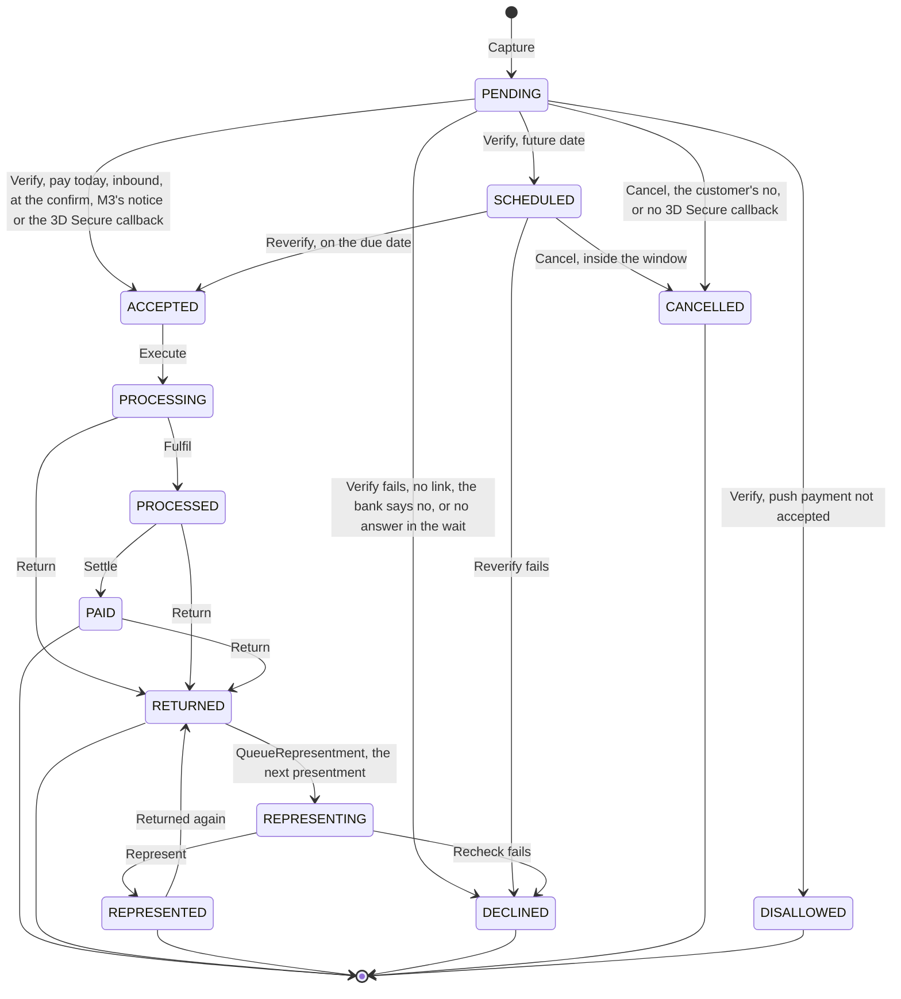
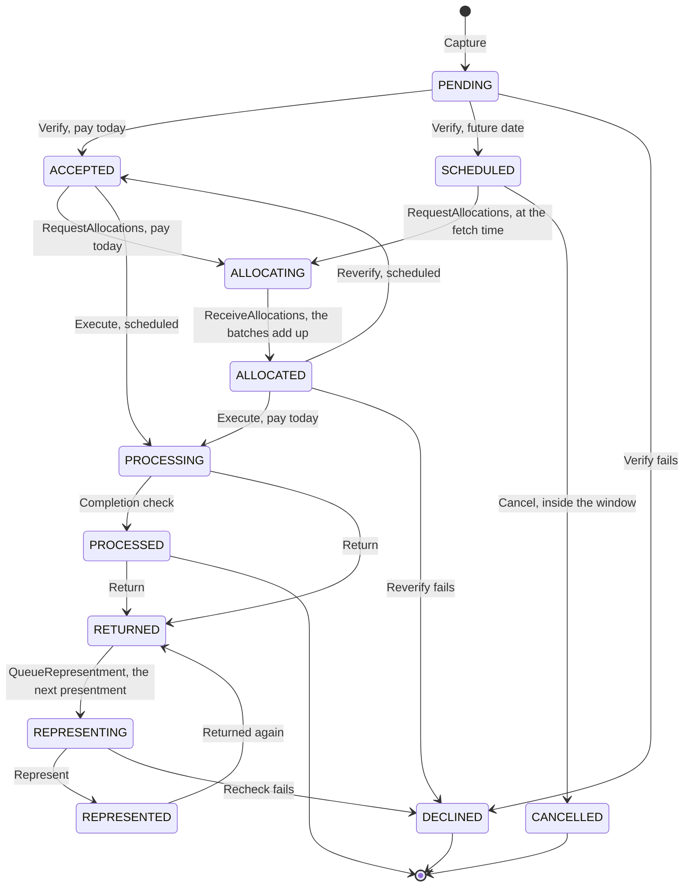

# Billpay Wiki Spec

> The source of truth for the Billpay wiki. It covers the One-Data functions, the Billpay core APIs, the Router, the workflows on the Online and Offline Temporal clusters, the stages, activities and clients they are built from, the dispatchers and governor that pace offline work, market onboarding, and the lifecycle states of payments and refunds. Every page takes its facts from here.

## Table of Contents

1. [Rules every part follows](#rules-every-part-follows)
2. [Billpay API Gateway - One Data Functions](#billpay-api-gateway---one-data-functions)
3. [Billpay APIs](#billpay-apis)
4. [Billpay Workflows (Temporal)](#billpay-workflows-temporal)
5. [Payment Lifecycle States](#payment-lifecycle-states)
6. [Payment Domain Model](#payment-domain-model)
7. [Market Onboarding & Payment Dimensions](#market-onboarding--payment-dimensions)
8. [Core Components in Workflows](#core-components-in-workflows)
9. [Workflow Logic](#workflow-logic)
10. [Periodic Workflows](#periodic-workflows)
11. [Activities](#activities)
12. [Overall Payments View](#overall-payments-view)
13. [Routing and Start Modes](#routing-and-start-modes)
14. [Work Tracker and Inbox](#work-tracker-and-inbox)
15. [Dispatchers and the Governor](#dispatchers-and-the-governor)
16. [Throttling, Priority and Fairness](#throttling-priority-and-fairness)
17. [Corporate Allocations](#corporate-allocations)
18. [Market Onboarding](#market-onboarding)
19. [Platform](#platform)
20. [Sequence and State Diagrams](#sequence-and-state-diagrams)
21. [Open Items](#open-items)

Payments and credit balance refunds are both in scope.

---

## Rules every part follows

When a choice is unclear, these rules decide it.

1. **Oracle is the source of truth.** Every status change is a conditional update that applies only if the status is still what the writer expects. Whoever loses backs off.
2. **Work that waits for a date waits in Oracle,** never in a sleeping workflow or on a Temporal timer. The one wait that stays in a workflow is a payment waiting minutes for its customer's confirmation, which `CreatePaymentIntentWorkflow` holds on a durable timer (agreed 2026-10-18).
3. **Nothing calls across clusters.** Oracle is the only hand-off between the Online and Offline clusters. Each of the two apps connects to its own cluster only ([Two apps](#two-apps)).
4. **Every payment workflow starts through the Router.** No API or dispatcher starts one on its own. Control workflows (dispatchers, the governor, market onboarding) start from Schedules or their own APIs.
5. **Pace at the door.** Admit only what a cluster and its downstreams can carry. Big bursts wait in Oracle or in One-Data's inbox, not in Temporal.
6. **One workflow per journey.** Stages are the only thing that varies by market behavior. There are no market-specific workflows.
7. **One Oracle commit per stage.** A stage makes its calls first, in parallel where they don't depend on each other; then the state change and the lifecycle timeline entry commit together. Its RTF lifecycle event, and a Raven message where the market's Raven setting tells the customer, go out right after the commit. Other systems subscribe to Billpay's RTF events. Fulfil is the exception: `PROCESSED` waits for both.
8. **Pin the resolved profile and the build at start.** A running workflow never has its code or config changed under it.
9. **Speed never costs a retry.** Look for bottlenecks and optimize, but never at the cost of retryability, and don't make an activity local just for speed (agreed 2026-11-07).

[^ Top](#table-of-contents)

---

## Billpay API Gateway - One Data Functions

One-Data functions are the versioned contracts that channels and partner systems call. Most front a Billpay core API. The functions and handlers for work nobody waits for (AR intake, inbound payments, returns, settlement and AR posting) keep it in One-Data's inbox instead, and Billpay pulls it through the inbox functions.

### Core

1. [CreatePayment.v3](https://explorer.aexp.com/functions/CreatePayment.v3?method=post): create a payment for today or schedule one for a future date. A create from a channel carries the payment option ID the customer chose ([Making a payment](#making-a-payment-the-channels-calls), agreed 2026-11-06). A payment that needs the customer to confirm their bank details (`requiresBankConfirmation`) comes back `PENDING` with Amex Pay with Bank Transfer's redirect link, and the first confirm, from the channel through `CreateConfirmPendingPayment.v1` or from Amex Pay with Bank Transfer itself, decides it (agreed 2026-11-10). A debit card payment comes back `PENDING` too, while 3D Secure runs. A create on a card account that already has a payment in `PENDING` never reaches Billpay: One-Data declines it ([Held creates and the pending check](#held-creates-and-the-pending-check), agreed 2026-10-21).
2. [UpdatePayment.v1](https://explorer.aexp.com/functions/UpdatePayment.v1?method=post): update a `SCHEDULED` payment. Works only inside the market's cancellation window; after that the answer is 409. A corporate payment leaves `SCHEDULED` when its allocations are requested.
3. [DeletePayment.v1](https://explorer.aexp.com/functions/DeletePayment.v1?method=post): cancel a `SCHEDULED` payment. Works only inside the cancellation window; after that the answer is 409. A corporate payment leaves `SCHEDULED` when its allocations are requested. It also cancels a `PENDING` payment that waits for a confirmation, when the customer says no (agreed 2026-10-18).
4. [ReadPayments.v1](https://explorer.aexp.com/functions/ReadPayments.v1): list the payments on a card account, through `GET /payments/account/{account-id}`.
5. [ReadPaymentEventsById.v1](https://explorer.aexp.com/functions/ReadPaymentEventsById.v1): list the lifecycle events of one payment, the states it has been through, through `GET /payments/{payment-id}` (agreed 2026-11-06).
6. [CreateCreditBalanceRefund.v1](https://explorer.aexp.com/functions/CreateCreditBalanceRefund.v1?method=post): refund a credit balance on a card account.
7. `CreateInboundPayment.v1`: take a payment pushed by a third party. One-Data stores it in its inbox and replies 202; the inbound dispatcher starts its workflow.
8. `CreateConfirmPendingPayment.v1`: confirm a payment that waits for the customer's bank. Channels call it with the same payment ID once the customer is back from their bank, and it carries the bank's answer. Amex Pay with Bank Transfer, the PISP (Payment Initiation Service Provider) interface, can send the same confirm straight to billpay-online. Billpay acts on whichever comes first, and the payment is `ACCEPTED` or `DECLINED` on that answer (agreed 2026-11-10).
9. `CreatePaymentAllocations.v1`: the allocations callback for corporate payments. Asynchronous: 202 once the batch is stored and its workflow has started.

**What One-Data passes** (agreed 2026-11-07). One-Data looks up the card account's market and account type with `ReadCustomerAccountInfo.v1` and passes both to billpay-online on every `/payments` call: the create, the update, the cancel and the confirm. billpay-online makes no lookup of its own. A create also carries each instruction's instrument type, and one payment ID for each instruction, which One-Data makes, so a create with several instructions arrives with all its IDs. Such a create also carries a group ID, a ULID One-Data makes for the whole request and repeats on every RTF retry, which names the composite's workflow ([Workflows](#online-cluster)). One-Data passes every ID; Billpay derives none (agreed 2026-11-07). The group ID lives only in the workflow IDs and the search attributes, as the composite's `PaymentId` and each instruction's `ParentPaymentId` (Proposed, 2026-11-07): each instruction stays its own payment row, and no row stores it (agreed 2026-11-07). One-Data sends one idempotency key per instruction, and each instruction's capture uses its own (agreed 2026-11-07). A create that RTF delivers carries an async flag, which One-Data's direct call never does. The wire names of these fields come with the API contracts; until then the build carries them as placeholders behind its mapping layer. The two callbacks carry no market: the card provider's 3D Secure callback names only its payment, and the allocations callback needs neither market nor account type, since its payment already exists and its workflows keep the config version they started on.

**CreatePayment.v3's reply** (agreed 2026-11-07). A 200 carries a `payments` array, one entry per instruction, each with its `status`, its `identifier` (the payment ID) and its `enrollmentIdentifier` (the instrument's enrollment ID), and the request's `confirmationCode`:

```json
{
  "payments": [
    { "status": "ACCEPTED", "identifier": "01JVTBBGZQ1HEM0W7NRMM6MSQ1", "enrollmentIdentifier": "ae21fbc5-88df-44fe-8ce1-c422f273f06" },
    { "status": "ACCEPTED", "identifier": "01JVTBBGZQ1HEM0W7NRMM6MSQ2", "enrollmentIdentifier": "be21fbc5-88df-44fe-8ce1-c422f273f06" }
  ],
  "confirmationCode": "W1642926062"
}
```

A decline uses the same shape; its exact fields come later. A `PENDING` entry that waits for bank confirmation or 3D Secure carries its redirect or challenge link in an optional field, absent on every other entry (agreed 2026-11-07; Proposed: named `confirmationUrl`). How a create with several instructions gets one payment ID per instruction is still open, since One-Data makes payment IDs ([Open Items](#open-items)).
10. `ReadBillpayInstruments.v1` (agreed 2026-11-05): the instruments a customer can pay from. The channel passes two mandatory filters: the source, enrolled instruments, a debit card or Pay with Bank Transfer, and the journey context, a one-time or a recurring direct debit (agreed 2026-11-10). It fronts a billpay-online endpoint, which calls the instruments systems and filters what they return by the market's rules. It starts no workflow. See [Making a payment: the channel's calls](#making-a-payment-the-channels-calls).

### Making a payment: the channel's calls

A channel's make-a-payment page calls three APIs, in this order (agreed 2026-11-05; it replaces the four calls agreed 2026-10-20):

1. **Payment Options' `ReadPaymentOptions.v1`**, called by the channel directly, separately from the calls Verify and Reverify make to Payment Options later. It returns:
   - the amounts the customer owes. If nothing is owed, the payment journey never starts and nothing else is called;
   - the payment options, such as Statement Balance, Total Balance, Minimum Due and Other Amount. Each carries a payment option ID, unique to that option and the balance it pays (agreed 2026-11-05; named 2026-11-06, it was the token ID). The create carries the ID of the option the customer chose, and Billpay validates it (The payment option ID, below);
   - whether the customer can pay today, on a future date, or both, and the range of dates a future payment can take (agreed 2026-11-05).
2. **`ReadBillpayInstruments.v1`**, once the customer picks where to pay from (agreed 2026-11-05). It is a One-Data function in front of a billpay-online endpoint. The channel passes two filters, and both are mandatory (agreed 2026-11-10):
   - **`source`**, where the customer pays from. Three for now: `EnrolledInstruments`, `DebitCard` and `PayWithBankTransfer`. billpay-online makes the call the source needs:
     - `EnrolledInstruments`: Payment Instruments' `ReadInstruments`, for the instruments the customer has enrolled;
     - `DebitCard` and `PayWithBankTransfer`: `ReadBanksForRealtimePayments.v1`, for the list of banks the customer can pay from in real time (agreed 2026-11-06). A US payment confirmed through Plaid is `PayWithBankTransfer` (agreed 2026-11-10).
   - **`journeyContext`**, what the instruments are for: `ONE_TIME_DIRECT_DEBIT`, a payment the customer makes through `CreatePayment.v3`, or `RECURRING_DIRECT_DEBIT`, setting up Autopay, which the channel then creates through `CreatePaymentPlan.v1`, the Autopay system's API, not Billpay's (agreed 2026-11-10). Autopay is set up from enrolled instruments only, so `RECURRING_DIRECT_DEBIT` takes only `EnrolledInstruments` (agreed 2026-11-10), and any other source gets 400 `INVALID_REQUEST` (Proposed, 2026-11-10).

   The journey context decides which enrolled instruments are offered, since one customer's list can differ between the two. The market's `enrolledInstrumentStatuses` setting lists, for each context, the instrument statuses the page may offer. It is set in each market and account type's release, and every context offers `ACTIVE` instruments alone until a market says otherwise (agreed 2026-11-10; the key's name is Proposed). For example, DE can keep a one-time direct debit to `ACTIVE` instruments and let Autopay take one still pending verification as well.

   Pay with Bank Transfer and a debit card pay today only, and so does a US payment confirmed through Plaid: a future-dated create with any of them gets 422 before any workflow starts (agreed 2026-11-06). Once the customer picks a later date, the page doesn't offer them.

   billpay-online filters each list by the market's rules, so the page only offers what this payment can use. Proposed (2026-11-07): the filter takes the Router's way-to-pay rules (no bank confirmation or debit card for a corporate payment; Pay with Bank Transfer only where the market takes bank confirmation, and a debit card only where it has a card provider), the market's accepted instrument types and, for enrolled instruments, the statuses `enrolledInstrumentStatuses` gives the context (2026-11-10, replacing Verify's `ACTIVE` status). Wallets aren't a source for now, so nothing calls `ReadEligibleWallets.v1` until a journey takes one (2026-11-10). The market and account type come in the same placeholder headers as on the other calls; a failed read answers 503, and a market that isn't live 422. `ReadBillpayInstruments.v1` replaces the channel's direct call to Payment Instruments (agreed 2026-11-05). Who owns the bank read is not decided yet, probably the Instruments domain.
3. **`CreatePayment.v3`**, when the customer reviews and pays. The Router picks the journey ([Routing and Start Modes](#routing-and-start-modes)).

What the reads return guides the page; it decides nothing. The Router and Verify check the create against the release active when it arrives, so a release that goes live between a read and the create can't let through a payment it refuses.

**The payment option ID** (agreed 2026-11-06). A create from a channel carries the option ID for every payment that pays a balance: pay today, a scheduled payment, Pay with Bank Transfer and debit card, the payment Pay & Plan makes, and multiple instructions. A request with multiple instructions carries one option ID for the whole payment, not one per instruction (agreed 2026-11-07); Proposed (2026-11-07): the composite checks it once for all its instructions, and an option that no longer holds declines every instruction with `PAYMENT_OPTION_INVALID`. Creates from AR intake, corporate payments and Pay with MR Points alone carry none, and neither does an inbound push payment, which comes from a third party rather than a channel; their Verify runs no Options check. Billpay validates the ID:

- **At the create**, Verify's Options check calls Payment Options' `ReadPaymentOptionByIdentifier.v1` with the chosen option ID, and a rule declines the payment if the option isn't valid.
- **On the due date**, a scheduled payment is checked again. Reverify's Options check calls `ReadPaymentOptions.v1` to confirm the customer still owes money and the chosen option still holds. Two rules decide (agreed 2026-11-07): `BALANCE_OWED` declines with `NO_BALANCE_OWED` when the customer no longer owes money, and `OPTION_VALID` declines with `PAYMENT_OPTION_INVALID` when the option no longer holds; both codes are placeholders until product sends its own. Proposed (2026-11-07): `BALANCE_OWED` outranks `OPTION_VALID` (priorities 360 and 350), and a customer owes money when some option today has an amount above 0; the balance options' names are placeholders. For an option whose amount follows a balance, such as Statement Balance or Total Balance, the amount is taken again that day, so it can differ from the amount at the create.

Where the page gets the rest of what it shows is open (2026-11-05): the ways to pay the market offers, its limits such as the largest payment, the cancellation window, whether it offers Pay & Plan and Pay with MR Points, and a payment already pending on the account, which the page can show (agreed 2026-10-21). `ReadPaymentOptions.v1` is one option ([Open Items](#open-items)).

**MR Points** (agreed 2026-10-20). Next to the way to pay, the customer can tick Pay with MR Points. Points alone run [Pay with MR Points](#composite-workflows). Points with a bank account are two instructions, and run as multiple instructions. Points pay today only: once they are ticked, the page offers no later date, and a future-dated create with points gets 422 before any workflow starts (Proposed). A debit card doesn't combine with MR Points (agreed 2026-10-20).

**Debit card** (agreed 2026-10-20). A debit card is a way to pay of its own, apart from a bank account. The page reads the banks the customer can pay from by debit card through `ReadBanksForRealtimePayments.v1` (agreed 2026-11-06). Every debit card payment needs 3D Secure, the card scheme's check that the customer is the cardholder: Billpay asks the market's card provider to authenticate the card, giving it a callback URL, and the provider calls Billpay back once the card is authenticated. The provider then authorizes the payment, and the authorization debits the customer's account if it holds enough money; the issuing bank declines it if not. Consumer and business travel payments can use a debit card; corporate payments can't (agreed 2026-11-06; it replaces the 2026-10-21 answer that any account type can). A debit card pays today only, with one instruction: a future-dated create, one with several instructions, a Pay & Plan request or a corporate payment that pays by debit card gets 422 before any workflow starts ([12. CreatePaymentIntentWorkflow](#12-createpaymentintentworkflow)).

### Composite

1. [CreatePaymentInstallment.v1](https://explorer.aexp.com/functions/CreatePaymentInstallment.v1): create a payment and a plan of future installments (Pay & Plan). Channels call it. One-Data runs the same pending check on it as on `CreatePayment.v3` (agreed 2026-10-21).
2. `CreateBillpayTransactionFromAccountsReceivable.v1`: payments and refunds raised by the Accounts Receivable platform, never a corporate payment. One-Data stores each in its inbox and replies 202; the AR intake dispatcher starts their workflows.

### Event Handlers

Event handlers take events from other platforms. None of them starts or waits on a workflow: the money movement and AR handlers store what arrives in One-Data's inbox, and call Billpay only to find a payment an event doesn't name.

1. `CreateMoneyMovementEventHandler.v1`: money movement events from MR/M3. A return is stored in One-Data's **inbox** for the returns dispatcher. A settlement is recorded in the inbox against its payment and presentment.
2. `CreateAccountsReceivableTransactionEventHandler.v1`: Accounts Receivable (GAR) events. An AR posting is recorded in the inbox against its payment, or leg, and presentment.
3. `CreateOpentoBuyUpdatePaymentEventHandler.v1`: Authorizations (AMP) events. It acknowledges them and does nothing else: no inbox row, and no work in Billpay (agreed 2026-10-18).

The inbox lives in One-Data's Postgres database, not in Billpay's Oracle. For PAID, One-Data marks a row `READY` once it has an AR posting and its settlement, and `ProcessPaidEventsWorkflow` reads only `READY` rows and sets each payment or leg `PAID` (see [Work Tracker and Inbox](#work-tracker-and-inbox)).

- The money movement and AR handlers write the raw event and upsert the payment's inbox row in one transaction, and acknowledge the sender only after the commit. If the database is down, the sender gets an error and retries.
- There is one row per payment or leg, under the ID the event carries. A leg's ID is `{paymentId}_{seq}`. A corporate leg's AR posting pairs with the settlement of the payment named before the `_`: a corporate payment settles once, as a whole, while each leg posts on its own. A consumer split's legs clear on their own, so each settles on its own too, and its posting pairs with its own settlement (agreed 2026-11-07).
- An event without a payment ID is matched through `ReadPayments.v1`, by its account ID: to the account's one payment in a fitting status, `PROCESSED` for a settlement or a posting, and `PROCESSING`, `PROCESSED`, `PAID` or `REPRESENTED` for a return (Proposed, 2026-11-07). Most events carry the ID, so the lookup is rare. If it finds no single payment, the raw event stays in `billpay_extnl_event` and an alert names it.
- Whichever event arrives second sets the row `READY` in the same transaction. A lock per payment ID makes a payment's settlement and its legs' postings that arrive together see each other, and a repeated event can't set a row twice.
- Handlers never pace anything or run on a schedule.

### Inbox functions

Billpay reaches the inbox through four One-Data functions, never through the database. `ProcessPaidEventsWorkflow` calls the first two, and the AR intake, returns and inbound dispatchers call the other two. One-Data runs a fifth on its own schedule. `ProcessMissingPaidEventsWorkflow` hands a found event to its One-Data handler, the same way MR/M3 and GAR send events. Every One-Data function's name starts with Create, Read, Update or Delete, by what it does, and these are the real names (agreed 2026-10-18).

1. `ReadPaidReadyPayments.v1`: puts `UNMATCHED` rows last tried over an hour ago, and under 48 hours old, back to `READY`, then returns up to 500 of the oldest `READY` rows, each with its `stlmt_ts` and `ar_pstd_ts`, which Settle writes onto the payment (agreed 2026-10-18). It changes nothing else, so a repeat before the status update returns the same rows. Proposed: function 5 takes over the move back to `READY`, so this one only reads.
2. `UpdatePaidReadyPayments.v1`: sets the listed rows `DONE` or `UNMATCHED` in one transaction and returns the counts. Setting a status twice does no harm, so a retry is safe.
3. `ReadStartRequests.v1`: returns up to a dispatcher's tick of the oldest `READY` requests for that dispatcher: AR intake (payments and refunds), returns or inbound. It changes nothing, so a repeat returns the same requests.
4. `UpdateStartRequests.v1`: sets the listed requests `DONE` or `REJECTED` in one transaction. Setting a status twice does no harm.
5. `UpdateUnmatchedPayments.v1`: One-Data runs it on a cron schedule; Billpay never calls it. It raises an alert for each row that has stayed `UNMATCHED` for 48 hours (agreed 2026-10-18). Proposed: it runs every 15 minutes, puts `UNMATCHED` rows last tried over an hour ago, and under 48 hours old, back to `READY`, and checks the age of the oldest waiting row in each inbox, for the returns and PAID backlog-age alerts. A row's age counts from when it last became `READY`, so a row back from `UNMATCHED` doesn't look old (agreed 2026-11-07).

### Held creates and the pending check

One-Data makes each payment's ID, a ULID, and every retry of a create carries it, so a retry always lands on the payment billpay-online already has. Most creates go straight to billpay-online and back. Two things live in One-Data's Redis, one active-active database across IPC1 and IPC2, which each One-Data writes at its own site: every create, stored as Pending, and each card account's list of pending payments. Persistence is on and eviction is off, so a restart or memory pressure can't drop them (agreed 2026-10-18). A payment that waits for its customer, by Pay with Bank Transfer, Plaid or a debit card, is kept there like any other, as Pending, until it is decided: confirmed, declined, cancelled by the customer's no, or expired when its window runs out (agreed 2026-11-08, replacing the same day's rule that kept these payments out of Redis). One-Data knows such a create from the instruction the customer chose (agreed 2026-11-07).

- **The pending check.** One Redis hash per card account lists its pending payments, each with a short summary: amount, date and time created. An entry stays only while its payment is `PENDING`: Billpay removes it once the payment is decided ([The delete](#held-creates-and-the-pending-check)). On every create from a channel through `CreatePayment.v3` or `CreatePaymentInstallment.v1`, before it calls billpay-online, One-Data reads the hash (agreed 2026-10-21):
  - If the account already has a pending payment, One-Data declines the new create there and then. The channel gets 200 with `DECLINED` and a reason, such as `ANOTHER_PAYMENT_PENDING` (the code's name is Proposed). billpay-online is never called, so no payment exists in Billpay for it: no Oracle row, no RTF event and no Raven message. The customer can't make another payment until the pending one is decided.
  - Otherwise One-Data adds the new payment to the hash and stores the create as Pending, then calls billpay-online. A create with several instructions adds one entry for each instruction (agreed 2026-11-07). The check and the add must be one atomic step, so that two creates arriving together can't both pass: a Lua script through the Java Redis SDK, still one Redis call (Proposed). One-Data stores every create it lets through (agreed 2026-10-18), Pay with Bank Transfer, Plaid and debit card creates included (agreed 2026-11-08). So while such a payment waits for its customer, its entry blocks the account's next payment until it is decided.
  - The check applies to payments from channels: creates through `CreatePayment.v3`, and Pay & Plan's through `CreatePaymentInstallment.v1`. Payments AR raises, push payments from third parties and refunds never go through it (agreed 2026-10-21).
  - It replaces the go-ahead, which held a new payment for the customer's yes while another was pending: that journey, its market setting and the pending IDs One-Data sent with a create are gone (agreed 2026-10-21).
- **Held creates.** When billpay-online doesn't answer `POST /payments` within 3 s, or answers with a 5xx, One-Data holds the create: it hands the stored create to RTF, which retries it into billpay-online with exponential backoff and the same payment ID. The channel gets the payment ID and `PENDING`. A `PENDING` reply in time is an answer, so it never goes to RTF.
- **Confirms.** One-Data doesn't hold a confirm for RTF. When billpay-online doesn't answer `POST /payments/{payment-id}/confirm` within 3 s, or answers with a 5xx, One-Data answers the channel 503, and the customer confirms again. A repeat carries the same update ID, so it is safe. Amex Pay with Bank Transfer sends its confirm straight to billpay-online, not through One-Data (agreed 2026-11-10). A US payment confirmed through Plaid follows the same rules as Pay with Bank Transfer (all agreed 2026-11-08). The customer's no isn't held either, because the payment is cancelled when its window ends anyway. Updates and cancels go straight to billpay-online (agreed 2026-10-19).
- **The delete.** Every create workflow calls One-Data's delete API, `DeletePendingPayment.v1` (agreed name, 2026-10-18), once its payment is decided, when it leaves `PENDING` for `ACCEPTED`, `SCHEDULED`, `DECLINED` or `CANCELLED` (agreed 2026-11-07; until then only a create from a channel called it). The call is always in the workflow's async part, after the caller's reply, never on the caller's path. It carries the payment and account IDs and retries until it lands. A composite calls it for every instruction it decided, a declined one included, since a declined instruction gets no child (agreed 2026-11-07). One-Data removes the stored create and the payment's entry in the account's hash, so the account can take its next payment (agreed 2026-10-21). For a create One-Data never stored, such as one from AR intake, the delete finds nothing to remove; a channel's credit balance refund calls it too, as a placeholder until One-Data says whether it stores refunds (2026-11-07). `ProcessInboundPaymentWorkflow` is not a create workflow: an inbound payment comes through its own One-Data API, `CreateInboundPayment.v1`, and makes no delete (agreed 2026-11-07). A payment decided after its reply, such as a create that got `PENDING` at 2.5 s, is cleared the same way, by its workflow's delete (agreed 2026-11-07). A payment that waits for its customer, by Pay with Bank Transfer, Plaid or a debit card, makes one delete call, once it is decided: by the confirm, M3's settled notice, the 3D Secure callback, the customer's no, or its window running out; or at the create, when it is declined there (agreed 2026-11-08; M3's notice 2026-11-10). A Pay with Bank Transfer payment's window is the market's wait of 24 to 48 hours, so its entry blocks the account that long when nothing comes back (agreed 2026-11-10). A create repeated after its run has closed starts a new run, which calls the delete like any other ([Creates that arrive late or twice](#creates-that-arrive-late-or-twice)). One-Data removes either only on Billpay's word: the delete, or billpay-online refusing the create with a 4xx; or when it answers 503 for a Pay with Bank Transfer, Plaid or debit card create it didn't hold (agreed 2026-11-08).
- **The sweep.** A pending entry can be left behind when no delete ever lands: One-Data's delete API keeps failing, billpay-online never got the create, or perhaps a delete reaches one Redis site before the entry has replicated from the other (for One-Data to confirm). So One-Data runs a sweep on its own schedule, every hour; Billpay never calls it. It takes the entries in each account's hash older than their market's sweep age and asks billpay-online about each one, through `GET /payments/{payment-id}` (agreed 2026-10-21; the function's name, `DeleteStalePendingPayments.v1`, is Proposed). The sweep age is a market setting (agreed 2026-11-10), `pendingSweepAfter`, an ISO duration, `PT2H` when unset (the name and the default Proposed), so a market whose Pay with Bank Transfer wait runs 48 hours sweeps after it. How One-Data reads each market's value is open:
  - The payment is no longer `PENDING` in billpay-online, whatever state it has reached, or billpay-online has no record of it: the sweep removes the entry, and the stored create if it is still there, as the missed delete would have. A create One-Data still holds for RTF is skipped, since it may still land.
  - The payment is still `PENDING` in billpay-online: the entry stays, so the account still can't take a second payment while this one is undecided.
  - A read that fails leaves the entry for the next run (Proposed, 2026-11-07).
  - A run that removed or kept any entries raises one alert with two lists, each with its count and payment IDs: the entries it removed, and the payments still `PENDING` whose entries it kept (agreed 2026-10-21). It replaces the pending entry age alert.
- **Reading.** `ReadPayments.v1` reads Redis and billpay-online, removes duplicates on payment ID and customer account, and Oracle wins. Every create One-Data stores is in Redis from the start, so a payment shows as soon as it is made, and it shows one `PENDING`, whatever it waits for.

Three cases need a rule of their own:

- **Redis down.** One-Data makes the pending check through `ReadPayments.v1` instead, which then reads billpay-online alone, and declines the create if the account has a `PENDING` payment there. Nothing is stored. A create One-Data held, or one billpay-online hasn't captured yet, isn't in Oracle, so the check can miss it; that edge is accepted (agreed 2026-10-21; it replaces creating the payment with no check, 2026-10-19).
- **Two sites at once.** Two creates for one account that reach different Redis sites within the replication lag miss each other, and both go through, though one should have been declined. The window is narrow, so it is accepted, and pairs like this are counted from Oracle. Only if they show up does billpay-online add the same check against Oracle, at one query per create (agreed 2026-10-19).
- **Pay with Bank Transfer, Plaid or a debit card while billpay-online is slow.** A held create would get a redirect link or a 3D Secure challenge link that nobody sees. So One-Data doesn't hold it: it answers the channel 503, and the channel asks the customer to try again; RTF never retries it (agreed 2026-11-07 for a debit card, 2026-11-08 for bank confirmation). `CreatePayment.v3` knows such a create from the instruction the customer chose (agreed 2026-11-07). One-Data stored the create and its entry before it called billpay-online, and removes both when it answers 503, so the customer's retry is never blocked (agreed 2026-11-08). If billpay-online captured the create after all, that payment waits with no customer, moves no money and ends when its window runs out, declined for Pay with Bank Transfer and cancelled for a debit card; its delete then finds nothing to remove.

[^ Top](#table-of-contents)

---

## Billpay APIs

Every write API admits the request first, through the Router (see [Routing and Start Modes](#routing-and-start-modes)). The Router checks the copy of the onboarding config each app caches in its JVM, never the database, so admission adds no call (agreed 2026-10-18). Only a call that names a market is checked: the 3D Secure callback and the allocations callback carry none and are admitted without a profile check (agreed 2026-11-07), and so, until their contracts say otherwise, are Amex Pay with Bank Transfer's confirm and M3's settled notice (Proposed, 2026-11-10):

- **422** when the market, account type or API is not live in this environment. Senders do not retry a 422. A held create that RTF delivers after its market was taken out of service is captured and declined instead, so the customer is told and the delete runs (agreed 2026-10-18), with the placeholder decline code `MARKET_OUT_OF_SERVICE` (Proposed, 2026-11-07). Its async flag is what tells it from a new create, which gets the 422 (agreed 2026-11-07).
- **422** with `NOT_ONBOARDED` too for a scheduled create, an update or a cancel in a market whose release has no time zone; the Router refuses that market's scheduled executions the same way (Proposed, 2026-11-07).
- **422** too when the request asks for what its way to pay can't do, before any workflow starts ([The Router's six steps](#the-routers-six-steps)): a future-dated create that pays by Pay with Bank Transfer, debit card, Plaid or MR Points (Proposed for MR Points); a debit card with several instructions, MR Points, Pay & Plan or a corporate payment; bank confirmation with several instructions, Pay & Plan or a corporate payment; and, until business travel is turned on for it, bank confirmation for a business travel payment (Proposed); and a payment that waits for its customer when its release has no confirmation or authentication window (Proposed, 2026-11-07).
- **429** with `Retry-After` when an allocation callback arrives over its traffic class's budget. The allocations manager retries on 429. The class is `ALLOCATION_CALLBACK`, with its `RATE_ALLOCATION` row scoped `'*'`: its bucket holds one second of rate, a `PAUSE` override answers `Retry-After: 30`, `MAXIMUM` caps the rate, and a class with no row isn't limited. The callback runs in the corporate priority class, keyed on its payment (Proposed, 2026-11-07).
- **409** when an update or cancel arrives for a payment that is no longer `SCHEDULED` (a corporate payment leaves it when its allocations are requested), or after the cancellation window has closed; and when a confirm arrives for a payment that has been cancelled, by the customer's no. A cancel of a `PENDING` payment that isn't waiting for a confirmation gets 409 too. Each 409 carries one of the codes `TOO_LATE`, `NOT_ELIGIBLE`, `NOT_WAITING` or `CANCELLED` (Proposed, 2026-11-07). A confirm repeated after its workflow has closed gets the payment's current state instead ([CreatePaymentIntentWorkflow](#12-createpaymentintentworkflow)).
- **503** with `Retry-After` for an allocation callback or a Market Onboarding API request while the Offline cluster is down. For the allocations callback, Proposed (2026-11-08): `Retry-After: 30` when billpay-offline's Offline health check is down, or the start fails as unavailable or past the APIs' 2.5 s; the batch is stored first in every case.
- **400** with `INVALID_REQUEST` for a request that fails validation, and for an allocations callback whose body can't be read (Proposed, 2026-11-08).
- **404** for an update, a cancel, a confirm, a 3D Secure callback or M3's settled notice on a payment billpay-online doesn't have (Proposed, 2026-11-08; the notice 2026-11-10).

AR intake, returns and inbound payments never reach these APIs. One-Data stores them, and dispatchers pull them at the governor's pace (see [Dispatchers](#dispatchers)).

billpay-online serves every API below except the allocation callback, `POST /payments/{payment-id}/allocations`, which billpay-offline serves with the Market Onboarding API, because their work runs on the Offline cluster (agreed 2026-11-07).

### Core

| API | What it does | Start mode | Reply |
| --- | --- | --- | --- |
| `POST /payments` | Pays today or schedules for a future date. A payment that needs bank confirmation stops at `PENDING`, and so does a debit card payment while 3D Secure runs | Update-With-Start | PENDING, ACCEPTED, SCHEDULED or DECLINED; PENDING with the redirect link when the customer must confirm at their bank, or the challenge link for a debit card, and the same reply, link included, on a repeated create. The API waits at most 2.5 s for a decision, then replies PENDING, so its answer reaches One-Data inside One-Data's 3 s (agreed 2026-10-18) |
| `PUT /payments/{payment-id}` | Updates a `SCHEDULED` payment inside the cancellation window. The replacement comes as a create's body, future-dated only, with its new ID in the payment-IDs header (Proposed, 2026-11-07) | Update-With-Start | The new payment's result, or 202 when it isn't decided within 2.5 s (Proposed); 409 outside the window |
| `DELETE /payments/{payment-id}` | Cancels a `SCHEDULED` payment inside the cancellation window, or a `PENDING` payment that waits for a confirmation when the customer says no (agreed 2026-10-18). Proposed (2026-11-07): it reads the payment's status first; a `PENDING` payment that waits for its customer gets the no as an update, and anything else goes to the cancel | Update-With-Start; for a `PENDING` payment, an update to its waiting `CreatePaymentIntentWorkflow` (agreed 2026-10-18) | CANCELLED; a repeated cancel gets CANCELLED again; 202 when it isn't decided within 2.5 s (Proposed); 409 otherwise |
| `POST /payments/{payment-id}/confirm` | The channel's confirm for a `PENDING` payment that waits for its bank. It carries the bank's answer, and the payment is `ACCEPTED` or `DECLINED` on it (agreed 2026-11-10) | The `confirm` update, ID `{paymentId}-confirm`, to the payment's waiting `CreatePaymentIntentWorkflow` (agreed 2026-10-18) | ACCEPTED or DECLINED, or PENDING if it isn't decided within the same 2.5 s. A second confirm, from the channel or Amex Pay with Bank Transfer, gets the same answer, and a confirm after the payment was decided another way, or after the workflow closed, gets its current state; 409 for a cancelled payment |
| `POST /payments/{payment-id}/bank-confirmation` | Amex Pay with Bank Transfer's confirm, the PISP interface's own word on the payment. It calls billpay-online directly, not through One-Data (agreed 2026-11-10; the path is Proposed), with mutual TLS, like the card provider (Proposed, 2026-11-10). Billpay acts on whichever confirm comes first (agreed 2026-11-10) | The same `confirm` update, ID `{paymentId}-confirm`, so the second confirm attaches to the first (Proposed, 2026-11-10) | As the channel's confirm |
| `POST /payments/{payment-id}/settlement` | M3's notice that the bank has settled the payment in real time: the bank tells Amex, M3 intercepts the message and calls billpay-online (agreed 2026-11-10; the path is Proposed), with mutual TLS (Proposed, 2026-11-10) | A signal, `settled`, to the payment's `CreatePaymentIntentWorkflow` (agreed 2026-11-10) | 202 once the workflow has it (Proposed); 404 for a payment billpay-online doesn't have. For a payment whose workflow has closed, Billpay reads its state: past `ACCEPTED`, the notice is a repeat; a `DECLINED` or `CANCELLED` payment goes on the exception list with an alert (2026-11-10, still open) |
| `POST /payments/{payment-id}/authentication` | The 3D Secure callback: the market's card provider calls it, directly and not through One-Data, once the customer's debit card is authenticated, or authentication has failed (agreed 2026-10-20; the path is Proposed). The provider and billpay-online authenticate each other with mutual TLS (Proposed, 2026-10-21) | An update to the payment's waiting `CreatePaymentIntentWorkflow` | ACCEPTED or DECLINED once the authorization decides; 409 once the workflow no longer waits; a repeated callback gets the same answer |
| `POST /payments/{payment-id}/allocations` | Takes one batch of allocations for a corporate payment | Stores the batch, then async start | 202 |
| `POST /refunds` | Refunds a credit balance | Update-With-Start | The refund's result. Until refunds are defined, 501 with `NOT_DEFINED`, the refund's ID in the payment-IDs header (Proposed, 2026-11-07) |
| `GET /payments/account/{account-id}` | Lists the payments on an account | Reads Oracle | The payments |
| `GET /payments/{payment-id}` | Returns one payment and its lifecycle events; `ReadPaymentEventsById.v1` calls it (agreed 2026-11-06) | Reads Oracle | The payment and its lifecycle events; with its redirect or challenge link while it waits for bank confirmation or 3D Secure (agreed 2026-10-18; the challenge link 2026-10-20) |
| `GET /instruments/account/{account-id}?source={source}&journeyContext={journeyContext}` | Behind `ReadBillpayInstruments.v1`: the instruments the customer can pay from, for one source, `EnrolledInstruments`, `DebitCard` or `PayWithBankTransfer`, and one journey context, `ONE_TIME_DIRECT_DEBIT` or `RECURRING_DIRECT_DEBIT`. Both are mandatory (agreed 2026-11-10; the path is Proposed) | Calls `ReadInstruments` or `ReadBanksForRealtimePayments.v1`, then filters by the market's rules and, for enrolled instruments, by the statuses the context allows. No workflow | The list the page may offer; 400 `INVALID_REQUEST` for a missing filter, or for a recurring direct debit from any source but enrolled instruments (Proposed, 2026-11-10) |

AR learns the outcome of a request it sent from the SCHEDULED and DECLINED notifications and lifecycle events, or from `GET /payments/{payment-id}`.

### Composite

| API | What it does | Start mode |
| --- | --- | --- |
| `POST /payment-installments` | Pays today and creates a plan of future installments | Update-With-Start. The composite makes the decision itself and replies once the decision, the plan and the Autopay update are in; its child, `CreateImmediatePaymentWorkflow` started with the decision, runs Execute and Fulfil on the Online cluster (agreed 2026-11-07) |

### Market Onboarding API

Each environment's billpay-offline exposes the Market Onboarding API (name agreed 2026-10-19), since the onboarding workflow runs on the Offline cluster (agreed 2026-11-07). Only the market-onboarding control plane, the Market Onboarding UI's backend, calls it, with its own service identity.

| Path | What it does |
| --- | --- |
| `/market-onboarding/releases` | Takes a frozen market release, reports its onboarding progress, records a sign-off and rolls a release back |
| `/market-onboarding/markets/{market}/{account-type}/pause` | Pauses a live market's dispatchers |
| `/market-onboarding/markets/{market}/{account-type}/resume` | Resumes them |
| `GET /market-onboarding/capabilities` | Returns the deployed build's capability manifest: every behavior combination the build can run |

Sending a release is idempotent: one onboarding workflow per market, account type, version and environment.

The bodies are Proposed (2026-10-18), for the Market Onboarding UI team to confirm. The work runs in `MarketOnboardingWorkflow`, so every call but the two reads answers `202` as soon as the workflow has it.

| Call | Request | Response |
| --- | --- | --- |
| `POST /market-onboarding/releases` | `market`, `accountType`, `version`, `checksum`, `config` (the frozen profile as JSON), `author`, `approver` | `202` with the workflow ID and status `REQUESTED`; the same reply when the release is sent again |
| `GET /market-onboarding/releases/{market}/{account-type}/{version}` | | The status (`REQUESTED`, `RUNNING`, `WAITING_FOR_SIGN_OFF`, `ACTIVE` or `FAILED`), the step the workflow is on, and for a failure, the step and the reason |
| `POST /market-onboarding/releases/{market}/{account-type}/{version}/sign-off` | `signedOffBy`, `signedOffAt`, and in E3 the RFC number | `202`; `409` when the release isn't waiting for a sign-off |
| `POST /market-onboarding/releases/{market}/{account-type}/{version}/rollback` | `requestedBy`, `reason` | `202`; the version before it becomes active again |
| `POST /market-onboarding/markets/{market}/{account-type}/pause`, `.../resume` | `requestedBy`, `reason` | `202` |
| `GET /market-onboarding/capabilities` | | `buildVersion`, and `combinations`: one entry per combination the build can run, an account type with Y or N for each of the other four behaviors |

[^ Top](#table-of-contents)

---

## Billpay Workflows (Temporal)

### Two clusters

Billpay runs on two self-hosted Temporal clusters. Each has its own Aurora PostgreSQL database and its own OpenSearch 2 visibility store.

- **Online cluster:** journeys where a caller waits for an answer, including a payment that waits minutes for the customer's confirmation. Peak 100 TPS.
- **Offline cluster:** work we can pace: scheduled execution, AR intake, corporate allocations, returns, inbound payments, representments, periodic jobs and the control workflows.

Separate databases mean offline load can never slow realtime traffic at the Temporal layer, and separate apps mean it can never take an online pod. Oracle and the downstream services are shared, and the governor watches online p99 as well as Oracle and the downstreams, so pressure on any of them slows offline work first. The one exception is a SEPA cutoff: when Online would leave a SEPA run too little of a downstream, Online is capped on that downstream until the cutoff ([When the cutoff wins](#when-the-cutoff-wins)).

**Nothing calls across clusters.** A payment accepted or scheduled on the Online cluster reaches the Offline cluster as a Work Tracker row in Oracle, written in the same commit as its state change. Self-hosted Nexus cannot bridge the two: it works only inside one cluster or across multi-cluster replication. Each app has a Temporal client for its own cluster only, so no app, payment or workflow ever calls the other cluster. Even a cutoff run's cap on Online reaches it through Oracle, and billpay-online applies it ([When the cutoff wins](#when-the-cutoff-wins), agreed 2026-11-07).

**Standby.** Each cluster runs active-passive, like the single cluster it replaces: active in us-east-1, with a passive standby in us-west-1 whose database replicates from the east. An operator promotes each standby on its own, and the app for that cluster reconnects to it.

### Two apps

Billpay runs as two apps built from one codebase, billpay-core: two Gradle app modules, `apps/online` and `apps/offline`, each its own Quarkus artifact (agreed 2026-11-07). Each app holds only its own cluster's client, workers and endpoints, and is named after the namespace it serves. The shared code, the domain, workflows, stages, activities, stores, clients and the Router, sits in library modules both apps depend on.

| App | Runs | Its cluster |
| --- | --- | --- |
| billpay-online | The APIs channels call through One-Data: create, update, cancel, the confirm and the no, the credit balance refund, the reads and the instruments read; the card provider's 3D Secure callback, Amex Pay with Bank Transfer's confirm and M3's settled notice; the Router for those requests; and the workers for the Online cluster | Online |
| billpay-offline | The dispatchers and the governor; the allocation callback and the Market Onboarding API; the Router for pulled work and async starts; and the workers for the Offline cluster, control workers included | Offline |

- Each app has its own pods, its own Oracle pool and its own scaling: more online capacity means more billpay-online pods, and more offline throughput more billpay-offline pods. Offline work can't take an online pod, because it never runs on one.
- Oracle and the downstream services stay shared, so the governor still watches online p99, Oracle and the downstreams, and pressure on any of them slows offline work first.
- One pipeline run builds both apps from the same commit (agreed 2026-11-07). Deploys are rolling. A change to workflow code that would alter a running workflow's history is patched with `Workflow.getVersion` and checked by the replay tests. Workflow code is patched with `Workflow.getVersion` from the first production deploy. Until then nothing runs in production, so a workflow change re-records its histories and the replay tests replay those (agreed 2026-11-08). Worker Versioning is parked for later (2026-11-08): it doesn't work with rolling deploys, since it needs each app's old and new builds running side by side.
- Load-test runs 4 and 6 run on both apps, and online p99 on billpay-online must stay unchanged while billpay-offline runs offline work.

### Sites

Billpay runs from two on-prem Hydra sites, IPC2 in the east and IPC1 in the west, against the two Temporal clusters in AWS. Only the front door is live in both sites: everything behind it processes in one place at a time, with a standby that does nothing until an operator promotes it.

| Part | Where it runs |
| --- | --- |
| One-Data | Active in both sites. Both call the core APIs on billpay-online in IPC2 (billpay-offline for the allocations callback); IPC1's One-Data routes across |
| Redis | A store in each site, run as one active-active database (Redis calls this a CRDB), so what one site writes the other can read |
| One-Data's inbox | One Postgres primary, replicated across IPC1 and IPC2 ([Inbox](#inbox-one-datas-postgres-tables)) |
| billpay-online and billpay-offline | IPC2. IPC1 keeps a standby of each app, deployed and ready, which an operator promotes if IPC2 goes. They are the only components that talk to Temporal, over gRPC, each to its own cluster |
| Oracle | The read/write primary in IPC2, with two read-only replicas beside it for read and reporting traffic. IPC1 holds the Oracle Data Guard standby and one more read-only replica. Promoting the standby is an operator's decision, never automatic |
| Temporal | Self-hosted on EKS in us-east-1, the frontend, history, matching and worker services of each cluster as pods; a passive standby of each in us-west-1 ([Two clusters](#two-clusters)) |

Temporal is the only part that doesn't run on Hydra. Its services talk to each other pod to pod all the time, so a cluster needs Kubernetes with that path left alone. AWS runs EKS across several Availability Zones in a region. Hydra doesn't form an EKS cluster across zones, so a cluster there would sit in one zone, and on Hydra the istio-proxy sits in the middle of pod traffic.

### Traffic classes

| Traffic | Volume and rate | Caller waits | Deadline | Cluster |
| --- | --- | --- | --- | --- |
| Pay today, from channels | Peak 100 TPS | Yes, until ACCEPTED, for at most 2.5 s | Never impacted, except while a SEPA run caps Online | Online |
| Schedule, update, cancel, from channels | Part of realtime traffic; cancel under 2 TPS | Yes | Cancel only inside the cancellation window | Online |
| Bank confirmation, or a debit card's 3D Secure | Part of pay today: the create call, then the confirm or the no from the channel, Amex Pay with Bank Transfer's confirm and M3's settled notice, or the 3D Secure callback from the card provider | Yes: until `PENDING`, with the redirect link for a bank or the challenge link for a card, then until the decision | A bank's confirm inside the market's wait of 24 to 48 hours, after which the payment's own workflow declines it; a debit card's callback inside 2 minutes, after which it is cancelled | Online, one workflow throughout (agreed 2026-10-18) |
| Credit balance refunds | From channels, or raised by AR | Channels: yes. AR: no, pulled with AR intake | None | Online from channels; Offline for AR |
| Scheduled intake, AR batch | 100 TPS sustained (1M in 2.8 h), at any time of day, spread out or in bursts (agreed 2026-10-18) | No: stored by One-Data, then 202; pulled at the governor's pace | None | Offline |
| Scheduled execution, US | Up to 1M at 00:01 MST (Phoenix time) | No | No cutoff; 50 TPS floor, faster when healthy | Offline |
| Scheduled execution, SEPA | Up to 250K per market (DE, IT) at midnight CET | No | 3 to 4 hour cutoff | Offline |
| Corporate | Up to 50K payments and 500K allocations a day; up to 100K allocations in one payment | Only for pay today, until `ACCEPTED` | The parent clears once `ALLOCATED`: at once for pay today, at the execution time for a scheduled payment | Offline; pay today starts on Online |
| Returns | Bursts of 100 TPS, up to 100K a day | No: stored by One-Data; pulled at the governor's pace | None | Offline |
| Inbound, pushed by a third party | 100 TPS, up to 500K a day, arriving around 8 PM MST | No: stored by One-Data, then 202; pulled at the governor's pace | None | Offline |
| Representments | A share of returns | No | The date market rules set | Offline |
| Settlement and AR posting | A settlement per payment, or per leg of a consumer split, and an AR posting per payment or leg, in bursts of up to 1,000 a second; the AR postings, which move payments to `PAID`, arrive in the US early morning. They wait in One-Data's inbox, and Billpay reads one `READY` row per payment, or per leg of a split payment | No | None; paced last of all | Offline |

### Kinds of workflow

- **Core workflows:** one business journey each, such as paying today, executing a scheduled payment or processing a return.
- **Composite workflows:** a parent that makes the decision itself and runs each payment's Execute and Fulfil as a child (agreed 2026-11-07), sometimes across domains: Pay & Plan (Billpay and GAR), Pay with MR Points (Billpay and Loyalty), multiple instructions. They run on the Online cluster, with their children on the same cluster.
- **Periodic workflows:** jobs started by Temporal Schedules on the Offline cluster.
- **Control workflows:** the dispatchers, the governor and market onboarding. They pace and configure payment work; they are not payment journeys.

### Online cluster

| Workflow | Workflow ID | Notes |
| --- | --- | --- |
| `CreateImmediatePaymentWorkflow` | `{paymentId}-init` | Pay today |
| `CreateScheduledPaymentWorkflow` | `{paymentId}-init` | Scheduled from channels |
| `UpdatePaymentWorkflow` | `{paymentId}-update` | |
| `CancelPaymentWorkflow` | `{paymentId}-cancel` | |
| `CreatePaymentIntentWorkflow` | `{paymentId}-init` | A payment that waits for the customer, for bank confirmation or a debit card's 3D Secure, from the create to its end; the confirm, the no and the 3D Secure callback reach it as updates (agreed 2026-10-18; the callback 2026-10-20) |
| `CreateBalanceRefundWorkflow` | `{paymentId}-init` | Refunds from channels |
| `CreatePaymentWithMultipleInstructionsWorkflow` | `{groupId}-init` (Proposed, 2026-11-07) | Several instructions: a composite with a unique ID of its own (agreed 2026-11-07). It captures and verifies every instruction itself and replies with the decisions; each accepted instruction's child, `{groupId}_{paymentId}-init`, suffixed with that instruction's payment ID (Proposed), runs Execute and Fulfil (agreed 2026-11-07). The child is `CreateImmediatePaymentWorkflow`, started with the composite's decision (agreed 2026-11-07); children on the Online cluster |
| `PayAndPlanWorkflow`, `PayWithMrPointsWorkflow` | `{paymentId}-plan`, `{paymentId}-points` (agreed 2026-11-07) | Composites for Pay & Plan and for MR Points alone, so the payment's own workflow keeps `{paymentId}-init`; children on the Online cluster (names Proposed, 2026-11-07) |
| `ExecuteSplitPaymentWorkflow` | `{paymentId}_{seq}-execute` | Consumer split legs of an Online parent run as its children |

### Offline cluster

| Workflow | Workflow ID | Started by |
| --- | --- | --- |
| `CreateScheduledPaymentWorkflow` | `{paymentId}-init` | The AR intake dispatcher |
| `ExecuteScheduledPaymentWorkflow` | `{paymentId}-execute` | The scheduled-payments dispatcher; for a corporate payment, scheduled or paid today, the allocated-payments dispatcher |
| `ExecuteSplitPaymentWorkflow` | `{paymentId}_{seq}-execute` | The leg dispatcher (corporate legs), or the parent (consumer splits) |
| `RequestAllocationsWorkflow` | `{paymentId}-allocations` | The allocation-request dispatcher |
| `ReceiveAllocationsWorkflow` | `{paymentId}-allocations-{batch}` | The allocations callback API |
| `ProcessReturnedPaymentWorkflow` | `{paymentId}-return-{seq}` | The returns dispatcher |
| `ProcessRepresentmentWorkflow` | `{paymentId}-represent-{seq}` | The representment dispatcher |
| `ProcessInboundPaymentWorkflow` | `{paymentId}-init` | The inbound dispatcher |
| `CreateBalanceRefundWorkflow` | `{paymentId}-init` | The AR intake dispatcher, for refunds AR raises |
| `ProcessPaidEventsWorkflow`, `ProcessMissingPaidEventsWorkflow`, `PurgeTransactionDataWorkflow` | Their Schedule's ID, plus the trigger time: `paid-drain`, `missing-paid-events` and `purge-transaction-data` (agreed 2026-11-08) | The Schedules `paid-drain`, `missing-paid-events` (hourly) and `purge-transaction-data` (daily at 02:00 UTC) |
| Dispatchers (scheduled payments, allocation requests, allocated payments, allocation legs, representments, AR intake, returns, inbound) | `dispatch-` and their Schedule's ID, plus the trigger time: `scheduled-payments-{market}-{accountType}` starts `dispatch-scheduled-payments-{market}-{accountType}`, `representments-{market}` starts `dispatch-representments-{market}`, and `ar-intake`, `returns` and `inbound` start `dispatch-ar-intake`, `dispatch-returns` and `dispatch-inbound` (names Proposed, 2026-11-07); `scheduled-payments-{market}-{accountType}-late` starts `dispatch-scheduled-payments-{market}-{accountType}-late`, and `allocation-requests`, `allocated-payments` and `allocation-legs` start `dispatch-allocation-requests`, `dispatch-allocated-payments` and `dispatch-allocation-legs` (Proposed, 2026-11-08) | Temporal Schedules |
| `GovernorWorkflow` | `governor`, plus its Schedule's trigger time | A Schedule that keeps it running |
| `MarketOnboardingWorkflow` | `onboard-{market}-{accountType}-v{N}` | The Market Onboarding API |

On returns and representments `{seq}` is the presentment sequence ([Presentments](#presentments)). A return's is the presentment that came back, and a representment's is the new one it sends, so a payment returned twice runs `-return-1`, `-represent-2`, `-return-2` and `-represent-3`.

There are no 2,500-a-minute batches and no executors on timers: dated work waits as Work Tracker rows, work nobody waits for waits in One-Data's inbox, and dispatchers release both at the rate the governor sets.

[^ Top](#table-of-contents)

---

## Payment Lifecycle States

Consumer and corporate payments share one set of states. A corporate payment adds two, `ALLOCATING` and `ALLOCATED`, while its allocations are fetched: after `ACCEPTED` for pay today, after `SCHEDULED` for a scheduled payment. It moves money only once it is `ALLOCATED`. A split payment, consumer or corporate, turns `PAID` leg by leg. A consumer split's parent stays `ACCEPTED` while its legs move through `PROCESSING` and `PROCESSED` (agreed 2026-11-07); a corporate parent stays `PROCESSED`.

| State | Meaning | Terminal? |
| --- | --- | --- |
| `PENDING` | Captured in Billpay, idempotency checked, awaiting validation; or waiting for the customer to confirm their bank details, or to authenticate their debit card with 3D Secure. While a payment is `PENDING`, One-Data declines any other create from a channel on its card account (agreed 2026-10-21). | No |
| `SCHEDULED` | Validated and waiting in Oracle for its due date, as a Work Tracker row. | No |
| `ACCEPTED` | Validated (on the day, for a scheduled payment) and ready to move money. A corporate payment paid today requests its allocations first. A Pay with Bank Transfer payment waits here for M3's settled notice before Execute runs (agreed 2026-11-10). | No |
| `ALLOCATING` | A corporate payment whose allocations have been requested from the allocations manager; batches may be arriving. | No |
| `ALLOCATED` | A corporate payment whose batches add up to its amount, ready to execute: at once for pay today, at its execution time for a scheduled payment. | No |
| `PROCESSING` | Being executed: clearing with the bank, the AR balance reduced, open-to-buy raised. A Pay with Bank Transfer or debit card payment has no clearing, since its money has already moved (agreed 2026-10-20). For a debit card, Execute sends One-Data the settlement event Billpay creates (agreed 2026-10-21); for Pay with Bank Transfer, M3's settled notice is the settlement (agreed 2026-11-10). | No |
| `PROCESSED` | Clearing, AR, OTB, accounting, eBNC, risk, TFNE, GPHDB and B2Notifier have all succeeded, and the lifecycle event (RTF) and the customer's message (Raven) have gone out. | No |
| `REPRESENTING` | The next presentment of a returned payment: a new row, numbered one higher, waiting for the date market rules set. | No |
| `PAID` | Settled and posted to Accounts Receivable. For a debit card payment, the settlement is the event Billpay created in Execute; for Pay with Bank Transfer, M3's settled notice (agreed 2026-11-10). | Yes, unless a return arrives |
| `RETURNED` | The presentment did not settle; the customer's bank returned the funds. | Yes. A representment is a new row |
| `REPRESENTED` | The next presentment of a returned payment, sent to the bank. | Yes, unless it is returned again |
| `DECLINED` | Failed validation, or a representment failed its recheck; or Amex Pay with Bank Transfer gave no redirect link, or the card provider gave no answer; or the bank's answer was no, or neither a confirm nor M3's settled notice came within the market's wait (agreed 2026-11-10); or the card's bank declined the authorization; or a held create arrived after its market was taken out of service. | Yes |
| `CANCELLED` | Withdrawn while `SCHEDULED`, inside the market's cancellation window; or a debit card payment whose 3D Secure callback didn't come within 2 minutes; or the customer said no to a payment waiting for bank confirmation. | Yes |
| `DISALLOWED` | A push payment (an inbound payment a third party sends) that American Express did not accept. Only push payments end here. | Yes |

### Transitions

| From | To | By |
| --- | --- | --- |
| Input | `PENDING` | Capture |
| `PENDING` | `ACCEPTED`, `SCHEDULED` or `DECLINED` | Verify |
| `PENDING` (inbound: a push payment) | `ACCEPTED` or `DISALLOWED` | Verify |
| `PENDING` (bank confirmation or 3D Secure) | `DECLINED` | Verify's own checks, before any link is asked for, when the Instrument, Options or Mandate check fails (agreed 2026-11-06) |
| `PENDING` (bank confirmation or 3D Secure) | `DECLINED` | RequestConfirmation, when Amex Pay with Bank Transfer gives no redirect link, or the card provider gives no answer (Proposed, 2026-10-20) |
| `PENDING` (bank confirmation or 3D Secure) | `ACCEPTED` or `DECLINED` | Verify's bank side: for a bank, the first confirm's answer, from the channel or Amex Pay with Bank Transfer, with no call (agreed 2026-11-10); for a debit card, the authorization once the card provider calls back |
| `PENDING` (bank confirmation) | `ACCEPTED` | Verify, on M3's settled notice when no confirm came first; Billpay logs the missing confirm (agreed 2026-11-10) |
| `PENDING` (bank confirmation) | `DECLINED` | Verify, once the market's wait of 24 to 48 hours ends with no confirm and no settled notice, with `CONFIRMATION_NOT_RECEIVED` (agreed 2026-11-10; the code is Proposed) |
| `PENDING` (bank confirmation or 3D Secure) | `CANCELLED` | Cancel, on the customer's no, or once a debit card's authentication window closes unanswered |
| `PENDING` (a held create whose market went out of service) | `DECLINED` | Verify, in a workflow that only captures and declines (agreed 2026-10-19) |
| `SCHEDULED` | `ACCEPTED` or `DECLINED` | Reverify, on the due date; a corporate payment goes through `ALLOCATED` first |
| `SCHEDULED` | `CANCELLED` | Cancel, inside the cancellation window only |
| `SCHEDULED` (corporate) | `ALLOCATING` | RequestAllocations, at the market's fetch time |
| `ACCEPTED` (corporate, pay today) | `ALLOCATING` | RequestAllocations, at once |
| `ALLOCATING` | `ALLOCATED` | ReceiveAllocations, once the batches add up to the payment amount |
| `ALLOCATED` (scheduled) | `ACCEPTED` or `DECLINED` | Reverify, at the execution time |
| `ALLOCATED` (pay today) | `PROCESSING` | Execute |
| `ACCEPTED` | `PROCESSING` | Execute |
| `PROCESSING` | `PROCESSED` | Fulfil; for a corporate parent, the leg dispatcher's completion check. A consumer split's parent never gets here: it stays `ACCEPTED`, and only its legs move on (agreed 2026-11-07) |
| `PROCESSED` | `PAID` | Settle, in `ProcessPaidEventsWorkflow`; for a split payment, each leg, never the parent |
| `PROCESSING`, `PROCESSED` or `PAID` | `RETURNED` | Return |
| `RETURNED` | The next presentment, a new row in `REPRESENTING`; the returned row stays `RETURNED` | QueueRepresentment |
| `REPRESENTING` | `REPRESENTED` or `DECLINED` | Represent |
| `REPRESENTED` | `RETURNED` | Return, when it is returned again |

There is no path from `ACCEPTED` to `CANCELLED`. A payment that has left `SCHEDULED` can no longer be cancelled, and a corporate payment leaves it when its allocations are requested.

### Presentments

Each time a payment goes to the bank is a presentment, numbered by `presentmentSequence` from 1, and each presentment is its own row in `trans_dtl` (`split_trans_dtl` for a leg). A return moves the presentment that came back to `RETURNED`, and that row stays `RETURNED`. If the payment can be represented, QueueRepresentment writes the next presentment as a new row, numbered one higher, in `REPRESENTING`. Its clearing date is the representment date, and Represent sends it to the bank on that date. If that one comes back too, it turns `RETURNED` and the next is numbered 3. If a representment fails its recheck, its own row turns `DECLINED`, and the presentment before it stays `RETURNED`.

Only a whole payment is represented, never a leg (agreed 2026-11-07). A corporate payment is represented as a whole, at the parent, and a returned consumer split leg stays `RETURNED`.

| Presentment | Its row's states, for a payment returned twice |
| --- | --- |
| 1 | `PENDING` through `PAID`, then `RETURNED` |
| 2 | `REPRESENTING` → `REPRESENTED` → `RETURNED` |
| 3 | `REPRESENTING` → `REPRESENTED` |

Every presentment keeps the payment's ID and confirmation code.

### Guarded updates

Every status change is a conditional update on the current status, such as `UPDATE trans_dtl SET status = 'CANCELLED' WHERE payment_id = :id AND status = 'SCHEDULED'`. A payment that has been represented has a row per presentment, so Return's guard also names the presentment. When two writers race, one wins and the other sees zero rows updated. At the edge of the cancellation window, either Cancel or Reverify wins; a cancel that loses gets 409, or the earlier result again if the payment is already `CANCELLED`. A corporate payment's allocation request races a cancel the same way: both are guarded on `SCHEDULED`, so only one wins. A payment that waits for its customer doesn't race in the database: its own workflow takes one answer, the confirm, the 3D Secure callback, the no or its timer, and its validators turn any other away with 409, writing nothing ([12. CreatePaymentIntentWorkflow](#12-createpaymentintentworkflow)). Verify and Cancel are still both guarded on `PENDING`.

### Corporate payments

A corporate payment fetches its allocations before it moves money. Pay today and scheduled payments differ only until they are `ALLOCATED`; from there they take the same steps.

| | Pay today | Scheduled |
| --- | --- | --- |
| Allocations requested | At once, after `ACCEPTED` | At the market's fetch time: on the due date, or a set number of hours or days before it |
| States | `ACCEPTED` → `ALLOCATING` → `ALLOCATED` → `PROCESSING` | `SCHEDULED` → `ALLOCATING` → `ALLOCATED` → `ACCEPTED` → `PROCESSING` |
| Executed | At once, once `ALLOCATED` | At the execution time on the due date, once `ALLOCATED`, after Reverify |

Corporate rules:

- No workflow waits for allocations, and no workflow starts the next step itself. Each step is a Work Tracker row in Oracle that a dispatcher picks up ([Corporate Allocations](#corporate-allocations)).
- The parent clears once, at payment level, in the batch for now, pay today included (agreed 2026-11-08). If its allocations are late, it waits in `ALLOCATING`, and an alert fires at the market's alert point.
- Legs are written when the parent's Execute commits, from the batches stored in `allocation_batch`. A declined parent never has legs.
- The parent turns `PROCESSED`, by a guarded update, once it has cleared **and** every leg is `PROCESSED` or `PAID`, and its own RTF event and Raven message have gone out.
- Legs turn `PAID` one by one, through Settle: each once the parent has settled and the leg's own AR posting is in. The parent stays `PROCESSED`; `PAID` is set only on legs.
- A leg whose retries run out goes on the exception list, and its parent stays `PROCESSING` until operations resolve it.
- Once its allocations are requested, a corporate payment is no longer `SCHEDULED`, so a cancel or an update gets 409.

[^ Top](#table-of-contents)

---

## Payment Domain Model

The payment model in code is `docs/domainModel/Payment.kt.md`, supplied on 2026-10-16; instruments and payment options are in `Instrument.kt.md` and `PaymentOption.kt.md`. It lives in the package `com.aexp.billpay.core.domain.transaction`. The model turns the lifecycle into types: a payment's class is its state, and a transition is a function from one class to the next.

The model below is the target, agreed on 2026-10-17. It covers the whole lifecycle apart from what [Still open](#still-open) lists. [Changes the code needs](#changes-the-code-needs) lists what the supplied file doesn't have yet, and [Types the model uses but doesn't define](#types-the-model-uses-but-doesnt-define) covers the five types it leans on.

### Root types

- `Transaction`: `id` (a `TransactionId`), `account` and `amount`, which may be null. It has two branches, `Payment` and `Refund`.
- `Payment` adds `paymentId` (its `id`), `confirmationCode`, `status`, `source`, `timeline`, `option`, `instrument`, `presentmentSequence`, `hasMoneyMovement` and `planDetailData`.
- `Refund` adds `refundId` (its `id`). It has no concrete types yet.
- In Oracle, `TRANS_TYPE_CD` is `PAYMENT` or `REFUND` for now; `ADJUSTMENT` and `REVERSAL` may follow. Adjustments and reversals across accounts move no money and are transaction types of their own. `TOT_TRANS_AM` is the create's total: for one instruction it equals `TRANS_AM`, and a create with several instructions writes one row per instruction, each carrying the same `TOT_TRANS_AM` (agreed 2026-11-07). `MONEY_MOVE_DA` holds the response that comes back from Multitail or M3 for the transaction's money movement (agreed 2026-11-08), and `TRANS_SRCE_NM` mostly matches `PaymentSource` (agreed 2026-11-07).
- Every sealed type serializes with a `type` property holding the class's simple name, such as `"type": "PaidSplitPayment"`.

### The type is the state

Fourteen sealed classes, one per state, each fixing `status`: `PendingPayment`, `ScheduledPayment`, `AcceptedPayment`, `AllocatingPayment`, `AllocatedPayment`, `ProcessingPayment`, `ProcessedPayment`, `PaidPayment`, `ReturnedPayment`, `RepresentingPayment`, `RepresentedPayment`, `CancelledPayment`, `DeclinedPayment` and `DisallowedPayment`. Two traits narrow what a state must hold:

| Trait | Guarantees | On |
| --- | --- | --- |
| `VerifiedPayment` | A `TokenizedAccount`, a non-null `amount`, a `VerifiedPaymentOption`, a `VerifiedInstrument` and an `ExecutableTimeline` | `SCHEDULED` through `REPRESENTED`, `ALLOCATING` and `ALLOCATED` included |
| `RepresentmentPayment` | `returnedInfo` | `RETURNED`, `REPRESENTING` and `REPRESENTED` |

`PENDING`, `CANCELLED`, `DECLINED` and `DISALLOWED` are not verified. `DeclinedPayment` adds a `declineCode`, and a declined payment has no confirmation code. A cancelled payment, like a declined one, may have no amount and only a plain `Timeline`, because a payment cancelled while `PENDING` was never verified.

### Full and split

Two shapes cross the states. `FullPayment` settles as one amount. `SplitPayment` is a leg: it adds `originalPaymentId` (the parent's ID), `sequenceNumber` and a non-null `amount`. A leg's ID is its parent's plus the sequence number, `{paymentId}_{seq}`.

| State | Full | Split |
| --- | --- | --- |
| `PENDING` | `PendingFullPayment` | |
| `SCHEDULED` | `ScheduledFullPayment` | |
| `ACCEPTED` | `AcceptedFullPayment` | `AcceptedSplitPayment` |
| `ALLOCATING` | `AllocatingFullPayment` | |
| `ALLOCATED` | `AllocatedFullPayment` | |
| `PROCESSING` | `ProcessingFullPayment` | `ProcessingSplitPayment` |
| `PROCESSED` | `ProcessedFullPayment` | `ProcessedSplitPayment` |
| `PAID` | `PaidFullPayment` | `PaidSplitPayment` |
| `RETURNED` | `ReturnedFullPayment` | `ReturnedSplitPayment` |
| `REPRESENTING` | `RepresentingFullPayment` | |
| `REPRESENTED` | `RepresentedFullPayment` | |
| `CANCELLED` | `CancelledFullPayment` | |
| `DECLINED` | `DeclinedFullPayment` | |
| `DISALLOWED` | `DisallowedFullPayment` | |

Nineteen data classes in all. A leg starts at `ACCEPTED`, made from a `SplitSlice`: `sequenceNumber`, `splitAmount`, `splitPaymentId` (the leg's ID) and `account` (the card account the leg pays). So there is no pending, scheduled, allocating or allocated leg. A consumer split's legs are written by Verify's `ACCEPTED` commit, through `AcceptedFullPayment.toAcceptedSplitPayment(splitSlice)`; a corporate payment's legs are written at its release, once its Execute has cleared it, through `ProcessingFullPayment.toAcceptedSplitPayment(splitSlice)`. A leg is never cancelled or declined. Only a whole payment is represented (agreed 2026-11-07), so a leg has no representment classes and a returned leg stays `RETURNED` (agreed 2026-11-08). Only a corporate payment is ever `ALLOCATING` or `ALLOCATED`, and only a push payment is ever `DISALLOWED`.

### Presentments in the model

`presentmentSequence` numbers a payment's presentments from 1 ([Presentments](#presentments)). A representment doesn't move the returned payment: `toRepresentingFullPayment(representmentDate)` builds the next presentment, a `RepresentingFullPayment` numbered one higher with the representment date as its clearing date, and the `ReturnedFullPayment` it came from stays as it is. Every other move keeps the number.

### Value types

- `ReturnedInfo`: `effectiveDate`, `returnReason`, `returnSource`, `originalPaymentId`, `originalPresentmentSequence` and `originalPaymentDate`. Which fields are required is still to be confirmed.
- `Timeline` holds `captureTimestamp`, `transactionDate` and `transactionTimestamp`. `ExecutableTimeline` adds `clearingDate`, `executionTimestamp`, `cancelCutoffTimestamp` and `frequency` (`ONCE` or `RECURRING`). `InitialTimeline` is the plain one, set at capture; `ImmediateTimeline` is executable with `frequency` `ONCE`; `ScheduledTimeline` adds `scheduleDate`.
- `BankConfirmation`: `providerReference`, Amex Pay with Bank Transfer's reference, and `redirectLink`, the link the customer follows, so `GET /payments/{payment-id}` can return it (agreed 2026-10-19). `PendingFullPayment` holds it as `bankConfirmation`, null unless the payment waits for the customer's bank.
- `PendingFullPayment` checks its amount when built: an amount must be present for a verified option, an other amount or an initial payment amount, and absent for every other option, whose amount is worked out later. Its defaults are `presentmentSequence` 1, `hasMoneyMovement` true, `planDetailData` null and `bankConfirmation` null.

### Transitions

There is no `setStatus`. Each allowed move is an extension function that takes one class and returns the next, 32 in all.

| From | Functions |
| --- | --- |
| `PendingFullPayment` | `toAcceptedFullPayment(account, amount, timeline, option, instrument)`, `toScheduledFullPayment(...)` with a `ScheduledTimeline`, `toDeclinedFullPayment(option, instrument, declineCode)`, `toDisallowedFullPayment(...)` for a push payment only, `toCancelledFullPayment()` on the customer's no, or when a debit card's window closes unanswered; a bank's wait that ends unanswered declines the payment instead (2026-11-10) |
| `ScheduledFullPayment` | `toAcceptedFullPayment()`, `toDeclinedFullPayment(declineCode)`, `toCancelledFullPayment()`, and for a corporate payment `toAllocatingFullPayment()` at the fetch time |
| `AcceptedFullPayment` | `toProcessingFullPayment()`, `toAcceptedSplitPayment(splitSlice)`, and for a corporate payment paid today `toAllocatingFullPayment()` |
| `AllocatingFullPayment` | `toAllocatedFullPayment()`, once the batches add up |
| `AllocatedFullPayment` | `toProcessingFullPayment()` for pay today; for a scheduled payment, Reverify's `toAcceptedFullPayment()` or `toDeclinedFullPayment(declineCode)` |
| `ProcessingFullPayment` | `toProcessedFullPayment()`, `toAcceptedSplitPayment(splitSlice)`, `toReturnedFullPayment(returnedInfo)` |
| `ProcessedFullPayment` | `toPaidFullPayment()`, `toReturnedFullPayment(returnedInfo)` |
| `PaidFullPayment` | `toReturnedFullPayment(returnedInfo)` |
| `ReturnedFullPayment` | `toRepresentingFullPayment(representmentDate)`, which builds the next presentment, numbered one higher, with the representment date as its clearing date |
| `RepresentingFullPayment` | `toRepresentedFullPayment()`, `toDeclinedFullPayment(declineCode)` when the recheck fails |
| `RepresentedFullPayment` | `toReturnedFullPayment(returnedInfo)` |
| `AcceptedSplitPayment` to `ReturnedSplitPayment` | Six moves at leg level: accepted to processing; processing to processed or returned; processed to paid or returned; paid to returned. A returned leg stays `RETURNED` (agreed 2026-11-08) |

Verify's results are the arguments of the move out of `PENDING`. A return's `ReturnedInfo` is the argument of every move that records a return, from `PROCESSING`, `PROCESSED`, `PAID` or `REPRESENTED`, so a payment returned twice keeps both returns' details, one on each presentment.

### Changes the code needs

Agreed on 2026-10-17, and not yet in the supplied file. The build makes them from this list (agreed 2026-10-18):

1. `ProcessingFullPayment.toReturnedFullPayment(returnedInfo)` and `ProcessingSplitPayment.toReturnedSplitPayment(returnedInfo)`.
2. `AllocatingPayment` and `AllocatedPayment`, with `AllocatingFullPayment` and `AllocatedFullPayment`, the six moves into and out of them, and the two status values.
3. `PendingFullPayment.toCancelledFullPayment()`, with `CancelledFullPayment` taking a nullable `amount` and a plain `Timeline`.
4. `bankConfirmation: BankConfirmation?` on `PendingFullPayment`.
5. `DisallowedFullPayment` and `PendingFullPayment.toDisallowedFullPayment(...)`, for push payments only.
6. `RepresentedFullPayment.toReturnedFullPayment(returnedInfo)` takes the new return's details. Today it keeps the last return's.
7. `ReturnedFullPayment.toRepresentingFullPayment(representmentDate)` builds the next presentment: numbered one higher, with the representment date as its clearing date. Today it copies the returned presentment's `presentmentSequence` and timeline.
8. A representment that fails its recheck: `RepresentingFullPayment.toDeclinedFullPayment(declineCode)`. The new presentment's row turns `DECLINED`; the one before it is already `RETURNED`. The move from `REPRESENTING` back to `RETURNED` goes.
9. `SplitSlice` gains `splitPaymentId` and `account`, and `toAcceptedSplitPayment(splitSlice)` takes the leg's ID and card account from it. Today it builds the ID with `paymentId.withSplit(seq)` and copies the parent's account.
10. The leg's representment classes go, since only a whole payment is represented: `RepresentingSplitPayment` and `RepresentedSplitPayment`, with `ReturnedSplitPayment.toRepresentingSplitPayment()`, `RepresentingSplitPayment.toRepresentedSplitPayment()` and `RepresentedSplitPayment.toReturnedSplitPayment()` (agreed 2026-11-08). `RepresentingSplitPayment.toReturnedSplitPayment()` goes under change 8. A leg gets no declined class: the supplied code has none, and none is added.

### Types the model uses but doesn't define

The supplied file leans on five types it doesn't define. The build takes each one from the current app where it exists there, so it matches production, and otherwise creates it as below (agreed 2026-10-19).

| Type | What it is |
| --- | --- |
| `TransactionId` | A payment's ID, which One-Data makes as a ULID (agreed 2026-10-18). A leg's ID is its parent's plus the sequence number, `{paymentId}_{seq}`. A small class over the string, checked against `[0-9A-HJKMNP-TV-Z]{26}(_[0-9]+)?` when it is built and written to JSON as the plain string |
| `MonetaryAmount` | `javax.money.MonetaryAmount` from JSR 354, the Java money API, with Moneta's `Money` behind it, so an amount is never a floating-point number. In JSON it is an amount and a currency code |
| `TokenizedAccount` | The card account, held as its token and never as a card number: `TokenizedAccount(val accountId: String)`, where the token is the account's `CARD_ACCT.ACCT_ID`. It narrows `Account`, the type `Transaction` holds; if the supplied files don't define `Account` either, it comes from the current app the same way |
| `PlanInfo` | The Pay & Plan details a payment carries, null on a payment made outside Pay & Plan. For now it holds `planId: String?`; its other fields follow the Installments API |
| `LegacyPayment` | Today's payment class. The model uses only its three enums: `PaymentStatus`, `PaymentSource` and `DeclineCode`. `PaymentStatus` holds the fourteen states, with `ALLOCATING` and `ALLOCATED` added by change 2. `PaymentSource` and `DeclineCode` keep the current app's values, which other systems already read |

### Still open

| Question | The model for now |
| --- | --- |
| Credit balance refunds | Skipped for now. `Refund` has no concrete types, and the refund steps are still to be defined |
| A debit card's challenge link and the card provider's reference | Not in the model yet. `BankConfirmation` holds only Amex Pay with Bank Transfer's reference and redirect link (2026-11-07) |
| The payment option ID | The create carries it, Verify's Options check validates it at the create, and Reverify checks the option again on the due date (agreed 2026-11-06). Proposed: it travels as the `id` a `PaymentOptionReference` already has, and Verify's answer turns the reference into a `VerifiedPaymentOption` |
| Reverify's new amount | `ScheduledFullPayment.toAcceptedFullPayment()` takes no amount, but a Statement Balance or Total Balance payment can pay a different amount on its due date (agreed 2026-11-06). Proposed: the move takes the amount Reverify read |

[^ Top](#table-of-contents)

---

## Market Onboarding & Payment Dimensions

Markets are onboarded through the Market Onboarding UI, the market-onboarding control plane. The process, releases and the Market Onboarding API are in [Market Onboarding](#market-onboarding).

A market profile is one market and one account type. Onboarding picks the Billpay APIs the profile takes and answers five behavior questions, the payment dimensions:

| Behavior | Values |
| --- | --- |
| `accountType` | `CONSUMER`, `CORPORATE`, `BUSINESS_TRAVEL` |
| `requiresArPosting` | Y, N or BOTH: the processed payment is posted to AR. Product calls it **Good faith credit**: whether the cardmember gets credit for the payment before the money settles, because Billpay tells AR to post the payment while it is still processing |
| `requiresRealtimeClearing` | Y, N or BOTH: clearing is realtime or batch |
| `requiresMandateAuthorization` | Y, N or BOTH: Verify, and Reverify on the due date, fetch the payment's mandate details from Plans, and the verification rules check them; a mandate that fails its check declines the payment (agreed 2026-10-18) |
| `requiresBankConfirmation` | Y, N or BOTH: the customer confirms the payment at their bank through Amex Pay with Bank Transfer, which works with each market's provider, Plaid in the US among them, before the payment is processed. Billpay integrates with Amex Pay with Bank Transfer alone, never with a provider directly (agreed 2026-11-10) |

**BOTH** means required for some journeys and not others. Onboarding stores which journeys get Y, and the Router resolves BOTH to Y or N per journey. For realtime clearing only pay-today payments from channels get Y: every future-dated payment clears in batch, whether it came from a channel or from AR. Future-dated payments never clear in real time. That holds whatever the release sets: the Router resolves realtime clearing to N for every scheduled execution, even where `requiresRealtimeClearing` is Y (agreed 2026-11-08). For now every corporate payment clears in the batch too, in every journey, pay today included: the Router resolves realtime clearing to N for the corporate account type whatever the release sets (agreed 2026-11-08). A corporate payment that opts into a realtime rail may take the realtime route later; how it would opt in isn't defined yet. For bank confirmation, BOTH is resolved from the request's payment method: a method that needs the customer to confirm at their bank gets Y. Which account types can take bank confirmation is configurable: it is on for consumer payments for now, and business travel can be turned on later without a code change (agreed 2026-11-06). Corporate payments never take it. Until business travel is turned on, its profiles don't offer bank confirmation, so a business travel request whose method needs it is a combination that isn't onboarded and gets 422 (Proposed). Bank confirmation takes only payments made today, and only with one instruction: a request with several instructions that would need bank confirmation gets 422, and so does a Pay & Plan request (agreed 2026-10-18). A future-dated request that would need it gets 422 too: Pay with Bank Transfer and a payment confirmed through Plaid pay today only (agreed 2026-11-06). So does a corporate payment whose payment method needs bank confirmation, such as Pay with Bank Transfer (agreed 2026-11-06).

A debit card's 3D Secure is not one of the five behaviors. Every debit card needs it, so onboarding asks nothing: the Router sets **card authentication** to Y in the resolved profile when the payment method is a debit card, and N otherwise, and stages pick their strategies from it as from a behavior (agreed 2026-10-20 that every debit card needs it; the flag is Proposed). The card provider varies by market ([Operations settings](#operations-settings)).

What a market does choose is which ways to pay it takes, debit cards included, through the instrument types in its verification rule settings, and whether it offers Pay & Plan, through whether the profile takes `CreatePaymentInstallment.v1` (Proposed). Consumer and business travel profiles can take debit cards; a corporate profile can't (agreed 2026-11-06).

A combination that is not onboarded for a market is rejected with 422 before any workflow starts.

[^ Top](#table-of-contents)

---

## Core Components in Workflows

Four layers handle every journey: **Workflow → Stage → Activity → Client**. Business sequencing belongs in workflows, business steps and every behavior variation in stages, calls to one system in activities, and contract mapping in clients.

| Layer | What it does | May call | Must not call | Location | Naming |
| --- | --- | --- | --- | --- | --- |
| **Workflow** | Runs one journey. No market logic | Stages; activities; child workflows on its own cluster | Clients, stores, external systems, anything on the other cluster | `core/lib/workflows/impl/` | `{Verb}{Object}Workflow`, such as `ExecuteScheduledPaymentWorkflow` |
| **Stage** | One business step: parallel calls, then one Oracle commit. Returns its outcome. The only layer that varies, through the strategies it is made of: its checks and its methods (agreed 2026-10-19) | Activities, through the stubs in its `StageContext`, its checks' calls included; strategies; rules; plain helper functions | Workflows, other stages, clients, external systems | `core/lib/stages/impl/{step}/`; a market's own in its module under `market/{m}/` | A `Payment{Step}Stage` interface, such as `PaymentVerifyStage`. The stage every market runs is `DefaultPayment{Step}Stage`, and a market's own flow is `{Market}Payment{Step}Stage` ([Naming stages and strategies](#naming-stages-and-strategies), agreed 2026-10-19) |
| **Activity** | The calls to one system, on that system's task queue | Stores and clients | Workflows, stages, other activities, external systems | `core/lib/activities/` and `impl/` | `{System}Activities`, such as `ClearingActivities`; Oracle reads and writes through the stores, such as `PaymentStore` |
| **Client** | Talks to one external system and maps its contract | That one system | Other clients, workflows, stages, activities | `core/lib/clients/` | `{System}Client` |

A workflow may call stages or activities, a stage calls activities, an activity calls stores or clients, and a client calls only its own system. There are no exceptions: control and periodic workflows follow the same rule (agreed 2026-11-07; until then a workflow called only stages). Nothing calls up or sideways: a stage never calls another stage, an activity never calls another activity, and a client never calls another client. Rules aren't a layer: like the domain, they are pure code a stage uses. Inside a stage, rules decide over the facts the stage's activities fetched, and a rule never calls an activity, a store or a client, and never reads the clock (agreed 2026-11-08).

### Stages

A stage is one business step, named after the journey step it performs. It returns its outcome, so the workflow never chooses between from-to stages. Each stage commits the new state, a timeline entry (with the cluster) and its Work Tracker rows in one guarded `PaymentStore` commit.

After the commit, the workflow calls the stage's announcement: an RTF lifecycle event for every state change, plus a Raven message where the customer is told. Which status changes send a Raven message is a market setting ([Operations settings](#operations-settings)); a status that is switched off sends none, and Fulfil then waits for RTF alone. The workflow waits for it before the next stage, so each payment's events reach RTF in order. Two exceptions:

- On the Online cluster, Capture and Verify commit back to back so the caller's answer isn't held up. Both announcements follow the reply, in order.
- Proposed (2026-11-07): a later presentment's announcements carry its number in their idempotency keys, `{paymentId}-{seq}-{status}-rtf` and `-raven`, since a payment returned twice turns `RETURNED`, and may turn `PAID`, once per presentment; the first presentment's keys stay as they are. `REPRESENTING` and `REPRESENTED` go to RTF only, and `RETURNED` and `DECLINED` to Raven as well.
- Fulfil sends its event and message before its commit, because `PROCESSED` means they have gone out. Comms go last, after accounting, eBNC, risk, TFNE, GPHDB and B2Notifier.

| Stage | Moves | Varies by |
| --- | --- | --- |
| Capture | Input → `PENDING`, with the idempotency check | Nothing |
| RequestConfirmation | `PENDING`, unchanged: gets the redirect link for the caller, from Amex Pay with Bank Transfer for a bank, and stores the link and the reference on the payment. `PENDING` → `DECLINED` when no link comes back. It runs only for bank confirmation or a debit card, and only once Verify's own checks have passed (agreed 2026-11-06). `CreatePaymentIntentWorkflow` then waits for the customer (agreed 2026-10-18). For a debit card it starts 3D Secure with the card provider and gets the challenge link, or no link when the issuer needs no challenge; either way the result arrives only through the provider's callback (Proposed, 2026-10-20) | Bank confirmation or card authentication, which pick the request; a debit card's provider is a market setting (agreed 2026-10-18), and a bank's request always goes to Amex Pay with Bank Transfer, which picks the market's provider (agreed 2026-11-10) |
| Verify | `PENDING` → `ACCEPTED`, `SCHEDULED` or `DECLINED`; a push payment (inbound) → `ACCEPTED` or `DISALLOWED`. For a payment that waits for its customer it runs in two parts: its own checks at the create, which can only decline, and the bank side after the answer (agreed 2026-11-06) | Mandate authorization and card authentication, which decide its checks: the Mandate check and the Card authorization check (card authentication Proposed, 2026-10-20). Bank confirmation adds no check, only the rule that reads the bank's answer (agreed 2026-11-10). Its commit writes a corporate payment's `ALLOC_REQUEST` row from the account type, as it writes a future-dated payment's `SCHED_EXEC` row from the date (agreed 2026-10-18) |
| Reverify | `SCHEDULED` → `ACCEPTED` or `DECLINED`; a corporate payment from `ALLOCATED` | All four |
| Execute | `ACCEPTED` → `PROCESSING`; a corporate payment paid today from `ALLOCATED`. A corporate parent only clears, once, and releases its legs, which make the AR and open-to-buy calls. The open-to-buy call first waits for the instrument's clear-text data from Payment Instruments (agreed 2026-10-18). A Pay with Bank Transfer or debit card payment makes no clearing call: its money moved at the bank connection, or at the card authorization (agreed 2026-10-20). For a debit card it hands One-Data the settlement event Billpay creates instead, keyed `{paymentId}-settlement` (Proposed, 2026-10-21; the key 2026-11-07). A Pay with Bank Transfer payment runs Execute only once M3's settled notice is in, and creates no settlement event: M3's notice is the settlement (agreed 2026-11-10) | Account type, AR posting, realtime clearing, bank confirmation, card authentication |
| Fulfil | `PROCESSING` → `PROCESSED` | Account type |
| RequestAllocations | `SCHEDULED`, or `ACCEPTED` for pay today, → `ALLOCATING` | Nothing |
| ReceiveAllocations | `ALLOCATING` → `ALLOCATED` once the batches add up, with the payment's `ALLOC_EXEC` row; earlier batches change no state | Nothing |
| Cancel | `SCHEDULED` → `CANCELLED`; `PENDING` → `CANCELLED` on the customer's no, or for a debit card whose 3D Secure callback never came | Account type, AR posting |
| Return | `PROCESSING`, `PROCESSED`, `PAID` or `REPRESENTED` → `RETURNED` | Account type |
| QueueRepresentment | Writes the next presentment, a new row numbered one higher, in `REPRESENTING`, with the representment date as its clearing date; the returned row stays `RETURNED` | All four |
| Represent | `REPRESENTING` → `REPRESENTED` or `DECLINED` | All four |
| Settle | `PROCESSED` → `PAID` for each payment or leg in a batch of up to 500 `READY` inbox rows | Nothing |

"All four" means account type, AR posting, realtime clearing and mandate authorization. Bank confirmation is the fifth behavior; it decides whether RequestConfirmation runs, and makes the workflow wait for the bank's answer and then for M3's settled notice (agreed 2026-11-10; it no longer adds the Token check). Card authentication, set by the Router for a debit card, picks RequestConfirmation's 3D Secure request and adds the Card authorization check to Verify (Proposed, 2026-10-20). Both take clearing out of Execute (agreed 2026-10-20). For a debit card, Execute sends Billpay's own settlement event instead (2026-10-21); for Pay with Bank Transfer, M3's settled notice is the settlement (agreed 2026-11-10).

### Verification rules

Verify, Reverify and Represent decide the same way (agreed 2026-10-18):

1. **Checks.** A check is one data source plus the rules about its answer: the Instrument check (Payment Instruments), the Options check (Payment Options: `ReadPaymentOptionByIdentifier.v1` in Verify, `ReadPaymentOptions.v1` in Reverify) and the Mandate check (Plans, which holds the mandate details). Each check says where it applies, and Verify runs every check that applies to the payment: the Instrument check everywhere, the Options check wherever the create carries a payment option ID (agreed 2026-11-06; Proposed: `OptionsCheck` applies everywhere, since an option ID isn't part of the profile, and makes no call for a payment without one), and the Mandate check where the profile requires mandate authorization ([Resolved profiles and stage lookup](#resolved-profiles-and-stage-lookup), agreed 2026-10-19). A debit card payment runs the Card authorization check (Proposed, 2026-10-20): it reads the 3D Secure result the callback brought, and only once the other checks' rules pass, asks the card provider to authorize the payment. The authorization debits the customer's account if it holds enough money, and the issuing bank declines it if not, so the check runs last: no other rule can decline a payment whose money has moved (agreed 2026-10-20 that the authorization debits the money). A failed 3D Secure result declines the payment without an authorization. A Pay with Bank Transfer payment runs no check after the bank step: Amex Pay with Bank Transfer has confirmed it, so neither Payment Instruments' Token check nor GB's Funds check runs, and one rule reads the bank's answer (agreed 2026-11-10; it replaces the Token check agreed 2026-10-17 and the Funds check agreed 2026-10-18). Represent runs checks of its own, still to be defined: see the placeholder below.
2. **Facts.** The checks' calls run in parallel, and their answers go into one read-only `VerificationFacts`, with the payment, the market's rule settings and the time, read once from `Workflow.currentTimeMillis()`. A check that didn't run leaves its part empty. These are the facts Verify passes on to Execute and Fulfil, encrypted in history.
3. **Rules.** A rule is a pure condition over the facts, built with the Specification pattern: a specification is a named yes/no question about the facts, `Spec<VerificationFacts>`, and specifications combine with `and`, `or` and `not`. A rule has an ID, a decline code, a priority, the steps it runs in, an `appliesTo` like a check's, and two specifications: `runsWhen`, whether the rule makes sense for these facts, such as "the instrument was found", and `passes`, whether the payment passes it. It makes no calls and never reads the clock. Small specifications such as `instrumentFound` and `mandateActive` are written once and shared, and a rule may read more than one check's answer. A rule keeps one decline code, so specifications are combined inside a rule only when one code fits the whole condition (agreed 2026-10-19).
4. **Evaluation.** A rule registry picks the payment's rules the way the stage registries pick checks: for each rule ID, the most specific rule that applies wins, so a market can add a rule, or replace a shared one by reusing its ID, without touching shared code. A picked rule is skipped when its `runsWhen` is false, and otherwise passes or fails on `passes`. "Instrument open" runs only when "instrument found" holds, so after "instrument not found" it is skipped, not failed, and there is no list of rule dependencies to keep. The highest-priority failure decides, and the report keeps every rule's result (agreed 2026-10-19).
5. **Decision.** With no failure the payment moves on: `ACCEPTED`, `SCHEDULED`, or the representment. A failure is `DECLINED` with that rule's decline code, or `DISALLOWED` for a push payment. There is no review outcome, since the state model has no state for one.
6. **Commit.** One guarded commit, whose timeline row in `trans_lfcyc_event` keeps the failed rules' IDs in its event JSON. A metric, `billpay_verification_declines_total`, counts declines by step and rule (agreed 2026-10-18).

- Rules run inside the stage, in workflow code. They are pure and fast, so they add no Temporal writes, and replay gives the same answer.
- An activity returns what a system said, such as a closed account or no valid mandate, as a fact. Only an error throws, and errors are retried, so an outage never declines a payment and a business "no" is never retried.
- A market's thresholds, such as its largest payment or the instrument types it takes, are rule settings in its release, so they change with a release and no deploy. The Router passes them to the workflow in the resolved profile, as values from the config version it pins (agreed 2026-10-18).
- An example of rule settings, with illustrative names and values (Proposed, 2026-10-20): GB's consumer release v7 sets `maxPaymentAmount` to 25,000 GBP and `acceptedInstrumentTypes` to `BANK_ACCOUNT` only. They are authored in the Market Onboarding UI's Operations step and frozen with the release. When v7 is active, the Router copies them into the resolved profile as `ruleSettings`, Verify puts them into `VerificationFacts`, and the largest-payment rule fails a 30,000 GBP payment. A payment started on v7 keeps 25,000 even after v8 raises it.
- The first rules (agreed 2026-11-07): `INSTRUMENT_FOUND`, `INSTRUMENT_OPEN` and `MANDATE_ACTIVE`; a rule that the payment option is still valid, for the Options check; and rules on the market's rule settings: the largest payment, the instrument types the market takes and the scheduling horizon. Each rule's decline code stays a placeholder until product sends the codes.
- A rule's logic changes with a deploy. A change that would alter a running payment's steps is patched, so a payment already past that point keeps the path it took; Reverify uses the build and config of the due date, which is what a recheck should use.
- Nothing inside a check or a rule asks which market or behaviors apply: their `appliesTo` picks them. A rule's `runsWhen` starts with the check it reads, such as `ran(MANDATE)`, so the Mandate check's rules are skipped for a payment that didn't run it. A market's own rule names its market in its own `appliesTo` (agreed 2026-10-19); no market has one today (2026-11-10).
- Verify has one flow, which a payment that waits for its customer runs in two parts (below), and only its checks vary: the Instrument check, the Options check where the create carries an option ID, the Card authorization check for a debit card (Proposed, 2026-10-20), and the Mandate check. Its account type changes nothing in Verify (agreed 2026-10-18).
- A check that moves money, such as the card authorization, runs in a second phase: Verify fetches the other checks and runs their rules first, and only if they pass does it make the money-moving call and run the rules again. The registry still returns strategies sorted by key; Verify splits them into the two phases (Proposed, 2026-10-20).
- For a payment that waits for its customer, Amex's own checks come before the bank step (agreed 2026-11-06). Verify runs the Instrument, Options and Mandate checks at the create, before RequestConfirmation, and a payment that fails them is `DECLINED` with no redirect or challenge link. After the 3D Secure callback, only the check that needs the customer's bank step runs, the Card authorization check. After a bank's confirm nothing is called: a rule reads the answer (agreed 2026-11-10). Proposed: each check says whether it needs the bank step, Verify splits its checks on that, and the first part's facts travel in the workflow to the second, which runs the rules again over all of them.
- Checks belong to the stages (agreed 2026-11-08). A check is a strategy a stage is made of, like Execute's clearing methods: its one call goes through the stage's own stubs, in the stage's workflow code, so a check calling an activity is the stage calling it. The shared checks sit in `core/lib/stages`, package `checks`, beside the stages, and depend on activity interfaces.
- The rules sit in `core/lib/rules` (renamed from `core/lib/verification`, 2026-11-08): `CheckKey` (which check a fact came from), `VerificationFacts`, the specifications, the rules and their `RuleSet` beans, the rule registry, the decline codes and the split policies. The module depends on the domain alone, with no activity interfaces and no Temporal SDK, so the build itself stops a rule from calling anything (agreed 2026-11-08). A market's own checks and rules would stay in its module, `market/{code}/`; no market has one today (2026-11-10, when GB's Funds check went).
- The systems' answers are domain types, in `domain.answers`: Payment Instruments' instrument answer, Payment Options' option and due-date answers, Plans' mandate answer, the card authorization and the 3D Secure result. The activity interfaces return them, the facts hold them and the rules read them (agreed 2026-11-08). The bank's answer a confirm brings is one too, and the token and funds answers went with their checks (2026-11-10).
- The business names stay: `VerificationFacts`, these verification rules and `billpay_verification_declines_total` still name the rules that Verify, Reverify and Represent run. Only the module and its packages change (agreed 2026-11-08).
- Conditions don't change without a deploy for now. If business teams need that later, simple conditions could move into the release as expressions, such as CEL, pinned with the config version. A CEL expression would be one more kind of specification.
- Every rule takes its decline code from one table, keyed by rule ID. Until product sends the codes, each rule uses a placeholder: an UPPERCASE enum with its words joined by underscores (agreed 2026-11-07). `INSTRUMENT_FOUND` declines with `INSTRUMENT_NOT_FOUND`, `INSTRUMENT_OPEN` with `INSTRUMENT_CLOSED`, `MANDATE_ACTIVE` with `MANDATE_NOT_ACTIVE`, the payment option rule with `PAYMENT_OPTION_INVALID`, the largest payment with `AMOUNT_ABOVE_MAXIMUM`, the instrument types with `INSTRUMENT_TYPE_NOT_ACCEPTED` and the scheduling horizon with `DATE_BEYOND_SCHEDULING_HORIZON`. Later rules follow the same pattern (Proposed, 2026-11-07, unless marked): Reverify's `BALANCE_OWED` with `NO_BALANCE_OWED` and `OPTION_VALID` with `PAYMENT_OPTION_INVALID` (both agreed); `BANK_CONFIRMED`, the rule that reads the bank's answer, with `BANK_CONFIRMATION_DECLINED`, and `CONFIRMATION_RECEIVED` with `CONFIRMATION_NOT_RECEIVED` (both 2026-11-10; they replace `TOKEN_VALID` and `FUNDS_AVAILABLE`, which went with their checks); `CARD_AUTHENTICATED` with `CARD_AUTHENTICATION_FAILED`; `CARD_AUTHORIZED` with `CARD_AUTHORIZATION_DECLINED`; `CONFIRMATION_AVAILABLE` with `CONFIRMATION_UNAVAILABLE`; and `MARKET_OUT_OF_SERVICE` for a held create after its market went out of service. When product's codes arrive, only the table changes. A test fails if any rule has no code (agreed 2026-10-19).

> **Placeholder: Represent's checks.** Which systems Represent calls, and what fails its recheck, are still to be defined. It calls none of Payment Instruments, Payment Options and Plans (2026-10-18). Its checks and rules will be strategies like Verify's, picked the same way. Until then the pages that cover Represent mark this gap (agreed 2026-10-19), and with no checks of its own the recheck passes (Proposed, 2026-11-07). QueueRepresentment and Represent vary by all four dimensions, but nothing says how yet, so every combination runs the default stage until it does (agreed 2026-11-07).

### Resolved profiles and stage lookup

- The Router pins a **resolved profile** at start (named 2026-10-20; it was the plan key, but it carries values as well as the fields the lookup reads, and it is the market's profile resolved for one payment): the market, the journey, the resolved behaviors and the market's config version. The market is there so a market's own classes can apply, when a market has some (agreed 2026-10-18). The profile also carries the market's rule settings from that version, for the [verification rules](#verification-rules), and for a payment that waits for the customer, the market's confirmation window, or for a debit card its authentication window, which its timer uses (agreed 2026-10-18). It carries card authentication too, Y for a debit card (Proposed, 2026-10-20).
- Nothing maps a resolved profile to classes by hand: no `when`, no `if` and no list to edit. Each step's stage, and each check or method a stage uses, such as Execute's realtime or batch clearing, is a **strategy**: a small class that names its job, its **key**, and says where it applies, its **`appliesTo`** (agreed 2026-10-19).
- `appliesTo` holds a market or none, an account type or none, the behaviors that must be Y and the behaviors that must be N. Empty means everywhere. It is data, never code, so the registry can compare two of them (agreed 2026-10-19).
- One rule picks the strategies: for each key, the most specific strategy that applies wins. A strategy tied to a market beats one that isn't; after that, the one that names more behaviors wins. Strategies with different keys add up, so Verify runs every check that applies. Strategies with the same key compete: Execute's clearing key has a realtime and a batch strategy, and exactly one applies to any payment (agreed 2026-10-19).
- Every strategy is a `@Singleton` bean, so Quarkus finds them all at build time and hands each kind over as `@All List<T>`. A **registry** for each kind, written once, works out the winners for every combination of market and behaviors when the app starts, so a lookup at runtime is a map read. Two strategies level for one key stop the app at start, and the error names them and the combination. A registry returns its strategies sorted by key, so a replay makes the same calls in the same order (agreed 2026-10-19).
- Strategies hold no state. The workflow calls the **stage resolver**, `stageResolver.resolve(profile)`, on its own thread, where Temporal requires activity stubs to be made. The resolver makes the stubs there, picks each step's stage, and binds it to a `StageContext` that holds the resolved profile and the stubs, so workflow code calls `stages.verify.run(paymentId)` and never touches a stub. The worker passes the resolver to each workflow through the factory it registers the workflow with (agreed 2026-10-19).
- The lookup runs inside the workflow, never in the Router: during a rolling deploy the Router and the workers can run different builds, so only the workflow's own build picks its classes (agreed 2026-10-18).
- Each step names the behaviors it must act on, such as mandate authorization, bank confirmation and card authentication for Verify, and the keys it must fill, such as clearing for Execute. A combination can't run where one of those behaviors is Y but no strategy that applies names it, or where one of those keys is empty. From this the registries work out the build's **capability manifest** when the app starts: every combination that every step of its journey can run (agreed 2026-10-19). The onboarding workflow checks each market profile against it. A combination the build can't run cannot be onboarded, and a request for a combination a market has not onboarded gets 422.
- A test writes a report: for each step, market and combination, the stage and the strategies it gets. The report is checked in, and the test fails when the build's differs, so a change to what a combination runs is reviewed as a diff (agreed 2026-10-18).
- Quarkus only sees beans in modules that carry an index, so each module that holds strategies has an empty `META-INF/beans.xml`. A test compares the strategy classes on the classpath with what the registries hold, so a class Quarkus can't see fails the build (agreed 2026-10-19).
- A deploy is rolling, so a running payment can carry on in the new build. Any change that would alter its history is patched with `Workflow.getVersion`, and the replay tests prove old histories still replay (2026-11-08). Workflow code is patched with `Workflow.getVersion` from the first production deploy. Until then nothing runs in production, so a workflow change re-records its histories and the replay tests replay those (agreed 2026-11-08).

### Naming stages and strategies

Every stage interface is `Payment{Step}Stage`, such as `PaymentVerifyStage` and `PaymentReverifyStage`. Names are for people: the registry reads `appliesTo`, never a name (agreed 2026-10-19).

- The stage every market runs is `DefaultPayment{Step}Stage`.
- A market whose flow for a step really differs gets a stage of its own, named with the market's code first, `{Market}Payment{Step}Stage`, such as `GBPaymentVerifyStage`, in its module under `market/{m}/`. No market needs one today.
- A shared stage whose whole flow for a step differs by a behavior is named for that behavior, `Payment{Step}StageWith{Behavior}`. Execute and Reverify have one each for the corporate account type, `PaymentExecuteStageWithCorporateAccount` and `PaymentReverifyStageWithCorporateAccount` (Proposed, 2026-11-08). A behavior that only adds or swaps a call is a check or a method (agreed 2026-10-19).
- A check or a method is named for its job, such as `MandateCheck`, `RealtimeClearing` and `BatchClearing`. A market's own starts with the market's code, `{Market}{Job}Check`; no market has one today (2026-11-10, when GB's Funds check went).
- A test fails for a class whose `appliesTo` names a market when its name doesn't start with that market's code.

| A market... | What runs at Verify |
| --- | --- |
| Checks instruments and options only | `DefaultPaymentVerifyStage`, with `InstrumentCheck` and `OptionsCheck` |
| Also requires mandate authorization | The same stage, plus `MandateCheck`, which asks Plans for the mandate details |
| Also takes bank confirmation | The same stage. After the bank step it calls nothing: one rule reads the confirm's answer (agreed 2026-11-10; it replaces `TokenCheck` and GB's `GBFundsCheck`) |
| A debit card | The same stage, plus `CardAuthorizationCheck`, which asks the card provider to authorize the payment, last (Proposed, 2026-10-20) |

On the due date, Reverify runs `MandateCheck` again for a payment whose profile requires mandate authorization: the same class, which lists both steps. Execute works the same way: `RealtimeClearing` applies when realtime clearing is Y, and `BatchClearing` when it is N. For Pay with Bank Transfer and a debit card, the clearing key gets a strategy that makes no clearing call: `BankTransferSettlement` names bank confirmation and realtime clearing, and creates no settlement event, since M3's settled notice is the settlement (2026-11-10); `CardSettlement` names card authentication and realtime clearing, and hands One-Data Billpay's own settlement event. Each names more than `RealtimeClearing` and wins (names Proposed, 2026-10-21; they were `NoClearingForBankTransfer` and `NoClearingForDebitCard`). A US payment confirmed through Plaid is Pay with Bank Transfer, so `BankTransferSettlement` names no market (2026-11-10). RequestConfirmation's request is a method too: `BankConfirmationRequest` and `CardAuthenticationRequest`.

- A name says what a class does, never which activities it calls: the mandate check is a `PlansActivities` call inside Verify and Reverify, not a stage of its own.
- Calls that every stage of a step makes the same way live in plain helper functions, never in a base class.
- Shared stages sit in `core/lib/stages/impl/{step}/` and shared checks in `core/lib/stages`, package `checks` (agreed 2026-11-08). A market's own classes sit in its module under `market/{m}/`.

### Why strategies and a registry

The first design gave every combination of behaviors a stage class of its own, and KSP, a compiler plugin, worked out the most specific class for each combination. Classes multiply that way: two optional checks need up to four Verify classes, and three need eight. With one strategy per job, three optional checks are three classes, and every combination of them comes free. The registry needs no tool to own, and a market's own variation is one new class (agreed 2026-10-19).

| Option | Why not |
| --- | --- |
| A stage class per combination, picked by KSP | Classes grow with every combination, and a processor on an experimental KSP API has to work out the winners |
| A hand-written index: a `when`, a map or a table | Every new market or variation means editing it, and a forgotten line silently runs the default |
| Java SPI (`ServiceLoader`) | It finds classes listed in `META-INF/services` at runtime, through reflection, but doesn't choose between them, and a class left out of the file is never found |
| A classpath scan at startup | Reflection, and ClassGraph finds nothing in a native image |
| `if` or `when` on behaviors inside a stage | A step's variation spreads through its code instead of living in one class per job |

What the design costs:

- A strategy holds no state, so a stage takes its stubs through a `StageContext`.
- A mistake such as a tie shows up when the app starts and in unit tests, not in the compiler. Both happen before a merge.
- A module that holds strategies must carry an index for Quarkus to see it, and a test checks that none is missed.

### Rules

- Workflows and stages are never `abstract`: composition over inheritance.
- Strategies, the stages, checks and methods the registries pick, hold no state: everything a payment needs arrives in its `StageContext` (agreed 2026-10-19).
- `appliesTo` is data: a market, an account type and behaviors, never a function (agreed 2026-10-19).
- There is one implementation of each workflow. A workflow gets its stages from the stage resolver and is never copied per market.
- Activities are shared across markets. Keep what a workflow carries as light as possible, without dropping a detail a later step must have, and without adding database reads that slow the run: a workflow may carry the create's request, and an activity may take the small value it needs, such as the money movement, instead of loading it again by ID (agreed 2026-11-08). Data from Payment Options and Payment Instruments is carried too: what a stage gets there, clear text included, travels in the workflow to the later calls of the same run that need it, such as Execute's and Fulfil's. Workflow history holds it encrypted by the payload codec (agreed 2026-10-18). The codec's key source is a placeholder for now, set in the company's environment (agreed 2026-11-08). Proposed (2026-11-08): AES-256-GCM with a fresh 12-byte nonce; each payload's metadata holds the encoding `binary/encrypted` and the key's ID under `encryption-key-id`, and a payload the codec didn't write passes through. The placeholder reads `billpay.codec.key` (base64, 32 bytes) and `billpay.codec.key-id` (default `placeholder`). An app with no key refuses to start rather than write clear-text data into history; tests and local runs use a test key.
- Billpay doesn't store instrument details. It keeps the instrument's enrollment ID, and on the payment, in `INSTRMT_DTL_DA`, only the instrument type, its token, its fingerprint, the bank's routing number and name, and the last 4 digits of the account number. It fetches the rest from Payment Instruments, through `ReadInstrumentByEnrollmentId.sor.v2`, when a step needs it (agreed 2026-11-07). Proposed (2026-11-07): Capture writes `ACCT_DTL_DA` as `{productType, accountType}` and the instrument type into `INSTRMT_DTL_DA`, because a dispatcher re-routes each row it claims with that day's config, and the account type is a routing input stored nowhere else.
- A workflow that creates a payment takes the request itself as its start input, and Capture writes it to Oracle. Nothing is written before the workflow starts, so the caller's path has no extra database call. From Capture on, stages pass the ID. A workflow that a Work Tracker row starts takes the payment ID, since the payment is already in Oracle (agreed 2026-10-18).
- Set search attributes once, at start. No signals or queries on the hot path: what a caller sends a running workflow, the confirm, the no and the 3D Secure callback, goes in as an update, which answers the caller (agreed 2026-10-18). M3's settled notice is the one signal: M3 needs no answer from the workflow, only the 202 (agreed 2026-11-10).
- Every HTTP call carries an idempotency key such as `{paymentId}-{step}`. Every Oracle write is insert-if-absent or a conditional update on the current state, because local activities run again if a worker dies mid-task and any activity can be retried after a timeout even when its call went through.

### Retries and timeouts

- **Business failures** found by Verify or Reverify (closed account, insufficient funds, an amount above the customer's AR balance, which Payment Options refuses, a payment option that no longer holds, a mandate that fails its check) are non-retryable. The payment goes to `DECLINED`, its Work Tracker row to `DONE`, and the workflow stops. Which HTTP answers count as business failures is set per contract. Until the contracts arrive, 422 is the placeholder, and every other error retries (Proposed, 2026-11-07).
- **429 with Retry-After:** throw `ApplicationFailure.newFailureWithCauseAndDelay(...)` with that delay plus up to 250 ms of jitter (Proposed, 2026-11-07). Temporal uses it in place of the retry policy's interval for that attempt.
- **Other errors:** retry with exponential backoff, the first retry after 6 s, doubling, capped at 45 minutes between tries (agreed 2026-11-08), within a schedule-to-close limit per activity. Every regular retry in Billpay follows this; a local attempt that fails retries at once, since its caller is waiting (Proposed: after 1 ms). After that the Work Tracker row goes to `FAILED` and the payment goes onto the exception list in its last state. Operations resolve each one by hand: someone reprocesses the payment's workflow, or terminates it (agreed 2026-10-18).
- **RTF and Raven** get a long schedule-to-close, like the database activities. Both must succeed, so an outage pauses payments where they are instead of sending them to the exception list.
- **Timeouts.** Every downstream HTTP call in Execute and Fulfil times out at 5 s, and its activity's start-to-close sits just above that (Proposed: 6 s), so the HTTP timeout fires first and a hung call frees its slot (agreed 2026-11-07). Verify's calls stay shorter: start-to-close about 2 to 3 times the call's p99. For Payment Instruments, Payment Options and Plans that p99 is at most 300 to 400 ms (agreed 2026-11-07), so their start-to-close is at most about 1.2 s, behind a setting of its own. Proposed (2026-11-08): a 1 s HTTP timeout under a 1.2 s start-to-close.
- **No HTTP-client retries** inside activities (for example MicroProfile `@Retry`). One task is one call, so a queue's limit stays the real call rate.

### Stores and Oracle outages

Every store reads and writes Oracle directly, one transaction per operation: `PaymentStore`, `WorkTrackerStore`, `AllocationBatchStore`, `ConfigStore` and `ControlStore` ([Store operations](#store-operations), agreed 2026-11-07). An activity calls the store, and every database activity a workflow makes for a payment runs local first (agreed 2026-11-07). Control activities that read Oracle on a `ctl-*` queue, such as `claimAndStart` and the governor's checks, are regular activities already and keep their own heartbeats:

- The first 2 attempts run as a local activity, so a healthy read or write needs no task round trip (agreed 2026-11-08).
- If both fail, the next try runs as a regular activity with the full retry policy: the first retry after 6 s, doubling, capped at 45 minutes between tries, within a schedule-to-close of a few hours (agreed 2026-11-08). A payment caught by an outage pauses where it is and resumes when Oracle is back, even across a worker restart. This replaces a local activity that waited an outage out on workflow timers.
- On the Online cluster, Capture keeps a short deadline so the caller gets a quick error: its 2 local attempts fit inside it, and a miss fails the create with 503, with no regular retry (Proposed, 2026-11-08: a 2 s deadline, 1 s per attempt, so the 503 comes before billpay-online's 2.5 s wait ends). Steps after the reply use the long one.
- During an outage the governor sees Oracle errors and stops dispatching, so only in-flight payments wait.
- Verify's downstream calls keep their own rule. On the Online cluster, while the caller waits, they get 2 attempts as a local activity, then a regular activity for up to 24 hours (agreed 2026-11-08). On the Offline cluster, in Reverify and AR intake's Verify, they run as a regular activity for up to 24 hours too (agreed 2026-11-08).

[^ Top](#table-of-contents)

---

## Workflow Logic

Each journey is one workflow built from stages. Pay today and scheduled execution share the same Execute and Fulfil stages.

### The scheduled payment lifecycle

A scheduled payment is a row in Oracle from intake to its due date. Temporal sees it only while it is checked and while it executes.

1. **Intake.** `CreateScheduledPaymentWorkflow` runs Capture and Verify, calling services in parallel where they don't depend on each other. One Oracle commit writes `SCHEDULED` and the `SCHED_EXEC` Work Tracker row (due at the execution time of the payment's market and account type on the due date). The same commit stores the cancel cutoff, worked out from the config version the payment was scheduled on, so a later config change doesn't move it (Proposed, 2026-11-07). A corporate payment gets an `ALLOC_REQUEST` row instead, due at its fetch time; its execution row comes once it is `ALLOCATED`. The caller gets its answer, the `SCHEDULED` event and message go out, and the workflow closes.
2. **Wait.** Nothing runs in Temporal until the due date. Payment Options gives each customer the range of dates they can pick (agreed 2026-11-05); the market's scheduling horizon, 30 days by default, is Proposed (2026-10-20), and whether it stays is open. Cancel and update work while the payment is `SCHEDULED`, until its stored cancel cutoff passes. A corporate payment leaves `SCHEDULED` when its allocations are requested.
3. **Release.** At the execution time of the payment's market and account type, their dispatcher claims the row, calls the Router with today's config, and starts `ExecuteScheduledPaymentWorkflow` `{paymentId}-execute`. A corporate payment's `ALLOC_EXEC` row goes to the allocated-payments dispatcher instead.
4. **Execute.** Reverify (`SCHEDULED`, or `ALLOCATED` for a corporate payment, → `ACCEPTED`), Execute (→ `PROCESSING`), Fulfil (→ `PROCESSED`; a corporate parent completes through the leg dispatcher instead). `PAID` follows once One-Data's inbox has both the settlement and the AR posting, and `ProcessPaidEventsWorkflow` picks the payment up. A split payment turns `PAID` leg by leg instead.
5. **Close.** The last commit marks the Work Tracker row `DONE`, which frees an in-flight slot.

An AR request dated today takes the same path: `CreateScheduledPaymentWorkflow` schedules it, and `ExecuteScheduledPaymentWorkflow` executes it the same day (agreed 2026-11-07). Once that day's run has passed, the late companion Schedule picks it up within 15 minutes (Proposed, 2026-11-08).

### Creates that arrive late or twice

A create can reach billpay-online more than once, or late: One-Data holds it while billpay-online is slow, and RTF retries it ([Held creates](#held-creates-and-the-pending-check)). Every try carries the same payment ID (agreed 2026-10-18).

- **A repeated create.** While `{paymentId}-init` runs, a repeat joins it (conflict policy `USE_EXISTING`). Once the run has closed, a repeat starts a new run under the default reuse policy, `ALLOW_DUPLICATE`, and Capture's idempotency check finds the payment. If it is still `PENDING` with nothing waiting on it, because the last run died before deciding, the new run carries on with the next stage, so the payment isn't stuck. Otherwise the run returns the payment as it stands and ends, so no stage runs twice; a payment that waits for a confirmation comes back with its link. Either way the run calls the delete once the payment is decided; a payment that waits for its customer makes that one call at its decision, or at once when it is declined at the create (agreed 2026-11-08). Workflows and activities are idempotent, so this needs no special reuse policy (agreed 2026-10-18).
- **A late create.** Nothing is declined for arriving late. One-Data stamps each create with the customer's submit date, which is the payment date. A scheduled payment that lands on its date runs that day as pay today; one that lands after its date runs when it lands and keeps its scheduled date (agreed 2026-10-19). A payment whose amount Verify works out uses the balance as of the submit date, if Payment Options can give a balance as of a past date (agreed 2026-10-19).
- **A market taken out of service.** A held create that arrives after its market was taken out of service is captured and declined, so the customer is told and the delete runs (agreed 2026-10-18). The Router starts its workflow with a resolved profile that only captures and declines, and Verify declines it (agreed 2026-10-19) with `MARKET_OUT_OF_SERVICE`, by the same placeholder rule as every decline code (Proposed, 2026-11-07). Proposed (2026-11-07): taking a market out of service sets `IN_SERVICE_IN` to N on its `MARKET_CONFIG_ACTIVE` row, so the active version stays readable for that capture and decline.

### Core workflows

#### 1. CreateImmediatePaymentWorkflow

> `{paymentId}-init` · Online · Update-With-Start from channels, Temporal's early-return pattern

- **A composite's child** reuses this workflow, started with the composite's decision: it skips Capture and Verify and runs Execute and Fulfil (agreed 2026-11-07).
- **Early return:** the caller's Update-With-Start lands on the workflow's update method, which returns Verify's decision as soon as it is committed. The workflow carries on with Execute and Fulfil, with nobody waiting (agreed 2026-10-18).
- **The decision in the first workflow task:** on the Online cluster, Capture, Verify's calls to Payment Instruments, Payment Options (`ReadPaymentOptionByIdentifier.v1`, where the create carries an option ID) and Plans, and Verify's commit all run as local activities. The decision is made, and the caller answered, inside the workflow's first task, with no task round trip (agreed 2026-10-18). Execute's and Fulfil's calls stay regular activities. A Verify call that fails its 2 local attempts (agreed 2026-11-08) is made again as a regular activity on `online-wf`, for up to 24 hours, and the caller gets `PENDING` at 2.5 s (agreed 2026-10-19).
- **Input:** the request, in the start operation. Nothing is written to Oracle before the workflow starts (agreed 2026-10-18).
- **Capture:** `PENDING`: writes the request with insert-if-absent, which is the idempotency check. A repeated request joins the existing workflow (conflict policy `USE_EXISTING`).
- **Verify:** `ACCEPTED` or `DECLINED`, in one guarded commit. The caller's update returns here. It calls Payment Instruments and, where the create carries an option ID, Payment Options' `ReadPaymentOptionByIdentifier.v1` with it, in parallel, and Plans too where the profile requires mandate authorization, then runs the [verification rules](#verification-rules) over the answers; a failed rule means `DECLINED` with its decline code (agreed 2026-10-18).
- If `DECLINED`, the workflow sends the `DECLINED` event and message, then ends.
- **Execute:** `PROCESSING`. Clearing, AR and OTB run in parallel, varied by account type, AR posting and realtime clearing. OTB first waits for an `InstrumentActivities` call that fetches the instrument's clear-text data; clearing and AR don't wait for it (agreed 2026-10-18).
- **Fulfil:** `PROCESSED`. Accounting, eBNC, risk, TFNE, GPHDB and B2Notifier run in parallel; then the RTF event and the Raven message; then the commit. TFNE, the Transaction Notification Engine, and GPHDB, the legacy Payments History Database, are legacy downstreams told when a payment moves from `PROCESSING` to `PROCESSED`, and B2Notifier is a downstream notification system that tells other downstream systems; `PROCESSED` waits for all three, and all three take the clear-text data Execute fetched (agreed 2026-10-18). Comms go last, so the customer hears only once everything else has succeeded.
- **Consumer split:** Verify's `ACCEPTED` commit writes the split legs, named `{paymentId}_{seq}`, and each runs `ExecuteSplitPaymentWorkflow` as a child on the Online cluster (agreed 2026-10-18). The parent doesn't clear, since its legs clear on their own. It stays `ACCEPTED`: each leg moves through `PROCESSING` and `PROCESSED` and sends its own RTF event and Raven message, and the parent's workflow ends once every leg has finished (agreed 2026-11-07). Whether the parent sends anything of its own then is open ([Open Items](#open-items)).
- **When a consumer payment splits** (agreed 2026-11-07): only in exceptions. In MX, a payment over 50,000 pesos from a particular set of banks is split into payments of 49,900, 49,800 and so on, each 100 pesos less than the one before. A push payment can be split across several card accounts too, on the Offline cluster; how its legs are chosen, and whether its parent clears and so where it stops, are open ([11](#11-processinboundpaymentworkflow)). Proposed (2026-11-07): MX's split is a market rule in `market/mx/`, MX's own module; it shapes the legs Verify's `ACCEPTED` commit writes rather than deciding the payment. Its parameters are rule settings in MX's release: `splitThreshold` (`"50000 MXN"`), `splitBanks`, matched on the instrument's institution identifier, `splitFirstSlice` (`"49900"`) and `splitDecrement` (`"100"`). The last leg takes what remains.
- **Corporate:** Verify's commit also writes an `ALLOC_REQUEST` row, due at once, and the workflow ends after its announcements, with no Execute or Fulfil. Dispatchers take every later step, the same way as for a scheduled corporate payment (see [Corporate Allocations](#corporate-allocations)).
- **Bank confirmation or a debit card:** a create that waits for the customer runs as `CreatePaymentIntentWorkflow` instead ([12](#12-createpaymentintentworkflow), agreed 2026-10-18; the debit card 2026-10-20).

#### 2. CreateScheduledPaymentWorkflow

> `{paymentId}-init` · Online from channels (Update-With-Start), Offline from AR (started by the AR intake dispatcher)

- **Capture**, then **Verify**: `SCHEDULED` or `DECLINED`. A consumer or business travel create from a channel has its option ID validated through `ReadPaymentOptionByIdentifier.v1`, as for pay today; a corporate create and one from AR carry none (agreed 2026-11-06).
- The `SCHEDULED` commit writes the `SCHED_EXEC` row; for a corporate payment, an `ALLOC_REQUEST` row instead, due at its fetch time.
- Reply, send the `SCHEDULED` event and message, then close. Nothing waits in Temporal until the due date.

#### 3. ExecuteScheduledPaymentWorkflow

> `{paymentId}-execute` · Offline · started through the Router, with today's config, by the scheduled-payments dispatcher; for a corporate payment, scheduled or paid today, by the allocated-payments dispatcher

- **Reverify:** `ACCEPTED` or `DECLINED`. Its guard (`SET status = 'ACCEPTED' WHERE status = 'SCHEDULED'`, or `'ALLOCATED'` for a corporate payment) means a cancel and the execution can never both win. A corporate payment paid today skips Reverify: Verify passed it minutes earlier. Where the profile requires mandate authorization, Reverify fetches the mandate details from Plans again, and the same rules check them; a failed rule means `DECLINED` (agreed 2026-10-18). Where the payment carries an option ID, Reverify's Options check calls `ReadPaymentOptions.v1`: if the customer no longer owes money, or the chosen option no longer holds, the payment is `DECLINED`. A Statement Balance or Total Balance payment takes the amount the option gives that day (agreed 2026-11-06).
- **Execute**, then **Fulfil**, as for pay today.
- **Corporate:** Execute clears once, at payment level, and makes no AR or open-to-buy call; its commit marks the legs released, and the leg dispatcher then writes and starts them. There is no Fulfil.
- The last commit marks its Work Tracker row, `SCHED_EXEC` or `ALLOC_EXEC`, `DONE`, or `FAILED` when retries run out.

#### 4. ExecuteSplitPaymentWorkflow

> `{paymentId}_{seq}-execute` · Offline for corporate legs; the parent's cluster for consumer splits

- **Execute:** AR balance and OTB in parallel, OTB once the Instruments call has returned the clear-text data. Consumer legs also clear; corporate legs never clear per allocation.
- **Fulfil:** accounting, eBNC, risk, TFNE, GPHDB and B2Notifier, then the leg's RTF event and Raven message, then `PROCESSED`.
- Corporate legs run at priority 2 with the parent's payment ID as fairness key, so one large payment cannot starve the others.

#### 5. RequestAllocationsWorkflow

> `{paymentId}-allocations` · Offline · started by the allocation-request dispatcher at the fetch time, or at once for pay today

- **RequestAllocations:** moves the payment to `ALLOCATING` with a guarded update, from `SCHEDULED` or, for pay today, `ACCEPTED`, then asks the allocations manager for the breakdown and ends. A payment cancelled first gets no request. No workflow waits for the answer.

#### 6. ReceiveAllocationsWorkflow

> `{paymentId}-allocations-{batch}` · Offline · started by the allocations callback API with only the payment ID and batch number

- **ReceiveAllocations:** checks the stored batch and writes no legs: every batch waits in `allocation_batch` until the parent's Execute releases them. It varies by nothing and its workflow starts with no profile, so, like Settle, one ReceiveAllocations stage applies everywhere and the payment's market comes from its row (Proposed, 2026-11-08).
- Proposed (2026-11-08): under the lock on the parent's row, a batch is `ALLOCATED` when the stored batches add up exactly to the amount; `WAITING` while they are short; `OVER_ALLOCATED`, which changes nothing, when they add up to more; `ALREADY_ALLOCATED`, which announces `ALLOCATED` again under the same key, for a repeat or a retry after its own commit; and `NOT_ALLOCATING` for a batch that arrives after the payment left `ALLOCATING`. `ALLOCATED` goes to RTF only. `OVER_ALLOCATED` and `NOT_ALLOCATING` are logged as errors and bump `billpay_allocation_batch_rejected_total`, labelled `reason` with the outcome's name. The workflow bumps it once the outcome is known, through its metrics scope, so an activity retry never counts a batch twice (agreed 2026-11-08; the name is Proposed).
- Once the batches add up to the payment amount, one guarded commit moves the payment to `ALLOCATED` and writes its `ALLOC_EXEC` row: due at once for pay today, or at the execution time on the due date for a scheduled payment (at once, if that time has passed).

#### 7. UpdatePaymentWorkflow

> `{paymentId}-update` · Online · Update-With-Start

- Checks the stored cancel cutoff and eligibility with read-only calls.
- Cancels the old payment with the guarded update; 409 if it is no longer `SCHEDULED`. A corporate payment leaves `SCHEDULED` when its allocations are requested.
- Maps the old and new payment IDs in `ORIG_TRANS_REFER_MAP` before it starts the new payment, so a retry after a crash finds the replacement (Proposed, 2026-11-07).
- Starts the new payment as child `CreateScheduledPaymentWorkflow` `{newId}-init`, with the same confirmation number. The replacement is future-dated only (Proposed, 2026-11-07).

#### 8. CancelPaymentWorkflow

> `{paymentId}-cancel` · Online · Update-With-Start

- Checks the stored cancel cutoff and eligibility with read-only calls.
- **Cancel:** one guarded update to `CANCELLED`. The same commit cancels the payment's Work Tracker rows. The `CANCELLED` event and message go out after the reply.
- Zero rows updated: if the payment is already `CANCELLED`, the API returns that result again; otherwise 409. A corporate payment whose allocations have been requested is no longer `SCHEDULED`, so it gets 409.
- A `PENDING` payment that waits for the customer is cancelled inside `CreatePaymentIntentWorkflow`, on the customer's no or when its window closes ([12](#12-createpaymentintentworkflow), agreed 2026-10-18).

#### 9. ProcessReturnedPaymentWorkflow

> `{paymentId}-return-{seq}` · Offline · started by the returns dispatcher

- Checks the payment (full or split), the presentment that came back, and its status. Eligible statuses: `PROCESSING`, `PROCESSED`, `PAID`, and `REPRESENTED` for a payment returned again.
- **Return:** that presentment's row turns `RETURNED`, with the return's details, and stays `RETURNED`. Proposed (2026-11-07): the workflow reads the presentment that came back, then commits `RETURNED` guarded on the status it read and on that presentment. A guard that loses, such as to Settle moving `PROCESSED` to `PAID`, reads again and tries once more, up to three times. A presentment already `RETURNED` is this workflow's own commit before a retry. A return Billpay can't apply, such as one for a presentment in `ACCEPTED`, goes on the exception list. The return's reason, source and effective date go in the `RETURNED` timeline row's event, with no new column.
- Judges whether the return can be represented under the market's representment rules (agreed 2026-10-18). They sit in the release as `representment`: `{representableReasons, maxRepresentments, delayDays}` (agreed 2026-11-07). A return can be represented when its reason is listed and the payment has been represented fewer than `maxRepresentments` times, counting every presentment after the first. A release with no `representment` block represents nothing. A return that isn't eligible stays `RETURNED`, and so does a leg's, since only a whole payment is represented (agreed 2026-11-07). The representment date is the day the return arrives, in the market's time zone, plus `delayDays`; 0 is the same day (agreed 2026-11-07).
- **QueueRepresentment:** in one commit, writes the next presentment as a new row, numbered one higher, in `REPRESENTING`, with the representment date as its clearing date, and its `REPRESENT` Work Tracker row due on that date. Returns never hand off to a representment workflow directly. Proposed (2026-11-07): the new row copies the payment's ID, confirmation code, account and amount, with the settlement and posting times and the decline code cleared and the representment date as `TRANS_CLR_DT`. Its `REPRESENT` row is `repr:{paymentId}:{seq}`, the new presentment's number, at priority 1 with the market as `GROUP_KEY`, due at the start of the representment date in the market's time zone, so a same-day representment is due at once, and it carries `TRACE_PARENT`. A market with no time zone dates it in UTC.

#### 10. ProcessRepresentmentWorkflow

> `{paymentId}-represent-{seq}` · Offline · started by the representment dispatcher on the representment date; `{seq}` is the new presentment's

- **Represent:** rechecks eligibility before anything goes to clearing, with checks of its own rather than Verify's: it calls neither Payment Instruments, Payment Options nor Plans, and its checks are still to be defined (2026-10-18). If the recheck passes, the new presentment goes to the bank and turns `REPRESENTED`; if it fails, nothing is sent and the presentment is `DECLINED`. Proposed (2026-11-07): it clears in the batch with the idempotency key `{paymentId}-represent-{seq}`; a failed recheck writes the failed rules' IDs in the timeline row; and both commits close the `REPRESENT` row `DONE`.

#### 11. ProcessInboundPaymentWorkflow

> `{paymentId}-init` · Offline · started by the inbound dispatcher

- An inbound payment is a push payment: a third party sends the money in. It is the only kind Verify can disallow.
- **Capture**, **Verify** (`ACCEPTED` or `DISALLOWED`), **Execute**, clearing in the batch, and **Fulfil** (Proposed, 2026-11-07, for the batch). It makes no One-Data delete, since an inbound payment never enters a channel's pending list.
- **Splits** (agreed 2026-11-07): one inbound payment can be split across several card accounts, each leg running `ExecuteSplitPaymentWorkflow`. Still open: what decides the legs, which card accounts and how much each, and whether the parent clears or leaves clearing to its legs ([Open Items](#open-items)).

#### 12. CreatePaymentIntentWorkflow

> `{paymentId}-init` · Online · Update-With-Start from channels; the confirm, from the channel or Amex Pay with Bank Transfer, and the no reach it as updates, and so does the card provider's 3D Secure callback; M3's settled notice is a signal (agreed 2026-10-18; the callback 2026-10-20; Amex Pay with Bank Transfer and M3 2026-11-10)

A create that needs the customer to confirm their bank details, or that pays by debit card, runs as this one workflow from the create to its end, so the whole wait shows in one history in the Temporal UI. It replaces the confirm workflow, the `CONFIRM_EXPIRY` Work Tracker row and the confirmation-expiry dispatcher (agreed 2026-10-18).

- **Capture**. Then **Verify's own checks**, before the bank step: the Instrument, Options and Mandate checks that apply, as local activities in the same first task. A payment that fails them is `DECLINED` in one commit guarded on `PENDING`: the caller's update returns `DECLINED`, with no link, and the workflow ends after its announcement and the delete. A payment that passes stays `PENDING`, and nothing is committed (agreed 2026-11-06).
- Then, for bank confirmation, **RequestConfirmation** asks Amex Pay with Bank Transfer for the customer's redirect link, with one try that fits inside the API's wait, and stores the link and its reference on the payment (agreed 2026-10-18). Billpay integrates with Amex Pay with Bank Transfer alone: it works with each market's provider, and Billpay calls no provider directly (agreed 2026-11-10). Proposed (2026-11-07): the try has Verify's 1.2 s, and the reply carries the link as `confirmationUrl`. The caller's update returns `PENDING` with the link, and the `PENDING` event goes out. If no link comes back, because Amex Pay with Bank Transfer is down or too slow, the payment is `DECLINED` instead, and the workflow ends after its announcement. An answer with no link counts as no answer: the code is `CONFIRMATION_UNAVAILABLE` (Proposed, 2026-11-07). The money moves at the bank, during the customer's bank connection, so Execute makes no clearing call for Pay with Bank Transfer (agreed 2026-10-20; it replaces the 2026-10-18 note that the provider never moves money).
- **The wait:** a durable timer for the market's window plus a grace of 10 s, so an answer sent at the last moment still lands (agreed 2026-10-19). For a bank the window is the market's wait, the release's `confirmationWindow`, of 24 to 48 hours (agreed 2026-11-10; it was at most 10 minutes); the redirect link itself still lasts about 10 minutes. Nothing else runs while the workflow waits.
- **The confirm** comes from the channel, `POST /payments/{payment-id}/confirm`, or from Amex Pay with Bank Transfer, the PISP (Payment Initiation Service Provider) interface, `POST /payments/{payment-id}/bank-confirmation`, which calls billpay-online directly (agreed 2026-11-10; the path is Proposed). Each carries the bank's answer. Billpay acts on whichever comes first and acknowledges both (agreed 2026-11-10): both send the `confirm` update with the update ID `{paymentId}-confirm`, so the second attaches to the first and gets the same answer (Proposed, 2026-11-10). A confirm that comes once the payment was decided another way gets its current state. The validator turns a confirm away only for a payment the customer said no to, which writes nothing to history, and the API answers 409.
- **Verify:** `ACCEPTED` or `DECLINED` on the bank's answer, in one commit guarded on `PENDING`, with no call. Amex Pay with Bank Transfer has confirmed the payment, so neither Payment Instruments' Token check nor GB's Funds check runs (agreed 2026-11-10; it replaces the Token check agreed 2026-10-17 and the Funds check agreed 2026-10-18). The confirm's update returns here: the same early return as the create's.
- **M3's settled notice.** Once the bank has settled the payment in real time, it tells Amex. M3 intercepts that message and calls billpay-online's `POST /payments/{payment-id}/settlement`, which signals the workflow, `settled` (agreed 2026-11-10; the path and the name are Proposed). An `ACCEPTED` payment waits for it: only then do Execute and Fulfil run (agreed 2026-11-10). A notice that comes while the payment is still `PENDING`, with no confirm from either source, accepts it on its own: Verify commits `ACCEPTED`, Execute and Fulfil follow, and Billpay logs that no confirm came for that payment ID (agreed 2026-11-10). A repeated notice changes nothing.
- **No settled notice.** The wait for M3 is a timer too. When it fires, the payment goes on the exception list in `ACCEPTED`, and an alert fires (agreed 2026-11-10). How long it waits is open.
- **When the bank and Billpay disagree.** A yes from the bank, or M3's notice, that comes after the payment was `DECLINED`, by the bank's no or the end of the wait, means money has moved on a declined payment. Billpay puts it on the exception list and raises an alert (agreed 2026-11-10 for now; still an open question). What M3 would send for a settlement that failed, and what it means for an `ACCEPTED` payment, is open (2026-11-10).
- Then **Execute** and **Fulfil**, as for pay today, in the same workflow: for a bank once M3's settled notice is in, for a debit card at once. No corporate payment runs here: corporate payments take neither bank confirmation nor a debit card (agreed 2026-11-06). Every payment this workflow runs is paid today: bank confirmation and debit cards take no later date, and the go-ahead that once brought scheduled payments here is gone (agreed 2026-10-21).
- **A debit card** (agreed 2026-10-20 unless marked): RequestConfirmation's 3D Secure request asks the market's card provider (Checkout.com in the UK) to authenticate the card, and gives it Billpay's callback URL, `POST /payments/{payment-id}/authentication` (Proposed): the setting `billpay.card.callback-base-url` plus `/payments/{payment-id}/authentication` (Proposed, 2026-11-07). When the issuer wants a challenge, such as a one-time code or a banking-app approval, the provider returns the challenge link, and the caller's update returns `PENDING` with it. When it needs none, the reply is `PENDING` with no link, and the callback follows on its own (Proposed). Either way the workflow waits for the callback on a timer of 2 minutes plus the 10 s grace. The callback is the `authenticated` update, with the update ID `{paymentId}-authentication`, so a repeated callback attaches to the same update (Proposed). The provider calls billpay-online directly, not through One-Data. Verify's own checks ran at the create, before 3D Secure (agreed 2026-11-06), so Verify now runs only the Card authorization check: the card provider authorizes the payment with the 3D Secure result, and the authorization debits the customer's account if it holds enough money; the issuing bank declines it if not, and a failed authentication declines the payment with no authorization. `ACCEPTED` or `DECLINED`, in one commit guarded on `PENDING`, and the callback's update returns here. Execute makes no clearing call, since the money has moved; it hands One-Data the settlement event instead, and Fulfil follows. With no callback in time, the timer runs Cancel, as for a bank confirmation. A debit card pays today only, with one instruction, and never with MR Points; a request that breaks this gets 422 before any workflow starts.
- **The no:** `DeletePayment.v1` sends the `decline` update with the update ID `{paymentId}-no`. Cancel moves the payment from `PENDING` to `CANCELLED`, guarded on `PENDING`, with no window check. A no and a yes from two tabs are two updates to one workflow: the first one it accepts wins, and the validator turns the other away with 409. A repeated no gets `CANCELLED` again (agreed 2026-10-18).
- **The timer:** when it fires with no answer, a bank's payment, with no confirm and no settled notice, is `DECLINED` by Verify with `CONFIRMATION_NOT_RECEIVED` (agreed 2026-11-10; the code is Proposed), and the `DECLINED` event and message go out. A debit card's is moved by Cancel to `CANCELLED`, and the `CANCELLED` event goes to RTF and the `CANCELLED` message to the customer through Raven, as for any cancel. The workflow never relies on a terminate or an execution timeout: either would leave the payment `PENDING`, with nobody told.
- **A timer handled late:** a timer handled late, because the Online cluster or its workers were down, ends the payment as an on-time timer does. The extra confirmation window it once gave is gone: it was there for a confirm One-Data held, and One-Data holds no confirm now (agreed 2026-11-08).
- **The delete:** this workflow calls One-Data's delete once, when the payment is decided: after the confirm's, M3's notice's, the callback's, the no's or the timer's decision, or at once for a payment declined at the create. Until then the payment's entry stays in Redis and blocks the account's next payment (agreed 2026-11-08) ([Held creates and the pending check](#held-creates-and-the-pending-check)).
- A repeated confirm that comes after the workflow has closed is a retry whose reply was lost. The API reads the payment and answers with its current state, such as `PROCESSED` or `DECLINED`, so the channel never shows a failure for a payment that went through. A confirm for a payment the customer said no to gets 409 (agreed 2026-10-18).
- A waiting workflow can leave its worker's sticky cache; the confirm then replays its short history first. A deploy is rolling, so a payment that waits across one carries on in the new build; a change to this workflow's steps is patched, like any other.

#### 13. CreateBalanceRefundWorkflow

> `{paymentId}-init` · Online from channels (Update-With-Start), Offline for refunds AR raises (started by the AR intake dispatcher)

- Follows the payment path: Capture, Verify, Execute, Fulfil. Detailed steps are still to be defined.

### Composite workflows

> `{paymentId}-plan` for Pay & Plan, `{groupId}-init` for several instructions (Proposed), `{paymentId}-points` for MR Points · Online · Update-With-Start; their children run on the same cluster

A composite makes the decision itself, so it can reply with it (agreed 2026-11-07). It runs Capture and Verify for each of its payments, answers the caller, and hands only Execute and Fulfil to its children. A child that decided on its own would be heard only when it ended, after Execute and Fulfil, because a workflow can't send an update to another and payment workflows take no signals from each other; the caller would mostly hear `PENDING`. Each child is `CreateImmediatePaymentWorkflow`, started with the composite's decision, so it skips Capture and Verify and runs Execute and Fulfil (agreed 2026-11-07). The composite calls One-Data's delete for every instruction it decides, a declined one included (agreed 2026-11-07).

1. **Pay & Plan (Create Payment & Installments):** one instruction (Proposed, 2026-11-07). The composite captures and verifies the payment; for an `ACCEPTED` payment it calls the Installments API and makes the optional Autopay update, and a child runs Execute and Fulfil; a declined payment gets no plan (Proposed). The reply waits for the decision, the plan and the Autopay update (agreed 2026-11-07). The Installments and Autopay calls are neither Execute's nor Fulfil's, so they run on the workflow's queue until their owners set a limit, and then move to a `ds-*` queue (Proposed, 2026-11-07). It never takes bank confirmation or a debit card: a request that would need either gets 422 before any workflow starts (agreed 2026-10-18; the debit card 2026-11-06).
2. **Multiple instructions** (`CreatePaymentWithMultipleInstructionsWorkflow`): captures each instruction, with that instruction's own idempotency key, verifies each, and replies with every decision; each accepted instruction's child runs Execute and Fulfil (agreed 2026-11-07). The request carries one option ID for the whole payment (agreed 2026-11-07). Proposed (2026-11-07): the composite checks it once for all its instructions, and an option that no longer holds declines every instruction with `PAYMENT_OPTION_INVALID`, after each is captured, so the customer is told and the delete runs. It never takes bank confirmation or a debit card: a request that would need either gets 422 before any workflow starts (agreed 2026-10-18; the debit card 2026-10-20). To the customer, several instructions are a bank account plus MR Points, paid today (agreed 2026-10-20).
3. **Pay with MR Points:** a create whose one instruction is MR Points, across Billpay and Loyalty, paid today only (agreed 2026-10-20). Its children and its calls to Loyalty are still to be defined ([Open Items](#open-items)).

### Sketch

How a payment workflow reads: Temporal's early-return pattern, with the caller's update answered at the decision and the rest of the journey run after it, and no signals or child for allocations. The second sketch is a payment that waits for the customer. Names other than the stages and `PaymentStore` are illustrative.

```kotlin
@WorkflowInterface
interface CreateImmediatePaymentWorkflow {
    @WorkflowMethod
    fun run(request: CreatePaymentRequest, profile: ResolvedProfile)   // the request itself is the start input

    // The caller's Update-With-Start lands here and returns once Verify has decided.
    @UpdateMethod
    fun decision(): PaymentDecision
}

class CreateImmediatePaymentWorkflowImpl(
    private val stageResolver: StageResolver,          // passed in by the factory the worker registers
) : CreateImmediatePaymentWorkflow {
    private var decided: PaymentDecision? = null

    override fun run(request: CreatePaymentRequest, profile: ResolvedProfile) {
        // Each step's stage, and the checks and methods it uses, come from the resolved profile at runtime.
        // On the Online cluster the stubs the resolver makes for Payment Instruments, Payment Options
        // and Plans are local activities, so Capture, Verify and its commit all run inside this
        // first workflow task.
        val stages = stageResolver.resolve(profile)
        val paymentId = request.paymentId              // One-Data made it

        stages.capture.run(request)                    // PENDING: writes the request, insert-if-absent
        val verified = stages.verify.run(paymentId)    // ACCEPTED or DECLINED, one guarded commit,
                                                       // with what Options and Instruments returned
        decided = verified.decision
        inbox.deletePending(paymentId)                 // decided: One-Data drops the create and the account's entry
        // Early return: the caller's update has its answer here, and the rest runs with nobody waiting.
        // Announce both changes, in order.
        stages.capture.announce(paymentId)             // the PENDING event to RTF
        stages.verify.announce(paymentId)              // the decision to RTF, and to Raven where the customer is told
        if (decided != PaymentDecision.ACCEPTED) return
        // A corporate payment stops here: Verify's commit wrote its ALLOC_REQUEST row,
        // and dispatchers start every later step.
        if (profile.accountType == AccountType.CORPORATE) return

        // Data from Options and Instruments travels on in the workflow, encrypted in history by the payload codec.
        val executed = stages.execute.run(paymentId, verified)  // PROCESSING: clearing, AR, and the Instruments call, then OTB
        stages.execute.announce(paymentId)             // the PROCESSING event
        stages.fulfil.run(paymentId, executed)         // accounting, eBNC, risk, TFNE, GPHDB, B2Notifier; then RTF and Raven; then PROCESSED
    }

    override fun decision(): PaymentDecision {
        Workflow.await { decided != null }
        return decided!!
    }
}
```

A payment that waits for the customer keeps one workflow from the create to its end. For a bank, the first confirm decides, from the channel or Amex Pay with Bank Transfer, and M3's settled notice, a signal, lets Execute run; it accepts the payment on its own when no confirm came (agreed 2026-11-10):

```kotlin
@WorkflowInterface
interface CreatePaymentIntentWorkflow {
    @WorkflowMethod
    fun run(request: CreatePaymentRequest, profile: ResolvedProfile)

    @UpdateMethod
    fun decision(): PaymentDecision                  // the create: PENDING with the link, or DECLINED

    @UpdateMethod
    fun confirm(answer: BankAnswer): PaymentDecision // update ID {paymentId}-confirm, from the channel or Amex PwBT:
                                                     // the first answer decides, a second gets the same reply
    @UpdateValidatorMethod(updateName = "confirm")
    fun checkConfirm(answer: BankAnswer)

    @UpdateMethod
    fun decline(): PaymentDecision                   // the customer's no, update ID {paymentId}-no: CANCELLED

    @UpdateValidatorMethod(updateName = "decline")
    fun checkDecline()

    @UpdateMethod
    fun authenticated(result: AuthenticationResult): PaymentDecision  // the card provider's 3D Secure callback,
                                                     // update ID {paymentId}-authentication: Verify's decision
    @UpdateValidatorMethod(updateName = "authenticated")
    fun checkAuthenticated(result: AuthenticationResult)

    @SignalMethod
    fun settled(notice: SettlementNotice)            // M3: the bank says the money has settled; no reply
}

class CreatePaymentIntentWorkflowImpl(private val stageResolver: StageResolver) : CreatePaymentIntentWorkflow {
    private var decided: PaymentDecision? = null     // the create's answer
    private var bank: BankAnswer? = null             // the first confirm, from the channel or Amex PwBT
    private var no = false                           // the customer's no
    private var authentication: AuthenticationResult? = null  // a debit card's 3D Secure result, from the callback
    private var settlement: SettlementNotice? = null // M3's notice, which can come before any confirm
    private var result: PaymentDecision? = null      // the decision every answer gets back
    private var waiting = false

    override fun run(request: CreatePaymentRequest, profile: ResolvedProfile) {
        val stages = stageResolver.resolve(profile)
        val paymentId = request.paymentId
        stages.capture.run(request)                                    // PENDING: the request
        val own = stages.verify.ownChecks(paymentId)                   // Amex's checks first: Instrument, Options,
                                                                       // Mandate; DECLINED in one commit on a failure
        decided = if (own.decision == PaymentDecision.DECLINED) own.decision
                  else stages.requestConfirmation.run(paymentId)       // PENDING with Amex PwBT's link, the card's
                                                                       // challenge link or none; or DECLINED
        waiting = decided == PaymentDecision.PENDING
        stages.capture.announce(paymentId)                             // the reply goes out with this task
        if (!waiting) {
            inbox.deletePending(paymentId)                             // decided: the account's entry goes
            return if (own.decision == PaymentDecision.DECLINED) stages.verify.announce(paymentId)
                   else stages.requestConfirmation.announce(paymentId)
        }
        val window = checkNotNull(profile.confirmationWindow)          // a bank: the market's 24 to 48 hours;
                                                                       // a debit card's 3D Secure: 2 minutes
        Workflow.await(window + GRACE) { answered() }                  // a late timer ends it like any other
        waiting = false                                                // the no and the callback are turned away now

        val decision = when {
            no -> stages.cancel.run(paymentId)                         // the no: CANCELLED
            authentication != null ->                                  // the card authorization
                stages.verify.cardAuthorization(paymentId, own, authentication!!)
            bank != null -> stages.verify.bankAnswer(paymentId, own, bank!!)  // no call: a rule reads the answer
            settlement != null -> {                                    // M3 came first: accept without a confirm
                log.warn("no confirm from the channel or Amex PwBT for {}", paymentId)
                stages.verify.accept(paymentId, own)
            }
            profile.cardAuthentication -> stages.cancel.run(paymentId) // no callback in time: CANCELLED
            else -> stages.verify.noAnswer(paymentId)                  // DECLINED, CONFIRMATION_NOT_RECEIVED
        }
        result = decision.status
        inbox.deletePending(paymentId)                                 // decided: the account's entry goes
        if (result == PaymentDecision.CANCELLED) stages.cancel.announce(paymentId)
        else stages.verify.announce(paymentId)

        if (result == PaymentDecision.ACCEPTED) {
            if (profile.bankConfirmation) {                            // a bank waits for M3 before Execute
                Workflow.await(checkNotNull(profile.settlementWait)) { settlement != null }  // its length is open
                if (settlement == null) return stages.exceptions.noSettlement(paymentId)  // exception list, alert
            }
            val executed = stages.execute.run(paymentId, decision)     // no clearing call for a bank or a card
            stages.execute.announce(paymentId)
            stages.fulfil.run(paymentId, executed)
        }
        Workflow.await { Workflow.isEveryHandlerFinished() }           // no update left without its reply
    }

    private fun answered() = no || bank != null || authentication != null || settlement != null

    override fun decision(): PaymentDecision { Workflow.await { decided != null }; return decided!! }

    override fun checkConfirm(answer: BankAnswer) = check(!no) { "cancelled" }   // the API answers 409
    override fun confirm(answer: BankAnswer): PaymentDecision {
        if (waiting && !answered()) bank = answer                      // the first answer decides
        Workflow.await { result != null }; return result!!             // a later one is acknowledged: the same reply
    }

    override fun checkDecline() = check(waiting && !answered()) { "not waiting" }
    override fun decline(): PaymentDecision { no = true; Workflow.await { result != null }; return result!! }

    override fun checkAuthenticated(result: AuthenticationResult) = check(waiting && !answered()) { "not waiting" }
    override fun authenticated(result: AuthenticationResult): PaymentDecision {
        authentication = result                                        // Verify reads the result
        Workflow.await { this.result != null }; return this.result!!
    }

    override fun settled(notice: SettlementNotice) { if (settlement == null) settlement = notice }  // a repeat changes nothing
}
```

[^ Top](#table-of-contents)

---

## Periodic Workflows

All run on the Offline cluster, started by Temporal Schedules.

#### 1. ProcessPaidEventsWorkflow

Billpay pulls PAID work at its own pace. A Temporal Schedule starts this workflow every 30 seconds with overlap policy SKIP, so only one run is ever active. A run takes batches until the inbox is empty, then ends. Each batch:

1. **Fetch** up to 500 `READY` rows through `ReadPaidReadyPayments.v1`. Fewer than 500 means this is the run's last batch; none ends the run.
2. **Settle** the batch in one `PaymentStore` transaction (see [Store operations](#store-operations)). The workflow generates the batch ID with `Workflow.randomUUID()`, so a retried Settle uses the same one.
3. **Announce:** one `LifecycleEventActivities` call sends a `PAID` event to RTF for each payment or leg whose timeline row carries the batch ID.
4. **Mark** the rows through `UpdatePaidReadyPayments.v1`: `DONE` for a payment or leg now `PAID`, `UNMATCHED` for the rest.
5. **Pace:** wait as long as the governor's rate for class `PAID` in `rate_allocation` asks, then fetch again. The run continues-as-new every 20 batches.

- Every step is safe to repeat. Settle changes only rows that still need it, and a retried Settle that committed the first time still finds the payments it moved by their batch ID, so their events go out.
- Mark runs last, so a row is `DONE` only once its payment's event has gone out. RTF consumers already accept a repeated event, because any activity can run twice.
- If RTF is down, the run waits on its batch. Later triggers are skipped, and new rows wait in the inbox.
- A run terminated by hand between Settle and the announcement leaves its payments `PAID` without their event. The batch ID, in the run's history and on their timeline rows, says which payments to re-send.
- An `UNMATCHED` row (no payment or leg, or one not yet `PROCESSED`) comes back an hour later through the fetch. After 48 hours it stays `UNMATCHED`, and One-Data's `UpdateUnmatchedPayments.v1` raises the alert.
- Proposed (2026-11-07): Settle takes the drain's one Settle stage without a profile, since it varies by nothing and the drain mixes markets. The run waits for a `PAID` rate above zero before each fetch, re-reading it every 5 s, and paces with rows ÷ rate. Its inbox and RTF calls retry with no schedule-to-close (the inbox calls with a start-to-close of 10 s, the batch's RTF call 2 minutes), so a long outage never leaves payments `PAID` without their event. A row whose payment or leg an earlier batch already made `PAID` is marked `DONE`. The `PAID` timeline row's event holds the settlement and posting times and the batch ID. `DISPATCH_RUN` keeps a drain run as `PAID_DRAIN`, with the payments moved as started and the `UNMATCHED` rows as rejected.
- One run settles an estimated 1,000 payments a second, at about half a second a batch; load-test run 1 measures it. More would need lanes: the fetch would take a lane number and count and filter on a hash of the payment ID.
- A split payment, consumer or corporate, turns `PAID` leg by leg: each leg's row is `READY` once the leg has posted and its settlement is in: a corporate leg takes its payment's settlement, and a consumer split's leg its own (agreed 2026-11-07). The parent stays as it was: `ACCEPTED` for a consumer split, `PROCESSED` for a corporate payment (agreed 2026-11-07). One parent's settlement can make up to 100K legs ready at once; the drain takes them 500 at a time, at the governor's pace.

#### 2. ProcessMissingPaidEventsWorkflow

- Finds payments, and legs of split payments, that have been `PROCESSED` for more than 48 hours without turning `PAID`. Split parents are skipped, since only their legs turn `PAID`.
- Asks MR/M3 and GAR for the payment's current state (for a corporate leg, its payment's settlement and its own posting; for a consumer split's leg, its own), and hands any event it finds to its One-Data handler, so events reach the inbox only one way. A debit card payment is filtered out of the MR/M3 question, since MR/M3 never settles it: the check asks GAR alone (agreed 2026-10-21). M3 does report a Pay with Bank Transfer payment's settlement now (2026-11-10), so whether the check asks MR/M3 about it waits on how M3's notice reaches One-Data's pairing (open). Proposed (2026-11-07): for a debit card it always hands over Billpay's own settlement event again, under its first key, `{paymentId}-settlement`, dated by the payment's `PROCESSING` timeline row, because Billpay can't read the inbox to see whether it has it; the handler ignores it if the row already has it. A payment with a provider's reference, `BANK_CNFRM_REF`, is a Pay with Bank Transfer or debit card payment.
- An event still missing raises an alert; the payment's inbox row shows which one. The counter behind it, `billpay_paid_overdue_total`, counts only a payment or leg whose events the check couldn't find and hand over, so the alert fires for what needs a person (agreed 2026-11-07).
- Proposed (2026-11-07): a run takes up to 500 payments and 500 legs, using `LST_UPDT_TS` for the 48 hours. A found settlement or posting is handed over with the key `{id}-{seq}-settlement-check` or `{id}-{seq}-posting-check`. Its calls run at priority 5 with the fairness key `paid-check`.
- A row already `UNMATCHED` for 48 hours is left for a person. Replaying an event can't bring it back, because the upsert only moves `WAITING` rows, so the alert names it.

#### 3. PurgeTransactionDataWorkflow

- Purges old transactional data. Work Tracker data is removed by dropping daily partitions 15 days after they fall due, so there are no mass `DELETE`s.
- A partition past its purge date that still holds an unfinished row (`SCHEDULED`, `DISPATCHING` or `DISPATCHED`) is kept and logged, and dropped on a later run once those rows finish (agreed 2026-11-07).
- Proposed (2026-11-07): it reads the interval partitions from `ALL_TAB_PARTITIONS` (owner `BPYSCH`) and drops each whose day ended 15 days ago, with `UPDATE GLOBAL INDEXES`.
- billpay-offline's database user gets the right to drop `WORK_TRACKER`'s partitions, on the DBA list (agreed 2026-11-07).

[^ Top](#table-of-contents)

---

## Activities

One activity interface per system, each on that system's task queue, with one exception: `TransactionNotificationActivities` covers three notification systems, one method each, and each method runs on its own system's queue (agreed 2026-10-18). Lifecycle events (RTF) and customer messages (Raven) are activities like the rest.

| Interface | System | Task queue | Called by |
| --- | --- | --- | --- |
| `PaymentStore` | Oracle | A local activity on the first 2 attempts, then a regular activity on the workflow's queue for every retry after (agreed 2026-11-07; 2 attempts, 2026-11-08) | Every stage's commit; Capture's insert-if-absent; the leg writes at release; the guarded cancel; the ID map in Update |
| `InstrumentActivities` | Payment Instruments, through `ReadInstrumentByEnrollmentId.sor.v2` with the payment's enrollment ID (agreed 2026-11-07) | Verify's calls on the Online cluster: a local activity (agreed 2026-10-18). Otherwise the workflow's queue: Payment Instruments has no rate limit | Verify, Reverify; at confirm, Verify also asks it whether the instrument's verification token is valid; Execute, for the instrument's clear-text data, before the open-to-buy call (agreed 2026-10-18) |
| `OptionsActivities` | Payment Options: `ReadPaymentOptionByIdentifier.v1` and `ReadPaymentOptions.v1` | Verify's calls on the Online cluster: a local activity (agreed 2026-10-18). Otherwise the workflow's queue: Payment Options has no rate limit | Verify, to validate the create's option ID through `ReadPaymentOptionByIdentifier.v1`; Reverify, through `ReadPaymentOptions.v1`, to confirm the customer still owes and the option still holds (agreed 2026-11-06) |
| `PlansActivities` | Plans, which holds the payment's mandate details; the verification rules check them where the profile requires mandate authorization (agreed 2026-10-18) | Like Payment Instruments and Payment Options: a local activity in Verify on the Online cluster, otherwise the workflow's queue (agreed 2026-10-18) | Verify and Reverify (agreed 2026-10-18) |
| `ClearingActivities` | MR/M3 | `ds-clearing` | Execute (payment level, and consumer legs), except for Pay with Bank Transfer and a debit card, which have no clearing (agreed 2026-10-20); Represent; `ProcessMissingPaidEventsWorkflow`, for a payment's state |
| `ReceivablesActivities` | Accounts Receivable (GAR), through `CreateAccountReceivablesTransactions.sor.v1` for Execute's AR call (agreed 2026-11-07) | `ds-receivables` | Execute, except a corporate parent's, and every leg; `ProcessMissingPaidEventsWorkflow`, for a payment's state |
| `AuthorizationActivities` | Authorizations (AMP), open-to-buy | `ds-authorization` | Execute, except a corporate parent's, and every leg |
| `AccountingActivities` | Accounting | `ds-accounting` | Fulfil, and every leg |
| `BalanceControlActivities` | eBNC (Balance & Control) | `ds-ebnc` | Fulfil, and every leg |
| `RiskActivities` | Risk | `ds-risk` | Fulfil, and every leg |
| `TransactionNotificationActivities` | Three systems told when a payment moves from `PROCESSING` to `PROCESSED`: TFNE, the Transaction Notification Engine; GPHDB, the legacy Payments History Database; and B2Notifier, a downstream notification system that tells other downstream systems (agreed 2026-10-18) | `ds-tfne`, `ds-gphdb` and `ds-b2notifier`: one per system, each with its own limit (agreed 2026-10-19) | Fulfil, and every leg |
| `AllocationActivities` | Allocations manager | `ds-allocations` | RequestAllocations |
| `BankConfirmationActivities` | Amex Pay with Bank Transfer, the one bank-confirmation service Billpay calls; it works with each market's provider, Plaid in the US among them (agreed 2026-11-10) | A local activity, with one try, inside the create's first workflow task: only the Online cluster calls it (agreed 2026-10-18) | RequestConfirmation, for the redirect link. Nothing else calls it: the bank's answer comes back in the confirm, and Verify asks it nothing (agreed 2026-11-10) |
| `CardActivities` | The market's card provider, for a debit card's 3D Secure and its authorization: Checkout.com in the UK; other markets' providers will be added over time (2026-10-21) | Local activities inside the decision, as for Amex Pay with Bank Transfer: only the Online cluster calls it. The authorization moves money, so it carries the payment ID as its idempotency key and a retry can't debit twice (Proposed, 2026-10-20) | RequestConfirmation, to start 3D Secure and get the challenge link; Verify's Card authorization check, last |
| `InboxActivities` | One-Data's inbox functions, event handlers and delete API | The workflow's own queue: nobody throttles them | `ProcessPaidEventsWorkflow`, to fetch and to mark; `ProcessMissingPaidEventsWorkflow`, to hand a found event to its handler; every create's workflow once its payment is decided, for the delete: One-Data's one activity interface makes this call too (agreed 2026-10-19; at the decision, 2026-10-21); Execute, to hand One-Data the settlement event Billpay creates for a debit card payment (Proposed, 2026-10-21; a Pay with Bank Transfer payment's settlement is M3's notice, 2026-11-10) |
| `LifecycleEventActivities` | RTF: Billpay's lifecycle events, which other systems subscribe to | The workflow's own queue: RTF has no rate limit | Every stage's announcement; Fulfil and the corporate completion check, before their commit; the `PAID` events after Settle |
| `CommunicationActivities` | Raven, customer messages | `ds-comms`, on both clusters, the announcements at Verify's decision included (Proposed, 2026-11-07) | Announcements the customer is told about; Fulfil and the corporate completion check, before their commit |

### Store operations

Every store reads and writes Oracle directly (agreed 2026-11-07). `WorkTrackerStore` holds the Work Tracker's claims, `DISPATCHED` marks and sweeps, and `PaymentStore` the corporate completion counts, since they read `SPLT_TRANS_DTL` (agreed 2026-11-08); `AllocationBatchStore` the allocation batches; `ConfigStore` the published market config; and `ControlStore` the dispatcher runs, the rate and downstream limits, and the governor's decisions. `PaymentStore` changes payment state, and each of its operations is one transaction:

- **Capture:** insert-if-absent into `trans_dtl`, `trans_lfcyc_event` and the idempotency table, `idempotency_checker`, from the request the workflow was started with. A duplicate means the request was seen before. `IDEMPOTENCY_CHECKER.API_ID` holds an internal value for the API, at most 30 characters. For `CreateBillpayTransactionFromAccountsReceivable.v1`, too long at 49, billpay-offline writes the placeholder `CreateBillpayTxnFromAR.v1`, to be replaced by the value the company's environment uses once Billpay is integrated (2026-11-07). For an inbound payment, which comes through `CreateInboundPayment.v1`, it writes the placeholder `INBOUND_PAYMENT` for now, since the value doesn't map straight to an API (agreed 2026-11-08). `IDEMPOTENCY_CHECKER.RESP_DA` holds the last response sent for the request: billpay-online writes the reply's JSON as it sent it, off the request thread, and a pulled request (AR or inbound), which sends no response, leaves it empty (agreed 2026-11-08; Proposed: 2 writer threads and a queue of 10,000 writes per pod). `RESP_DA` and `MONEY_MOVE_DA` always fit in their 4,000 characters; if a response ever doesn't, the column is widened (agreed 2026-11-08).
- **A stage commit:** the guarded status update, the timeline entry with the cluster, and any Work Tracker rows the step creates or closes.
- **Writing legs:** a batch's split rows in 1,000-row array inserts, each with its `ALLOC_LEG` row, in the transaction that records on the batch when its legs were written, so each batch is written once.
- **Bank confirmation or 3D Secure:** the redirect or challenge link and the provider's reference, guarded on `PENDING`.
- **Cancel:** the guarded update to `CANCELLED` and the cancellation of the payment's Work Tracker rows.
- **Mapping a replacement:** the old and new payment IDs in `ORIG_TRANS_REFER_MAP`.
- **Giving up:** the Work Tracker row to `FAILED`, and the payment or leg whose retries ran out onto `exception_list` in the status it stopped in. Proposed (2026-11-08): a call before Execute that runs out of retries puts the payment on the list keyed by its workflow ID, with the stage and status it stopped at; a row a dispatcher sets `FAILED` uses the ID its workflow would have had, with the stage `DISPATCH`.
- **Settle:** a batch of inbox rows, sent as JDBC batches in one transaction. Each row is a guarded update, `PROCESSED` → `PAID` with `stlmt_ts` and `ar_pstd_ts`: on `trans_dtl` for a payment, or on `split_trans_dtl` for a leg (an ID with `_{seq}`). Wherever the update count is 1, a `PAID` row tagged with the batch ID goes into that table's timeline. Then it reads back the payments and legs whose timeline row carries the batch ID. A row is `UNMATCHED` if its payment or leg isn't `PAID` afterwards.
- **Reads:** loading the fields an activity or stage needs, by ID.

### Where each call runs

| Call | Runs as | Why |
| --- | --- | --- |
| Oracle reads and writes, through the stores | A local activity on the first 2 attempts; a regular activity for every retry after (agreed 2026-11-07; 2 attempts, 2026-11-08) | A healthy call needs no task round trip; a retry runs on a worker like any activity, with the full retry policy |
| The decision's calls on the Online cluster: Payment Instruments, Payment Options and Plans in Verify, the card provider's authorization in Verify for a debit card, and Amex Pay with Bank Transfer or the card provider in RequestConfirmation | Local activity | The caller's answer comes out of the first workflow task, with no task round trip (agreed 2026-10-18). None of these systems has a rate limit, which a local activity would skip. Verify's get 2 attempts, then the same call runs as a regular activity on `online-wf` for up to 24 hours (agreed 2026-10-19; 2 attempts, 2026-11-08). RequestConfirmation keeps one try, since its link has to come back inside the caller's wait (Proposed, 2026-11-08) |
| Calls a downstream may throttle | Regular activity on that system's `ds-*` queue | The queue's server-side rate limit is the throttle; priority and fairness apply there |
| Slow calls nobody throttles | Regular activity on the workflow's queue, eager dispatch on | Eager dispatch skips matching and saves writes |

Throttled calls stay off eager dispatch: it hands the task straight back to the worker, which skips the queue's limit. RTF calls fall in the third row, since nobody throttles them. Raven has an agreed rate, so its calls run on `ds-comms`, on both clusters, the announcements at Verify's decision included (Proposed, 2026-11-07).

On the Online cluster, the decision's calls run as local activities. Execute's and Fulfil's calls to a downstream with a `ds-*` queue always run on the Online cluster's own `ds-*` queue for it, off eager dispatch, at the limit the governor sets ([Throttling, Priority and Fairness](#throttling-priority-and-fairness), agreed 2026-11-07). The calls nobody throttles, such as RTF's, run on `online-wf` with eager dispatch.

[^ Top](#table-of-contents)

---

## Overall Payments View

> One-Data function → Billpay core API → Billpay Router → workflow → stages → activities → clients

Between the core APIs and the workflows sits the Billpay Router. For every row below except settlement, AR posting and the reads, which are not routed, it does the same six steps: **admit, pick the journey, resolve behaviors, pin the resolved profile, choose the run site, start.** The confirm, from the channel or Amex Pay with Bank Transfer, the no to a payment that waits, the card provider's 3D Secure callback and M3's settled notice are only admitted: they are updates, or for M3 a signal, to a workflow that is already running, so there is nothing to pick, pin or choose (agreed 2026-10-18; the callback 2026-10-20; Amex Pay with Bank Transfer and M3 2026-11-10).

| One-Data function | Core API | Router: journey and start | Workflows | Children and follow-ups |
| --- | --- | --- | --- | --- |
| `CreatePayment.v3` | `POST /payments` | Today, one instruction; Update-With-Start | `CreateImmediatePaymentWorkflow` (Online) | Consumer: `ExecuteSplitPaymentWorkflow` children (Online). Corporate: `RequestAllocationsWorkflow`, `ReceiveAllocationsWorkflow`, `ExecuteScheduledPaymentWorkflow` and one `ExecuteSplitPaymentWorkflow` per leg, each started by a dispatcher (Offline) |
| | | Needs bank confirmation, or pays by debit card; Update-With-Start | `CreatePaymentIntentWorkflow` (Online) | None: the confirm, the no and the 3D Secure callback arrive as updates, M3's settled notice as a signal, and Execute and Fulfil run in the same workflow (agreed 2026-10-18; the callback 2026-10-20; M3 2026-11-10) |
| | | Today, several instructions; Update-With-Start | `CreatePaymentWithMultipleInstructionsWorkflow` (Online), which makes every decision | One child per accepted instruction, for Execute and Fulfil (agreed 2026-11-07) |
| | | Today, MR Points as the one instruction; Update-With-Start (agreed 2026-10-20) | Pay with MR Points composite (Online) | Still to be defined |
| | | Future-dated; Update-With-Start | `CreateScheduledPaymentWorkflow` (Online), then `ExecuteScheduledPaymentWorkflow` on the due date (Offline) | Consumer: as for pay today, on the Offline cluster. Corporate: `RequestAllocationsWorkflow` and `ReceiveAllocationsWorkflow` first, then the execution and one `ExecuteSplitPaymentWorkflow` per leg, each started by a dispatcher |
| `UpdatePayment.v1` | `PUT /payments/{payment-id}` | `SCHEDULED`, inside the window; Update-With-Start | `UpdatePaymentWorkflow` (Online) | Child `CreateScheduledPaymentWorkflow` `{newId}-init` |
| `DeletePayment.v1` | `DELETE /payments/{payment-id}` | `SCHEDULED`, inside the window; Update-With-Start. `PENDING`, waiting for a confirmation, on a no: an update | `CancelPaymentWorkflow` (Online); for the no, the payment's `CreatePaymentIntentWorkflow` | |
| `CreateConfirmPendingPayment.v1` | `POST /payments/{payment-id}/confirm` | `PENDING`, waiting for bank confirmation; an update | The payment's `CreatePaymentIntentWorkflow` (Online) | |
| None: the card provider calls billpay-online directly | `POST /payments/{payment-id}/authentication` | `PENDING`, waiting for a debit card's 3D Secure; an update (agreed 2026-10-20) | The payment's `CreatePaymentIntentWorkflow` (Online) | |
| None: Amex Pay with Bank Transfer calls billpay-online directly | `POST /payments/{payment-id}/bank-confirmation` | `PENDING`, waiting for bank confirmation; the same `confirm` update as the channel's (agreed 2026-11-10) | The payment's `CreatePaymentIntentWorkflow` (Online) | |
| None: M3 calls billpay-online directly | `POST /payments/{payment-id}/settlement` | A Pay with Bank Transfer payment, `PENDING` or `ACCEPTED`; a signal (agreed 2026-11-10) | The payment's `CreatePaymentIntentWorkflow` (Online) | |
| `CreatePaymentInstallment.v1` | `POST /payment-installments` | Pay & Plan; Update-With-Start | Pay & Plan composite (Online), which makes the decision | A child for Execute and Fulfil (agreed 2026-11-07) |
| `CreateCreditBalanceRefund.v1` | `POST /refunds` | From a channel; Update-With-Start | `CreateBalanceRefundWorkflow` (Online) | |
| `ReadPayments.v1` | `GET /payments/account/{account-id}` | Not routed: a read. One-Data reads Redis too and removes duplicates | None | |
| `ReadPaymentEventsById.v1` | `GET /payments/{payment-id}` | Not routed: a read (agreed 2026-11-06) | None | |
| `ReadBillpayInstruments.v1` | `GET /instruments/account/{account-id}?source={source}&journeyContext={journeyContext}` (path Proposed) | Not routed: a read (agreed 2026-11-05) | None | |
| `CreateBillpayTransactionFromAccountsReceivable.v1` (payment) | None: stored in One-Data's inbox | Future-dated or today from AR, a payment dated today executing the same day; the AR intake dispatcher calls the Router | `CreateScheduledPaymentWorkflow` (Offline), then `ExecuteScheduledPaymentWorkflow` on the due date | As for any scheduled payment |
| `CreateBillpayTransactionFromAccountsReceivable.v1` (refund) | None: stored in One-Data's inbox | A refund AR raises; the AR intake dispatcher calls the Router | `CreateBalanceRefundWorkflow` (Offline) | |
| `CreateMoneyMovementEventHandler.v1` (return) | None: stored in One-Data's inbox | A return; the returns dispatcher calls the Router | `ProcessReturnedPaymentWorkflow` (Offline) | A `REPRESENT` row; `ProcessRepresentmentWorkflow` on its date (Offline) |
| `CreateMoneyMovementEventHandler.v1` (settlement), `CreateAccountsReceivableTransactionEventHandler.v1` | None: the events stay in One-Data's inbox | Not routed: One-Data marks a payment's or leg's row `READY` | `ProcessPaidEventsWorkflow` (Offline) reads `READY` rows every 30 s | The `PAID` events to RTF |
| `CreateInboundPayment.v1` | None: stored in One-Data's inbox | Third-party push; the inbound dispatcher calls the Router | `ProcessInboundPaymentWorkflow` (Offline) | |
| `CreatePaymentAllocations.v1` | `POST /payments/{payment-id}/allocations` | A corporate batch; stored, then async start, 202 | `ReceiveAllocationsWorkflow` (Offline) | Once the batches add up: `ExecuteScheduledPaymentWorkflow` from the allocated-payments dispatcher, then one `ExecuteSplitPaymentWorkflow` per leg from the leg dispatcher |
| Representment dispatcher | None | A `REPRESENT` row falls due; the dispatcher calls the Router | `ProcessRepresentmentWorkflow` (Offline) | |

### Periodic and control workflows

All on the Offline cluster.

| Schedule | Workflow | Runs |
| --- | --- | --- |
| Scheduled payments, one per market and account type (agreed 2026-11-07) | The scheduled-payments dispatcher | At the execution time its release sets, in its time zone; local midnight by default; drains, sweeps stragglers, then ends |
| Scheduled payments, late, one per market and account type (Proposed, 2026-11-08) | The scheduled-payments dispatcher, for rows that fall due after the day's run, such as an AR payment dated today | Every 15 minutes; never at the same time as the day's run |
| Allocation requests | The allocation-request dispatcher | Every minute |
| Allocated payments | The allocated-payments dispatcher | Every minute |
| Allocation legs | The leg dispatcher | Every minute |
| Representments, one per market | The representment dispatcher | Every 5 minutes (Proposed, 2026-11-07) |
| AR intake | The AR intake dispatcher | Every minute |
| Returns | The returns dispatcher | Every minute |
| Inbound | The inbound dispatcher | Every minute |
| Governor | `GovernorWorkflow` | Kept running; a check every 15 s |
| Paid events | `ProcessPaidEventsWorkflow` | Every 30 s, overlap SKIP; a run drains the inbox's `READY` rows, then ends |
| Missing paid events | `ProcessMissingPaidEventsWorkflow` | Hourly (Proposed, 2026-11-07) |
| Purge | `PurgeTransactionDataWorkflow` | Daily at 02:00 UTC (Proposed, 2026-11-07) |

[^ Top](#table-of-contents)

---

## Routing and Start Modes

The Billpay Router is a library inside the core APIs and the dispatchers. It decides the journey, the stages and where the work runs, so no channel or market branches that choice by hand.

### The Router's six steps

1. **Admit.** The market, account type and API must be live in this environment, checked against the app's in-memory copy of the onboarding config, so admission adds no call; if not, 422, which senders don't retry, and a dispatcher marks a pulled request `REJECTED`. A held create, which RTF delivers with an async flag, that arrives after its market was taken out of service is captured and declined instead ([Creates that arrive late or twice](#creates-that-arrive-late-or-twice)). The 3D Secure callback and the allocations callback carry no market and skip this check (agreed 2026-11-07). The allocations callback starts with no resolved profile (Proposed, 2026-11-07). A Work Tracker row is refused only if its market was taken out of service after the row was written: its dispatcher marks it `FAILED`, which raises the retries-exhausted alert. An async start must be inside its traffic class's budget; if not, 429 with `Retry-After`. Dispatchers are already paced by the governor, so their starts never get 429.
2. **Pick the journey** from the routing table. Proposed (2026-10-20): each request type names its own journey, so no central `when` maps requests to journeys. `RouteRequest` is a sealed interface with `journey(version)`, and a new request type doesn't compile until it names one. A Work Tracker item type and an inbox request type each carry their journey as an enum property. A create is the one request with conditions: an ordered list of `JourneyRule`s decides it, and the first that matches wins: waits for the customer, then future-dated, then several instructions, then MR Points alone (placed here 2026-10-20, Proposed), then pay today. A future-dated create with MR Points, or one with MR Points where the market doesn't offer them, gets 422 at admission (Proposed, 2026-10-20). A test writes the routing table from the code, trigger, condition and journey, and compares it with a checked-in copy, so the code and this table can't drift. A create that waits for the customer, for bank confirmation or a debit card's 3D Secure, takes `CreatePaymentIntentWorkflow` (agreed 2026-10-18; the debit card 2026-10-20). A debit card create that is future-dated, has several instructions or carries MR Points gets 422 at admission (agreed 2026-10-20), and so does a corporate one (agreed 2026-11-06). A corporate create whose payment method needs bank confirmation gets 422 too, and so does a Pay & Plan request that would need bank confirmation or pays by debit card (agreed 2026-11-06; bank confirmation 2026-10-18). Until business travel is turned on for bank confirmation, a business travel create that would need it gets 422 too (Proposed). A create on an account with a payment already `PENDING` never reaches the Router: One-Data declines it ([Held creates and the pending check](#held-creates-and-the-pending-check), agreed 2026-10-21).
3. **Resolve behaviors** from the market's active config. A behavior set to BOTH becomes Y or N by the market's journey rule. One-Data passes each instruction's instrument type, so the Router tells, before anything starts, a way to pay that needs bank confirmation (Pay with Bank Transfer, Plaid), a debit card (3D Secure) and MR Points (agreed 2026-11-07). For a debit card the Router also sets card authentication to Y (Proposed, 2026-10-20).
4. **Pin the resolved profile:** the market, the journey, the resolved behaviors and the config version (the market is there so a market's own classes can apply, agreed 2026-10-18), plus the market's rule settings from that version, as values, for the verification rules, and for a payment that waits for the customer, its confirmation window, or for a debit card its 2-minute authentication window and card authentication (agreed 2026-10-18; the card Proposed, 2026-10-20).
5. **Choose the run site:** cluster, task queue, priority, fairness key and workflow ID, held in a `RunSite` (named 2026-10-20; it was `Placement`). An Online journey's Execute and Fulfil calls always go to the Online cluster's `ds-*` queues (agreed 2026-11-07). The run site's cluster picks them: the queues have the same names on both clusters, so the run site doesn't name them (agreed 2026-11-07).
6. **Start** with the journey's start mode.

### Start modes

| When | Start | Reply | Used by |
| --- | --- | --- | --- |
| A caller waits | Update-With-Start, conflict policy `USE_EXISTING` | The update's result: PENDING, ACCEPTED, SCHEDULED, DECLINED or CANCELLED. The API waits at most 2.5 s; a payment not decided by then is answered PENDING and finishes on its own | Pay today, schedule, a payment that waits for the customer, composites, update, cancel, refunds from channels |
| A caller answers a waiting payment | An update to its running `CreatePaymentIntentWorkflow` | The update's result: ACCEPTED, DECLINED or CANCELLED; 409 once the workflow no longer waits, except a confirm, which gets the payment's current state (2026-11-10). The same 2.5 s wait, then PENDING | The confirm, from the channel or Amex Pay with Bank Transfer, the customer's no, and the card provider's 3D Secure callback (agreed 2026-10-18; the callback 2026-10-20; Amex Pay with Bank Transfer 2026-11-10) |
| M3 says a waiting payment has settled | A signal to its running `CreatePaymentIntentWorkflow` | 202 (Proposed, 2026-11-10) | M3's settled notice for Pay with Bank Transfer (agreed 2026-11-10) |
| Nobody waits | One-Data stores the request; a dispatcher pulls it from the inbox and starts it through the Router | AR intake and inbound: 202 from One-Data, once stored. A return arrives as an event | AR intake (payments and refunds), returns, inbound |
| An allocation callback | Async start; the workflow exists before we reply | 202; 429 with `Retry-After` over budget | Allocation callbacks |
| Due on a date, or a big fan-out | A Work Tracker row in the producer's commit; a dispatcher starts it through the Router | None | Scheduled execution, allocation requests, corporate execution, corporate legs, representments |

- PENDING in a reply means the payment is captured but not yet decided; the caller learns the outcome from notifications, lifecycle events or `GET /payments/{payment-id}`. For a payment that needs bank confirmation, PENDING comes with Amex Pay with Bank Transfer's redirect link, and the first confirm's reply, the channel's or Amex Pay with Bank Transfer's, carries the decision. For a debit card, PENDING comes with the challenge link, or none, and the card provider's callback brings the decision; the channel learns it from the payment's state. A caller that loses the link gets it again from a repeated create or from `GET /payments/{payment-id}`, while the payment waits (agreed 2026-10-18).
- A create from a channel repeated after its `{paymentId}-init` run has closed starts a new run under the default reuse policy, and Capture's idempotency check decides whether it carries on ([Creates that arrive late or twice](#creates-that-arrive-late-or-twice), agreed 2026-10-18).
- Update-With-Start is Temporal's early-return pattern: the update returns the decision, and the workflow carries on with the rest of the journey, with nobody waiting (agreed 2026-10-18).
- The request is the start input: the Router puts it in the start operation, and Capture writes it inside the first workflow task. Nothing writes to Oracle before a workflow starts, so the caller's path has no extra database call (agreed 2026-10-18).
- Eager workflow start is not used: the server refuses it with Update-With-Start (`RequestEagerExecution is not supported`, checked in the server's code, 2026-10-18). Online latency comes from Update-With-Start and from local activities, which put the whole decision inside the first workflow task.
- For pulled work and async starts the workflow ID comes from the request: the payment ID in its idempotency key, or for a return the returned payment and its sequence number. So a repeated request finds the same workflow. A start that fails as already started counts as done, and reuse policy `REJECT_DUPLICATE` stops a second run after it closes.
- The payment ID is a ULID (agreed 2026-10-18). Every workflow ID is the payment ID plus a suffix, such as `{paymentId}-init` or `{paymentId}-execute` (see [Platform](#platform)).

### Routing table

| Trigger | Condition | Workflow | Cluster | Start |
| --- | --- | --- | --- | --- |
| Create payment | Today, one instruction | `CreateImmediatePaymentWorkflow` | Online | Update-With-Start |
| Create payment | Today, several instructions | `CreatePaymentWithMultipleInstructionsWorkflow` | Online | Update-With-Start |
| Create payment | Today, MR Points as the one instruction | Pay with MR Points composite | Online | Update-With-Start (agreed 2026-10-20) |
| Create payment | Future-dated | `CreateScheduledPaymentWorkflow`; `ExecuteScheduledPaymentWorkflow` on the due date | Online, then Offline | Update-With-Start; then dispatcher |
| Create payment | Today with bank confirmation; or today by debit card | `CreatePaymentIntentWorkflow` | Online | Update-With-Start (agreed 2026-10-18) |
| From Accounts Receivable | Future-dated, or today; a payment dated today is scheduled and executes the same day (agreed 2026-11-07) | `CreateScheduledPaymentWorkflow`; `ExecuteScheduledPaymentWorkflow` on the due date | Offline | AR intake dispatcher; then the scheduled-payments dispatcher |
| Update payment | `SCHEDULED`, inside the cancellation window | `UpdatePaymentWorkflow` | Online | Update-With-Start |
| Cancel payment | `SCHEDULED`, inside the cancellation window | `CancelPaymentWorkflow` | Online | Update-With-Start |
| Cancel payment | `PENDING`, waiting for a confirmation, on the customer's no | `CreatePaymentIntentWorkflow`, already running | Online | An update (agreed 2026-10-18) |
| Confirm payment | `PENDING`, waiting for bank confirmation, inside the market's wait; from the channel or Amex Pay with Bank Transfer | `CreatePaymentIntentWorkflow`, already running | Online | An update (agreed 2026-10-18; Amex Pay with Bank Transfer 2026-11-10) |
| M3's settled notice | A Pay with Bank Transfer payment, `PENDING` or `ACCEPTED` | `CreatePaymentIntentWorkflow`, already running | Online | A signal (agreed 2026-11-10) |
| 3D Secure callback | `PENDING`, waiting for a debit card's authentication, inside the 2-minute window | `CreatePaymentIntentWorkflow`, already running | Online | An update (agreed 2026-10-20) |
| Credit balance refund | From a channel | `CreateBalanceRefundWorkflow` | Online | Update-With-Start |
| Credit balance refund | Raised by AR | `CreateBalanceRefundWorkflow` | Offline | AR intake dispatcher |
| Money movement event | A return | `ProcessReturnedPaymentWorkflow` | Offline | Returns dispatcher |
| Representment falls due | A `REPRESENT` row | `ProcessRepresentmentWorkflow` | Offline | Dispatcher |
| Inbound payment | Initiated by a third party | `ProcessInboundPaymentWorkflow` | Offline | Inbound dispatcher |
| Allocations callback | A corporate payment | `ReceiveAllocationsWorkflow` | Offline | Async start |

A payment that needs bank confirmation, or that pays by debit card, runs as `CreatePaymentIntentWorkflow` from the create to its end: it replies `PENDING`, waits on its own timer, and takes the confirm, the 3D Secure callback and the no as updates (agreed 2026-10-18; the debit card 2026-10-20).

Consumer split legs run as child workflows on the parent's cluster. Corporate legs start from Work Tracker rows instead, because one payment can have 100K of them. A corporate payment's own execution starts from a Work Tracker row too, once it is `ALLOCATED`, whether it was paid today or scheduled. No child workflow ever crosses clusters.

### Re-routing on the due date

On the due date the dispatcher calls the Router again, so a scheduled payment runs with today's config. The version used at scheduling stays in its timeline for audit. Two guardrails keep replay safe: the resolved profile carries the resolved behaviors and the config version, and a change to workflow code that would alter a running payment's history is patched (2026-11-08).

[^ Top](#table-of-contents)

---

## Work Tracker and Inbox

One narrow Work Tracker table drives all dated work. The **inbox**, where AR intake, returns, inbound payments, settlements and AR postings land, is One-Data's, in its Postgres database. Payment data stays in the domain tables, with a few additions. There is no outbox: lifecycle events and customer messages are activities (see [Activities](#activities)).

### `work_tracker`

| Column | Holds |
| --- | --- |
| `item_id` | Primary key: a deterministic business key such as `exec:{paymentId}`, `allocreq:{paymentId}` for an allocation request, or `repr:{paymentId}:{seq}` for a representment (Proposed, 2026-11-07), so a retried insert can't create duplicate work |
| `item_type` | `SCHED_EXEC`, `ALLOC_REQUEST`, `ALLOC_EXEC`, `ALLOC_LEG`, `REPRESENT` |
| `ref_id` | Payment or leg ID in the domain tables |
| `group_key` | What a run claims by (agreed 2026-11-08): `{market}-{accountType}` on a `SCHED_EXEC` row, so a scheduled-payments run claims only its own market and account type's rows; the market on a `REPRESENT` row; the parent's payment ID on an `ALLOC_LEG` row; none on `ALLOC_REQUEST` and `ALLOC_EXEC` rows, whose dispatchers run across markets |
| `due_at` | Earliest start: execution time, fetch time, the time a leg is written, or representment date |
| `priority` | Claim order inside a type: 1 for an execution or a representment, 2 for an allocation request (Proposed, 2026-11-07) |
| `status` | See below |
| `run_id`, `claimed_at` | Which dispatcher run claimed it, and when |
| `attempts`, `last_error` | Dispatch retries, and the last failure |
| `trace_parent` | OpenTelemetry context from the producer, for span links |

Workflow IDs are not stored: each is the payment ID plus its suffix.

| Type | One row per | Due at | Started by |
| --- | --- | --- | --- |
| `SCHED_EXEC` | Scheduled payment, other than corporate | The execution time of its market and account type on the due date | Scheduled-payments dispatcher |
| `ALLOC_REQUEST` | Corporate payment | Its fetch time; at once for pay today | Allocation-request dispatcher |
| `ALLOC_EXEC` | Corporate payment, written once it is `ALLOCATED` | At once for pay today; the execution time on the due date for a scheduled payment, or at once if that has passed | Allocated-payments dispatcher |
| `ALLOC_LEG` | Allocation leg | When the leg is written, at its parent's release | Leg dispatcher |
| `REPRESENT` | Representment | The start of the representment date, in the market's time zone (Proposed, 2026-11-07) | Representment dispatcher |

### Status

`SCHEDULED → DISPATCHING → DISPATCHED → DONE` or `FAILED`, `DISPATCHING → FAILED` when the Router refuses the row, and `CANCELLED` from `SCHEDULED`. A leg has no waiting status: it is written only at its parent's release, so its row starts `SCHEDULED`.

| Status | Set by |
| --- | --- |
| `SCHEDULED` | The producer, in the same commit as the domain row: for a leg, the leg dispatcher's release |
| `DISPATCHING` | The dispatcher's claim |
| `DISPATCHED` | The dispatcher, after a successful start |
| `DONE` or `FAILED` | The workflow's last commit; or `FAILED` from the dispatcher, when the Router refuses the row |
| `CANCELLED` | `CancelPaymentWorkflow`, in the commit that cancels the payment |

### Inbox: One-Data's Postgres tables

Oracle holds no inbox. The handlers and functions write three tables in One-Data's Postgres, and Billpay sees only rows that are ready. The database is replicated across IPC1 and IPC2, and both sites' handlers write to its one primary, so every event for a payment lands in the same database.

| Table | One row per | Holds |
| --- | --- | --- |
| `billpay_extnl_event` | Event, as received | The raw event, its source, type and idempotency ID: the log to audit or replay from |
| `billpay_paid_ready` | Payment or leg, and presentment: `pymt_id`, `prsnt_seq_no` | `prnt_pymt_id` (the ID before any `_`), `acct_id`, `stlmt_ts`, `ar_pstd_ts`, `sta_cd`, `creat_ts`, `lst_updt_ts` |
| `billpay_start_rqst` | Request to start, by its idempotency key: `rqst_id` | `rqst_type` (AR payment, AR refund, return or inbound), `rqst_body`, `sta_cd`, `creat_ts`, `lst_updt_ts` |

A start request is `READY` as soon as it is stored. Its dispatcher starts the workflow and marks it `DONE`. A request the Router can't admit, because nothing live matches its market, account type or API, is marked `REJECTED` and raises an alert for operations. The sender is not told, and the request stays `REJECTED`. In production this shouldn't happen: market profiles change rarely, and a market's traffic is enabled only once its release has been tested in the lower environments and is live in production (agreed 2026-10-18). A repeated request, with the same idempotency key, is stored once and answered 202 again.

A PAID row is `READY` once it has an AR posting and a settlement: its own, or for a corporate leg, its payment's; a consumer split's leg settles on its own (agreed 2026-11-07). Every payment gets both, even where `requiresArPosting` is N. A debit card payment has no clearing, so no settlement comes from MR/M3. Billpay creates its settlement event itself: Execute hands it to `CreateMoneyMovementEventHandler.v1`, the handler MR/M3 uses, dated when the money moved, and One-Data pairs it with the GAR posting like any other, so no row needs a rule of its own (agreed 2026-10-21 that Billpay creates it; how is Proposed). It replaces `READY` on the GAR posting alone (2026-10-20). A Pay with Bank Transfer payment has no clearing either, but M3 reports its settlement, and M3's settled notice is its settlement (agreed 2026-11-10, replacing the event Billpay created for it). How that notice reaches One-Data's pairing is open. A corporate payment's own row holds only its settlement, which its legs take.

| `sta_cd` | Meaning |
| --- | --- |
| `WAITING` | A payment or leg still missing an event |
| `READY` | Its posting and its settlement are in; waiting for Billpay |
| `DONE` | Billpay has applied it; or, for a split payment's own row, a leg has taken its settlement |
| `UNMATCHED` | Billpay found nothing ready for it: no payment or leg, or one not yet `PROCESSED`. Tried again an hour later, for up to 48 hours; after that, `UpdateUnmatchedPayments.v1` raises an alert |

Each event is one transaction: a lock on its payment ID, an upsert that sets the event's timestamp only where it is still empty, then the pairing across rows for a leg's posting or a payment's settlement:

```sql
-- the payment's lock: shared for a posting, exclusive for a settlement
select pg_advisory_xact_lock_shared(hashtext(:prnt_pymt_id));   -- a posting
select pg_advisory_xact_lock(hashtext(:prnt_pymt_id));          -- a settlement

insert into bpyevnts.billpay_paid_ready as p
  (pymt_id, prsnt_seq_no, prnt_pymt_id, acct_id, stlmt_ts, ar_pstd_ts, sta_cd)
values
  (:pymt_id, :prsnt_seq_no, :prnt_pymt_id, :acct_id, :stlmt_ts, :ar_pstd_ts, 'WAITING')   -- one of the two is null
on conflict (pymt_id, prsnt_seq_no) do update set
  stlmt_ts    = coalesce(p.stlmt_ts, excluded.stlmt_ts),
  ar_pstd_ts  = coalesce(p.ar_pstd_ts, excluded.ar_pstd_ts),
  sta_cd      = case when p.sta_cd = 'WAITING'
                      and coalesce(p.stlmt_ts, excluded.stlmt_ts) is not null
                      and coalesce(p.ar_pstd_ts, excluded.ar_pstd_ts) is not null
                     then 'READY' else p.sta_cd end,
  lst_updt_ts = now()
where (p.stlmt_ts is null and excluded.stlmt_ts is not null)
   or (p.ar_pstd_ts is null and excluded.ar_pstd_ts is not null);

-- a corporate leg's posting: take its payment's settlement, if it is in
-- (a consumer split's leg gets its own settlement, under its own ID, through the upsert above)
update bpyevnts.billpay_paid_ready l
   set stlmt_ts = p.stlmt_ts, sta_cd = 'READY', lst_updt_ts = now()
  from bpyevnts.billpay_paid_ready p
 where l.pymt_id = :pymt_id and l.prsnt_seq_no = :prsnt_seq_no
   and l.pymt_id <> l.prnt_pymt_id
   and l.sta_cd = 'WAITING' and l.ar_pstd_ts is not null and l.stlmt_ts is null
   and p.pymt_id = l.prnt_pymt_id and p.prsnt_seq_no = l.prsnt_seq_no
   and p.stlmt_ts is not null;

-- a corporate payment's settlement (an ID without "_"): hand it to every leg that has posted
update bpyevnts.billpay_paid_ready
   set stlmt_ts = :stlmt_ts, sta_cd = 'READY', lst_updt_ts = now()
 where prnt_pymt_id = :pymt_id and pymt_id <> prnt_pymt_id
   and prsnt_seq_no = :prsnt_seq_no
   and sta_cd = 'WAITING' and ar_pstd_ts is not null and stlmt_ts is null;

-- run only when a pairing above moved a leg: the payment's own row is done
update bpyevnts.billpay_paid_ready
   set sta_cd = 'DONE', lst_updt_ts = now()
 where pymt_id = :prnt_pymt_id and prsnt_seq_no = :prsnt_seq_no;
```

- When both events of one row arrive at once, Postgres makes the second upsert wait for the first one's row, so it sees both and sets `READY`.
- The payment's lock does the same across rows: a settlement waits for postings already in flight, and a posting that arrives during a settlement waits for it, so a corporate leg and its payment's settlement always meet.
- When a pairing moves a leg, the same transaction sets the payment's own row `DONE` and touches its `lst_updt_ts`, so the purge keeps it while legs still arrive.
- One settlement can hand off to up to 100K legs in one statement; the drain then takes them at the governor's pace.
- Only `WAITING` moves to `READY`, and the `where` clause skips an event the row already has. A repeat changes nothing, not even `lst_updt_ts`, so a `READY` row keeps its place in the fetch order and an `UNMATCHED` row keeps its retry time.
- `billpay_extnl_event` needs no unique index on the idempotency ID: a repeated event leaves the inbox row as it was, and Settle skips a payment that is already `PAID`.
- Partial indexes keep each read small: `READY` rows by `lst_updt_ts` for the fetch, `UNMATCHED` rows by `lst_updt_ts` for the hourly retry, `WAITING` rows by `creat_ts` for the 48-hour view, `WAITING` legs with a posting by `prnt_pymt_id` for a settlement's hand-off, and `READY` start requests by type and `creat_ts` for the dispatchers.
- One-Data deletes `DONE` rows and requests 30 days after their last update, and drops `billpay_extnl_event` partitions on the same schedule.

### Indexes and partitions

- **Claim index:** function-based, on `CASE WHEN status = 'SCHEDULED' THEN … END` for `item_type`, `group_key`, `priority` and `due_at`. Oracle stores no entry when every key is NULL, so the index holds only claimable rows and stays small beside millions of finished ones.
- **In-flight index:** the same trick for `DISPATCHING` and `DISPATCHED` rows, so the in-flight count is a small index scan.
- **Partitions:** daily interval partitions on `due_at`, with row movement on. Purge drops partitions 15 days after they fall due.
- **Settle's indexes:** `trans_lfcyc_event (batch_id)` and `split_trans_lfcyc_event (batch_id)` hold only the `PAID` rows Settle tags, since Oracle stores no entry when every key is NULL.

### Claiming rows

- Open a cursor with `FOR UPDATE SKIP LOCKED`, fetch up to N rows (`BULK COLLECT … LIMIT N`), mark those IDs `DISPATCHING`, and commit.
- Don't use `ROWNUM <= N` with SKIP LOCKED: ROWNUM counts locked rows too, so you can get fewer rows than asked, or none.
- Don't use `FETCH FIRST`: Oracle doesn't allow it together with `FOR UPDATE`.
- The claim, the sweep and Settle compare times against the database clock, never a time the app binds, so every pod of both apps works from one clock (agreed 2026-11-08). In SQL the clock is `sys_extract_utc(systimestamp)`: a plain UTC timestamp, the type `DUE_AT` and `CLAIMED_AT` have, so the indexes' case expressions compare with no conversion (agreed 2026-11-08).

### Changes to domain tables

| Table | Change | Why |
| --- | --- | --- |
| `trans_dtl` | One row per presentment ([Presentments](#presentments)). Statuses `ALLOCATING` and `ALLOCATED`, and `legs_released_at` on corporate parents. On every payment but a split parent: `stlmt_ts` and `ar_pstd_ts`, set by Settle. Amex Pay with Bank Transfer's reference and the redirect link, for a payment waiting for bank confirmation, or the challenge link for a debit card (agreed 2026-10-19; the go-ahead's pending IDs are gone, 2026-10-21) | A representment is a new presentment, so it gets its own row. A corporate payment's allocations are part of its lifecycle, and its legs are written once its Execute releases them. The two timestamps say when the money settled and when AR posted. The reference links the payment to the provider's record, and the stored link lets `GET /payments/{payment-id}` return it |
| `split_trans_dtl` | One row per leg and presentment. `stlmt_ts` and `ar_pstd_ts`, set by Settle when the leg turns `PAID` | A split payment turns `PAID` leg by leg; a leg is never represented, only a whole payment |
| `trans_lfcyc_event` | One row per status per presentment. Two new columns, set on insert: the cluster that ran the step, and `batch_id` on the `PAID` rows Settle writes. A row for a decline by Verify, Reverify or Represent keeps the failed rules' IDs in its event JSON, with no new column (agreed 2026-10-18) | Says which cluster's UI holds each step; lets a retried Settle find the payments it moved |
| `split_trans_lfcyc_event` | The same two columns, set on insert; `batch_id` goes on the `PAID` rows Settle writes for legs | Legs run on both clusters; a retried Settle finds the legs it moved |
| `allocation_batch` (new) | Each callback's allocations, stored before its workflow starts, and when its legs were written. `ALLOC_DA` holds the batch as a JSON array of `{accountId, accountCountry, accountDetail, amount}`, which the callback API maps the placeholder body into, and `BATCH_AM` the sum of its amounts (Proposed, 2026-11-08) | Keeps big batches out of workflow inputs; holds every batch until the parent's Execute releases its legs, and makes sure they are written once |
| `market_config_version`, `market_config_active` (new) | Published market config: immutable versions, and the active one per market and account type | The Router reads it; only `MarketOnboardingWorkflow` writes it |

Every status change in `trans_dtl` and `split_trans_dtl` is a conditional update on the current status. QueueRepresentment changes no status: it inserts the next presentment's row. Their timelines, `trans_lfcyc_event` and `split_trans_lfcyc_event`, are append-only: a step adds a row and never updates one.

### Control tables

| Table | One row per | Used for |
| --- | --- | --- |
| `dispatch_run` | Dispatcher run | Ops view: counts, current rate, paused or not |
| `rate_allocation` | Traffic class, market or corporate payment | The governor writes it; dispatchers read it every few seconds; manual overrides live here |
| `downstream_limit` | Downstream endpoint | Agreed TPS (`AGREED_TPS`), online margin, current offline share, Online cap and when it ends (`ONLINE_CAP_TPS`, `ONLINE_CAP_END_TS`), last 429; column names Proposed (2026-11-07). The governor writes it; billpay-online reads Online's limits from it |
| `governor_decision` | Governor check, every 15 s | Inputs and outputs, to explain any rate later |
| `exception_list` (new) | Payment or leg whose retries ran out | Operations' review: the stage and status it stopped in, the last error, and who resolved it and when. Billpay keeps this list itself (agreed 2026-10-18), and `PaymentStore` adds the row in the commit that gives up. Each row is resolved by hand: someone reprocesses the payment's workflow or terminates it (agreed 2026-10-18) |

[^ Top](#table-of-contents)

---

## Dispatchers and the Governor

### Dispatchers

One dispatcher per kind of work releases work into Temporal at the governor's rate, spread evenly: due Work Tracker rows from Oracle, or requests waiting in One-Data's inbox. Each has its own Schedule, control queue and budget, so one kind can't hold up another. Every start goes through the Router.

| Dispatcher | Claims | Runs | Starts |
| --- | --- | --- | --- |
| Scheduled payments, one per market and account type per day (agreed 2026-11-07) | `SCHED_EXEC` due in that market and account type | Schedule at the execution time its release sets, local midnight by default; drains, sweeps stragglers, then ends | `ExecuteScheduledPaymentWorkflow` |
| Allocation requests | `ALLOC_REQUEST` at its fetch time | Schedule every minute | `RequestAllocationsWorkflow` |
| Allocated payments | `ALLOC_EXEC` rows due | Schedule every minute | `ExecuteScheduledPaymentWorkflow` |
| Allocation legs | `ALLOC_LEG` rows, fair across parents | Schedule every minute | `ExecuteSplitPaymentWorkflow` |
| Representments, one per market | `REPRESENT` rows due | Schedule every 5 minutes (Proposed) | `ProcessRepresentmentWorkflow` |
| AR intake | `READY` AR requests in One-Data's inbox, payments and refunds | Schedule every minute | `CreateScheduledPaymentWorkflow`, `CreateBalanceRefundWorkflow` |
| Returns | `READY` returns in One-Data's inbox | Schedule every minute | `ProcessReturnedPaymentWorkflow` |
| Inbound | `READY` inbound payments in One-Data's inbox | Schedule every minute | `ProcessInboundPaymentWorkflow` |

Proposed (2026-11-07): AR intake runs on the control queue `ctl-intake`, returns on `ctl-return`, inbound on `ctl-inbound` and representments on `ctl-repr`. Their `rate_allocation` classes are `INTAKE`, `RETURN` and `INBOUND`, scoped `'*'`, and `REPRESENTMENT`, scoped by market. Scheduled execution reads class `EXECUTION`, scoped by market, with the class's `'*'` row when the market has none, and the PAID drain reads `PAID`, scoped `'*'`, in payments a second. Proposed (2026-11-08): the corporate dispatchers run across markets, allocation requests on `ctl-alloc`, allocated payments on `ctl-allocated` and allocation legs on `ctl-leg`, each every minute, with the classes `ALLOCATION_REQUEST`, `ALLOCATED_EXECUTION` and `ALLOCATION_LEG`, scoped `'*'`; the governor's even split across corporate payments comes with M9. What a run claims follows the row's `group_key` (agreed 2026-11-08): a scheduled-payments run claims its own `{market}-{accountType}`, a representments run its market, the leg dispatcher takes rows from each parent in turn, and the allocation-request and allocated-payments dispatchers claim rows with no key. A dispatcher's class with no row at all gets zero, so its run waits. An API class with no row, such as `ALLOCATION_CALLBACK`, isn't limited.

**Schedules.** Each market and account type has its own scheduled-payments Schedule, so account types in one market can run at different times (agreed 2026-11-07). Its release sets `timeZone`, an IANA zone such as `America/Phoenix`, `executionTime` as `HH:mm`, local midnight when unset, and `cancellationWindow`, an ISO duration before the run, `PT1H` when unset (agreed 2026-11-07). A Schedule takes its time zone, so the execution time holds across daylight saving; test the DST weekends. The US market runs on Phoenix time, which has no daylight saving, so its run starts at 00:01 MST all year. On the Temporal dev server (1.32.2), a Schedule at local midnight in `Europe/London` fires every local midnight on both sides of both clock changes, plus one extra run at 00:00Z on 2027-10-31, which is 01:00 BST, just before the clocks go back. The extra run finds nothing due and ends after its sweep, so it does no harm, but check it on the production server's version before a market with daylight saving relies on Schedules (2026-11-07). Proposed (2026-11-07): until market activation creates the Schedules, billpay-offline syncs them from the active config every 15 s and creates any that are missing, and tests create them paused. Execution runs every day: no market keeps a holiday calendar. Proposed (2026-11-08): each scheduled-payments Schedule has a late companion, `scheduled-payments-{market}-{accountType}-late`, every 15 minutes, for rows that fall due after the day's run, such as an AR payment dated today; a late run that finds nothing due sweeps and ends. The two never run at once (agreed 2026-11-08): a late run that fires while the day's run is going ends at once, and a late run still going at the execution time finishes first, then the day's run starts. Proposed (2026-11-08): a scheduled-payments run calls `ScheduleActivities.running` on `ctl-sched` as it starts, which asks the server whether the companion Schedule has a run going, and a day's run waiting for a late run checks again every 10 s. Each sync updates the late Schedules' action as it does the day Schedules', so a changed dispatcher input reaches Schedules that already exist. Overlap policy SKIP and a 6-hour catch-up window, so a trigger missed in an outage still fires. Each run's workflow ID is `dispatch-` and its Schedule's ID, such as `dispatch-scheduled-payments-DE-CONSUMER` for the Schedule `scheduled-payments-DE-CONSUMER`, plus the trigger time Temporal appends (names Proposed, 2026-11-07). A minute Schedule starts a short run that drains what is due, continues-as-new while work remains, and ends when a claim comes back empty.

**One tick**

1. Tick size = allowed rate × 20 s; 50 TPS gives 1,000 items.
2. Activity `claimAndStart`, on its dispatcher's control queue: claims up to that many rows as `DISPATCHING` stamped with the run ID, which is the dispatcher's workflow ID (Proposed); starts one workflow per row through the Router and a token bucket (50 TPS is one start every 20 ms); re-reads the allowed rate every 5 s, on a timer, and checks in-flight; heartbeats its position every 2 s, also while it waits on the cap or the bucket; marks the rows `DISPATCHED` and returns counts (the 5 s and 2 s Proposed, 2026-11-07).
3. The workflow adds the counts and loops. An empty claim triggers a sweep of the `DISPATCHING` rows claimed more than 120 s ago, by this run or an earlier one (Proposed, 2026-11-07), then the run ends.
4. Continue-as-new when the SDK suggests it.

Proposed numbers (2026-11-07): a tick of 20 s; the in-flight cap of 1,000, re-checked every 250 ms while full; a hold of 60 s; a sweep after 120 s; rows marked `DISPATCHED` in batches of 100 and before each heartbeat, so every row missing from a heartbeat is already marked and a retried tick leaves none behind. The tick's activity has the 10 s heartbeat timeout and a start-to-close of 10 minutes, which already covers the hold many times over (2026-11-08).

Each start sets the deterministic workflow ID, reuse policy `REJECT_DUPLICATE`, the task queue, priority and fairness keys, and the search attributes.

**Inbox dispatchers.** The AR intake, returns and inbound dispatchers run the same tick against One-Data's inbox: `ReadStartRequests.v1` in place of the claim, then `UpdateStartRequests.v1` marks the requests `DONE` once started, or `REJECTED`. Nothing needs claiming, because each has one run at a time (overlap SKIP) and a repeated start counts as done. The tick is one activity, so it calls the One-Data client itself rather than `InboxActivities`, since an activity can't call another activity (agreed 2026-11-08). The workflow ID comes from the request, as for async starts, and the request's body is the workflow's start input (agreed 2026-10-18). An inbox tick never resumes from its heartbeat: the inbox is its position, so a retried tick reads again, and a request it started but hadn't marked comes back already started and is marked `DONE` (Proposed, 2026-11-07). Proposed (2026-11-07): an AR payment's and an inbound payment's body is `CreatePayment.v3`'s body with one instruction, plus the fields One-Data passes in headers on a create, under placeholder names; until the key's format is known, the payment ID is the request's whole idempotency key; and a body that can't be read, or a return for a payment Billpay doesn't have, is `REJECTED`. From AR, a refund is a plain start that fails at once while refunds are a skeleton, so its request is `DONE`. They have no in-flight cap, since no Work Tracker row counts their work: the governor's rate paces them, and drops to zero while RTF calls fail or a downstream they call is out.

**Backpressure.** The Work Tracker dispatchers cap in-flight work. In-flight = rate × time per payment. At 50 TPS and 6 s per payment, about 300 are open. If a downstream slows to 30 s, that becomes 1,500 and keeps climbing. A cap makes the activity wait instead, and the real rate settles at cap ÷ time per payment: 1,000 ÷ 30 s ≈ 33 TPS. The execution cap starts at 1,000 and is tuned in the load test.

**Changing the rate.** The activity reads `rate_allocation` every few seconds, so a new rate lands within seconds, with no signals and no extra history. Overrides (pause, resume, a maximum rate) are rows in `rate_allocation`, written through an ops API that billpay-offline serves (Proposed), and win over the governor. Pausing a Schedule stops new runs too.

**Crash safety.** A worker that dies mid-tick trips the heartbeat timeout (10 s), and the retried activity resumes from its last heartbeat. A repeated start fails as already started and counts as done; `REJECT_DUPLICATE` stops a second execution. Rows claimed but never started are caught by the sweep or by the next run.

**The leg dispatcher's extra jobs.** Release: once a parent's Execute marks it released, it writes the legs of every batch stored for it, 1,000 rows at a time, each with a `SCHEDULED` row, heartbeating its position. Each batch records when its legs were written, so it is written once. Completion: every 60 s it counts legs by status for parents in `PROCESSING`. Once every batch of a parent has its legs and every leg is `PROCESSED` or `PAID`, it sends the parent's RTF event and Raven message, then moves the parent to `PROCESSED`.

**Cost and scale.** About 5 Temporal writes per tick: 1M payments at 50 TPS is about 1,000 ticks, so about 5K writes. One activity can issue a few hundred starts a second. Past that, split into lanes, each owning a hash bucket of `ref_id` at rate ÷ lanes.

### Execution windows

| Window | Starts (UTC, winter) | Starts (local) | Volume | Cutoff | Rate needed |
| --- | --- | --- | --- | --- | --- |
| SEPA (DE, IT) | 23:00 | Midnight CET, 4 PM MST | Up to 500K | 3 to 4 h | 46 TPS for 3 h; the governor aims at about 56 |
| US | 07:01 | 00:01 MST (Phoenix time) | Up to 1M | None | 50 TPS floor (5.6 h); 100 TPS takes 2.8 h |

In summer the SEPA window starts an hour earlier in UTC; the US run doesn't move. AT and other SEPA markets run below DE and IT, in the same window. The windows never overlap, so one Offline cluster serves them in turn and the US window sets its size. SEPA runs during the US evening, so it is the window most likely to cap Online ([When the cutoff wins](#when-the-cutoff-wins)).

### The governor

`GovernorWorkflow` sets every offline rate every 15 s. It raises rates slowly while all signals are healthy, cuts fast when any degrades, and hands out the budget by priority.

**Signals: the worst one wins**

| Signal | Raise if | Hold if | Cut if |
| --- | --- | --- | --- |
| Offline Aurora CPU (Enhanced Monitoring, 1 to 5 s) | Under 50% | 50 to 60% | Over 60% |
| Offline persistence p99 | Under 1.5× baseline | 1.5 to 2× | Over 2× |
| Offline schedule-to-start | Flat | Rising | Rising for a minute |
| Online p99 (`POST /payments`, SLO 500 ms) | Under 70% of SLO | 70 to 90% | Over 90% |
| Oracle commit latency and errors | Near baseline | Rising | Over 2× baseline, or errors |

CPU over 70%, or online p99 over its SLO, halves the budget instead. Persistence p99 is the fastest honest signal; standard per-minute CloudWatch CPU is too slow. The load test sets the final bands: hold sits just below the knee where persistence p99 starts to climb.

**The budget**

- Raise by 5%, but only after two calm checks, because metrics lag about 30 s. Cut ×0.8.
- The budget is in Temporal writes per second, not starts, because the DB is the constraint. Each class is charged its measured cost per workflow: about 55 for execution, 40 for a leg, 20 for a return. The PAID drain costs about 20 per batch of 500; its weight falls on Oracle instead, so its rate is in payments a second and the Oracle signals cut it first.
- The ceiling is the writes/s the load test measured at 60% CPU.

**Handing it out, in order**

1. **Online first.** If online p99 or shared Oracle degrade, every offline class is cut, execution included. One exception: online p99 never cuts a SEPA run below its cutoff floor. The cutoff comes first, and while a run caps Online, Online's p99 rises by design.
2. **SEPA cutoff floor:** remaining ÷ (time left − 30 minutes), for each SEPA market in its window, so the run finishes 30 minutes before its cutoff.
3. **US execution floor:** 50 TPS.
4. **AR intake:** its demand, the requests waiting in One-Data's inbox.
5. **The rest by priority, up to demand:** SEPA and US execution above their floors, then corporate (split evenly across active corporate payments), then inbound, then representments, then returns, then the PAID drain last.

Every class is also capped by its downstreams (see [Throttling, Priority and Fairness](#throttling-priority-and-fairness)). The inbox dispatchers have no in-flight cap, so while RTF calls fail or a downstream they call is out, they get no rate at all.

**Cutoff alert.** Projected finish = now + remaining ÷ current rate. The governor alerts when that passes the cutoff minus 15 minutes, or when the floor no longer fits the budget.

**Cap warning.** Two hours before each SEPA run, the governor compares Online's peak for the run's hours over the last 4 weeks with each downstream's agreed TPS less the run's need, and warns when Online is likely to be capped.

**Guardrails**

- Missing metrics: hold. Still missing after 5 minutes: drop to the floors.
- If the governor itself stops, dispatchers fall back to the floors once `rate_allocation` is 5 minutes stale.
- Manual overrides always win.
- Every decision goes to `governor_decision` with its inputs.

It runs as `governor` on the Offline cluster, and a Schedule with overlap policy SKIP starts it again if it isn't running. One activity per check reads Prometheus and Oracle, then writes `rate_allocation`, the Offline cluster's downstream queue limits (only when they change), Online's limits, a cutoff run's cap included, to `downstream_limit` (billpay-online applies them, [When the cutoff wins](#when-the-cutoff-wins)) and the decision row. It continues-as-new hourly and costs about 20 writes a minute.

[^ Top](#table-of-contents)

---

## Throttling, Priority and Fairness

Each downstream sees at most its agreed TPS. The two clusters share it by use, not by a fixed split: Offline gets whatever Online isn't using, less a headroom, and when a SEPA run and Online collide, the cutoff comes first (agreed 2026-10-17). The governor sets the limit of every `ds-*` queue on both clusters: Online comes before Offline, except for a SEPA run's execution, which comes before Online (agreed 2026-11-07).

Every external call made after a payment is accepted can be rate-limited by how available its downstream is, Online's Execute and Fulfil calls included (agreed 2026-11-07).

Until each downstream's owner agrees its own number, every downstream is taken at 100 TPS. Payment Instruments and Payment Options have no limit, so their calls run on the workflow's own queue (agreed 2026-10-17), and so does Plans' mandate check (agreed 2026-10-18).

### Must-succeed calls: clearing, AR, OTB, accounting, eBNC, risk, TFNE, GPHDB, B2Notifier, Raven

- **One choke point.** One activity task queue per downstream endpoint on the Offline cluster: `ds-clearing`, `ds-receivables`, `ds-authorization`, `ds-accounting`, `ds-ebnc`, `ds-risk`, `ds-tfne`, `ds-gphdb`, `ds-b2notifier`, `ds-comms` and `ds-allocations`. Its server-side rate limit is the overall limit for the queue, across all pods. The governor changes it at runtime through the task queue config API. The Online cluster has the same `ds-*` queues, but `ds-allocations`, for Execute's and Fulfil's calls, so Online is always throttled too (agreed 2026-11-07).
- **Online's use, measured (OK for now, 2026-10-18).** Online workers count their calls and 429s per downstream, and billpay-online publishes them with its other metrics. The Prometheus server that scrapes Temporal's metrics scrapes both apps' pods too, and the governor reads Online's use as the peak of the last minute. That server has to be sized for the extra volume; how to scale it is a separate discussion ([Open Items](#open-items)).
- **Online's limit.** Online comes first, so outside a SEPA run its limit on a downstream is the agreed TPS, and Offline gets what Online leaves (agreed 2026-11-07). During a SEPA run with a cutoff the run comes first, and Online's limit drops to the cap ([When the cutoff wins](#when-the-cutoff-wins)). The governor writes Online's limits to `downstream_limit` in Oracle and billpay-online sets them on its own queues, since nothing calls across clusters.
- **Offline share** = agreed TPS − Online's use − headroom, recomputed every 15 s. There is no fixed split: with an agreed TPS of 100, Online at 25 leaves Offline 65, Online at 80 leaves it 10, and an idle Online leaves it 90.
- **Headroom (OK for now, 2026-10-18; to revisit).** Offline reacts up to about 45 s late. The governor checks every 15 s, and the numbers it reads are about 30 s old: the scrape interval plus the window a rate is computed over. So after Online's traffic jumps, Offline can keep its old share for up to 45 s, and the headroom has to cover the biggest rise Online can make in that time. It is the larger of 10% of the agreed TPS and the biggest rise in Online's use within 45 s over the last 4 weeks and in the load test, and it is the online margin in `downstream_limit`. A faster scrape shortens the lag, and the headroom with it.
- **Admission.** Across all classes, the sum of start rate × calls per workflow to a downstream stays within its offline share, handed out in priority order. Admitting more only parks tasks in the queue backlog, and that backlog is DB rows.
- **Reaction.** One call waits out `Retry-After`. If the 429 rate passes 1% or p99 doubles, the queue limit drops ×0.7, then probes back up 5% at a time. A 429 on an Online call means Offline took room Online needed, so one halves that downstream's offline share at the next check. Neither ever takes a SEPA run below its need. In an outage the queue trickles at 1 RPS to probe, and admissions for classes that need it pause; only work already in flight waits.
- **Worker slots** ≈ queue limit × call latency: 100 RPS at 1 s needs about 100 slots across pods. More slots won't add throughput.

### When the cutoff wins

A SEPA run's cutoff comes before Online. The US run has no cutoff, so it never caps Online.

- **The need.** During a run with a cutoff, Offline's share of a downstream never drops below the run's need: its cutoff floor ([the governor](#the-governor)) times its calls per payment to that downstream. A full SEPA run needs about 56 RPS of clearing.
- **The cap.** If Online's use would leave less than the need, Online is capped on that downstream at agreed TPS − the run's need, until the run's cutoff. With an agreed TPS of 100 on clearing, that is 44 RPS.
- **Enforcing it.** The governor, in billpay-offline, writes the cap and its end time to `downstream_limit` in Oracle, beside each downstream's agreed TPS; it never calls the Online cluster. billpay-online reads `downstream_limit` and sets each Online `ds-*` queue's rate limit through its own cluster's task queue config API (agreed 2026-11-07). Proposed: each billpay-online pod reads it every 15 s, as often as the governor writes, and sets a limit only when it changed; setting the same limit twice is harmless. Proposed (2026-11-07): a queue's limit is `ONLINE_CAP_TPS` while `ONLINE_CAP_END_TS` is in the future, and `AGREED_TPS` otherwise. A queue with no row keeps the limit it has, and a cap with no end time is ignored, since the governor always writes the two together. Online's Execute and Fulfil calls always run on those queues, so a cap changes a limit, never a queue.
- **Lifting it.** The cap ends at the run's cutoff. billpay-online ignores a cap past its end time and sets the queue back to Online's normal limit then, and the governor rewrites the row, so a stopped governor can't leave Online capped.
- **The cost.** While capped, some Online payments wait for that downstream. A payment not decided before the API stops waiting replies PENDING and finishes afterwards.

### Comms and events

- Raven is a must-succeed call like the rest: `ds-comms` carries its offline share, and a 429 waits out `Retry-After`.
- RTF has no limit to respect: RTF guarantees delivery once it has an event. Its calls run on the workflow's own queue, and each workflow announces one state change at a time, so a payment's events reach RTF in order.
- Both must succeed before `PROCESSED`, so an outage of either holds payments in Fulfil. Their in-flight slots stay taken, and once the cap fills the Work Tracker dispatchers wait, as for any downstream outage; the governor stops the inbox dispatchers.

### Priority and fairness

Priority decides who goes first on a shared downstream queue; fairness splits one priority level between markets and corporate payments. Both are set once at workflow start, and activities inherit them.

| Class | Priority key | Fairness key | Per-key limit |
| --- | --- | --- | --- |
| AR batch intake | 1 | `intake` | None in effect: weight 100 |
| SEPA execution | 1 | Market | None in effect: weight 100 |
| US execution | 1 | Market | None in effect: weight 100 |
| Corporate: parent execution, allocation requests, legs | 2 | Parent payment ID | The queue's default per-key RPS, so one payment can't take the whole queue |
| Inbound | 3 | `inbound` | None in effect: weight 100 |
| Representments | 4 | Market | None in effect: weight 100 |
| Returns | 5, the lowest | `returns` | None in effect: weight 100 |

- Priority keys run from 1 (first) to 5.
- Returns sit at the lowest level, so on a shared queue they wait until every higher level drains, even through a whole execution window. That is acceptable for async work; their backlog age is alerted on so a long wait is visible.
- Fairness is switched on in the server's dynamic config: a self-hosted server needs both `matching.useNewMatcher` and `matching.enableFairness` (2026-11-08). The default per-key limit applies to every key on a queue, scaled by the key's weight, so every key except a corporate parent's carries weight 100 and never meets it. Weights only compare keys within one priority level.
- `ProcessPaidEventsWorkflow` uses no shared queue, so it has no priority key. Its calls to One-Data and RTF run on its own queue, Oracle goes through `PaymentStore`, and the governor paces it directly.

[^ Top](#table-of-contents)

---

## Corporate Allocations

A corporate payment fetches its allocations before it moves money, and no workflow waits for them: each step is a Work Tracker row in Oracle that a dispatcher picks up. Pay today and scheduled payments differ only in when the first rows fall due, and from `ALLOCATED` on they take the same path. A corporate payment always comes from a channel, through `CreatePayment.v3`: Accounts Receivable never raises one.

- **Intake.** Verify's commit writes an `ALLOC_REQUEST` row: due at once for pay today (`ACCEPTED`), or at the market's fetch time for a scheduled payment (`SCHEDULED`). Fetch timing is a market setting: on the due date, or a set number of hours or days before it. The release sets it as `allocationFetchBefore`, an ISO duration before the execution time on the due date: `PT0S`, the default, fetches at the execution time, `P1D` a day before and `PT6H` six hours before (agreed 2026-11-08). The intake workflow ends there and starts nothing.
- **Request.** The allocation-request dispatcher starts `RequestAllocationsWorkflow`. It moves the payment to `ALLOCATING` with a guarded update, asks the allocations manager, and ends; no workflow waits for the answer. The manager's request API isn't in the sources yet, so billpay-core calls it through placeholders: the payment ID, account, market, amount and currency, with the idempotency key `{paymentId}-allocations` (agreed 2026-11-08). RequestAllocations has its own timeout setting, 6 s until the manager's p99 is known (Proposed, 2026-11-08). The guard races a cancel the way Reverify does: one wins, and a payment cancelled first is never asked about. From here a cancel or an update gets 409.
- **Receive.** The allocations manager calls `POST /payments/{payment-id}/allocations` through One-Data (`CreatePaymentAllocations.v1`), once or several times, with batches numbered per payment. The callback is agreed as designed, and allocations never change once they have arrived (agreed 2026-10-17); its full contract, idempotency rules included, is still to be agreed with the allocations manager. `CreatePaymentAllocations.v1`'s body is placeholders too: a batch number and, per allocation, its card account, country, account details and amount; both contracts sit behind a mapping layer, to be finished in the company's environment (agreed 2026-11-08). The API stores each batch in `allocation_batch`, starts `ReceiveAllocationsWorkflow` with only the payment ID and batch number, and replies 202. The workflow checks the batch and writes no legs. Once the batches add up to the payment amount, one guarded commit moves the payment to `ALLOCATED` and writes its `ALLOC_EXEC` row: due at once for pay today, or at the execution time on the due date for a scheduled payment (at once, if that time has passed).
- **Execute.** The allocated-payments dispatcher starts `ExecuteScheduledPaymentWorkflow` for both kinds. A scheduled payment is reverified first (`ALLOCATED` → `ACCEPTED`, or `DECLINED`); pay today skips Reverify. A corporate payment counts as scheduled when its payment date is after its submit date, which decides whether Reverify runs and which status Execute moves it from (Proposed, 2026-11-08). Execute clears the parent once, at payment level (→ `PROCESSING`), and makes no AR or open-to-buy call: the legs do. Its commit sets `LEGS_RELEASED_AT`, closes the `ALLOC_EXEC` row and marks the parent a split payment. There is no Fulfil. Proposed (2026-11-08): the parent's and the legs' Execute is one stage, `PaymentExecuteStageWithCorporateAccount`: the parent only clears, and a leg makes the AR call where AR posting is Y and the open-to-buy call, and never clears. Reverify's is `PaymentReverifyStageWithCorporateAccount`, which takes a corporate payment from `ALLOCATED`.
- **Release.** The leg dispatcher writes the legs of every stored batch as `{paymentId}_{seq}` in `ACCEPTED`, each with its allocation's card account, in 1,000-row array inserts, each with a `SCHEDULED` `ALLOC_LEG` row. A declined parent is never released, so its batches are never written. Proposed (2026-11-08): the legs are numbered across batches, in batch order; a leg's request is its parent's with the leg's ID, amount and card account, and the instrument stays the parent's, so the open-to-buy call reads the same clear-text data; each `ALLOC_LEG` row carries the release's span context as `TRACE_PARENT`; a batch that would take the legs past the payment amount was never counted toward `ALLOCATED`, so it is left unwritten and logged; and each pass releases up to 100 parents.
- **Legs.** Each runs `ExecuteSplitPaymentWorkflow`, apart from the parent's clearing: AR balance and OTB in parallel (OTB after the Instruments call), then accounting, eBNC, risk, TFNE, GPHDB and B2Notifier, then RTF and Raven. Clearing never runs per allocation.
- **Fairness.** Legs run at priority 2 with the parent's ID as fairness key and a per-key limit. At 100 legs a second, a 100K payment takes about 17 minutes without starving other payments. The fairness key only shares the queue between legs already started, so the claim is fair too: each `ALLOC_LEG` row carries its parent's ID as `group_key`, and the leg dispatcher takes rows from each parent in turn, so a small payment's legs never wait behind all of a large one's (agreed 2026-11-08). Proposed (2026-11-08): the leg claim reads up to 100 parents at a time and takes an even share of the tick's rows from each.
- **Completion.** The leg dispatcher counts each parent's legs by status every 60 s. The parent turns `PROCESSED`, by a guarded update, once it has cleared, every batch has its legs, and every leg is `PROCESSED` or `PAID`; the check sends the parent's RTF event and Raven message first. Proposed (2026-11-08): the dispatcher's workflow sends them through their own activities, `{paymentId}-PROCESSED-rtf` and `-raven`, then commits; the parent is done once the batches written add up to its amount; the leg dispatcher releases before each claim, and runs the completion check when its run starts, every 60 s and before it ends, up to 1,000 parents a pass. Its legs turn `PAID` one by one through Settle, each once the parent has settled and the leg's AR posting is in; the parent stays `PROCESSED`. A leg whose retries run out goes on the exception list, and its parent stays `PROCESSING` until operations resolve it.
- **Late allocations.** A payment still `ALLOCATING` at the market's alert point raises an alert. The alert point is the release's `allocationAlertAfter`, an ISO duration counted from when the payment turned `ALLOCATING`, which the `TRANS_DTL_ALLOCATING` index on `LST_UPDT_TS` serves; a release without it raises no late alert (agreed 2026-11-08). On each run, the allocation-request dispatcher bumps `billpay_allocations_late_total` once for each payment still `ALLOCATING` past that point, and logs their IDs (agreed 2026-11-08; Proposed: it reads up to 1,000 `ALLOCATING` payments a run). Nothing clears and no leg runs until the last batch arrives; a scheduled payment already past its execution time then executes at once.
- **Volume.** Up to 50K parents and 500K allocations a day, and 100K in one payment. One workflow per leg handles that, so there is no chunk mode.

[^ Top](#table-of-contents)

---

## Market Onboarding

Onboarding has its own frontend, backend and tables, kept apart from payments. Environments take only frozen releases, through one API, and a workflow in each environment checks, tests and activates them.

- The control plane never reads or writes an environment's Oracle or Temporal, and an environment never reads the authoring tables.
- A release moves through three environments: E1, E2 and E3. E3 is production, where an RFC is required.

### What runs where

| Part | What it is | Lives in |
| --- | --- | --- |
| Market Onboarding UI frontend | The onboarding wizard, with an Operations step, BOTH rules, and pause and resume | The control plane |
| Market Onboarding UI backend | The control plane itself: SSO, maker-checker, audit, versioned releases | The control plane, one for all environments |
| Authoring tables | Drafts, revisions, releases, approvals, deployments, audit | The control plane's own schema, outside Billpay's |
| Market Onboarding API | Takes releases, sign-offs, pause and resume; reports progress and the build's capability manifest | Each environment's billpay-offline (see [Billpay APIs](#market-onboarding-api)) |
| `MarketOnboardingWorkflow` | Checks, tests and activates a release | Each environment's Offline cluster |
| Published config | `market_config_version` and `market_config_active` | Each environment's Billpay schema, `BPYSCH` |

### From draft to live

1. **Freeze.** When a release is approved, the backend saves the draft as release vN: the profile's full config as JSON, a checksum, the author and the approver. A release is one profile (a market and account type). It never changes; later edits become vN+1.
2. **Send.** The backend calls E1's Market Onboarding API with vN, using its own service identity. The call is idempotent: one workflow per market, account type, version and environment.
3. **Track.** A deployment row per release and environment follows the workflow: requested, running, waiting for sign-off, active or failed. The readiness screen reads it.
4. **Sign off.** When someone signs off in the UI, the backend sends the sign-off through the same API. In E3 the RFC must pass the ServiceNow check first.
5. **Promote.** Once vN is active and signed off in E1, the same vN goes to E2, then E3.
6. **Enable traffic.** A new market's traffic is enabled only once vN is live in E3. Market profiles change rarely, and every change is tested in the lower environments before it reaches production (agreed 2026-10-18). Traffic comes from the channels, mostly through One-Data, and a profile gets none until they start sending it. A new account type in a live market is the same: active in E3 doesn't mean traffic, which starts when the channels send it (agreed 2026-10-20).

There are two human checks: approval once, on the content (maker-checker), and sign-off in each environment after its test payments pass.

### Onboarding paths

Every path ends in a frozen release that goes through E1, E2 and E3 as above. They differ in what comes before it and what happens after (2026-10-20, from the agreed facts above):

| Path | Example | Before the release | After it is live in E3 |
| --- | --- | --- | --- |
| A new market, its first account type | DE consumer | Every behavior combination in the build's manifest, or a build first; the whole profile and its operations settings authored | Channels start sending its traffic |
| A new account type in a live market | US corporate, with US consumer live | Its own profile, v1, authored like a new one; a market-level Raven setting applies unless the account type sets its own | Channels start sending that account type's traffic |
| A change to a live profile | Raising the largest payment | A new version, vN+1, of the same profile, approved again | New payments use vN+1 at once; running payments keep their version |
| A change that needs new code | A behavior combination the build lacks | The build, through the deploy pipeline, before the release can pass step 1 | As for the change it carries |

Rollback, pause and resume act on a live profile without a new release.


> `onboard-{market}-{accountType}-v{N}` · Offline · started by the Market Onboarding API · control queue `ctl-onboard`

1. **Check** vN against the deployed build's capability manifest. A combination the build can't run stops here, marked as needing a build. So does a profile whose cancellation window doesn't close before its execution time (agreed 2026-10-18).
2. **Save** vN as an inactive version, with the Schedules, dispatcher settings, rate rows and fairness settings it needs, also inactive.
3. **Test** with payments from mock accounts set up for vN (agreed 2026-11-07). Proposed: the release's JSON lists them, `testAccounts` by account token, frozen with the release, and the Router pins vN for any payment from one of them, even before vN is active; every other account runs on the active version. The pin holds for the payment's updates, cancels and due-date execution too (agreed 2026-11-08).
4. **Wait** for sign-off, and for the RFC in E3.
5. **Activate:** switch `market_config_active` to vN and apply its Schedules and settings. New payments use vN at once; running workflows keep the version in their resolved profile. Each pod of both apps keeps the onboarding config in memory and reloads it when the onboarding workflow activates or rolls back a version (agreed 2026-10-19). The workflow runs on the Offline cluster, so it reaches billpay-online through Oracle, as the SEPA cap does (Proposed: each pod reads `market_config_active` every 15 s and reloads when the version or `IN_SERVICE_IN` changed). Proposed (2026-11-07): the same read takes `market_config_version`'s keys too, since a version set up for mock accounts can exist before it is active, and adding one doesn't change `market_config_active`.

**The release JSON** (Proposed, 2026-11-07). The Router reads a version from `MARKET_CONFIG_VERSION.CONFIG_DA`: billpay-ui's `apis` and behavior keys (`requiresArPosting`, `requiresRealtimeClearing`, `requiresMandateAuthorization`), plus `requiresBankConfirmation`, `bankConfirmation` (`confirmationWindow`, the market's wait of 24 to 48 hours; no `provider`, since Amex Pay with Bank Transfer picks it, 2026-11-10), `enrolledInstrumentStatuses` and `pendingSweepAfter` (both agreed 2026-11-10 as market settings; their names Proposed), `cardAuthentication` (`provider`, `authenticationWindow`), `payWithMrPoints`, `ruleSettings` and `testAccounts`, and the schedule keys `timeZone`, `executionTime` and `cancellationWindow` and the `representment` block (both agreed 2026-11-07), and for a corporate release `allocationFetchBefore` and `allocationAlertAfter` (agreed 2026-11-08), and `ravenStatuses`, set in each market and account type's release (agreed 2026-11-08). A behavior set to BOTH lists `yesForJourneys`, its BOTH rule from the Operations settings. A payment that waits for its customer, in a release with no confirmation or authentication window, gets 422.

Rollback switches the pointer, and the Schedules and settings, back to the previous version. Pause and resume stop and restart a live market's dispatchers.

### Operations settings

A step in the Market Onboarding UI. Each setting drives something at runtime.

| Setting | Used by |
| --- | --- |
| Time zone and execution time, per market and account type: `timeZone`, an IANA zone, and `executionTime`, `HH:mm`, local midnight when unset (agreed 2026-11-07) | That market and account type's scheduled-payments Schedule |
| Cancellation window, `cancellationWindow`, an ISO duration before the run: by default `PT1H`, so it closes 1 hour before a midnight run, at 11 PM local time (agreed 2026-11-07) | Cancel and update. It closes before execution starts. A corporate payment leaves `SCHEDULED`, and stops taking cancels and updates, once its allocations are requested |
| Cutoff, if any | The governor's cutoff floor and alert |
| Allocation fetch timing and alert point: `allocationFetchBefore`, an ISO duration before the execution time on the due date, `PT0S` by default; and `allocationAlertAfter`, an ISO duration from when the payment turned `ALLOCATING`, with no late alert when it is unset (agreed 2026-11-08) | When a scheduled payment's `ALLOC_REQUEST` row falls due (on the due date, or a set number of hours or days before it), and when a payment still `ALLOCATING` raises an alert |
| Representment rules, the `representment` block: `representableReasons`, `maxRepresentments` and `delayDays`, the days after the return arrives, 0 for the same day. A release without the block represents nothing (agreed 2026-11-07) | The return workflow, which decides whether a return is represented and when |
| Raven notifications: which status changes send a Raven message. By default SCHEDULED, DECLINED, CANCELLED, PROCESSED and RETURNED; a market can override the default, and an account type can override its market's: the account type's setting wins (agreed 2026-10-18). Its release key is `ravenStatuses`, a list of statuses in each market and account type's release, or in an extension of it later; a market-wide list is set in each of its account types' releases, and with no key the default list applies (agreed 2026-11-08) | Every stage's announcement: a status that is switched off sends no Raven message |
| Bank confirmation: the wait, `confirmationWindow`, 24 to 48 hours, set per market (agreed 2026-11-10; it was at most 10 minutes). Billpay asks Amex Pay with Bank Transfer for every market's link, so the market sets no provider (2026-11-10) | When `CreatePaymentIntentWorkflow` declines a payment that has had no confirm and no settled notice: once the wait and its grace have passed |
| Instrument statuses per journey context, `enrolledInstrumentStatuses`: for `ONE_TIME_DIRECT_DEBIT` and `RECURRING_DIRECT_DEBIT`, which enrolled instrument statuses the page may offer; `ACTIVE` alone for both by default (agreed 2026-11-10; the key's name is Proposed) | `ReadBillpayInstruments.v1`, which filters enrolled instruments by the context the channel passes |
| Pending sweep age, `pendingSweepAfter`: how old a pending entry must be before One-Data's hourly sweep asks about it, `PT2H` when unset (agreed 2026-11-10 that it is a market setting; the name and default are Proposed) | One-Data's sweep. Set it past the market's Pay with Bank Transfer wait |
| Card authentication: the card provider for a debit card's 3D Secure and authorization (Checkout.com in the UK), and the authentication window, 2 minutes (agreed 2026-10-20) | Which provider RequestConfirmation and Verify's Card authorization check call, and when `CreatePaymentIntentWorkflow` cancels a debit card payment still waiting for the callback: once the window and its grace have passed |
| Verification rule settings, such as the largest payment and the instrument types the market takes | The verification rules in Verify, Reverify and Represent. The Router passes them to the workflow in the resolved profile (agreed 2026-10-18). `ReadBillpayInstruments.v1` filters the instruments it returns by the market's rules (agreed 2026-11-05) |
| Scheduling horizon: how many days ahead a payment can be scheduled, 30 by default (Proposed, 2026-10-20) | The verification rules, which decline a create dated beyond it. Like the other rule settings, it reaches the workflow in the resolved profile. `ReadPaymentOptions.v1` now gives each customer's date range (agreed 2026-11-05), so whether this setting stays is open |
| Pay with MR Points: offered or not, off by default (Proposed, 2026-10-20) | The Router, which answers 422 to a create with MR Points where it is off. How the page learns whether to offer it is open (2026-11-05) |
| Expected volumes | The governor's floors and budgets |
| BOTH rules, per behavior | The Router: which journeys get Y; for bank confirmation, which payment methods |

A market and an account type disagree on Raven when the Market Onboarding UI holds a setting for the whole market and another for one of its account types. For example, the US turns the `SCHEDULED` message off for the whole market, and US Corporate turns it back on. A US corporate payment then follows US Corporate, because the account type's setting wins (agreed 2026-10-18). A US consumer payment follows the market's setting, since US Consumer has none of its own, and a market with no setting follows the default.

### Capability manifest

Every build ships a manifest of the behavior combinations it can run, returned by `GET /market-onboarding/capabilities`. The stage registries work it out when the app starts, from the strategies in the build ([Resolved profiles and stage lookup](#resolved-profiles-and-stage-lookup), agreed 2026-10-19). A profile built only from combinations in the manifest goes live with config alone. A new combination is flagged as needing a build while it is authored, and the onboarding workflow stops at step 1 until that build is deployed. Before a build rolls out to an environment, the deploy pipeline compares its manifest with every release live there, and stops the rollout if a combination a live release uses is missing (agreed 2026-10-19).

### What changes in today's Market Onboarding UI code

- `promote()` only moves a status in H2 today; it will send vN to the next environment.
- `verifyProfile()`, the sign-off, will send the sign-off to that environment's workflow.
- `recordRfc()` stays, and becomes required before the E3 sign-off.
- `Readiness.kt` is simulated today; the deployment rows replace it.
- The behaviors gain `requiresBankConfirmation`, and `requiresRepresentableReturn` goes, since representment is now a market rule. Today's profiles hold none of the Operations step's settings yet.
- The API catalog takes the spec's names: `CreatePaymentIntent.v1` goes, `CreateConfirmPendingPayment.v1` and `CreatePaymentAllocations.v1` join, and the event handlers' names start with Create.
- The third account type is stored as `BUSINESS_TRAVEL_ACCOUNT`; onboarding maps it to `BUSINESS_TRAVEL` (Proposed, 2026-10-18).
- Authoring checks each new combination against the manifest.
- The Operations step gains the scheduling horizon and the Pay with MR Points setting (Proposed, 2026-10-20). Whether the horizon stays is open, now that `ReadPaymentOptions.v1` gives each customer's date range (2026-11-05).

[^ Top](#table-of-contents)

---

## Platform

### Temporal server

Both clusters run the latest server, at least 1.30.1, so visibility can use OpenSearch 2.

| Setting | Online | Offline | Why |
| --- | --- | --- | --- |
| History shards | 2K | 4K | Fixed when the cluster is created; room for more markets |
| Persistence | Own Aurora PostgreSQL | Own Aurora PostgreSQL | Isolation |
| Visibility | OpenSearch 2 | OpenSearch 2, its own index | Off the main DB; Temporal recommends it at scale |
| Standby | Passive, in us-west-1 | Passive, in us-west-1 | Active-passive; an operator promotes each standby on its own |
| `system.enableActivityEagerExecution` | true | true | Eager activities save writes |
| Eager workflow start | Not used | Not used | The server refuses it with Update-With-Start (`RequestEagerExecution is not supported`) |
| `matching.useNewMatcher` | Not needed | true | The matcher fairness needs on a self-hosted server (2026-11-08) |
| `matching.enableFairness` | Not needed | true | Fairness keys and per-key limits |
| Namespace retention | 30 days | 30 days | The retention requirement |
| Namespace RPS limits | Well above peak | About 2× the API requests per second at the governor's ceiling | A hard backstop if the governor misbehaves |

All Schedules live on the Offline cluster.

### Online namespace and task queue

The Online namespace has one main task queue, `online-wf`. It carries the workflow tasks and the activities nobody throttles, with eager dispatch on. It also has a `ds-*` queue for each downstream Execute and Fulfil call, and for Raven's calls (Proposed, 2026-11-07), which always carries the limit the governor sets, a SEPA run's cap included ([When the cutoff wins](#when-the-cutoff-wins), agreed 2026-11-07). Online workers poll them. A worker's slots are fixed when it starts, while billpay-online reads the limits every 15 s and changes one when a cap starts or ends, so they are sized for the agreed TPS, the most Online gets, through a `billpay.online.ds.{queue}.slots` setting (OK for now, 2026-11-07).

### Offline namespace and task queues

One Offline namespace serves all markets, with market as a fairness key, so each downstream has one queue and one limit (confirmed 2026-10-17).

| Task queue | Carries | Workers |
| --- | --- | --- |
| `offline-wf` | Workflow tasks, and unthrottled activities run eagerly | Workflow workers |
| `ctl-sched`, `ctl-alloc`, `ctl-allocated`, `ctl-leg`, `ctl-repr`, `ctl-intake`, `ctl-return`, `ctl-inbound`, `ctl-governor`, `ctl-onboard` | One control queue per dispatcher kind, plus the governor and market onboarding (`ctl-repr`, `ctl-intake`, `ctl-return` and `ctl-inbound` Proposed, 2026-11-07) | Control workers in billpay-offline |
| `ds-clearing`, `ds-receivables`, `ds-authorization`, `ds-accounting`, `ds-ebnc`, `ds-risk`, `ds-tfne`, `ds-gphdb`, `ds-b2notifier`, `ds-comms`, `ds-allocations` | One downstream each, rate-limited | A worker per downstream in billpay-offline, its slots sized to the queue's limit through `billpay.offline.ds.{queue}.slots`, where `{queue}` is the name after `ds-`, as in `billpay.offline.ds.clearing.slots`; a worker with no setting keeps the SDK's default (Proposed, 2026-11-07) |

Queue limits are set through the task queue config API, for example:

```bash
temporal task-queue config set --task-queue ds-clearing --task-queue-type activity \
  --queue-rps-limit 120 --queue-rps-limit-reason governor
```

Queues that carry legs also get `--fairness-key-rps-limit-default`. Every other fairness key carries a large weight, so the default limits only corporate parents.

### Java SDK settings

- Caller waits: Update-With-Start, conflict policy `USE_EXISTING`, and the default reuse policy: the early-return pattern. The request is the start operation's input (agreed 2026-10-18). The confirm, the no and the 3D Secure callback are updates to the waiting `CreatePaymentIntentWorkflow`, with the update IDs `{paymentId}-confirm`, `{paymentId}-no` and `{paymentId}-authentication` (agreed 2026-10-18; the callback 2026-10-20, Proposed). The API's 2.5 s bound covers the whole call, not just its result: with the decision made by local activities, the worker reports the update accepted only when the first workflow task completes, so acceptance and the answer arrive together (checked in the Java SDK's code, 2026-10-18).
- On the Online cluster, the decision's calls are local activities: Payment Instruments, Payment Options and Plans in Verify, start-to-close about 2 to 3× the system's p99, which is at most 300 to 400 ms (agreed 2026-11-07), and retried in the worker; the provider in RequestConfirmation, with one try (agreed 2026-10-18); and for a debit card, the card provider's authorization in Verify, with the payment ID as its idempotency key (Proposed, 2026-10-20). Verify's get 2 attempts, `maximumAttempts` 2, since a Java local activity with neither a schedule-to-close nor a maximum attempts is not retried at all (agreed 2026-11-08). If both fail, Verify makes the same call as a regular activity on `online-wf` with a schedule-to-close of 24 hours; after that the payment goes on the exception list, as for any activity whose retries run out. The caller still gets `PENDING` at 2.5 s (agreed 2026-10-19).
- Allocation callbacks: async start, conflict policy `USE_EXISTING`, reuse policy `REJECT_DUPLICATE`; reply only after the start returns.
- Dispatcher starts: reuse policy `REJECT_DUPLICATE`, priority and fairness keys, search attributes.
- Database activities: the first 2 attempts a local activity, `maximumAttempts` 2; after that a regular activity, with the first retry after 6 s, doubling, a maximum retry interval of 45 minutes and a schedule-to-close of a few hours (agreed 2026-11-08). Capture on the Online cluster gets a short deadline, with both local attempts inside it and no regular retry (Proposed, 2026-11-08: 2 s, 1 s per attempt).
- Activities per downstream: its task queue; for Execute and Fulfil a start-to-close just above the 5 s HTTP timeout (Proposed: 6 s, agreed 2026-11-07), and for the rest, such as RequestAllocations, about 2 to 3× p99 as before; business errors non-retryable; which errors those are is set per contract, with 422 the placeholder until the contracts arrive (Proposed, 2026-11-07).
- RTF and Raven activities: idempotency keys, and a long schedule-to-close.
- Schedule-to-close settings (Proposed, 2026-11-08): `billpay.activities.decision-schedule-to-close` (24 h), `billpay.activities.announcement-schedule-to-close` (4 h) and `billpay.activities.database-schedule-to-close` (4 h).
- Inbox function activities: idempotent, unlimited retries with the same backoff (from 6 s, capped at 45 minutes), and a start-to-close a little above the function's own time limit.
- A 429 becomes `ApplicationFailure.newFailureWithCauseAndDelay(...)` with the `Retry-After` value plus up to 250 ms of jitter (Proposed, 2026-11-07).
- Versioning: deploys are rolling, so workflow code changes are patched with `Workflow.getVersion` and checked by the replay tests, from the first production deploy; before it, a change re-records its histories (agreed 2026-11-08). Worker Versioning, with payment workflows pinned to their build, is parked for later (2026-11-08).
- Each app's workers: slot caps (`setMaxConcurrentActivityExecutionSize`, `setMaxConcurrentWorkflowTaskExecutionSize`) sized to that app's pods and its Oracle pool. The two apps share no pod, so offline work can't starve online work there. Proposed (2026-11-08), per pod, to tune in the load test: a sticky cache of 2,000 workflows on Online and 4,000 on Offline; 200 workflow-task slots on each; and local-activity slots at about 80% of the pod's Oracle pool, 40 on Online (pool 50) and 24 on Offline (pool 30), so database local activities never queue for a connection and the rest stay free for the APIs and dispatchers. The settings are `billpay.temporal.online.*` and `billpay.temporal.offline.*`, each with `sticky-cache-size`, `workflow-task-slots` and `local-activity-slots`. The paid-events drain takes 4 of billpay-offline's 24 local-activity slots and `offline-wf` the rest, so a pod's database calls never outnumber its pool (Proposed, 2026-11-08).
- OpenTelemetry interceptors on clients and workers. HTTP clients inside activities have their own retries off.

### Environments

A release moves through E1, E2 and E3, and E3 is production ([Market Onboarding](#market-onboarding)). Each environment has its own billpay-online and billpay-offline, its own Online and Offline clusters and its own Oracle schema (agreed 2026-10-19):

- One build runs in every environment. What differs is config or a secret, read when the app starts, and nothing environment-specific goes into the image.
- Both namespaces keep their names everywhere, `billpay-online` and `billpay-offline`, so moving between environments changes only the cluster endpoints.
- Config per environment and app: its cluster's Temporal endpoint, its Oracle pool's connection, One-Data's base URL, each downstream's base URL, the Prometheus address and the OpenTelemetry collector's address.
- Secrets come from the organization's secret store, under one path per environment: each app's Oracle pool login, the client certificate for each app's Temporal cluster, the credentials One-Data and each downstream take (held the way the current app holds them), and the Prometheus login the governor reads with. No secret sits in a config file.

### Branches, checks and merging

billpay-core's code lives on GitHub, CI runs on GitHub Actions, and a `CODEOWNERS` file names who must approve a change to each folder. Branches follow Gitflow (agreed 2026-10-20):

- `develop` is where work comes together. Feature and fix branches start from it and merge back into it.
- A `release/*` branch is cut from `develop`. Once that release is live in production, it merges to `main`.
- `main` is the production copy: it always holds what runs in E3.
- A fix needed in production starts on a `hotfix/*` branch from `main`. It is deployed to production, then merged back to both `main` and `develop`.

Proposed (2026-10-20), for the team to confirm:

- Branch names: `feature/{ticket}-{short-name}` and `fix/{ticket}-{short-name}` from `develop`, `release/{version}` from `develop`, `hotfix/{version}` from `main`.
- The build that moves through E1, E2 and E3 is built from the `release/*` or `hotfix/*` branch. A merge to `develop` runs every check and publishes an image, but deploys nowhere.
- A fix found while a release is being tested goes onto its `release/*` branch through a pull request, and the release branch merges back to `develop` when it closes, so the fix isn't lost.
- Merge methods: a feature or fix branch is squashed into `develop`, one commit per pull request, its title in Conventional Commits form, such as `feat(verify): add MandateCheck`. A `release/*` or `hotfix/*` branch merges to `main` and to `develop` with a merge commit, never squashed, so `main` keeps the exact commits that were tested. The merge to `main` is tagged with the release version, `v{version}`, and the release branch is deleted once it has merged back to `develop`. A hotfix also merges to an open release branch. Commit titles follow Conventional Commits so the release notes can be built from the log.
- Branch protection on `develop`, `release/*` and `main`: changes arrive only through a pull request that isn't a draft and has no conflicts; no reviewer has asked for changes; every required check passes on the branch's latest commit; the branch is up to date with its base; no force push; nobody, administrators included, merges past a failing check or a missing approval.
- Pull requests: each does one thing, small enough to review in one sitting. The description says what changed and why and links the ticket, and it stays a draft until it is ready. A change to what a combination runs updates the checked-in stage report in the same pull request.
- Code owners: `core/lib/` needs a platform owner, since every market runs it, and `market/{m}/` needs that market's team. Reviewers rotate, so knowledge of an area doesn't sit with one person.
- Approvals: one approval, and the code owner's where `CODEOWNERS` names one. A change to workflow or stage code, or to anything under `core/lib/rules/`, needs two, because a determinism mistake there only shows up when a payment replays. A pull request to `main` needs the release manager's approval too.
- Required checks on every pull request: the Gradle build, which makes a breach of the layer rules a compile error; ktlint and detekt; the unit tests, including the registry tests, the checked-in stage report and the bean-index test; the integration tests against Oracle in TestContainers; the replay tests over the recorded histories; and the organization's dependency, static-analysis and secret scans. Auto-merge is allowed once a pull request is approved, so it merges as soon as the checks pass.
- Replay histories: one or more per journey are checked in, and each release adds histories recorded in E2 for the journeys it changed.
- A check that fails is fixed, not rerun, unless its log shows a failure outside the code, such as a runner that couldn't start a container. A test that fails now and then is fixed or removed within the sprint, never left to be rerun.

### Coding agents

The billpay-core codebase ships skills for coding agents, so an agent works inside the same guardrails as a person: the layer rules the module graph enforces, deterministic workflow and stage code, Oracle only through the stores, the naming rules, and the tests and checked-in reports a change must update (agreed 2026-10-20). Temporal code, from workflows and activities to workers and Schedules, is written and reviewed with the `temporal-developer` skill from the Temporal plugin (agreed 2026-10-20).

### Tech stack

Kotlin throughout, on JDK 25, with the latest stable Kotlin, Quarkus and Temporal Java SDK (agreed 2026-11-07); Quarkus (ArC/CDI) for wiring, used lightly; and one Gradle multi-module monorepo. Each library below was picked for predictable failure modes and explicit control over timeouts and transactions.

| Concern | Choice | How the billpay-core codebase uses it |
| --- | --- | --- |
| Database | Oracle | One schema, `BPYSCH`, with a read-write and a read-only user. The `BPYSCH` DDL shared on 2026-10-16 is current: it is what runs in production, and every new table and column goes on a separate list for the DBAs ([New tables and columns](#new-tables-and-columns), agreed 2026-11-07). Schema migrations are version-controlled and run through the standard Amex DB pipeline, never by hand and never by the ORM. Complex payloads, such as a corporate payment's allocation batches, can sit in JSON-typed columns. The DBO team runs the replicas and Data Guard |
| Connection pool | Agroal | One pool per app: billpay-online's for online work and billpay-offline's for offline (agreed 2026-11-07). Each app's workers run no more database local activities at once than its pool has connections, so a store never queues for a connection. The pool fails fast when Oracle is down and doesn't retry: Temporal's retry is the only retry layer |
| ORM | Exposed | The only path to Oracle, on its DSL. One `Table` object per table, the only types that name columns. Only the stores open a `transaction { }`, one per operation, and it returns immutable data classes. No Hibernate |
| HTTP client | OkHttp | One shared client per category of downstream: clearing, posting, validation and notification. Execute's and Fulfil's calls time out at 5 s, just under their activity's start-to-close (Proposed: 6 s), and Verify's under its own shorter one, at most about 1.2 s from a p99 of at most 300 to 400 ms (agreed 2026-11-07), so the HTTP layer gives up first, and `retryOnConnectionFailure(false)` keeps one task to one call |
| Serialization | Jackson | One `ObjectMapper`, with the Kotlin and Java time modules, for REST, the clients and Temporal: both Temporal clients take it through `JacksonJsonPayloadConverter`. Dates are not written as timestamps, and unknown fields are ignored, so code one release behind reads a new payload. A new field gets a default value, so an old payload still reads. kotlinx.serialization was turned down: Temporal ships no converter for it |

Konsist, for architecture tests, and Arrow's `Either`, for validation errors, are under evaluation. Until either is adopted, the code doesn't use them.

### New tables and columns

Every Oracle timestamp Billpay writes or reads is a UTC wall time, and the database clock in SQL is `sys_extract_utc(systimestamp)` (agreed 2026-11-08).

The `BPYSCH` DDL shared on 2026-10-16 is what runs in production. What the design adds to it goes on this list for the DBAs, and no migration changes a production table off it (agreed 2026-11-07):

- **New columns.** `TRANS_DTL`: `LEGS_RELEASED_AT`, `STLMT_TS`, `AR_PSTD_TS`, `BANK_CNFRM_REF`, `BANK_CNFRM_URL` and `PYMT_OPTN_ID`, the payment option ID the create carried (Proposed, 2026-11-08). `SPLT_TRANS_DTL`: `STLMT_TS` and `AR_PSTD_TS`. `TRANS_LFCYC_EVENT` and `SPLT_TRANS_LFCYC_EVENT`: `CLUSTER_NM` and `BATCH_ID`. Names and sizes are in the Build spec, and some are Proposed.
- **New indexes.** The batch-ID index on each timeline, and the function-based indexes for the corporate completion check, the late-allocations check and the 48-hour check (Proposed).
- **New tables.** `WORK_TRACKER`, `ALLOCATION_BATCH`, `EXCEPTION_LIST`, `MARKET_CONFIG_VERSION`, `MARKET_CONFIG_ACTIVE` (with `IN_SERVICE_IN`, Proposed), `DISPATCH_RUN`, `RATE_ALLOCATION`, `DOWNSTREAM_LIMIT` and `GOVERNOR_DECISION`.
- **New values.** `ALLOCATING` and `ALLOCATED` in `TRANS_STA_CD`.
- **New rights.** billpay-offline's database user can drop `WORK_TRACKER`'s partitions, for the purge (agreed 2026-11-07).

### Deployables

Six things ship. The Temporal clusters are self-hosted infrastructure, not deployables.

| Deployable | What it is |
| --- | --- |
| billpay-online | The `apps/online` module of the billpay-core codebase, its own Quarkus artifact: the channel APIs, the 3D Secure callback and the Online cluster's workers ([Two apps](#two-apps)) |
| billpay-offline | The `apps/offline` module, its own Quarkus artifact: the dispatchers, the governor, the allocations callback, the Market Onboarding API and the Offline cluster's workers |
| One-Data's functions and inbox | The functions, the event handlers, the inbox functions, the hourly sweep, the Redis stores and the inbox database |
| Market Onboarding UI | The control plane, one for all environments ([Market Onboarding](#market-onboarding)) |
| Codec server | Decrypts payloads for the Temporal Web UI, so a workflow's payloads read as plain data there. Each cluster has its own Web UI |
| Mocks app | A stand-in for downstream integrations until an end-to-end test environment is ready |

### Operating tools

| Tool | What operators use it for |
| --- | --- |
| Kibana | Billpay's alerts ([Alerts](#alerts)) |
| Grafana | The health of both Temporal clusters: the governor's inputs, and each `ds-*` and `ctl-*` queue's backlog and current rate limit |
| Hydra console | billpay-online's and billpay-offline's pods, in IPC2 and IPC1 |
| OpenSearch | The app-health dashboard, and the logs |
| Temporal Web UI | One per cluster: a payment's workflows by ID or search attribute, with payloads decrypted by the codec server |
| Tracing UI | One payment's traces, followed through their span links ([Workflow IDs and tracing](#workflow-ids-and-tracing)) |
| Market Onboarding UI | A market's operations settings, a release's readiness, and pausing a live market |

Oracle issues are escalated to the DBO team on `#oracle-dbo-support`.

### Sizing

| Item | Online cluster | Offline cluster |
| --- | --- | --- |
| Aurora | 64 vCPU; under 40% at the 100 TPS peak | 64 vCPU to start, up to 192; under 60% |
| History shards | 2K | 4K |
| Visibility | OpenSearch 2 | OpenSearch 2, its own index |
| Retention | 30 days | 30 days |
| Workflow workers | Sticky cache at least the in-flight count | Sticky cache at least the in-flight count (2,000+) |
| Activity workers | Sized for the 100 TPS peak | Per downstream: slots ≈ queue limit × call latency |

### Capacity

Every number here is an estimate from the write model; load-test run 1 measures the real costs and the governor takes them.

**Write model**

- A regular activity costs about 4 writes: scheduled, started, completed, and the next workflow task.
- A group of local activities inside one workflow task costs about 2 writes in total. On the Online cluster that is how a decision runs: Capture, Verify's two or three calls and Verify's commit cost about 2 writes together, where Verify's calls as regular activities would cost about 2k + 3 (agreed 2026-10-18).
- A payment that waits for the customer runs as one workflow: a timer and an update, with no second workflow, no Work Tracker row and no dispatcher's claim. A cancel when its window closes writes on the Online cluster.
- A stage of k parallel regular activities costs about 2k + 3.
- Start and close cost about 4. Visibility writes go to OpenSearch, not Aurora.

| Workflow | Writes per workflow |
| --- | --- |
| Scheduled execution | ≈55 |
| Return | ≈20 |
| Leg | ≈40 |
| AR batch intake | ≈24 |
| PAID drain | ≈20 per batch of 500 payments |

An announcement costs about 4 writes, or about 7 when RTF and Raven go together, so announcements are about 15 of an execution's 55. Execute's Instruments call before OTB adds about 4, and B2Notifier in Fulfil about 2 (2026-10-18). Where a profile requires mandate authorization, Reverify's Plans call, made alongside Instruments and Options, adds about 2 more.

| Window | Work | Rate | Offline writes/s |
| --- | --- | --- | --- |
| SEPA, 23:00 to 02:00 UTC | DE and IT execution | 56 TPS | ≈3,100 |
| US, from 07:01 UTC | US execution | 50 to 100 TPS | 2,750 to 5,500 |
| Any time | AR batch intake, whenever AR sends it | 100 TPS | ≈2,400 |
| Any time | Returns, at the full burst | 100 TPS | ≈2,000 |
| Any time | Corporate legs, paced | 100 a second | ≈4,000 |
| US early morning, last priority | The PAID drain, as AR posting events arrive | Up to about 1,000 payments a second | ≈40 |

- The worst overlap (US at 100 TPS, AR intake, a returns burst and corporate legs at once) needs about 13,900 writes/s. AR can send at any time, so it is counted in (agreed 2026-10-18). The governor still keeps the total under its ceiling: past it, the classes further down its order wait.
- Dispatchers and the governor add under 10 writes/s.
- The PAID drain is light on Temporal and heavy on Oracle: at full speed it adds about 2,000 Oracle writes/s, an update and a timeline insert per payment or leg. That is why the governor gives it budget last and the Oracle signals cut it first.
- 500K legs a day average about 230 writes/s. A 100K payment at 100 legs a second adds about 4,000 writes/s for about 17 minutes.
- **Offline DB size.** Load-test run 2 measures writes/s at 60% CPU on 64 and on 192 vCPU. If 64 vCPU covers the worst overlap, Offline starts there and keeps 192 as headroom.
- **Downstream demand.** Calls per second to a downstream = the sum over classes of rate × calls per workflow to it. US execution at 100 TPS calling clearing once needs 100 RPS of clearing's offline share. During a SEPA run, Online is capped at a downstream's agreed TPS less the run's need, so an agreed TPS that covers Online's evening peak plus the run's need (about 56 RPS of clearing) keeps Online uncapped.

### Workflow IDs and tracing

Any payment can be traced from its ID alone. Workflow IDs are the payment ID plus a suffix, the timeline in `trans_lfcyc_event` names each step's cluster, and OpenTelemetry links tie the traces together.

| Thing | Workflow ID |
| --- | --- |
| Create or schedule, including a payment that waits for its customer | `{paymentId}-init` |
| Pay & Plan and MR Points composites | `{paymentId}-plan`, `{paymentId}-points` (agreed 2026-11-07) |
| Several instructions | `{groupId}-init` for the composite, `{groupId}_{paymentId}-init` for each instruction (Proposed) |
| Scheduled or corporate execution | `{paymentId}-execute` |
| Update and cancel | `{paymentId}-update`, `{paymentId}-cancel` |
| Allocation request and received batch | `{paymentId}-allocations`, `{paymentId}-allocations-{batch}` |
| Leg | `{paymentId}_{seq}-execute` |
| Return and representment | `{paymentId}-return-{seq}`, `{paymentId}-represent-{seq}` |
| Dispatcher run | `dispatch-` and its Schedule's ID, such as `dispatch-scheduled-payments-DE-CONSUMER`, plus the trigger time (Proposed) |
| Governor | `governor`, plus its Schedule's trigger time |
| Market onboarding | `onboard-{market}-{accountType}-v{N}` |

The confirm, the no and the 3D Secure callback are not workflows. They are updates to the waiting payment's `{paymentId}-init`, with the update IDs `{paymentId}-confirm`, `{paymentId}-no` and `{paymentId}-authentication`, so they show in that one history (agreed 2026-10-18; the callback 2026-10-20, Proposed).

- **Search attributes,** set once at start: `PaymentId`, `Market`, `Journey`, `DueDate`, `ConfigVersion`, and `ParentPaymentId` for legs and, holding the group ID, for each instruction of a create with several instructions (Proposed). `Journey` holds the journey's name and `ConfigVersion` the version number (Proposed, 2026-11-07). The composite of several instructions has the group ID as its `PaymentId`, so `PaymentId = groupId` finds it and `ParentPaymentId = groupId` finds its children (Proposed, 2026-11-07). The allocations callback's workflow has no `DueDate` (agreed 2026-11-07), and, since it starts with no profile, no `Market` or `ConfigVersion` either (Proposed, 2026-11-07).
- **Traces.** One trace per workflow, through the SDK's OpenTelemetry interceptors. Execution and leg spans carry a span link to the producer's trace, read from `trace_parent`; a single 30-day trace isn't practical. Proposed (2026-11-07): a dispatcher makes one span per start, `dispatch {itemType}`, carrying the payment ID, with no parent and with links to `trace_parent` and the tick's span.
- **Finding payment X:** read `trans_lfcyc_event` by payment ID for every step and its cluster; open `{paymentId}-{suffix}` in that cluster's Temporal UI (within 30 days); open the trace for call-level detail.
- **A payment or leg stuck in `PROCESSED`:** its row in One-Data's inbox says which event is missing, or that it is `UNMATCHED`.

### Service levels

Each API and function has an availability, the SLA, which is the commitment to its callers, and latency targets, the SLOs engineering steers to, at P50, P90, P99, P99.9 and P99.99. The SLI is what is measured. Every figure here is assumed for now (2026-11-07) and still to be agreed; a row whose SLI ends in "targets Proposed" had its targets proposed with its API (2026-10-20). One target is fixed by the design: p99 for `POST /payments` is 500 ms, which the governor watches ([The governor](#the-governor)).

Billpay core APIs, measured at the ingress of the app that serves each one:

| API | SLA | P50 | P90 | P99 | P99.9 | P99.99 | SLI |
| --- | --- | --- | --- | --- | --- | --- | --- |
| `POST /payments` | 99.95% | 120 ms | 250 ms | 500 ms | 900 ms | 1.5 s | Request to response. The API waits at most 2.5 s for a decision |
| `PUT /payments/{payment-id}` | 99.95% | 160 ms | 320 ms | 650 ms | 1.1 s | 1.8 s | The round trip through `UpdatePaymentWorkflow` |
| `DELETE /payments/{payment-id}` | 99.95% | 100 ms | 200 ms | 420 ms | 800 ms | 1.3 s | The round trip through `CancelPaymentWorkflow` |
| `POST /refunds` | 99.95% | 140 ms | 280 ms | 550 ms | 950 ms | 1.6 s | A refund from a channel, until its result |
| `GET /payments/account/{account-id}` | 99.99% | 45 ms | 95 ms | 200 ms | 400 ms | 700 ms | Read latency from Oracle |
| `GET /payments/{payment-id}` | 99.99% | 35 ms | 80 ms | 170 ms | 350 ms | 600 ms | Read latency for one payment from Oracle |
| `POST /payment-installments` | 99.9% | 220 ms | 450 ms | 900 ms | 1.6 s | 2.4 s | End to end, through the composite's decision, the plan and the optional Autopay update |
| `POST /payments/{payment-id}/confirm` | 99.95% | 120 ms | 250 ms | 500 ms | 900 ms | 1.5 s | Request to response, through the update; the same 2.5 s wait. Targets Proposed |
| `POST /payments/{payment-id}/bank-confirmation` | Not set | | | | | | Targets still to come (2026-11-10) |
| `POST /payments/{payment-id}/settlement` | Not set | | | | | | Targets still to come (2026-11-10) |
| `POST /payments/{payment-id}/authentication` | 99.95% | 150 ms | 300 ms | 600 ms | 1 s | 1.5 s | Request to response, through the update; its Verify makes one more call, the authorization. Targets Proposed |
| `POST /payments/{payment-id}/allocations` | 99.95% | 50 ms | 110 ms | 230 ms | 450 ms | 800 ms | Time to the 202. A 429 over budget is pacing, not an error. Targets Proposed |
| Market Onboarding API writes | 99.9% | 80 ms | 150 ms | 300 ms | 600 ms | 1 s | Time to the 202; a 503 while the Offline cluster is down counts against availability. Targets Proposed |
| Market Onboarding API reads | 99.9% | 30 ms | 60 ms | 150 ms | 300 ms | 500 ms | Read latency for a release's status and the capability manifest. Targets Proposed |
| `GET /instruments/account/{account-id}?source={source}&journeyContext={journeyContext}` | Not set | | | | | | Targets still to come |

One-Data functions, measured at the One-Data edge, so their latencies include the contract validation and, for a create, the pending check:

| Function | SLA | P50 | P90 | P99 | P99.9 | P99.99 | SLI |
| --- | --- | --- | --- | --- | --- | --- | --- |
| `CreatePayment.v3` | 99.95% | 130 ms | 270 ms | 540 ms | 950 ms | 1.6 s | Caller-observed latency. A create billpay-online doesn't answer within 3 s is held for RTF and answered `PENDING`, except a Pay with Bank Transfer, Plaid or debit card create, which gets 503 |
| `UpdatePayment.v1` | 99.95% | 170 ms | 340 ms | 700 ms | 1.2 s | 1.9 s | End to end, through the cancel and re-create |
| `DeletePayment.v1` | 99.95% | 110 ms | 220 ms | 450 ms | 850 ms | 1.4 s | The round trip to `CANCELLED`, or 409 |
| `ReadPayments.v1` | 99.99% | 50 ms | 100 ms | 210 ms | 420 ms | 750 ms | Account-scoped read, from Redis and billpay-online together |
| `ReadPaymentEventsById.v1` | 99.99% | 40 ms | 85 ms | 180 ms | 360 ms | 650 ms | One payment and its lifecycle events |
| `CreateCreditBalanceRefund.v1` | 99.95% | 150 ms | 300 ms | 580 ms | 1 s | 1.7 s | Until the refund's result |
| `CreatePaymentInstallment.v1` | 99.9% | 240 ms | 480 ms | 950 ms | 1.7 s | 2.5 s | End to end at the function edge |
| `CreateConfirmPendingPayment.v1` | 99.95% | 130 ms | 270 ms | 540 ms | 950 ms | 1.6 s | Until the confirm's answer. One-Data holds no confirm for RTF: past 3 s, or on a 5xx, the channel gets 503 and the customer confirms again (agreed 2026-11-08). Targets Proposed |
| `CreatePaymentAllocations.v1` | 99.95% | 60 ms | 120 ms | 250 ms | 500 ms | 900 ms | Time to the 202. Targets Proposed |
| `CreateInboundPayment.v1`, `CreateBillpayTransactionFromAccountsReceivable.v1` | 99.95% | 80 ms | 200 ms | 500 ms | 900 ms | 1.5 s | Time to the 202, once stored. Load-test run 6 holds AR intake's p99 under 500 ms; the other cells are Proposed |
| `CreateMoneyMovementEventHandler.v1`, `CreateAccountsReceivableTransactionEventHandler.v1`, `CreateOpentoBuyUpdatePaymentEventHandler.v1` | 99.99% | 30 ms | 70 ms | 150 ms | 300 ms | 600 ms | Time to the acknowledgement: for money movement and AR, after the raw event and the inbox row commit together; the authorization handler acknowledges and stores nothing. Targets Proposed |
| `DeletePendingPayment.v1` | 99.9% | 20 ms | 40 ms | 100 ms | 200 ms | 400 ms | The call every create workflow makes once its payment is decided, after the caller's reply; an inbound payment makes none. Targets Proposed |
| `ReadPaidReadyPayments.v1`, `ReadStartRequests.v1` | 99.9% | 50 ms | 120 ms | 300 ms | 600 ms | 1 s | One batch of `READY` rows. Targets Proposed |
| `UpdatePaidReadyPayments.v1`, `UpdateStartRequests.v1` | 99.9% | 40 ms | 100 ms | 250 ms | 500 ms | 900 ms | One batch of rows set in one transaction. Targets Proposed |
| `ReadBillpayInstruments.v1` | Not set | | | | | | Targets still to come |

- The error budget follows from the SLA: 0.05% of a 30-day window at 99.95%, about 21.6 minutes; 0.01% at 99.99%, about 4.3 minutes; 0.1% at 99.9%, about 43.2 minutes.
- Work nobody waits for is measured to One-Data's 202, then by its backlog age: how long it waits for its dispatcher, which the backlog-age alerts watch.
- `UpdateUnmatchedPayments.v1` and the hourly sweep have no SLA: nobody calls them, and their alerts are the measure.

### Alerts

| Alert | Fires when | People do |
| --- | --- | --- |
| SEPA cutoff at risk | The projected finish passes the cutoff minus 15 minutes, or the cutoff floor no longer fits the budget | Raise downstream limits or the rate override, or accept the delay |
| Online capped | A SEPA run caps Online on a downstream, or the cap warning says one is likely | Raise that downstream's agreed TPS if it happens often |
| Late allocations | A corporate payment is still `ALLOCATING` at the market's alert point | Chase the allocation source |
| Returns backlog age | The oldest return waiting in One-Data's inbox passes its age threshold (Proposed: checked by `UpdateUnmatchedPayments.v1`) | Check whether higher priorities are holding the queue |
| PAID backlog age | The oldest `READY` row in the inbox passes its age threshold (Proposed: checked by `UpdateUnmatchedPayments.v1`) | Check whether the governor is holding the drain, or RTF is down |
| Payment not PAID | A payment, other than a split parent, or a leg is still `PROCESSED` after 48 hours, or an inbox row has stayed `UNMATCHED` for 48 hours (that part raised by One-Data's `UpdateUnmatchedPayments.v1`) | Read the inbox row for the missing event, or check the event's IDs against Oracle |
| Event without a payment | An event with no payment ID matches no payment through `ReadPayments.v1`, or more than one | Find the payment and replay the event through its handler |
| Stale pending entries | A run of One-Data's hourly sweep found entries older than their market's sweep age. One alert per run, with two lists, each with its count and payment IDs: the entries it removed, because billpay-online had decided the payment or never got it, and the payments still `PENDING` whose entries it kept (agreed 2026-10-21) | Removed: find why each delete never landed, whether the delete API, a create billpay-online never got, or the two Redis sites. Kept: find why the payment is still undecided, such as a workflow that stopped before deciding or Verify's calls still failing, while its account stays blocked |
| Creates held for RTF | One-Data's hand-offs to RTF jump from near zero | Check billpay-online and the Online cluster: this is usually the first sign |
| Delete calls failing | Billpay's delete calls to One-Data keep failing | Fix One-Data's delete API; until then, the accounts with stale entries can't make a payment until the sweep clears them |
| No settled notice | An `ACCEPTED` Pay with Bank Transfer payment's wait for M3's notice ended, and the payment went on the exception list (agreed 2026-11-10) | Ask M3 or the bank whether the money settled, then reprocess or resolve the payment from the list |
| Money on a declined payment | A yes from the bank, or M3's notice, came for a `DECLINED` Pay with Bank Transfer payment, which went on the exception list (2026-11-10; still open) | Settle it with the bank and the customer |
| Redis memory or write errors | Redis memory is near its limit, or a write fails | Fix it: while Redis is down, the check goes through `ReadPayments.v1`, which misses a create billpay-online hasn't captured yet |
| Rejected request | A dispatcher marks a pulled request `REJECTED`: nothing live matches its market, account type or API | Find why traffic reached something that isn't live, since traffic is enabled only after a release is live in production. The sender is not told |
| Retries exhausted | A Work Tracker row goes `FAILED`, or a payment lands on the exception list | Review the exception list, then reprocess or terminate each payment's workflow by hand |
| Downstream outage | A `ds-*` queue drops to its 1 RPS probe | Contact the downstream's owner if it lasts |
| RTF or Raven down | Their calls have failed for 5 minutes, so payments are waiting in Fulfil | Contact the owner; payments resume when they are back |
| Offline DB hot | Offline Aurora CPU stays above the governor's cut band for 15 minutes | Look at what is running and whether the bands need tuning |
| Governor down | `rate_allocation` is 5 minutes stale; dispatchers have fallen back to their floors | Find why the governor stopped, if the Schedule's restart doesn't hold |
| Offline cluster down | The Offline cluster stops answering | Restore the cluster, or promote its standby |
| Release failed onboarding | `MarketOnboardingWorkflow` stops before activation | Fix the profile, or ship the build it needs |

### Failure modes

Most failures need no one: the system slows down, waits, or resumes on its own.

| Failure | What the system does | People do |
| --- | --- | --- |
| Downstream sends 429 | Calls wait out `Retry-After`; the queue limit drops ×0.7, or the offline share halves after an Online 429, never below a SEPA run's need; admissions follow | Nothing |
| Downstream outage | The queue trickles at 1 RPS; dependent admissions pause; in-flight stays capped | Contact the owner if it lasts |
| Raven or RTF outage | Payments wait in Fulfil, short of `PROCESSED`, and other announcements wait in their workflows, the PAID drain's included. Once the in-flight cap fills, the Work Tracker dispatchers stop, and the governor stops the inbox dispatchers, so a SEPA cutoff can be missed | Contact the owner; the cutoff alert fires if the run falls behind |
| Oracle outage or patching | Database activities retry as regular activities and wait it out; dispatchers stop claiming; work resumes when Oracle is back. Reads still work off the read-only replicas | Nothing, unless it outlasts the schedule-to-close; a longer outage means promoting the Data Guard standby in IPC1 |
| A whole site | Losing IPC1 costs its front door and the standbys there, and nothing stops, since IPC1 already sends its traffic to IPC2. Losing IPC2 leaves IPC1's One-Data answering and holding new creates for RTF | For IPC2, promote both apps and the Data Guard standby in IPC1 |
| Offline DB runs hot | The governor cuts; a hard breach halves the budget | Look if it lasts over 15 minutes |
| Online p99 near its SLO | Every offline class is cut, execution included, but a SEPA run keeps its cutoff floor | Nothing, unless a cutoff alert follows |
| Online would leave a SEPA run short | Online is capped on that downstream at agreed TPS less the run's need, until the cutoff | Nothing; raise the agreed TPS if it happens often |
| SEPA cutoff at risk | Alert with the projected finish | Raise downstream limits, or accept the delay |
| Governor down or metrics missing | Dispatchers hold their rates, then fall back to the floors after 5 minutes; a Schedule restarts the governor | Look if it keeps failing |
| Worker dies mid-dispatch | Heartbeat timeout; the activity resumes; starts are idempotent | Nothing |
| Online cluster down | Journeys where a caller waits can't start, so One-Data holds their creates for RTF and channels get `PENDING`; a Pay with Bank Transfer, Plaid or debit card create gets 503 instead, and so does a confirm. The Offline cluster carries on, since nothing calls across. A payment waiting for the customer has its timer handled late, once the cluster is back, and ends then, declined for a bank or cancelled for a debit card, with no extra window (agreed 2026-11-08) | Restore the cluster, or promote its standby |
| us-east-1 down, both clusters | Nothing new starts in Temporal: caller journeys fail, allocation callbacks get 503, dated work waits in Oracle and pulled work in One-Data's inbox | Promote both us-west-1 standbys, each on its own, and point each app's Temporal client at its cluster's us-west-1 frontend |
| Offline cluster down | Dated work waits in Oracle and pulled work in One-Data's inbox; allocation callbacks get 503 with `Retry-After` and are retried; running offline payments pause, announcements included, and resume on the restored cluster; the Online cluster keeps serving | Restore the cluster, or promote its standby |
| Cancel at the window's edge | The guarded update lets one side win; a late cancel gets 409 | Nothing |
| Confirm at the window's edge | The workflow takes one answer: a confirm while it waits wins, and one after the wait gets the payment's current state. The grace keeps a last-second confirm from losing to the timer (2026-11-10) | Nothing |
| A confirm's reply is lost | The channel repeats the confirm. It gets the same answer while `CreatePaymentIntentWorkflow` runs, since the repeat carries the same update ID, or the payment's current state once it has closed | Nothing |
| The customer never confirms, and no settled notice comes | The workflow's timer fires once the market's wait and its grace have passed, and Verify moves the payment to `DECLINED` with `CONFIRMATION_NOT_RECEIVED`. RTF gets the `DECLINED` event, and the customer gets the `DECLINED` message through Raven (2026-11-10) | Nothing |
| M3's settled notice comes, but no confirm | The notice accepts the payment, the workflow logs that no confirm came for that payment ID, and Execute and Fulfil run (agreed 2026-11-10) | Nothing |
| An accepted payment's settled notice never comes | The payment stays `ACCEPTED`; its timer for M3 fires, and it goes on the exception list with an alert (agreed 2026-11-10; how long it waits is open) | Ask M3 or the bank whether the money settled, then reprocess or resolve the payment from the list |
| Amex Pay with Bank Transfer is down or slow when a pay-by-bank payment is created | RequestConfirmation's one try gets no link, so the payment is `DECLINED`, and the caller gets `DECLINED` instead of a link | Nothing |
| The card provider is down or slow when a debit card payment is created | RequestConfirmation's one try gets no challenge link and no result, so the payment is `DECLINED` (Proposed, 2026-10-20) | Nothing |
| The 3D Secure callback never comes | The timer fires after 2 minutes and the grace, and Cancel moves the payment to `CANCELLED`; nothing was authorized, so no money moved | Nothing |
| An authorization's answer is lost | Verify retries the authorization with the same idempotency key, so the card provider returns the first answer instead of debiting twice (Proposed, 2026-10-20) | Nothing, if the provider honours the key |
| Validation fails | `DECLINED`, with notifications | Nothing |
| Retries run out | Work Tracker row `FAILED`; the payment goes on the exception list in its last state | Review the list; reprocess or terminate each workflow by hand |
| Allocations late | The payment waits in `ALLOCATING`: nothing clears and no leg runs until the last batch arrives; an alert fires at the market's alert point | Chase the allocation source |
| A release fails onboarding | The workflow stops before activation; readiness shows the failed step | Fix the profile, or ship the build it needs |
| A burst of AR intake, returns or inbound | Requests wait in One-Data's inbox; their dispatchers take them at the governor's rate | Nothing |
| A pulled request can't be admitted | The dispatcher marks it `REJECTED` and an alert fires; the sender is not told | Find why it was sent before its market was live |
| billpay-online slow or down for creates or confirms | One-Data hands the creates it holds to RTF, which retries each with the same payment ID; channels get `PENDING` (agreed 2026-10-19). A Pay with Bank Transfer, Plaid or debit card create gets 503 instead, and so does a confirm (agreed 2026-11-08) | Nothing; RTF delivers once billpay-online is back |
| A held create arrives after its market went out of service | billpay-online captures and declines it, so the customer is told and the delete runs | Nothing |
| Redis down | One-Data makes the pending check through `ReadPayments.v1`, against Oracle, and stores nothing. A create it held, or one not yet captured, can be missed, so a customer may get a second payment through (agreed 2026-10-21) | Restore Redis |
| A delete call keeps failing | Billpay retries it until it lands; meanwhile One-Data declines the account's next payments as pending, and the sweep removes an entry once it is 2 hours old and its payment decided | Fix One-Data's delete API |
| billpay-online runs short of capacity | Online p99 climbs while Oracle and the downstreams are healthy, so the governor cuts offline work, execution included | Add billpay-online pods |
| billpay-offline runs short of capacity | Offline schedule-to-start climbs and backlogs grow while the governor's signals are healthy | Add billpay-offline pods; online traffic isn't touched |
| One-Data's inbox database down | One-Data can't store requests or events, so senders retry; the dispatchers' and the drain's fetches retry; nothing new starts from the inbox and nothing turns `PAID` until it is back | Restore it; the dispatchers and PAID catch up on their own |
| A burst of settlements and postings | Events wait in the inbox; the drain takes them at the governor's rate | Nothing |
| An inbox row matches no payment | `UNMATCHED`, tried again hourly; after 48 hours an alert fires | Check the event's IDs |
| An event without a payment ID matches no single payment | The raw event stays in `billpay_extnl_event` and an alert names it | Find the payment and replay the event |

### Load tests

Seven runs show whether the design holds. Runs 1 and 2 measure costs and the DB ceiling, runs 3 to 6 replay each window (with failures injected in run 5), and run 7 proves a market release. Every run uses downstream stubs at the agreed TPS with real latency.

| Run | What | Pass if |
| --- | --- | --- |
| 1. Cost per workflow | Each workflow type alone at 10 TPS | Measured writes within 20% of the model; otherwise the governor's costs are updated |
| 2. DB ceiling | Execution at 25, 50, 100 and 150 TPS, then upward until 60% CPU, on 64, then 192 vCPU | Writes/s at 60% CPU and the persistence-p99 knee are recorded; they become the governor's ceiling and bands |
| 3. US window | 1M executions, governor on | At least 50 TPS throughout; ramps up when healthy; Offline CPU under 60% |
| 4. SEPA window | 500K executions with a 3-hour cutoff, plus synthetic realtime traffic on the Online cluster against the same stubs: below the cap for the first half, above it for the second | Done with 15% of the cutoff to spare; online p99 unchanged on billpay-online in the first half; in the second, Online's calls stay under the cap, and the cap lifts at the cutoff |
| 5. Failures | During run 3: a 429 storm, a downstream outage, worker kills, a governor kill, an Offline Aurora failover, an Oracle restart. With creates running on Online: billpay-online killed mid-create, a delete call that keeps failing, a Redis site failover, and two creates for one account through different Redis sites | No duplicates, no lost items, recovery with no manual step |
| 6. Corporate and intake | One 100K and twenty 10K corporate payments, with allocations arriving by callback in parts, some after the execution time, plus 100 TPS of AR intake and a 10-minute burst of 1,000 settlement and posting events a second, both into One-Data's inbox | Parents clear as soon as they are `ALLOCATED`; legs progress fairly; One-Data stores intake with p99 under 500 ms; the AR intake dispatcher and the PAID drain clear their backlogs at the governor's pace, with online p99 unchanged on billpay-online |
| 7. Market release | Publish, test, activate and roll back a release in E1 while payments run | New payments use the new version; running ones keep theirs; rollback restores the old one |

Runs 4 and 6 prove the two apps share Oracle and the downstreams safely: online p99 must hold on billpay-online while offline work runs on billpay-offline, outside a cutoff run's cap, and go-live waits until it does.

After every run, reconcile: Work Tracker rows by status match the completed workflows, and the stubs' ledger matches `PAID` payments and legs with no duplicates.

[^ Top](#table-of-contents)

---

## Sequence and State Diagrams

Pages draw these in Mermaid. Every sequence shows the Router's hops (admit, pin the resolved profile, choose the run site), the start mode, stages as participants, and the RTF and Raven calls after each commit (before it, in Fulfil).

### Sequence diagrams

| # | Flow | Must show |
| --- | --- | --- |
| 1 | Pay today, one instruction | Update-With-Start on Online; Verify's calls, `ReadPaymentOptionByIdentifier.v1` for the option ID among them; the reply at Verify, then the announcements; Execute and Fulfil; RTF and Raven last in Fulfil, before `PROCESSED` |
| 2 | Scheduled payment, created today and executed later | Intake on Online writes `SCHEDULED` and a `SCHED_EXEC` row; on the due date the dispatcher re-routes and starts `ExecuteScheduledPaymentWorkflow` on Offline, whose Reverify calls `ReadPaymentOptions.v1` to confirm the customer still owes and the option still holds |
| 3 | Corporate payment, pay today | Update-With-Start on Online to `ACCEPTED`, with an `ALLOC_REQUEST` row due at once; `RequestAllocationsWorkflow` (`ALLOCATING`); the callbacks; `ALLOCATED` with an `ALLOC_EXEC` row; `ExecuteScheduledPaymentWorkflow` from the allocated-payments dispatcher, clearing once; the release and the legs; the completion check |
| 4 | Corporate payment, scheduled | `SCHEDULED` with an `ALLOC_REQUEST` row at the fetch time; `ALLOCATING`, after which a cancel gets 409; the callbacks and `ALLOCATED`, with an `ALLOC_EXEC` row due at the execution time; on the due date, Reverify and Execute in `ExecuteScheduledPaymentWorkflow`; then the release and the legs, as for pay today |
| 5 | Update a scheduled payment | The guarded cancel, then child `CreateScheduledPaymentWorkflow` `{newId}-init`; 409 when late |
| 6 | Cancel a payment | The guarded update; the payment's Work Tracker rows cancelled in the same commit; 409 outside the window, or once a corporate payment's allocations have been requested |
| 7 | Return | One-Data stores the return; the returns dispatcher starts the workflow through the Router; Return moves the presentment that came back to `RETURNED`; QueueRepresentment writes the next presentment, numbered one higher, in `REPRESENTING`, with the representment date as its clearing date and its `REPRESENT` row |
| 8 | Representment | The representment dispatcher on the date; Represent rechecks, then the new presentment is `REPRESENTED` or `DECLINED` |
| 9 | Inbound (push) payment | One-Data stores it and replies 202; the inbound dispatcher starts it through the Router; Verify to `ACCEPTED` or `DISALLOWED` |
| 10 | Paid events | MR/M3 and GAR events recorded in One-Data's inbox, the second one setting the row `READY` (a corporate leg's posting takes its payment's settlement; a consumer split's leg has its own); the Schedule starts `ProcessPaidEventsWorkflow`; fetch up to 500 `READY` rows; Settle in one transaction; the `PAID` events to RTF; the rows marked `DONE` or `UNMATCHED` |
| 11 | Missing paid events | `ProcessMissingPaidEventsWorkflow` finds payments and legs still `PROCESSED` after 48 hours, asks MR/M3 and GAR, and sends any event it finds through One-Data's handler |
| 12 | Pay & Plan | The composite on Online with its children on the same cluster |
| 13 | Allocations callback | One-Data, `POST /payments/{payment-id}/allocations`, the batch stored in `allocation_batch`, async start, 202; `ReceiveAllocationsWorkflow` checks the batch, and the one that completes the amount moves the payment to `ALLOCATED` with its `ALLOC_EXEC` row |
| 14 | Pay by bank: create, confirm and settlement | `POST /payments` on Online starts `CreatePaymentIntentWorkflow`; Capture, then Verify's own checks, which can decline it with no link; then RequestConfirmation asks Amex Pay with Bank Transfer for the link, and the reply `PENDING` with the redirect link, or `DECLINED` when no link comes back; the workflow waits on its timer; the first confirm, the channel's `POST /payments/{payment-id}/confirm` or Amex Pay with Bank Transfer's `POST /payments/{payment-id}/bank-confirmation`, is an update: `ACCEPTED` or `DECLINED` on the bank's answer, guarded on `PENDING`, with no call, and the second confirm gets the same answer; then M3's `POST /payments/{payment-id}/settlement` signals the workflow, and Execute, with no clearing call, and Fulfil run; M3's notice with no confirm accepts the payment and logs the missing confirm; with neither, the timer fires and Verify declines it with `CONFIRMATION_NOT_RECEIVED` (2026-11-10) |
| 15 | A new payment while another is pending | One-Data's pending check, one atomic Redis call, finds a pending payment on the account and answers 200 `DECLINED` with its reason; billpay-online is never called. With no pending payment, it adds the new one and stores the create, then calls billpay-online; a Pay with Bank Transfer, Plaid or debit card create is added and stored like any other, and blocks the account until it is decided (2026-11-08). With Redis down, the check goes through `ReadPayments.v1`. Once the earlier payment is decided, Billpay's delete removes its entry and the account can pay again (2026-10-21) |
| 16 | Pay by Debit card: create, 3D Secure and authorization | `POST /payments` on Online starts `CreatePaymentIntentWorkflow`; Capture, then Verify's own checks, which can decline it before 3D Secure; then RequestConfirmation asks the card provider to start 3D Secure with Billpay's callback URL; the reply `PENDING` with the challenge link; the customer completes the challenge; the provider's `POST /payments/{payment-id}/authentication` is an update to the workflow: the authorization, which debits the account or is declined, `ACCEPTED` or `DECLINED` guarded on `PENDING`, the reply to the callback, then Execute with no clearing and Fulfil; with no callback, the timer fires and Cancel runs (2026-10-20) |

### Payment states



From `REPRESENTING` on, each state belongs to a later presentment, in its own row ([Presentments](#presentments)).

### Corporate payment states



A corporate parent reaches `PROCESSED` through the completion check instead of Fulfil, and stays there while its legs turn `PAID`.

[^ Top](#table-of-contents)

---

## Open Items

These inputs are still assumed. The first changes the numbers most. The other inputs the design assumed were answered between 2026-10-17 and 2026-10-19 and are written into the sections above.

| Item | Assumed for now | Why it matters |
| --- | --- | --- |
| Agreed TPS per downstream | 100 TPS for every downstream, until each owner agrees its own (OK for now, 2026-10-17) | Caps every window. During a SEPA run, Online is capped at agreed TPS less the run's need, about 56 RPS of clearing |
| Prometheus capacity | The server that scrapes Temporal's metrics also scrapes both apps' pods (OK for now, 2026-10-18) | It has to be sized for the volume of metrics; how to scale it is a separate discussion |
| Headroom window | 45 s: one 15 s check plus about 30 s of metric lag (OK for now, 2026-10-18) | Revisit once the scrape interval and the load test are known |
| Balance as of a past date | A late payment whose amount Verify works out uses the balance as of its submit date (agreed 2026-10-19) | For Payment Options to confirm it can give a past balance. It sets what such a payment pays |
| One-Data's delete API | `DeletePendingPayment.v1` (agreed name, 2026-10-18) removes a stored create and its account-hash entry; its contract is to come | How Billpay reports a decided create |
| Balance refund steps | They follow the payment path. Skipped for now (OK for now, 2026-10-18) | Detailed stages are still to be defined |
| Represent's eligibility checks | Its own checks, not Verify's: no call to Payment Instruments, Payment Options or Plans (2026-10-18). A marked placeholder stands in for them (agreed 2026-10-19) | Which systems it calls, and what fails the recheck, are still to be defined |
| Decline codes for verification rules | One table maps each rule ID to a `DeclineCode`. Until product sends the codes, each rule uses a placeholder, an UPPERCASE enum joined by underscores such as `INSTRUMENT_NOT_FOUND` (agreed 2026-11-07), and a test fails if any rule has no code (agreed 2026-10-19) | Product will send the codes, so each code is a placeholder until then (2026-11-07); only the table changes. They decide what code a declined payment carries, and what the channel tells the customer |
| `ReadBillpayInstruments.v1` | A One-Data function in front of a billpay-online endpoint, which takes two mandatory filters, the source and the journey context, calls `ReadInstruments` or `ReadBanksForRealtimePayments.v1`, and filters by the market's rules (agreed 2026-11-05; the filters 2026-11-10) | Its contract, and the billpay-online endpoint's path, are still to come |
| The bank and wallet reads | `ReadBanksForRealtimePayments.v1`, for Pay with Bank Transfer and debit card (agreed 2026-11-06), and `ReadEligibleWallets.v1` (agreed 2026-11-05) | Who owns them, probably the Instruments domain, and their contracts. Nothing is decided yet |
| What else the payment page reads | Not covered (2026-11-05): the ways to pay the market offers, its limits, the cancellation window, whether it offers Pay & Plan and Pay with MR Points, and a payment already pending on the account | Where each comes from. `ReadPaymentOptions.v1` is one option |
| The payment option ID | Each option `ReadPaymentOptions.v1` returns carries an option ID. The create carries the chosen one; Verify validates it through `ReadPaymentOptionByIdentifier.v1`, and Reverify checks the option again through `ReadPaymentOptions.v1` (agreed 2026-11-06) | The contracts of both Payment Options APIs, the decline code for an option that no longer holds, and which workflow checks the one option ID of multiple instructions (Proposed: the parent) |
| The scheduling horizon setting | Kept as a Proposed setting (2026-10-20) | `ReadPaymentOptions.v1` now gives each customer's date range (agreed 2026-11-05). Whether the market setting stays |
| Pay with MR Points | Points alone run their own composite across Billpay and Loyalty; with a bank account they run as multiple instructions; today only (agreed 2026-10-20) | Its children, its calls to Loyalty, and how a points instruction runs inside multiple instructions are still to be defined |
| Wallet | `ReadEligibleWallets.v1` lists the wallets a customer can pay with, but no journey takes one yet, and a wallet isn't a source of `ReadBillpayInstruments.v1` for now (2026-11-10) | Which instrument a wallet is, and whether it needs a bank step |
| The allocations callback's contract | Agreed as designed, and allocations never change once they have arrived (agreed 2026-10-17) | Its full contract, idempotency rules included, is still to be agreed with the allocations manager |
| Service level targets | The figures in [Service levels](#service-levels), assumed for now (2026-11-07); none yet for the instruments read | To be agreed before they are quoted outside the team |
| A channel refund in Redis | Whether One-Data stores a credit balance refund. The refund's delete call is a placeholder until then (2026-11-07) | Whether the refund's delete removes anything |
| The composite's workflow ID | A unique ID of its own for a create with several instructions, from the group ID One-Data passes; One-Data passes every ID and Billpay derives none (agreed 2026-11-07). Proposed: `{groupId}-init` for the composite and `{groupId}_{paymentId}-init` for each instruction. Each instruction stays its own payment row, and the rows don't store the group ID (agreed 2026-11-07). Pay & Plan's and MR Points' composites are `{paymentId}-plan` and `{paymentId}-points`, so each payment's own workflow keeps `{paymentId}-init` (agreed 2026-11-07) | The form for several instructions, until it is agreed |
| A consumer split's parent | It stays `ACCEPTED` while its legs move through `PROCESSING` and `PROCESSED`, each with its own RTF event and Raven message (agreed 2026-11-07) | Whether the parent sends anything of its own once every leg has finished |
| Inbound splits | One inbound payment can be split across several card accounts (agreed 2026-11-07) | What decides the legs, which card accounts and how much each, and whether the parent clears or leaves clearing to its legs |
| QueueRepresentment and Represent by dimension | Every combination runs the default stage (agreed 2026-11-07) | How they vary by account type, AR posting, realtime clearing and mandate authorization |
| Worker Versioning | Deploys are rolling, and workflow code changes are patched and replay-tested (2026-11-08) | Parked for later: whether to move to side-by-side deploys so payment workflows can be pinned to their build |
| Schedules and clock changes | The dev server fires one extra run as the clocks go back, which does no harm (2026-11-07) | Whether the production server's version does the same, before a market with daylight saving relies on Schedules |
| Request and response contracts | Not provided yet. The build uses placeholders behind a mapping layer, shaped by sample payloads for `CreatePayment.v3`, `ReadInstrumentByEnrollmentId.sor.v2`, `ReadPaymentOptions.v1`, `ReadPaymentOptionByIdentifier.v1` and `CreateAccountReceivablesTransactions.sor.v1`. Request validations, the enum values and attribute rules, get a framework now (agreed 2026-11-07). The wire names of the market, the account type, the instrument type, the async flag and the per-instruction payment IDs come with the contracts, and are placeholders until then | The full contracts, and the validation rules, filled in later against the existing Billpay app |
| Write-ups still to come | The deployment pipeline stage by stage; alert escalation and the steps to acknowledge and resolve an alert in Kibana; the codec server, the mocks app, app health and OpenSearch logs (2026-11-07) | Operators need them before go-live |
| End-to-end environment | Not ready: the mocks app stands in for the downstreams, and integration tests fall back to mocks where an integration isn't containerised | Where end-to-end tests against the real integrations run |
| The bank's wait | A market setting of 24 to 48 hours, after which a payment with no confirm and no settled notice is `DECLINED` (agreed 2026-11-10) | Each market's value, and whether a default applies |
| Amex Pay with Bank Transfer's confirm | It calls billpay-online directly, with the same update as the channel's confirm, and the first confirm decides (agreed 2026-11-10) | Its contract, the shape of the bank's answer, the path, and how it authenticates |
| M3's settled notice | M3 calls a new billpay-online endpoint, which signals the waiting workflow; it is the payment's settlement (agreed 2026-11-10) | Its contract and path; how long an `ACCEPTED` payment waits for it before the exception list; how it reaches One-Data's `PAID` pairing; and whether M3 can report a settlement that failed, and what that means for an `ACCEPTED` payment (open, 2026-11-10) |
| Money on a declined payment | A yes from the bank, or M3's notice, after the payment was `DECLINED`: the exception list and an alert, for now (2026-11-10) | Whether that stays the answer |
| The sweep age | `pendingSweepAfter` is a market setting (agreed 2026-11-10) | How One-Data, which runs the sweep, reads each market's value |
| Verify and the instrument statuses | `enrolledInstrumentStatuses` lists the statuses each journey context offers (agreed 2026-11-10) | Whether Verify's `INSTRUMENT_OPEN` rule, which takes `ACTIVE` alone, follows the one-time setting when a market adds a status |

[^ Top](#table-of-contents)
