import Lead from '@site/src/components/Lead';
import SectionIndex from '@site/src/components/SectionIndex';

# Domain Model

<Lead>The domain model lives in <code>com.aexp.billpay.core.domain.transaction</code> and is built around one idea: <strong>make illegal payment states unrepresentable.</strong> Each lifecycle state is its own Kotlin type, every type is immutable, and the only way from one state to the next is a function the compiler checks. An illegal state change is caught at compile time rather than at runtime.</Lead>

## The type hierarchy

```mermaid
flowchart TD
  T["Transaction<br/><i>sealed interface · id · account · amount?</i>"]
  P["Payment<br/><i>sealed interface · status · timeline · option · instrument …</i>"]
  R["Refund<br/><i>no classes yet</i>"]
  S["14 state classes<br/><i>PendingPayment · ScheduledPayment · AcceptedPayment · AllocatingPayment ·<br/>AllocatedPayment · ProcessingPayment · ProcessedPayment · PaidPayment ·<br/>ReturnedPayment · RepresentingPayment · RepresentedPayment ·<br/>CancelledPayment · DeclinedPayment · DisallowedPayment</i>"]
  L["22 data classes<br/><i>&#123;State&#125;FullPayment / &#123;State&#125;SplitPayment</i>"]
  D["directives<br/><i>PaymentOption · Instrument, each Reference → Verified</i>"]
  TL["Timeline<br/><i>Initial · Immediate · Scheduled</i>"]
  T --> P --> S --> L
  T --> R
  D --> P
  TL --> P
```

Three patterns repeat throughout the model:

- State and shape are two independent axes. A payment's state (its sealed class) and its shape (`FullPayment` or `SplitPayment`) combine into the data classes, so `AcceptedSplitPayment` is exactly what its name says.
- Every state that can move money, `SCHEDULED` through `REPRESENTED` with the corporate `ALLOCATING` and `ALLOCATED`, is required by its type to carry a tokenized account, a non-null amount, a `VerifiedPaymentOption`, a `VerifiedInstrument` and an executable timeline. `PENDING`, `CANCELLED`, `DECLINED` and `DISALLOWED` may hold unverified data. Validation here is a change of type, not a boolean flag.
- Payment options and instruments both arrive as unverified references and are resolved into verified values by the system of record. The same two-phase pattern runs on both directive families.

Every sealed hierarchy carries a Jackson `"type"` discriminator, so the concrete types survive every serialization boundary ([Serialization](../tech-stack/serialization.md)).

The five behaviors that route a payment, `accountType`, `requiresArPosting`, `requiresRealtimeClearing`, `requiresMandateAuthorization` and `requiresBankConfirmation`, aren't on these types. The Router resolves them per journey and pins them in the resolved profile the workflow carries ([Building the Router](../core-build/router.md)). Idempotency and the lifecycle timeline are persistence concerns, with no domain type of their own.

## In this section

<SectionIndex
  items={[
    {
      term: 'Payment',
      to: '/docs/build/domain-model/payment',
      desc: `The root types, the five supporting types the model leans on, the traits that narrow each state, how legs are made, and what a move between states looks like in code.`,
    },
    {
      term: 'Payment Options',
      to: '/docs/build/domain-model/payment-options',
      desc: `The eight option types, and the lifecycle each one runs from Reference to Verified.`,
    },
    {
      term: 'Instruments',
      to: '/docs/build/domain-model/instruments',
      desc: `Bank accounts, debit cards, and loyalty as funding instruments, with the international identification schemas.`,
    },
  ]}
/>

The Oracle tables these types are persisted into are on the [Database](../database.md) page.

## The supplied file and the agreed model

The Kotlin supplied on 2026-10-16 is behind the model agreed on 2026-10-17 in nine places, such as the corporate states and the move from `PENDING` to `CANCELLED`. The build makes all nine (agreed 2026-10-18), and [Design → Domain Model](../../design/domain-model.md#what-the-code-still-needs) lists them. The file also leans on five types it doesn't define; [Payment](./payment.md#the-types-the-model-leans-on) has them. Refunds stay unmodelled for now, because their steps are still to be defined.
