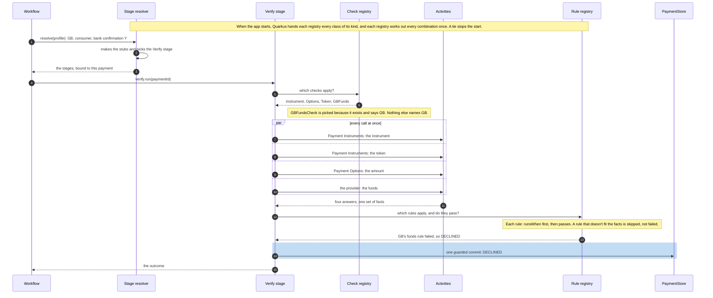

import Lead from '@site/src/components/Lead';
import ClassMap from '@site/src/components/ClassMap';
import {strategyFamily, pickingClasses} from '@site/src/components/ClassMap/diagrams';

# Building the Stage Resolver

<Lead>The stage resolver is how a workflow finds the stage for each step, and the checks and methods that stage uses. Nothing maps a payment to classes by hand: every class says where it applies, one rule picks the most specific, and a market's own variation is one new class.</Lead>

## What the resolver has to do

Three parts of Billpay depend on the resolver, each at a different moment:

| When | Who uses it | What it must get right |
| --- | --- | --- |
| A payment runs | The workflow, through `stageResolver.resolve(profile)` | The same classes, called in the same order, on every replay |
| A release is onboarded | The onboarding workflow, through `GET /market-onboarding/capabilities` | Only the combinations the build really runs |
| A change is built | Whoever adds or changes a class | A mistake fails the build before it merges, and names the class |

A step varies by behaviors and by market. If every combination got a class of its own, the classes would multiply: two optional checks need up to four versions of Verify, and three need eight. So each job is one class, and a payment gets the sum of the jobs that apply to it.

## The idea

Think of airport security. Every traveler goes through the same lane in the same order. What changes is which checks they get, and each check has a sign: international flights only, or flights to one country only. Someone reads the boarding pass, collects every check whose sign matches, and sends the traveler through. A new check needs a new sign, and nobody rebuilds the lane.

| At the airport | In Billpay |
| --- | --- |
| The boarding pass | The resolved profile, which the [Router](./router.md) pins when the payment starts: the market, the account type and the resolved behaviors |
| The lane | A stage: one step's fixed flow, such as Verify's, which makes every call at once, applies the rules and commits once |
| A check and its sign | A strategy and its `appliesTo` |
| The person reading the pass | A registry, one for each kind of strategy |

## The pieces

| Piece | What it is |
| --- | --- |
| Strategy | A small class that does one job for a step, such as asking Plans for a mandate. Stages are strategies too, and so are methods such as Execute's realtime or batch clearing. A strategy keeps no state, so one instance serves every payment. The verification rules are picked the same way |
| Key | The name of the job, such as `MANDATE` or `CLEARING`. Strategies with different keys add up. Strategies with the same key compete, and one wins |
| `appliesTo` | Where the strategy applies: a market or every market, an account type or every account type, the behaviors that must be Y and the behaviors that must be N. Empty means everywhere. It is plain data, not code, so two of them can be compared |
| Registry | One small class, written once and used for every kind of strategy. It gets every strategy of its kind, works out the winners for every combination when the app starts, and after that answers each payment with a lookup |
| Stage resolver | The workflow's one way in. On the workflow's own thread it makes the activity stubs, the handles through which a workflow calls other systems, picks each step's stage and hands back stages that are ready to run |

Every class the registries pick is a strategy. This class diagram shows it for Verify and for Execute's clearing:

<ClassMap {...strategyFamily} />

`InstrumentCheck`, `OptionsCheck` and `TokenCheck` sit beside `MandateCheck` and look the same. `GBFundsCheck` is the one that lives in GB's module.

These are the classes that do the picking, numbered in the order they act:

<ClassMap {...pickingClasses} />

## The one rule

For each key, the most specific strategy that applies wins:

1. A strategy applies when the payment matches everything its `appliesTo` names.
2. A strategy tied to a market beats one that isn't. That is what makes a market the exception.
3. After that, the strategy that names more behaviors wins.
4. If two are still level, the app refuses to start, and the error names both and the combination.

A strategy whose key no other strategy shares simply runs wherever it applies. That is how one payment ends up with several checks.

## The complete picture

Here is everything at once for the payment the worked example below follows: a GB customer paying with Pay with Bank Transfer. The workflow finds its stage, the stage finds its checks, the checks make their calls, and the rules decide:



What the design does for this payment:

- No code maps the payment to classes. Picking the stage (step 2), the checks (step 5) and the rules (step 12) are lookups in answers the registries worked out when the app started.
- GB's difference is one class in GB's module. The stage, the shared checks and the shared rules are the same code every market runs.
- The calls run in parallel and the commit happens once, so the customer's answer isn't held up by a list of checks run one after another.
- The order of the checks is fixed, so a replay of this workflow makes the same calls in the same order.

## A worked example: Verify

Verify decides whether a payment can go ahead. Its flow never changes: it makes its checks' calls at once, gathers the answers into one set of facts, runs the [verification rules](./stages.md#writing-verification-rules) and commits once. What varies from payment to payment is which checks run.

### The checks

Five checks exist today. Each is a class, and each says where it applies:

| Check | Key | `appliesTo` | What it asks |
| --- | --- | --- | --- |
| `InstrumentCheck` | `INSTRUMENT` | Everywhere | Payment Instruments, about the payment's instrument |
| `OptionsCheck` | `OPTIONS` | Everywhere | Payment Options, whether it accepts the amount |
| `TokenCheck` | `TOKEN` | Bank confirmation Y | Payment Instruments, whether the verification token it holds for the instrument is valid |
| `MandateCheck` | `MANDATE` | Mandate authorization Y | Plans, for the mandate details |
| `GBFundsCheck` | `FUNDS` | GB, bank confirmation Y | The bank-confirmation provider, whether the customer's bank account holds enough money for the payment |

In code, a check is this small:

```kotlin
/** Where a strategy applies. Empty means everywhere. */
data class AppliesTo(
    val market: Market? = null,            // null: any market
    val accountType: AccountType? = null,  // null: any type
    val on: Set<Behavior> = emptySet(),    // must be Y
    val off: Set<Behavior> = emptySet(),   // must be N
)

@Singleton
class MandateCheck : Check {
    override val key = CheckKey.MANDATE
    // the same class checks again on the due date
    override val steps = setOf(VERIFY, REVERIFY)
    override val appliesTo =
        AppliesTo(on = setOf(MANDATE_AUTHORIZATION))

    // starts the call; the stage waits for every check
    override fun fetch(ctx: StageContext, paymentId: String) =
        Async.function(
            ctx.stubs.plans::mandateDetails, paymentId)
}

// in market/gb/
@Singleton
class GBFundsCheck : Check {
    override val key = CheckKey.FUNDS
    override val steps = setOf(VERIFY)
    override val appliesTo =
        AppliesTo(market = GB, on = setOf(BANK_CONFIRMATION))

    override fun fetch(ctx: StageContext, paymentId: String) =
        Async.function(
            ctx.stubs.bankConfirmation::funds, paymentId)
}
```

*(A sketch: the names are illustrative.)*

- `@Singleton` makes the class a bean: Quarkus creates one instance and hands it to anything that asks for its type. That is how the check reaches the registry, with no list to edit.
- `steps` lets one class serve two stages. `MandateCheck` runs at Verify, and again at Reverify on the due date.
- The check takes the stubs it calls through from `ctx` and keeps nothing between payments.
- GB's check lives in GB's module. GB needs no Verify class of its own, because this class existing is enough.

### The stage

```kotlin
@Singleton
class DefaultPaymentVerifyStage(
    private val checks: CheckRegistry,
    private val rules: RuleRegistry,
) : PaymentVerifyStage {
    override val key = VERIFY
    override val appliesTo = AppliesTo()       // every market

    override fun run(
        ctx: StageContext, paymentId: String,
    ): VerifyOutcome {
        // every check that applies, sorted by key
        val mine = checks.forProfile(ctx.profile, VERIFY)
        // every call at once, then one set of facts
        val facts = fetchAll(mine, ctx, paymentId)
        // the rules that apply decide
        val report = rules.evaluate(ctx.profile, VERIFY, facts)
        val outcome = ctx.stubs.store.commitVerify(
            paymentId, report.decision, report.failedRuleIds)
        // the facts travel on to Execute and Fulfil
        return outcome.copy(facts = facts)
    }
}
```

*(A sketch.)*

The stage never asks which market it is in or which behaviors are on. It asks the registries for its checks and its rules and runs the same flow every time, so there is no `if` on a behavior anywhere in Verify.

### One payment, start to finish

A GB customer pays their bill with Pay with Bank Transfer. The Router pins the resolved profile: market GB, a consumer account, bank confirmation Y and mandate authorization N.

1. The Verify registry holds one stage, `DefaultPaymentVerifyStage`, which applies everywhere, so it runs.
2. The check registry reads each check's `appliesTo` against the resolved profile:

| Check | `appliesTo` | This payment |
| --- | --- | --- |
| `InstrumentCheck` | Everywhere | Runs |
| `OptionsCheck` | Everywhere | Runs |
| `TokenCheck` | Bank confirmation Y | Runs |
| `MandateCheck` | Mandate authorization Y | Not picked |
| `GBFundsCheck` | GB, bank confirmation Y | Runs |

3. Four calls go out at the same time: two to Payment Instruments, one to Payment Options and one to the bank-confirmation provider. The stage waits for all four.
4. The answers become one set of facts. The rule registry picks the payment's rules the same way it picked the checks: GB's funds rule names GB and bank confirmation, as its check does, and it runs because a funds answer is among the facts. If the account holds less than the payment, the funds rule fails and the payment is `DECLINED`.
5. One guarded commit writes the decision and the timeline row, with the ID of the rule that failed.

A consumer whose profile requires mandate authorization goes through the same stage and gets the Instrument, Options and Mandate checks. Nothing in the code names a market, except the one class GB owns.

### Every combination

A test writes what every combination gets, and the result is checked in. This is Verify's part. Every row runs `DefaultPaymentVerifyStage`, so the stage's column is left out here:

```text
VERIFY     mandate=N bank=N  Instrument, Options
VERIFY     mandate=N bank=Y  Instrument, Options, Token
VERIFY     mandate=Y bank=N  Instrument, Options, Mandate
VERIFY     mandate=Y bank=Y  Instrument, Options, Token, Mandate
VERIFY GB  mandate=N bank=N  Instrument, Options
VERIFY GB  mandate=N bank=Y  Instrument, Options, Token, Funds
VERIFY GB  mandate=Y bank=N  Instrument, Options, Mandate
VERIFY GB  mandate=Y bank=Y  Instrument, Options, Token, Mandate, Funds
```

One stage serves all eight rows. The last row, a GB payment that needs both a mandate and bank confirmation, gets every check that applies to it, with no class written for that combination.

:::info[Placeholder: Represent's checks]
Represent's rows in the report list no checks yet. Which systems Represent calls, and what fails its recheck, are still to be defined. When they are, its checks and rules are classes like these, listing Represent among their steps, and the report shows them on its rows.
:::

### A key with two strategies: Execute's clearing

Checks add up because each has its own key. When a step needs exactly one of several ways to do a job, the strategies share a key instead. Execute clears a payment either in real time or in batch:

```kotlin
@Singleton
class RealtimeClearing : ClearingMethod {
    override val key = ExecuteKey.CLEARING
    override val appliesTo =
        AppliesTo(on = setOf(REALTIME_CLEARING))
    // ...
}

@Singleton
class BatchClearing : ClearingMethod {
    override val key = ExecuteKey.CLEARING
    override val appliesTo =
        AppliesTo(off = setOf(REALTIME_CLEARING))
    // ...
}
```

*(A sketch.)*

Realtime clearing is either Y or N for any payment, so exactly one of the two applies. Execute's stage asks the registry for its clearing method and never needs to know which one it got.

## How the registry decides

The registry is the only place where matching happens, and one class serves every kind of strategy. Its core is four steps:

```kotlin
/** Market first, then how many behaviors a strategy names. */
val MORE_SPECIFIC = compareBy<AppliesTo>(
    { it.market != null }, { it.named.size })
val BY_APPLIES_TO = Comparator<Strategy<*>> { a, b ->
    MORE_SPECIFIC.compare(a.appliesTo, b.appliesTo) }

// combo: one market, account type and set of behaviors
private fun resolve(all: List<S>, combo: Combination): List<S> =
    // 1. the strategies whose appliesTo matches
    all.filter { it.appliesTo.matches(combo) }
        // 2. grouped by job
        .groupBy { it.key }
        // 3. one winner for each job; a tie stops the app
        .map { (key, candidates) ->
            val best = candidates.maxWith(BY_APPLIES_TO)
            val level = candidates.filter {
                BY_APPLIES_TO.compare(it, best) == 0
            }
            // the error names both and the combination
            check(level.size == 1) { tie(key, level) }
            best
        }
        // 4. a fixed order, for replay
        .sortedBy { it.key }
```

*(A sketch.)*

- When the app starts, the registry runs this for every combination of market, account type and behaviors that any of its strategies names, and keeps the answers in a map. A payment's lookup is one read from that map, so no reflection, I/O or container call happens while a workflow runs.
- Step 4 matters to Temporal. A workflow must make the same calls in the same order every time it replays, so the order can't depend on the order in which Quarkus happened to find the beans.
- The registry gets its strategies from Quarkus, which collects every bean of a type at build time and injects them as one list, `@All List<Check>`. It is the job Java's `ServiceLoader` does at runtime, done at build time.
- The verification rules use the same registry. A rule's ID is its key and it has an `appliesTo` like a check's, so a market can add a rule, or replace a shared one by reusing its ID. [Writing verification rules](./stages.md#writing-verification-rules) shows rules built from small, shared yes/no questions about the facts.

## How a workflow uses it

A workflow sees none of this. It calls the stage resolver once, at the top of its method, and runs its steps:

```kotlin
// in the workflow, on its own thread
val stages = stageResolver.resolve(profile)
stages.capture.run(request)
val verified = stages.verify.run(paymentId)
```

Inside, the resolver makes the stubs, picks each stage and binds the two:

```kotlin
fun resolve(profile: ResolvedProfile): Stages {
    // the activity stubs, made on this thread
    val ctx = StageContext(profile, Stubs.create())
    return Stages(
        // the step's stage, bound to this payment
        verify = VerifyStep(verifyStages.one(profile), ctx),
        // ...one line for each step
    )
}

class VerifyStep(
    private val stage: PaymentVerifyStage,
    private val ctx: StageContext,
) {
    fun run(paymentId: String) = stage.run(ctx, paymentId)
    fun announce(paymentId: String) =
        stage.announce(ctx, paymentId)
}
```

*(A sketch.)*

The stubs are the reason for the context. Temporal only lets a workflow make activity stubs on its own thread, and a strategy is one instance shared by every payment, so it can't hold a payment's stubs. The resolver makes them where Temporal requires, wraps them with the resolved profile in a `StageContext`, and every call carries it. The worker gives the resolver to each workflow through the factory it registers the workflow with.

## When things change

| Change | What you write | What happens |
| --- | --- | --- |
| A check every market needs | One class, applying everywhere | Every payment runs it |
| A check for one behavior | One class, with the behavior in `on` | Payments with that behavior run it |
| A market's own check | One class in `market/{m}/`, with `market = M` | Only that market runs it |
| A market replaces a shared check | One class in `market/{m}/`, with the shared check's key and `market = M` | It beats the shared check in that market, and nowhere else |
| A market's own rule | A rule in a `RuleSet` in `market/{m}/`, with `market = M` | Only that market runs it. With a shared rule's ID, it replaces that rule there |
| A market's Verify flow really differs | `{M}PaymentVerifyStage`, with `market = M` | It beats `DefaultPaymentVerifyStage` in that market. Its checks still come from the registry |
| A step's whole flow differs by a behavior | `Payment{Step}StageWith{Behavior}`, with the behavior in `on` | It beats the default stage wherever that behavior is Y. No step needs one today |
| Two classes claim the same job equally, by mistake | Nothing | The app refuses to start: `Verify check tie for FUNDS at GB [BANK_CONFIRMATION]: [GBFundsCheck, GBBalanceCheck]` |

None of these changes touches shared code, the resolver or a list.

## What keeps it safe

The registries find mistakes when the app starts. Unit tests build the registries the same way, so the same mistakes fail the build before anything is deployed:

| Mistake | What catches it |
| --- | --- |
| Two strategies level for one key | The app refuses to start, and the error names both |
| A behavior nobody handles | Each step names the behaviors it must act on: mandate authorization and bank confirmation for Verify. A combination where one of them is Y, and no strategy that applies names it, can't run. Delete `MandateCheck`, and no combination with a mandate can run, while payments without one are unaffected |
| A key nobody fills | Each step also names the keys it must fill, such as `CLEARING` for Execute. A combination with no clearing method can't run |
| A class Quarkus can't see | Quarkus only finds beans in modules that carry an index, so each module that holds strategies has an empty `META-INF/beans.xml`. A test compares the strategy classes on the classpath with what the registries hold, and fails for any that are missing |
| A misleading name | A test fails for a class whose `appliesTo` names a market when its name doesn't start with that market's code |
| An unnoticed change | The report above is checked in, and a test fails when the build's report differs, so a change to what any combination runs shows up as a diff in review |

The resolver has unit tests of its own, listed on [Testing → Unit](../../../testing/functional/unit.md#the-profile-lookup).

## The capability manifest

The registries also work out the build's capability manifest when the app starts: every combination of behaviors that every step of its journey can run, by the two rules above for behaviors and keys. `GET /market-onboarding/capabilities` returns it, and the onboarding workflow checks each market release against it before anything goes live. A release built only from combinations in the manifest goes live with config alone. A release that needs a new combination is flagged as needing a build while it is authored, and the onboarding workflow stops at its first step until a build with that combination is deployed. Before a build rolls out to an environment, the [deploy pipeline](../../../deployment/pipeline.md#the-capability-manifest) compares its manifest with every release live there, and stops the rollout if a combination a live release uses is missing.

## Why the lookup stays in the workflow

The Router builds the resolved profile, so it could pick the stages as well and hand each workflow its class names. It doesn't, because during a rolling deploy the Router and the workers can run different builds. A Router on the new build could name a class that the worker's build doesn't have yet. When the workflow looks up its own stages, the build that runs them is the build that chose them, and Worker Versioning, Temporal's way of keeping a workflow on the build it started on, keeps that pairing for the life of the workflow.

## Why not KSP, SPI or a `when`

| Option | Why not |
| --- | --- |
| A stage class for each combination, picked by KSP, Kotlin's code generator | Classes grow with every combination, and a processor on an experimental KSP API has to work out the winners |
| A hand-written index: a `when`, a map or a table | Every new market or variation means editing it, and a forgotten line silently runs the default |
| Java's `ServiceLoader`, the service provider interface (SPI) | It finds the classes listed in `META-INF/services` at runtime, through reflection, but doesn't choose between them, and a class left out of the file is never found |
| A classpath scan at startup | It needs reflection, and a scan finds nothing in a native image |
| An `if` or a `when` on behaviors inside a stage | A step's variation spreads through its code instead of living in one class per job |

The design has three costs:

- A strategy holds no state, so stages take their stubs through a `StageContext`.
- A mistake shows up when the app starts and in unit tests, not in the compiler. Both happen before a merge.
- A module that holds strategies must carry an index for Quarkus to see it, and a test checks that none is missed.
