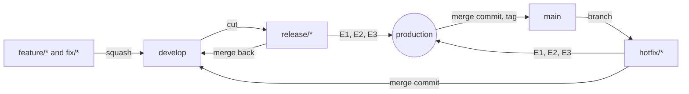

import Lead from '@site/src/components/Lead';

# Code Merge Strategy

<Lead>billpay-core follows Gitflow: work comes together on <code>develop</code>, ships from a release branch, and <code>main</code> always holds what runs in production. Every change arrives through a pull request on GitHub, with the code owners' approval and every CI check green.</Lead>

The branch model is agreed (2026-10-20). Branch names, merge methods, approvals and protection rules are Proposed (2026-10-20), for the team to confirm.

## The branches

| Branch | Starts from | Merges into | What it holds |
| --- | --- | --- | --- |
| `develop` | | | Work that has passed review and every check, waiting for the next release |
| `feature/{ticket}-{short-name}` | `develop` | `develop` | One piece of new work |
| `fix/{ticket}-{short-name}` | `develop` | `develop` | A fix for something not yet in production |
| `release/{version}` | `develop` | `main`, then `develop` | One release, from the cut until it is live in production |
| `main` | | | The production copy: what runs in E3, and nothing else |
| `hotfix/{version}` | `main` | `main` and `develop` | A fix production needs before the next release |

## From a feature to production

1. A developer branches `feature/{ticket}-{short-name}` from `develop` and opens a pull request back to it.
2. The pull request passes its checks and its reviews, then is squashed into `develop`.
3. When the team is ready to ship, someone cuts `release/{version}` from `develop`. From then on, new work keeps landing on `develop` without touching the release.
4. The release branch's build moves through E1, E2 and E3 ([Pipeline](./pipeline.md)). A fix found while it is tested goes onto the release branch through its own pull request.
5. Once the release is live in production, the release branch merges to `main` with a merge commit, and that commit is tagged `v{version}`.
6. The release branch merges back to `develop`, so the fixes made during testing aren't lost, and is then deleted.

Nothing deploys from `develop`. The build that reaches production is always one built from a release or hotfix branch, the same image in every environment.

## Hotfixes

1. Branch `hotfix/{version}` from `main`, so the fix starts from exactly what production runs.
2. Open a pull request to `main`. It needs the same checks and approvals as any other change, and gets reviewed first.
3. The hotfix branch's build moves through E1, E2 and E3 like a release.
4. Once it is live, merge it to `main` with a merge commit and tag it.
5. Merge it to `develop` too, so the next release carries the fix. If a release branch is open, merge it there as well.

A hotfix never skips a check or an approval. When production is broken, the quickest safe path is a small, reviewed change, not a bypass.

## Merge methods

| From | To | Method | Why |
| --- | --- | --- | --- |
| `feature/*`, `fix/*` | `develop` | Squash | One commit per pull request, so `develop` reads as a list of changes and any one of them can be reverted on its own |
| `release/*`, `hotfix/*` | `main` | Merge commit, then a tag | `main` keeps the exact commits that were tested, and the tag names the build in production |
| `release/*`, `hotfix/*` | `develop` | Merge commit | Brings back the fixes made on the branch without rewriting history either side |

A squashed commit's title follows Conventional Commits, such as `feat(verify): add MandateCheck` or `fix(settle): skip split parents`, so the release notes can be built from the log.

## Pull requests

A pull request does one thing, small enough to review in one sitting.

- The description says what changed and why, and links the ticket.
- It stays a draft until it is ready for review.
- A change to what a combination runs updates the checked-in stage report in the same pull request, so the reviewer sees the rows that moved.
- A new market class carries the market's code at the front of its name, such as `GBFundsCheck`, and sits in that market's module.

## Reviews and code owners

`CODEOWNERS` names who must approve a change to each folder, and GitHub asks them for a review when a pull request touches it.

- `core/lib/` needs a platform owner, since every market runs it.
- `market/{m}/` needs that market's team.
- Workflow code, stage code and anything under `core/lib/verification/` need two approvals. A determinism mistake there only shows up when a payment replays, so it gets a second pair of eyes.
- A pull request to `main` also needs the release manager.

Reviewers rotate, so knowledge of each area doesn't sit with one person.

## When a pull request can merge

Branch protection on `develop`, `release/*` and `main` makes these hard rules, not habits:

- The pull request is open, not a draft, and has no conflicts.
- Every required check has passed on its latest commit.
- It has its approvals, and no reviewer has asked for changes.
- It is up to date with its base branch.

Nobody force-pushes to a protected branch, and nobody merges past a failing check or a missing approval, administrators included. Once a pull request is approved, the author can turn on auto-merge, and it merges as soon as the checks pass.
