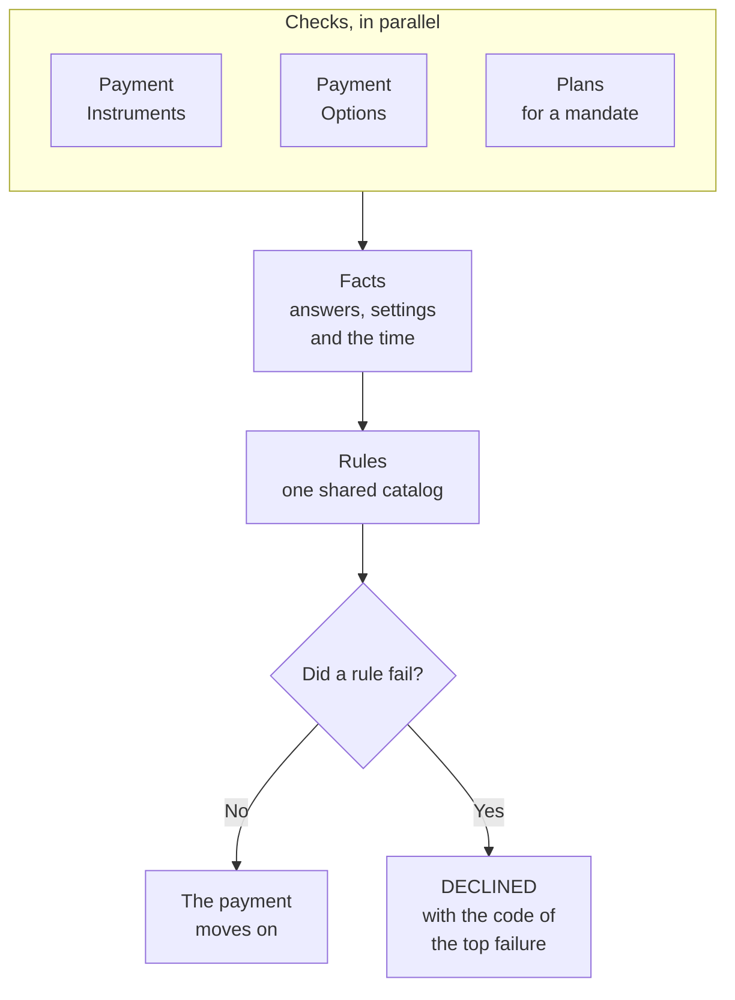

import Lead from '@site/src/components/Lead';

# Stages

<Lead>A stage is one business step, named for the journey step it performs: Verify, Execute, Settle. It makes its calls, in parallel where they don't depend on each other, commits the result in one guarded Oracle transaction, and returns its outcome.</Lead>

Stages are the only layer that changes between markets. Verify in a market that checks a mandate is a different implementation from Verify in one that doesn't, and the workflow never knows the difference: it looks its stages up from its plan key, and the most specific match wins. Thirteen stages cover every journey.

## What every stage does

Every stage follows the same three beats.

1. It calls its activities, in parallel where the calls don't depend on each other.
2. It commits in one guarded `PaymentStore` transaction: the new state, a timeline entry that names the cluster, and any Work Tracker rows the step creates or closes.
3. After the commit, the workflow calls the stage's announcement: an RTF lifecycle event for every state change, plus a Raven message where the customer is told. The workflow waits for it before the next stage, so each payment's events reach RTF in order.

Two stages bend that order, for good reasons:

- On the Online cluster, Capture and Verify commit back to back so the caller's answer isn't held up. Both announcements follow the reply, in order.
- Fulfil sends its event and message before its commit, because `PROCESSED` means they have gone out. Comms go last, after accounting, eBNC, risk and the three notification systems (the Transaction Notification Engine, TFNE; the legacy Payments History Database, GPHDB; and B2Notifier), so the customer hears only once everything else has worked.

Which changes send a Raven message is a market setting. By default they are `SCHEDULED`, `DECLINED`, `CANCELLED`, `PROCESSED` and `RETURNED`. A market can change that default, and an account type can change its market's. Where both have a setting, the account type's wins. A change that is switched off sends no message, and Fulfil then waits for RTF alone.

## The thirteen stages

| Stage | Moves | Varies by |
| --- | --- | --- |
| Capture | Input → `PENDING`, with the idempotency check | Nothing |
| RequestConfirmation | `PENDING`, unchanged: gets the provider's redirect link for the caller, and stores the link and the provider's reference on the payment. `PENDING` → `DECLINED` when the provider gives no link. It runs only for bank confirmation | Nothing |
| Verify | `PENDING` → `ACCEPTED`, `SCHEDULED` or `DECLINED`; a push payment (inbound) → `ACCEPTED` or `DISALLOWED` | Mandate authorization and bank confirmation, which decide its checks |
| Reverify | `SCHEDULED` → `ACCEPTED` or `DECLINED`; a corporate payment from `ALLOCATED` | All four |
| Execute | `ACCEPTED` → `PROCESSING`; a corporate payment paid today from `ALLOCATED`. A corporate parent only clears, once, and releases its legs, which make the AR and open-to-buy calls | Account type, AR posting, realtime clearing |
| Fulfil | `PROCESSING` → `PROCESSED` | Account type |
| RequestAllocations | `SCHEDULED`, or `ACCEPTED` for pay today, → `ALLOCATING` | Nothing |
| ReceiveAllocations | `ALLOCATING` → `ALLOCATED` once the batches add up, with the payment's `ALLOC_EXEC` row; earlier batches change no state | Nothing |
| Cancel | `SCHEDULED` → `CANCELLED`; `PENDING` → `CANCELLED` for a payment never confirmed, or on the customer's no | Account type, AR posting |
| Return | `PROCESSING`, `PROCESSED`, `PAID` or `REPRESENTED` → `RETURNED`, on the presentment that came back | Account type |
| QueueRepresentment | Writes the next presentment, a new row numbered one higher, in `REPRESENTING`, with the representment date as its clearing date; the returned row stays `RETURNED` | All four |
| Represent | `REPRESENTING` → `REPRESENTED` or `DECLINED` | All four |
| Settle | `PROCESSED` → `PAID` for each payment or leg in a batch of up to 500 ready inbox rows | Nothing |

"All four" means account type, AR posting, realtime clearing and mandate authorization. Bank confirmation is the fifth behavior: it decides whether RequestConfirmation runs, and which Verify implementation confirms the payment. A go-ahead is not a behavior, and no stage has a version for it. It is a market setting, off by default: where it is on, a create that One-Data sends with other pending payments' IDs waits in Create Payment Intent, and Capture stores the IDs.

## Which workflow runs which stages

| Workflow | Stages, in order |
| --- | --- |
| Create Immediate Payment | Capture, Verify, Execute, Fulfil. A corporate payment stops after Verify |
| Create Scheduled Payment | Capture, Verify |
| Create Payment Intent | Capture, RequestConfirmation for bank confirmation, then the wait. On a yes: Verify, Execute, Fulfil, or Verify alone for a future-dated payment (Proposed). On a no, or when the window closes: Cancel |
| Execute Scheduled Payment | Reverify, Execute, Fulfil. A corporate parent has no Fulfil, and one paid today skips Reverify |
| Execute Split Payment | Execute, Fulfil |
| Request Allocations | RequestAllocations |
| Receive Allocations | ReceiveAllocations |
| Update Payment | Cancel, then the child runs Capture and Verify |
| Cancel Payment | Cancel, from a caller |
| Process Returned Payment | Return, QueueRepresentment |
| Process Representment | Represent |
| Process Inbound Payment | Capture, Verify, Execute, Fulfil |
| Process Paid Events | Settle, once per batch |

Create Balance Refund follows the payment path; its detailed stages are still being defined.

## Naming implementations

A stage interface is named for its step, with `Payment` in front: `PaymentVerifyStage`, `PaymentExecuteStage`. An implementation keeps that name whole and adds what it serves after it, so it always reads as one version of a step, never as a step of its own. The parts come from the implementation's index declaration, in this order:

1. `For` and the account type: `ForConsumer`, `ForCorporate` or `ForBusinessTravel`.
2. `With` and each behavior it needs, joined with `And`, in the profile's order: `ArPosting`, `RealtimeClearing` (`BatchClearing` when it is N), `Mandate`, then `BankConfirmation`. A behavior it needs to be N follows as `Without`, such as `WithoutArPosting`.
3. `In` and the market, for a market override only, such as `InGb`.

The implementation that declares nothing is `DefaultPayment{Step}Stage`, and it runs for every combination nothing more specific matches. A name never lists the activities an implementation calls. The mandate check, for example, is a call to Plans that Verify makes, so a market that needs one runs a Verify that makes that call:

| Verify implementation | What it does |
| --- | --- |
| `DefaultPaymentVerifyStage` | Instruments and Options checks only: Payment Instruments and Payment Options |
| `PaymentVerifyStageWithMandate` | Mandate authorization: Payment Instruments, Payment Options and Plans |
| `PaymentVerifyStageWithBankConfirmation` | Bank confirmation: Payment Instruments, with the verification token check, and Payment Options |
| `PaymentVerifyStageWithMandateAndBankConfirmation` | Both: Payment Instruments, with the token check, Payment Options and Plans |
| `PaymentVerifyStageWithBankConfirmationInGb` | A rule only GB needs, kept in `market/gb/stages/` |

*(Examples of the rule, agreed on 2026-10-18.)*

On the due date, a payment that needs a mandate runs `PaymentReverifyStageWithMandate`, which asks Plans again. Execute works the same way: `DefaultPaymentExecuteStage` clears in batch, and `PaymentExecuteStageWithRealtimeClearing` clears in real time.

Three rules keep the names straight:

- The build checks every name. KSP, the code generator that builds the stage index, works out the expected name from each declaration and fails the build when a class is named anything else.
- Calls that every implementation of a step makes, such as Verify's Instruments and Options calls, live in a plain helper function, never in a base class.
- A step's implementations sit together in one folder, such as `core/lib/stages/impl/verify/`.

## How verification decides

Verify, Reverify and Represent each decide whether a payment can go ahead, and they decide it the same way. The stage first asks the systems that know about the payment, then runs a set of rules over their answers. Keeping the two apart makes each rule a plain condition over data, and lets the three stages share one catalog of rules.

- A check is one system and the rules about its answer. A version of a stage is its list of checks: the default Verify runs the Instrument and Options checks, and `PaymentVerifyStageWithMandate` adds the Mandate check, which asks Plans. Represent will run checks of its own, still to be defined.
- The checks' calls go out in parallel. What a system says, such as a closed account or no valid mandate, comes back as a fact. Only an error fails the call, and Temporal retries it, so an outage never declines a payment and a business "no" is never retried.
- A rule makes no calls and never reads the clock, so a replay reaches the same decision. Every rule that applies runs, except one whose check didn't run or whose earlier rule failed, such as the instrument rules after "instrument not found".
- The highest-priority failure decides: `DECLINED` with that rule's code, or `DISALLOWED` for a push payment. There is no outcome that sends a payment to review, because the state model has no state for one.
- A market's thresholds, such as its largest payment or the instrument types it takes, are rule settings in its release, and the Router hands them to the workflow in the plan key. So a threshold changes with a release and no deploy, while a rule's logic changes with a deploy. The commit's timeline row keeps the IDs of the rules that failed, and a metric counts declines by step and rule.

## Capture

Turns the request into a `PENDING` payment. `PaymentStore` inserts into `trans_dtl`, `trans_lfcyc_event` and the idempotency table, all insert-if-absent. A duplicate means the request was seen before, and the caller gets the existing payment. On the Online cluster Capture gets a short deadline, so a caller facing an Oracle problem gets a quick error instead of a long wait.

## RequestConfirmation

Runs after Capture, in place of Verify, when a payment needs the customer to confirm their bank details (`requiresBankConfirmation` resolves to Y). It asks the market's provider, such as Plaid in the US or Pay with Bank Transfer in the UK, for the customer's redirect link, with one try that fits inside the API's wait. One commit guarded on `PENDING` stores the link and the provider's reference. The payment stays `PENDING`, the caller's update returns with the link, and [Create Payment Intent](./workflows/core.md#create-payment-intent) waits for the customer. The link is stored so that a caller who loses it can get it again, from a repeated create or from `GET /payments/{payment-id}`.

If no link comes back, because the provider is down or too slow, the commit moves the payment to `DECLINED` instead, and the caller gets `DECLINED`. No payment is ever left `PENDING` without a link. The provider only checks the customer's bank details. It never moves money: Billpay does that in Execute, once the customer has confirmed.

A payment can also wait for the customer's go-ahead, in a market that has it turned on, when One-Data sends other pending payments' IDs with the create. That needs no stage of its own and no provider call: Capture already stored the IDs of the payments the customer was shown, which came with the request. The caller gets `PENDING`, and One-Data adds the pending payments to the reply. A payment that needs both waits once: RequestConfirmation gets the link, the reply carries the link and the list, and confirming at the bank is the go-ahead.

## Verify

Decides whether a pending payment can go ahead. It calls Payment Instruments, to confirm the way the customer is paying, and Payment Options, to confirm the amount.

- A business failure, such as a closed account, insufficient funds, an amount above the customer's AR balance, which Payment Options refuses, or a mandate that fails its check, is not retried. The payment goes to `DECLINED`.
- A future-dated payment commits `SCHEDULED` together with its `SCHED_EXEC` Work Tracker row. A corporate payment gets an `ALLOC_REQUEST` row instead, due at the market's fetch time.
- A corporate payment made today commits `ACCEPTED` together with an `ALLOC_REQUEST` row due at once, and its workflow ends there.
- A push payment (inbound, sent by a third party) that Amex won't take commits `DISALLOWED`. No other kind of payment can end there.
- A payment that waited for bank confirmation is verified in Create Payment Intent, when the confirm arrives, guarded on `PENDING`. The provider has already verified the customer's bank details, so Verify asks Payment Instruments whether the verification token it holds for the instrument is valid, to guard against fraud. Payment Instruments decides what makes a token valid. A payment without a valid token is `DECLINED`.
- A payment that waited for a go-ahead is verified there too, guarded on `PENDING`, by the Verify its behaviors pick, as for any payment. It goes through even if the earlier payment was decided while the customer looked. A future-dated payment commits `SCHEDULED` with its `SCHED_EXEC` row (Proposed).

Verify's versions differ only in their checks. Where the profile requires mandate authorization, Verify also fetches the mandate details from Plans, in parallel with its other two calls, and a mandate that fails its check is `DECLINED`. That version of Verify is `PaymentVerifyStageWithMandate`. Where it requires bank confirmation, the Instruments check adds the token check. Nothing else picks a Verify: the corporate `ALLOC_REQUEST` row comes from the account type, the way the `SCHED_EXEC` row comes from the date, and what a payment waited for picks nothing.

## Reverify

Checks a scheduled payment again on its due date, with the same calls as Verify, the mandate check included where the profile requires one, and commits `ACCEPTED` or `DECLINED`. Its guard, `WHERE status = 'SCHEDULED'`, means a cancel and the execution can never both win. A scheduled corporate payment is reverified from `ALLOCATED`, once its allocations are in. One paid today skips Reverify, because Verify passed it minutes earlier.

## Execute

Moves the money and commits `PROCESSING`. Three calls go out in parallel, each on its own rate-limited queue: clearing (MR/M3), the AR balance (GAR) and open-to-buy (AMP).

Open-to-buy needs the instrument's details in clear text, which Billpay never stores. So that branch starts with a call to Payment Instruments for them, and only then calls AMP. Clearing and AR don't wait for it. The same details stay in the workflow for Fulfil, whose notifications need them too, and workflow history keeps them encrypted by the payload codec.

- A corporate parent clears once, at payment level, and makes no AR or open-to-buy call. The same commit sets `legs_released_at`, which tells the leg dispatcher to write and start its legs, and each leg makes those two calls.
- A corporate leg updates the AR balance and open-to-buy only. It never clears.
- A consumer leg also clears.

## Fulfil

Tells everyone who needs to know, then commits `PROCESSED`. Accounting, eBNC, risk, TFNE, GPHDB and B2Notifier run in parallel. B2Notifier is a notification system that passes the news on to other downstream systems, and the three notification calls use the clear-text details Execute fetched. Then the RTF event and the Raven message go out, and only then does the commit happen. For a scheduled payment, the same commit marks its `SCHED_EXEC` row `DONE`. A corporate parent has no Fulfil: Execute's commit marks its `ALLOC_EXEC` row `DONE`, and the leg dispatcher's completion check moves it to `PROCESSED` once every leg is done. A consumer split's parent has none either: its legs run Fulfil, and the parent commits `PROCESSED` once every leg has finished.

## RequestAllocations

Moves a corporate payment to `ALLOCATING` with a guarded update, from `SCHEDULED` or, for pay today, `ACCEPTED`, then asks the allocations manager for the breakdown. Nothing waits for the answer; the allocations manager calls back. A cancel is guarded on `SCHEDULED` too, so the request and a cancel never both win, and from this commit on a cancel or an update gets 409.

## ReceiveAllocations

Checks one stored callback batch and writes no legs: every batch waits in `allocation_batch` until the parent's Execute releases them. Once the batches add up to the payment amount, one guarded commit moves the payment to `ALLOCATED` and writes its `ALLOC_EXEC` row, due at once for pay today, or at the execution time on the due date for a scheduled payment (at once, if that time has passed). Earlier batches change no state.

## Cancel

Moves a `SCHEDULED` payment to `CANCELLED` with one guarded update, inside the market's cancellation window only. A corporate payment leaves `SCHEDULED` once its allocations are requested, so from `ALLOCATING` on there is nothing to cancel. The same commit cancels the payment's Work Tracker rows, so no dispatcher will ever start it. If the update changes nothing, the payment has already moved on.

Cancel also ends a payment that waited for its customer, inside Create Payment Intent: on the customer's no, which arrives as an update, or when the workflow's timer fires with no answer. It moves the payment from `PENDING` to `CANCELLED`, guarded on `PENDING`, with no window check. As for any cancel, the `CANCELLED` event goes to RTF and the `CANCELLED` message goes to the customer through Raven.

## Return

Moves the [presentment](../payment-state-model.md#presentments) the bank sent back to `RETURNED`, from `PROCESSING`, `PROCESSED`, `PAID`, or `REPRESENTED` when a later presentment is returned. The return's details (when it took effect, why, where it came from and what it returned) go on that presentment's row, which stays `RETURNED`. A payment returned twice keeps both returns' details, one on each presentment.

## QueueRepresentment

Writes the next presentment as a new row, with the same payment ID and a `presentmentSequence` one higher, in `REPRESENTING`. Its clearing date is the representment date, which the market's rules set. The same commit writes its `REPRESENT` Work Tracker row, due on that date. The return never starts the representment itself; the representment dispatcher does, when the date comes.

## Represent

Rechecks eligibility before anything goes to clearing, then sends the new presentment for clearing and commits `REPRESENTED`. The recheck is its own, not Verify's: Represent calls neither Payment Instruments, Payment Options nor Plans, and which checks it runs is still to be defined. A failed recheck commits `DECLINED`, and nothing is sent.

## Settle

Moves the payments and legs of a batch of up to 500 `READY` inbox rows to `PAID`, in one `PaymentStore` transaction sent as JDBC batches. Each row is a guarded update from `PROCESSED` to `PAID`, setting `stlmt_ts` and `ar_pstd_ts`: on `trans_dtl` for a payment, or on `split_trans_dtl` for a leg. Wherever the update changes a row, a `PAID` timeline row tagged with the batch ID goes in with it. Settle then reads back every payment and leg carrying that batch ID, which is how a retried Settle knows exactly what it moved the first time.
