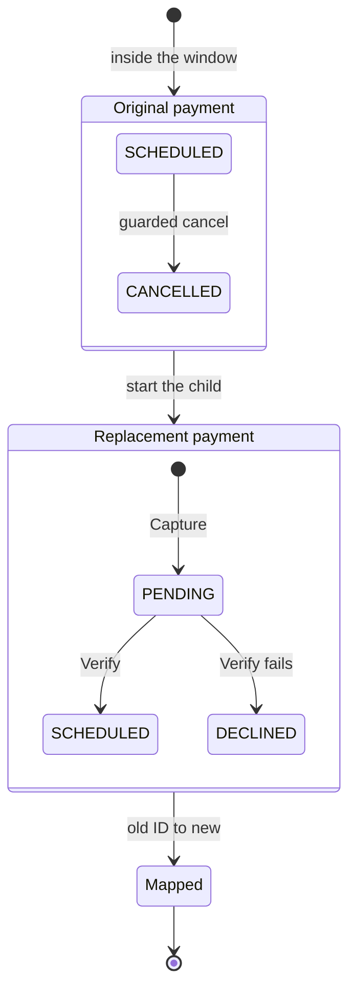

import Lead from '@site/src/components/Lead';
import WorkflowMeta from '@site/src/components/WorkflowMeta';

# Core Workflows

<Lead>Thirteen core workflows, one per journey. Each runs its stages in order and holds no market logic: the stage implementations it looks up from its plan key do all the varying.</Lead>

Every stage commits its state change in one guarded `PaymentStore` transaction. Then the workflow announces the change, an RTF lifecycle event and, where the market tells the customer, a Raven message, and waits for that before the next stage, so a payment's events reach RTF in order. Fulfil is the exception: it sends both before its commit, because `PROCESSED` means they have gone out.

The strip under each heading shows the cluster, the workflow ID, what starts the workflow and which behaviors change its stages. [Stages](../stages.md) says what each stage calls, and the [sequence diagrams](../../sequence-diagrams.md) trace the same flows call by call.

## Create Immediate Payment

<WorkflowMeta cluster="Online" id="{paymentId}-init" start="Update-With-Start, from channels" behaviors={['accountType', 'requiresArPosting', 'requiresRealtimeClearing', 'requiresMandateAuthorization', 'requiresBankConfirmation']} />

`CreateImmediatePaymentWorkflow` pays a bill today. The caller waits only until Verify decides.

1. Capture writes `PENDING`, with the idempotency check. A repeated request joins the existing workflow (conflict policy `USE_EXISTING`). One that comes after the workflow has closed starts a new run, and Capture's check decides what it does ([Creates that arrive late or twice](#creates-that-arrive-late-or-twice)).
2. Verify decides `ACCEPTED` or `DECLINED` in one guarded commit, and the caller's update returns here. The announcements for both changes follow the reply, in order.
3. If the payment is `DECLINED`, the workflow sends the `DECLINED` event and message, then ends.
4. Execute moves it to `PROCESSING`: clearing, AR and open-to-buy in parallel. Open-to-buy first fetches the instrument's clear-text details from Payment Instruments, and Fulfil reuses them.
5. Fulfil runs accounting, eBNC, risk, the Transaction Notification Engine (TFNE), the legacy Payments History Database (GPHDB) and B2Notifier in parallel, then sends the RTF event and the Raven message, then commits `PROCESSED`. TFNE and GPHDB are legacy systems that need to know when a payment is processed, and B2Notifier passes the news on to other downstream systems. Comms go last, so the customer hears only once everything else has worked.

A consumer split payment's legs are written by Verify's `ACCEPTED` commit, and each leg runs `ExecuteSplitPaymentWorkflow` as a child on the Online cluster. The parent doesn't clear, because its legs clear on their own. Once every leg has finished, the parent sends its RTF event and Raven message and commits `PROCESSED`, the same way a corporate parent completes.

A corporate payment stops after Verify. Verify's commit also writes an `ALLOC_REQUEST` row, due at once, and the workflow ends after its announcements, with no Execute or Fulfil. Dispatchers take every later step from rows in Oracle, the same way as for a scheduled corporate payment (see [Corporate Allocations](../../corporate-allocations.md)).

A payment the customer must confirm at their bank stops even earlier. When `requiresBankConfirmation` resolves to Y, RequestConfirmation runs after Capture in place of Verify: it gets the provider's redirect link, with one try, and commits the link with a `CONFIRM_EXPIRY` row, due when the market's confirmation window closes. The caller's update returns `PENDING` with the link, the `PENDING` event goes out, and the workflow ends. If the provider gives no link, the payment is `DECLINED` there and then, and the caller gets `DECLINED`. [Confirm Payment](#confirm-payment) takes over when the caller confirms.

A payment made while another is pending on the same card account stops at the same point. When One-Data sends other pending payments' IDs with the create, RequestConfirmation runs after Capture with its go-ahead implementation. It makes no provider call: it commits a `CONFIRM_EXPIRY` row, due when the market's confirmation window closes, with the IDs of the payments the customer was shown. The caller gets `PENDING`, One-Data adds the pending payments to the reply, and the workflow ends. A payment that needs both waits once: the reply carries the link and the list, and confirming at the bank is the go-ahead. [Confirm Payment](#confirm-payment) takes over on a yes, and [Cancel Payment](#cancel-payment) on a no.

Every create from a channel ends with a call to One-Data's delete API, `DeletePendingPayment.v1`, which clears the payment out of One-Data's Redis. When the payment still waits for a confirmation, the call says so: One-Data drops only the stored create, and the account's pending entry stays until Confirm Payment or Cancel Payment ends.

## Create Scheduled Payment

<WorkflowMeta cluster="Online / Offline" id="{paymentId}-init" start="Update-With-Start from channels, on Online; the AR intake dispatcher for AR, on Offline" behaviors="all" />

`CreateScheduledPaymentWorkflow` books a payment for a future date, then closes. Nothing waits in Temporal until the due date.

1. Capture, then Verify: `SCHEDULED` or `DECLINED`.
2. The `SCHEDULED` commit writes the `SCHED_EXEC` Work Tracker row, due at the market's execution time on the due date. A corporate payment gets an `ALLOC_REQUEST` row instead, due at the market's fetch time, and its execution row comes once it is `ALLOCATED`.
3. The caller gets its answer, the `SCHEDULED` event and message go out, and the workflow closes.

A create from a channel that One-Data sends with other pending payments' IDs takes the same branch as pay today: Capture, then RequestConfirmation, and `PENDING`. At confirm, Verify commits `SCHEDULED` with its `SCHED_EXEC` row, and the workflow stops (Proposed). A create from a channel ends with the same delete call as [Create Immediate Payment](#create-immediate-payment).

## Execute Scheduled Payment

<WorkflowMeta cluster="Offline" id="{paymentId}-execute" start="The scheduled-payments dispatcher, or for a corporate payment the allocated-payments dispatcher, through the Router, with today's config" behaviors="all" />

`ExecuteScheduledPaymentWorkflow` runs a scheduled payment on its due date, and every corporate payment once its allocations are in. It checks a scheduled payment again before any money moves, because a lot can change in 30 days.

1. Reverify: `ACCEPTED` or `DECLINED`. Its guard, `SET status = 'ACCEPTED' WHERE status = 'SCHEDULED'` (or `'ALLOCATED'` for a corporate payment), means a cancel and the execution can never both win. A corporate payment paid today skips Reverify, because Verify passed it minutes earlier.
2. Execute, then Fulfil, as for pay today.
3. The last commit marks its Work Tracker row, `SCHED_EXEC` or `ALLOC_EXEC`, `DONE`, or `FAILED` when retries run out. That frees a slot under the dispatcher's in-flight cap.

For a corporate payment, Execute clears the parent once, at payment level, and makes no AR or open-to-buy call, because the legs do. Its commit marks the legs released. The leg dispatcher then writes the legs of every stored batch and starts them. There is no Fulfil.

## Execute Split Payment

<WorkflowMeta cluster="Online / Offline" id="{paymentId}_{seq}-execute" start="The parent, for consumer splits; the leg dispatcher, for corporate legs" behaviors={['accountType', 'requiresArPosting', 'requiresRealtimeClearing']} />

`ExecuteSplitPaymentWorkflow` runs one leg of a split payment. Consumer legs run on their parent's cluster; corporate legs run only on the Offline cluster.

1. Execute updates the AR balance and open-to-buy in parallel, open-to-buy once Payment Instruments has returned the clear-text details. Consumer legs also clear. Corporate legs never clear per allocation; the parent clears once, as a whole, at payment level.
2. Fulfil runs accounting, eBNC, risk, TFNE, GPHDB and B2Notifier, then sends the leg's RTF event and Raven message, then commits `PROCESSED`.

Corporate legs run at priority 2 with the parent's payment ID as fairness key, so one large payment can't starve the others. Each leg turns `PAID` on its own later, once it has posted and its parent has settled.

## Request Allocations

<WorkflowMeta cluster="Offline" id="{paymentId}-allocations" start="The allocation-request dispatcher, at the market's fetch time, or at once for pay today" behaviors="generic" />

`RequestAllocationsWorkflow` runs one stage. RequestAllocations moves the payment to `ALLOCATING` with a guarded update, from `SCHEDULED` or, for pay today, `ACCEPTED`, then asks the allocations manager for the breakdown and ends. No workflow waits for the answer: the allocations manager calls back. From this commit on, a scheduled payment can no longer be cancelled or updated, and a payment cancelled first is never asked about.

## Receive Allocations

<WorkflowMeta cluster="Offline" id="{paymentId}-allocations-{batch}" start="The allocations callback API, with only the payment ID and batch number" behaviors="generic" />

`ReceiveAllocationsWorkflow` checks one callback batch. It writes no legs: every batch waits in `allocation_batch` until the parent's Execute releases them.

1. ReceiveAllocations checks the stored batch. A batch that leaves the amount short changes no state.
2. Once the batches add up to the payment amount, one guarded commit moves the payment to `ALLOCATED` and writes its `ALLOC_EXEC` row: due at once for pay today, or at the execution time on the due date for a scheduled payment (at once, if that time has passed).

## Update Payment

<WorkflowMeta cluster="Online" id="{paymentId}-update" start="Update-With-Start" />

`UpdatePaymentWorkflow` changes a scheduled payment. Nothing is edited in place: the original is cancelled and a replacement is created, so every payment record stays as it was written.

1. Check the cancellation window and eligibility with read-only calls.
2. Cancel the old payment with the guarded update. If it is no longer `SCHEDULED`, the answer is 409. A corporate payment leaves `SCHEDULED` when its allocations are requested.
3. Start the new payment as child `CreateScheduledPaymentWorkflow` `{newId}-init`, with the same confirmation number. Its result is the caller's answer.
4. Map the old and new payment IDs in `ORIG_TRANS_REFER_MAP`.

Two payments are in play at once, which is easier to see drawn:

## Cancel Payment

<WorkflowMeta cluster="Online / Offline" id="{paymentId}-cancel" start="Update-With-Start, on Online; the confirmation-expiry dispatcher, on Offline" behaviors={['accountType', 'requiresArPosting']} />

`CancelPaymentWorkflow` withdraws a `SCHEDULED` payment inside the market's cancellation window. A corporate payment can be withdrawn only until its allocations are requested, when it moves to `ALLOCATING`.

1. Check the window and eligibility with read-only calls.
2. Cancel: one guarded update to `CANCELLED`. The same commit cancels the payment's Work Tracker rows. The `CANCELLED` event and message go out after the reply.
3. If the update changes no row and the payment is already `CANCELLED`, the API returns that result again. Otherwise the answer is 409, which is what a corporate payment gets once it is `ALLOCATING`.

The same workflow cancels a payment the customer never confirmed, at their bank or with a go-ahead. When its `CONFIRM_EXPIRY` row falls due, the confirmation-expiry dispatcher starts it on the Offline cluster. It skips the window check, and Cancel's guard is on `PENDING`, so a payment confirmed first is left alone. As for any cancel, the `CANCELLED` event goes to RTF and the `CANCELLED` message goes to the customer through Raven.

It also takes a customer's no to a payment made while another was pending. The channel calls `DeletePayment.v1` with the new payment's ID, and Cancel takes the `PENDING` payment with no window check, guarded on `PENDING`. Its commit cancels the `CONFIRM_EXPIRY` row. A no and a yes from another tab race on that guard: one wins, the other gets 409, and a repeated no gets `CANCELLED` again. When the workflow ends, it calls One-Data's delete API, and the payment leaves the account's pending list.

## Process Returned Payment

<WorkflowMeta cluster="Offline" id="{paymentId}-return-{seq}" start="The returns dispatcher, from One-Data's inbox" behaviors="all" />

`ProcessReturnedPaymentWorkflow` handles a payment the bank sends back, and queues another attempt when one makes sense. Each attempt is a [presentment](../../payment-state-model.md#presentments) with its own row, and `{seq}` here is the one that came back.

1. Check the payment, full or split, the presentment that came back, and its status. The eligible statuses are `PROCESSING`, `PROCESSED`, `PAID`, and `REPRESENTED` for a payment returned again.
2. Return: that presentment's row turns `RETURNED` and stays there.
3. Judge whether the return can be represented under the market's representment rules: which return reasons can be represented, and how many times a payment can be. A return that fails either test stays `RETURNED`. The same rules set the representment date: today or later.
4. QueueRepresentment writes the next presentment as a new row, numbered one higher, in `REPRESENTING`, with that date as its clearing date and a `REPRESENT` Work Tracker row due on it. A return never hands off to a representment workflow directly.

## Process Representment

<WorkflowMeta cluster="Offline" id="{paymentId}-represent-{seq}" start="The representment dispatcher, on the representment date" behaviors="all" />

`ProcessRepresentmentWorkflow` sends a returned payment's next presentment to the bank, and `{seq}` is that presentment's number. Represent rechecks eligibility before anything goes to clearing, then commits `REPRESENTED`, or `DECLINED` if the recheck fails and nothing is sent.

## Process Inbound Payment

<WorkflowMeta cluster="Offline" id="{paymentId}-init" start="The inbound dispatcher, from One-Data's inbox" behaviors="all" />

`ProcessInboundPaymentWorkflow` takes a push payment: one a third party sends in. It runs Capture, then Verify (`ACCEPTED` or `DISALLOWED`), then Execute and Fulfil. A push payment is the only kind that can end `DISALLOWED`.

## Confirm Payment

<WorkflowMeta cluster="Online" id="{paymentId}-confirm" start="Update-With-Start, from the Confirm API" behaviors={['accountType', 'requiresArPosting', 'requiresRealtimeClearing', 'requiresMandateAuthorization', 'requiresBankConfirmation']} />

`ConfirmPaymentWorkflow` picks up a payment that waited for the customer: for their bank, or for their go-ahead on a payment made while another was pending. The caller sends the same payment ID once the customer has confirmed, and the workflow runs the rest of the pay-today path. The confirm is admitted only for a `PENDING` payment with an open `CONFIRM_EXPIRY` row. Anything else gets 409, so a confirm never races the create's own Verify.

1. Verify decides `ACCEPTED` or `DECLINED` in one commit guarded on `PENDING`, which also cancels the payment's `CONFIRM_EXPIRY` row. The caller's update returns here. The provider has already verified the customer's bank details, so Verify doesn't call it. Before it accepts the payment, Verify asks Payment Instruments whether the verification token it holds for the instrument is valid, to guard against fraud. Payment Instruments decides what makes a token valid. A payment without a valid token is `DECLINED`.

   For a go-ahead, Verify runs the usual pay-today checks with no provider call, and the payment goes through even if the earlier one was decided while the customer looked. A future-dated payment commits `SCHEDULED` with its `SCHED_EXEC` row, and the workflow stops there (Proposed).
2. Execute, then Fulfil, as for pay today. When the workflow ends, it calls One-Data's delete API, and the payment leaves the account's pending list.

A repeated confirm is a retry, usually because the caller lost the reply to a confirm that worked. While the workflow runs, the repeat joins it and gets the same answer. Once the workflow has closed, the API reads the payment and answers with its current state, such as `PROCESSED` or `DECLINED`, so the channel never shows a failure for a payment that went through. Only a confirm for a payment that was cancelled, such as one whose confirmation window closed, gets 409.

## Create Balance Refund

<WorkflowMeta cluster="Online / Offline" id="{paymentId}-init" start="Update-With-Start from channels, on Online; the AR intake dispatcher for refunds AR raises, on Offline" />

`CreateBalanceRefundWorkflow` refunds a credit balance. It follows the payment path, Capture, Verify, Execute and Fulfil, but its detailed steps are still being defined.

## Creates that arrive late or twice

A create can reach billpay-core more than once, or late. One-Data holds it while billpay-core is slow, and RTF retries it ([Stored creates and the pending check](../../../build/api-spec/one-data.md#stored-creates-and-the-pending-check)). Every try carries the same payment ID.

- A repeat that arrives while `{paymentId}-init` runs joins it (conflict policy `USE_EXISTING`).
- A repeat that arrives after the run has closed starts a new run, under the default reuse policy. Capture's idempotency check finds the payment. If it is still `PENDING` with nothing waiting on it, because the last run died before deciding, the new run carries on with the next stage, so the payment isn't stuck. Otherwise the run returns the payment as it stands and ends, so no stage runs twice. A payment that waits for a confirmation comes back with its redirect link or its pending list. Workflows and activities are idempotent, so this needs no special reuse policy.
- Nothing is declined for arriving late. One-Data stamps each create with the customer's submit date, which is the payment date. A scheduled payment that lands on its date runs that day as pay today. One that lands after its date runs when it lands and keeps its scheduled date (Proposed). A payment whose amount Verify works out uses the balance as of the submit date (Proposed, if Payment Options can give a balance as of a past date).
- A held create that arrives after its market was taken out of service is captured and declined, so the customer is told and the delete still runs. Proposed: the Router starts its workflow with a plan that only captures and declines.
