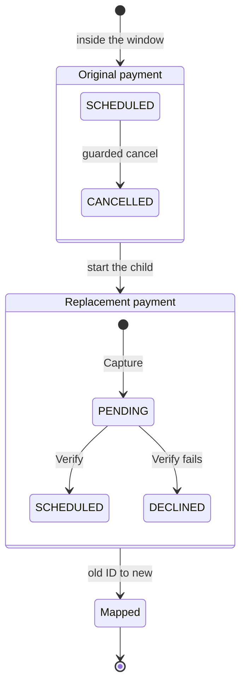

import Lead from '@site/src/components/Lead';
import WorkflowMeta from '@site/src/components/WorkflowMeta';

# Core Workflows

<Lead>Thirteen core workflows, one per journey. Each runs its stages in order and holds no market logic: the stages it looks up from its resolved profile, with their checks and methods, do all the varying.</Lead>

Every stage commits its state change in one guarded `PaymentStore` transaction. Then the workflow announces the change, an RTF lifecycle event and, where the market tells the customer, a Raven message, and waits for that before the next stage, so a payment's events reach RTF in order. Fulfil is the exception: it sends both before its commit, because `PROCESSED` means they have gone out.

The strip under each heading shows the cluster, the workflow ID, what starts the workflow and which behaviors change its stages. [Stages](../stages.md) says what each stage calls, and the [sequence diagrams](../../sequence-diagrams.md) trace the same flows call by call.

## Create Immediate Payment

<WorkflowMeta cluster="Online" id="{paymentId}-init" start="Update-With-Start, from channels" behaviors={['accountType', 'requiresArPosting', 'requiresRealtimeClearing', 'requiresMandateAuthorization']} />

`CreateImmediatePaymentWorkflow` pays a bill today, with Temporal's early-return pattern: the caller waits only until Verify decides, and the same workflow carries on with Execute and Fulfil after the reply.

A composite's child reuses this workflow, started with the composite's decision, so it skips Capture and Verify and runs only Execute and Fulfil ([Composite Workflows](./composite.md), agreed 2026-11-07).

On the Online cluster, the decision's calls run as local activities, inside the worker. Capture, Verify's calls to Payment Instruments, Payment Options and Plans, and Verify's commit all happen in the workflow's first task, so nothing makes a round trip through the Temporal server before the caller has its answer.

1. Capture writes the request, which arrives as the workflow's start input, as `PENDING`, with the idempotency check. Nothing is written before the workflow starts, so the caller's path has no extra database call. A repeated request joins the existing workflow (conflict policy `USE_EXISTING`). One that comes after the workflow has closed starts a new run, and Capture's check decides what it does ([Creates that arrive late or twice](#creates-that-arrive-late-or-twice)).
2. Verify fetches what it needs from Payment Instruments and Payment Options, and from Plans where the profile requires a mandate, runs the verification rules over the answers, then decides `ACCEPTED` or `DECLINED` in one guarded commit, and the caller's update returns here. The announcements for both changes follow the reply, in order.
3. If the payment is `DECLINED`, the workflow sends the `DECLINED` event and message, then ends.
4. Execute moves it to `PROCESSING`: clearing, AR and open-to-buy in parallel. Open-to-buy first fetches the instrument's clear-text details from Payment Instruments, and Fulfil reuses them.
5. Fulfil runs accounting, eBNC, risk, the Transaction Notification Engine (TFNE), the legacy Payments History Database (GPHDB) and B2Notifier in parallel, then sends the RTF event and the Raven message, then commits `PROCESSED`. TFNE and GPHDB are legacy systems that need to know when a payment is processed, and B2Notifier passes the news on to other downstream systems. Comms go last, so the customer hears only once everything else has worked.

A consumer split payment's legs are written by Verify's `ACCEPTED` commit, named `{paymentId}_{seq}`, and each leg runs `ExecuteSplitPaymentWorkflow` as a child on the Online cluster. The parent doesn't clear, because its legs clear on their own. It stays `ACCEPTED`: each leg moves through `PROCESSING` and `PROCESSED` and sends its own RTF event and Raven message, and the parent's workflow ends once every leg has finished (agreed 2026-11-07). Whether the parent sends anything of its own at that point is still open.

### When a consumer payment splits

Most consumer payments never split. A split happens only in a few exceptions (agreed 2026-11-07):

- In Mexico (MX), a payment over 50,000 pesos from a particular set of banks is split into payments of 49,900, 49,800 and so on, each 100 pesos less than the one before.
- A push payment can be split across several card accounts ([Process Inbound Payment](#process-inbound-payment)). It runs on the Offline cluster, and how its legs are chosen and whether its parent clears are still open.

MX's split is a market rule in `market/mx/`, the one market rule today (Proposed, 2026-11-07). It shapes the legs Verify's `ACCEPTED` commit writes, and the last leg takes what remains. Its numbers are rule settings in MX's release, so they change with a release and no deploy:

| Setting | Value | What it does |
| --- | --- | --- |
| `splitThreshold` | `"50000 MXN"` | A payment above it splits |
| `splitBanks` | The banks that split | Matched on the instrument's institution identifier |
| `splitFirstSlice` | `"49900"` | The first leg's amount |
| `splitDecrement` | `"100"` | How much smaller each next leg is |

A corporate payment stops after Verify. Verify's commit also writes an `ALLOC_REQUEST` row, due at once, and the workflow ends after its announcements, with no Execute or Fulfil. Dispatchers take every later step from rows in Oracle, the same way as for a scheduled corporate payment (see [Corporate Allocations](../../corporate-allocations.md)).

A create that has to wait for its customer, for their bank or for their debit card's 3D Secure, runs as [Create Payment Intent](#create-payment-intent) instead.

As soon as Verify has decided, every create workflow calls One-Data's delete API, `DeletePendingPayment.v1`, after the caller's reply and never on its path. For a create One-Data never stored, such as one from Accounts Receivable, the call finds nothing to remove. An inbound payment is not a create: it comes through its own One-Data API and makes no delete. A channel's credit balance refund makes the call too, as a placeholder until One-Data says whether it stores refunds. One-Data drops the stored create and the payment's entry in the card account's pending list, so the customer can make their next payment: while an entry stays, One-Data declines every other create on that account.

## Create Scheduled Payment

<WorkflowMeta cluster="Online / Offline" id="{paymentId}-init" start="Update-With-Start from channels, on Online; the AR intake dispatcher for AR, on Offline" behaviors="all" />

`CreateScheduledPaymentWorkflow` books a payment for a future date, then closes. Nothing waits in Temporal until the due date.

1. Capture, then Verify: `SCHEDULED` or `DECLINED`.
2. The `SCHEDULED` commit writes the `SCHED_EXEC` Work Tracker row, due at the execution time of the payment's market and account type on the due date. The same commit stores the cancel cutoff, worked out from the config version the payment was scheduled on (Proposed, 2026-11-07). A corporate payment gets an `ALLOC_REQUEST` row instead, due at the market's fetch time, and its execution row comes once it is `ALLOCATED`.
3. The caller gets its answer, the `SCHEDULED` event and message go out, and the workflow closes.

A payment Accounts Receivable raises for today takes this path too: it is scheduled, then executes the same day (agreed 2026-11-07). Once that day's run has passed, the scheduled-payments dispatcher's late companion Schedule, every 15 minutes, picks it up (Proposed, 2026-11-08).

It makes the same delete call as [Create Immediate Payment](#create-immediate-payment), once Verify has decided, whether a channel or Accounts Receivable started it. `SCHEDULED` is a decision, so a scheduled payment never keeps the customer from making another payment while it waits.

## Execute Scheduled Payment

<WorkflowMeta cluster="Offline" id="{paymentId}-execute" start="The scheduled-payments dispatcher, or for a corporate payment the allocated-payments dispatcher, through the Router, with today's config" behaviors="all" />

`ExecuteScheduledPaymentWorkflow` runs a scheduled payment on its due date, and every corporate payment once its allocations are in. It checks a scheduled payment again before any money moves, because a lot can change before its date.

1. Reverify: `ACCEPTED` or `DECLINED`. Its guard, `SET status = 'ACCEPTED' WHERE status = 'SCHEDULED'` (or `'ALLOCATED'` for a corporate payment), means a cancel and the execution can never both win. Where the profile requires a mandate, Reverify fetches it from Plans again, and the same rules check it. Where the payment carries an option ID, Reverify calls Payment Options' `ReadPaymentOptions.v1`: if the customer no longer owes money, or the option they picked no longer holds, the payment is `DECLINED`. A Statement Balance or Total Balance payment takes the amount the option gives that day. A corporate payment paid today skips Reverify, because Verify passed it minutes earlier.
2. Execute, then Fulfil, as for pay today.
3. The last commit marks its Work Tracker row, `SCHED_EXEC` or `ALLOC_EXEC`, `DONE`, or `FAILED` when retries run out. That frees a slot under the dispatcher's in-flight cap.

For a corporate payment, Execute clears the parent once, at payment level, and makes no AR or open-to-buy call, because the legs do. Its commit marks the legs released. The leg dispatcher then writes the legs of every stored batch and starts them. There is no Fulfil.

## Execute Split Payment

<WorkflowMeta cluster="Online / Offline" id="{paymentId}_{seq}-execute" start="The parent, for consumer splits; the leg dispatcher, for corporate legs" behaviors={['accountType', 'requiresArPosting', 'requiresRealtimeClearing']} />

`ExecuteSplitPaymentWorkflow` runs one leg of a split payment. Consumer legs run on their parent's cluster; corporate legs run only on the Offline cluster.

1. Execute moves the leg to `PROCESSING` and updates the AR balance and open-to-buy in parallel, open-to-buy once Payment Instruments has returned the clear-text details. Consumer legs also clear, while their parent stays `ACCEPTED`. Corporate legs never clear per allocation; the parent clears once, as a whole, at payment level.
2. Fulfil runs accounting, eBNC, risk, TFNE, GPHDB and B2Notifier, then sends the leg's RTF event and Raven message, then commits `PROCESSED`.

Corporate legs run at priority 2 with the parent's payment ID as fairness key, so one large payment can't starve the others. Each leg turns `PAID` on its own later, once it has posted and its settlement is in: a corporate leg's parent settles once for all its legs, and a consumer leg settles on its own (agreed 2026-11-07).

## Request Allocations

<WorkflowMeta cluster="Offline" id="{paymentId}-allocations" start="The allocation-request dispatcher, at the market's fetch time, or at once for pay today" behaviors="generic" />

`RequestAllocationsWorkflow` runs one stage. RequestAllocations moves the payment to `ALLOCATING` with a guarded update, from `SCHEDULED` or, for pay today, `ACCEPTED`, then asks the allocations manager for the breakdown and ends. No workflow waits for the answer: the allocations manager calls back. From this commit on, a scheduled payment can no longer be cancelled or updated, and a payment cancelled first is never asked about.

## Receive Allocations

<WorkflowMeta cluster="Offline" id="{paymentId}-allocations-{batch}" start="The allocations callback API, with only the payment ID and batch number" behaviors="generic" />

`ReceiveAllocationsWorkflow` checks one callback batch. It writes no legs: every batch waits in `allocation_batch` until the parent's Execute releases them.

1. ReceiveAllocations checks the stored batch. A batch that leaves the amount short changes no state.
2. Once the batches add up to the payment amount, one guarded commit moves the payment to `ALLOCATED` and writes its `ALLOC_EXEC` row: due at once for pay today, or at the execution time on the due date for a scheduled payment (at once, if that time has passed).

## Update Payment

<WorkflowMeta cluster="Online" id="{paymentId}-update" start="Update-With-Start" />

`UpdatePaymentWorkflow` changes a scheduled payment. Nothing is edited in place: the original is cancelled and a replacement is created, so every payment record stays as it was written.

1. Check the cancel cutoff stored with the payment, and its eligibility, with read-only calls. The cutoff was worked out from the config version the payment was scheduled on, so a later config change doesn't move it (Proposed, 2026-11-07).
2. Cancel the old payment with the guarded update. If it is no longer `SCHEDULED`, the answer is 409. A corporate payment leaves `SCHEDULED` when its allocations are requested.
3. Map the old and new payment IDs in `ORIG_TRANS_REFER_MAP`, before the new payment starts, so a retry after a crash finds the replacement (Proposed, 2026-11-07).
4. Start the new payment as child `CreateScheduledPaymentWorkflow` `{newId}-init`, with the same confirmation number. Its result is the caller's answer. The replacement is future-dated only (Proposed).

Two payments are in play at once, which is easier to see drawn:

## Cancel Payment

<WorkflowMeta cluster="Online" id="{paymentId}-cancel" start="Update-With-Start" behaviors={['accountType', 'requiresArPosting']} />

`CancelPaymentWorkflow` withdraws a `SCHEDULED` payment inside the market's cancellation window. A corporate payment can be withdrawn only until its allocations are requested, when it moves to `ALLOCATING`.

1. Check the stored cancel cutoff and eligibility with read-only calls.
2. Cancel: one guarded update to `CANCELLED`. The same commit cancels the payment's Work Tracker rows. The `CANCELLED` event and message go out after the reply.
3. If the update changes no row and the payment is already `CANCELLED`, the API returns that result again. Otherwise the answer is 409, which is what a corporate payment gets once it is `ALLOCATING`.

A `PENDING` payment that waits for its customer isn't cancelled here. [Create Payment Intent](#create-payment-intent) ends it itself: it cancels it on the customer's no or when a debit card's window closes, and declines a bank payment whose wait ends with no confirm and no settled notice.

## Process Returned Payment

<WorkflowMeta cluster="Offline" id="{paymentId}-return-{seq}" start="The returns dispatcher, from One-Data's inbox" behaviors="all" />

`ProcessReturnedPaymentWorkflow` handles a payment the bank sends back, and queues another attempt when one makes sense. Each attempt is a [presentment](../../payment-state-model.md#presentments) with its own row, and `{seq}` here is the one that came back.

1. Check the payment, full or split, the presentment that came back, and its status. The eligible statuses are `PROCESSING`, `PROCESSED`, `PAID`, and `REPRESENTED` for a payment returned again.
2. Return: that presentment's row turns `RETURNED` and stays there. The commit is guarded on the status the workflow read and on that presentment, so if Settle moves the payment to `PAID` in between, the workflow reads again and tries once more, up to three times. A return Billpay can't apply, such as one for a presentment still `ACCEPTED`, goes on the exception list. The return's reason, source and effective date go in the `RETURNED` timeline row (Proposed, 2026-11-07).
3. Judge whether the return can be represented. The market's release holds the rules as a `representment` block: the return reasons that can be represented, the most times a payment can be, and `delayDays` (agreed 2026-11-07). A return can be represented when its reason is listed and the payment has been represented fewer times than the limit. A release with no block represents nothing. The representment date is the day the return arrives, in the market's time zone, plus `delayDays`, so 0 is the same day.
4. QueueRepresentment writes the next presentment as a new row, numbered one higher, in `REPRESENTING`, with that date as its clearing date and a `REPRESENT` Work Tracker row due at the start of it, so a same-day representment is due at once (Proposed). A return never hands off to a representment workflow directly.

Only a whole payment is represented, never a leg (agreed 2026-11-07). A corporate payment is represented as a whole, at the parent, and a returned consumer split leg stays `RETURNED`.

## Process Representment

<WorkflowMeta cluster="Offline" id="{paymentId}-represent-{seq}" start="The representment dispatcher, on the representment date" behaviors="all" />

`ProcessRepresentmentWorkflow` sends a returned payment's next presentment to the bank, and `{seq}` is that presentment's number. Represent rechecks eligibility before anything goes to clearing, with checks of its own that are still to be defined, then commits `REPRESENTED`, or `DECLINED` if the recheck fails and nothing is sent. Until its checks exist, the recheck passes, and the new presentment clears in the batch with the idempotency key `{paymentId}-represent-{seq}` (Proposed, 2026-11-07). How QueueRepresentment and Represent should vary by account type and behavior isn't decided, so every combination runs the default stage for now (agreed 2026-11-07).

## Process Inbound Payment

<WorkflowMeta cluster="Offline" id="{paymentId}-init" start="The inbound dispatcher, from One-Data's inbox" behaviors="all" />

`ProcessInboundPaymentWorkflow` takes a push payment: one a third party sends in. It runs Capture, then Verify (`ACCEPTED` or `DISALLOWED`), then Execute, clearing in the batch (Proposed), and Fulfil. A push payment is the only kind that can end `DISALLOWED`. It makes no One-Data delete, since an inbound payment never enters a channel's pending list.

One inbound payment can be split across several card accounts, each leg running `ExecuteSplitPaymentWorkflow` (agreed 2026-11-07). Two things are still open: what decides the legs, meaning which card accounts and how much each, and whether the parent clears or leaves clearing to its legs.

## Create Payment Intent

<WorkflowMeta cluster="Online" id="{paymentId}-init" start="Update-With-Start, from channels; the confirm, from the channel or Amex Pay with Bank Transfer, and the no arrive as updates, and so does the card provider's 3D Secure callback; M3's settled notice arrives as a signal" behaviors={['accountType', 'requiresArPosting', 'requiresRealtimeClearing', 'requiresMandateAuthorization', 'requiresBankConfirmation']} />

`CreatePaymentIntentWorkflow` runs a payment that has to wait for its customer: for their bank, when `requiresBankConfirmation` resolves to Y; or for their debit card's 3D Secure, whenever they pay by debit card. One workflow holds the whole wait, from the create to the payment's end, so its history in the Temporal UI tells the payment's whole story.

1. Capture writes `PENDING`. Amex's own checks come next, before the bank step or 3D Secure: Verify's Instrument, Options and Mandate checks that apply, in the same first task. A payment that fails them is `DECLINED` there and then, with no link, and the caller gets `DECLINED`. One that passes stays `PENDING`, and nothing is committed. For bank confirmation, RequestConfirmation then asks Amex Pay with Bank Transfer for the redirect link, with one try that has Verify's 1.2 seconds (Proposed), and stores it on the payment. Billpay talks to no market's provider directly: Amex Pay with Bank Transfer works with each one, Plaid in the US among them. The caller's update returns `PENDING` with the link, and the `PENDING` event goes out. If no link comes back, or an answer without one, the payment is `DECLINED` there and then with `CONFIRMATION_UNAVAILABLE` (Proposed), and the caller gets `DECLINED`. The reply carries the link as `confirmationUrl` (Proposed). For a debit card, RequestConfirmation starts 3D Secure with the market's card provider and gives it Billpay's callback URL, the setting `billpay.card.callback-base-url` plus `/payments/{payment-id}/authentication` (Proposed); the reply carries the challenge link, or no link when the card's bank needs no challenge (Proposed).
2. The workflow waits on a timer for the market's window plus a grace of 10 seconds, so an answer sent at the last moment still lands. For a bank the window is the market's wait, 24 to 48 hours; for a debit card it is 2 minutes.
3. For a bank, the confirm comes from the channel or from Amex Pay with Bank Transfer, the PISP (Payment Initiation Service Provider) interface, which calls billpay-online directly. Each carries the bank's answer, and both arrive as the same update, so whichever lands first decides and the second gets the same answer. Verify commits `ACCEPTED` or `DECLINED` on the answer, guarded on `PENDING`, and calls nothing: once the bank has confirmed, there is no Payment Instruments token check and no funds check. The confirm's reply carries the decision, the same early return as the create's. For a debit card, the card provider's callback brings the 3D Secure result instead. A failed result is `DECLINED`. Otherwise Verify only authorizes the payment with the card provider (Proposed): the authorization debits the customer's account if it holds enough money, and the card's bank declines it if not.
4. An `ACCEPTED` bank payment waits once more, for M3. When the bank settles the payment in real time it tells Amex, and M3 intercepts the message and calls billpay-online, which signals the workflow. If M3's notice arrives before any confirm, Verify accepts the payment on it, and the workflow logs that no confirm came for that payment ID. If the notice never comes, the payment goes on the exception list with an alert; how long the workflow waits for it is still open.
5. Execute, then Fulfil, as for pay today, in the same workflow: for a bank once M3's notice is in, for a debit card at once. Execute makes no clearing call for either, because their money has already moved. For a debit card it creates the payment's settlement event, keyed `{paymentId}-settlement`, and hands it to One-Data, dated when the money moved (Proposed). For a bank, M3's notice is the settlement. No corporate payment runs here: corporate payments take neither bank confirmation nor a debit card. Every payment this workflow runs is paid today.

The customer's no is an update too. Cancel moves the payment from `PENDING` to `CANCELLED`, with no window check. A yes and a no from two browser tabs are two updates to one workflow, so the first one it accepts wins and the other gets 409. When the timer fires with no answer, a bank payment is `DECLINED` with `CONFIRMATION_NOT_RECEIVED` (the code is Proposed), and a debit card payment is cancelled; either way RTF gets the event and the customer the message through Raven. The workflow never ends by a terminate or a timeout, because either would leave the payment `PENDING` with nobody told.

The confirm and the no are updates rather than signals because a signal can't answer the caller, and the channel needs the decision in the confirm's reply. The 3D Secure callback is an update for the same reason: the card provider calls billpay-online directly, at `POST /payments/{payment-id}/authentication` (Proposed), not through One-Data, and gets the decision back. M3's settled notice is the one signal: M3 needs no answer from the workflow, only a 202 from billpay-online. Billpay authenticates the calls that come straight to billpay-online by mutual TLS (Proposed). An update can also be turned away before anything is written: a no or a callback once the workflow no longer waits gets 409.

A timer handled late, because the Online cluster or its workers were down, ends the payment as an on-time timer does. There is no extra window: it was there for a confirm One-Data held during an outage, and One-Data holds no confirm now. A confirm sent while billpay-online was slow got 503, and the customer confirms again (agreed 2026-11-08, [Stored creates and the pending check](../../../build/api-spec/one-data.md#stored-creates-and-the-pending-check)).

Each update carries a fixed ID, `{paymentId}-confirm`, `{paymentId}-no` or `{paymentId}-authentication` (Proposed), so a repeat whose reply was lost attaches to the same update and gets the same answer. A confirm that comes after the payment was decided another way, or after the workflow has closed, gets the payment's current state, such as `PROCESSED` or `DECLINED`, so the channel never shows a failure for a payment that went through. Only a confirm for a payment the customer said no to gets 409. A yes, or M3's notice, that comes after the payment was declined means money moved on a declined payment: for now it goes on the exception list with an alert, and the answer is still open.

The workflow calls One-Data's delete API once, as soon as the payment is decided, or at the create when it is declined there. Until then the payment stays on the account's pending list, so the customer can't make another payment while it waits: up to 2 minutes for a debit card, and up to the market's 24 to 48 hours for a bank. A US payment confirmed through Plaid works the same way.

## Create Balance Refund

<WorkflowMeta cluster="Online / Offline" id="{paymentId}-init" start="Update-With-Start from channels, on Online; the AR intake dispatcher for refunds AR raises, on Offline" />

`CreateBalanceRefundWorkflow` refunds a credit balance. It follows the payment path, Capture, Verify, Execute and Fulfil, but its detailed steps are still being defined.

## Creates that arrive late or twice

A create can reach billpay-online more than once, or late. One-Data holds it while billpay-online is slow, other than a Pay with Bank Transfer, Plaid or debit card create, and RTF retries it ([Stored creates and the pending check](../../../build/api-spec/one-data.md#stored-creates-and-the-pending-check)). Every try carries the same payment ID.

- A repeat that arrives while `{paymentId}-init` runs joins it (conflict policy `USE_EXISTING`).
- A repeat that arrives after the run has closed starts a new run, under the default reuse policy. Capture's idempotency check finds the payment. If it is still `PENDING` with nothing waiting on it, because the last run died before deciding, the new run carries on with the next stage, so the payment isn't stuck. Otherwise the run returns the payment as it stands and ends, so no stage runs twice. A payment that waits for a confirmation comes back with its redirect or challenge link. Workflows and activities are idempotent, so this needs no special reuse policy.
- Nothing is declined for arriving late. One-Data stamps each create with the customer's submit date, which is the payment date. A scheduled payment that lands on its date runs that day as pay today. One that lands after its date runs when it lands and keeps its scheduled date. A payment whose amount Verify works out uses the balance as of the submit date, if Payment Options can give a balance as of a past date.
- A held create that arrives after its market was taken out of service is captured and declined, so the customer is told and the delete still runs. The Router starts its workflow with a resolved profile that only captures and declines, and Verify declines it with `MARKET_OUT_OF_SERVICE`, a placeholder code like the others (Proposed, 2026-11-07).
