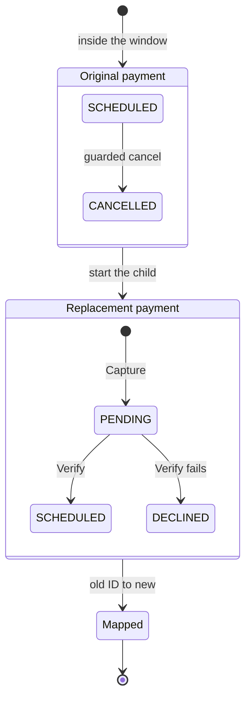

import Lead from '@site/src/components/Lead';
import WorkflowMeta from '@site/src/components/WorkflowMeta';

# Core Workflows

<Lead>Thirteen core workflows, one per journey. Each runs its stages in order and holds no market logic: the stage implementations it looks up from its plan key do all the varying.</Lead>

Every stage commits its state change in one guarded `PaymentStore` transaction. Then the workflow announces the change, an RTF lifecycle event and, where the customer is told, a Raven message, and waits for that before the next stage, so a payment's events reach RTF in order. Fulfil is the exception: it sends both before its commit, because `PROCESSED` means they have gone out.

The strip under each heading shows the cluster, the workflow ID, what starts the workflow and which behaviors change its stages. [Stages](../stages.md) says what each stage calls, and the [sequence diagrams](../../sequence-diagrams.md) trace the same flows call by call.

## Create Immediate Payment

<WorkflowMeta cluster="Online" id="{paymentId}-init" start="Update-With-Start, from channels" behaviors="all" />

`CreateImmediatePaymentWorkflow` pays a bill today. The caller waits only until Verify decides.

1. Capture writes `PENDING`, with the idempotency check. A repeated request joins the existing workflow (conflict policy `USE_EXISTING`).
2. Verify decides `ACCEPTED` or `DECLINED` in one guarded commit, and the caller's update returns here. The announcements for both changes follow the reply, in order.
3. If the payment is `DECLINED`, the workflow sends the `DECLINED` event and message, then ends.
4. Execute moves it to `PROCESSING`: clearing, AR and open-to-buy in parallel.
5. Fulfil runs accounting, eBNC and risk in parallel, then sends the RTF event and the Raven message, then commits `PROCESSED`. Comms go last, so the customer hears only once everything else has worked.

A consumer split payment's commit also writes its legs, and each leg runs `ExecuteSplitPaymentWorkflow` as a child on the Online cluster.

A corporate payment takes a different path after Verify. Verify's commit also writes the `ALLOC_REQUEST` row and marks the legs released, so each batch's legs are written as soon as it arrives. Execute clears at payment level, and there is no Fulfil: the parent completes through the leg dispatcher (see [Corporate Allocations](../../corporate-allocations.md)).

## Create Scheduled Payment

<WorkflowMeta cluster="Online / Offline" id="{paymentId}-init" start="Update-With-Start from channels, on Online; the AR intake dispatcher for AR, on Offline" behaviors="all" />

`CreateScheduledPaymentWorkflow` books a payment for a future date, then closes. Nothing waits in Temporal until the due date.

1. Capture, then Verify: `SCHEDULED` or `DECLINED`.
2. The `SCHEDULED` commit writes the `SCHED_EXEC` Work Tracker row, due at the market's execution time on the due date, plus an `ALLOC_REQUEST` row for a corporate payment.
3. The caller gets its answer, the `SCHEDULED` event and message go out, and the workflow closes.

## Execute Scheduled Payment

<WorkflowMeta cluster="Offline" id="{paymentId}-execute" start="The scheduled-payments dispatcher, through the Router, with today's config" behaviors="all" />

`ExecuteScheduledPaymentWorkflow` runs on the due date. It checks the payment again before any money moves, because a lot can change in 30 days.

1. Reverify: `ACCEPTED` or `DECLINED`. Its guard, `SET status = 'ACCEPTED' WHERE status = 'SCHEDULED'`, means a cancel and the execution can never both win.
2. Execute, then Fulfil, as for pay today.
3. The last commit marks the `SCHED_EXEC` row `DONE`, or `FAILED` when retries run out. That frees a slot under the dispatcher's in-flight cap.

For a corporate payment, Reverify's commit marks the legs released, and the leg dispatcher writes the legs of the batches that arrived while the payment waited. Execute clears at payment level, and there is no Fulfil.

## Execute Split Payment

<WorkflowMeta cluster="Online / Offline" id="{paymentId}_{seq}-execute" start="The parent, for consumer splits; the leg dispatcher, for corporate legs" behaviors={['accountType', 'requiresArPosting', 'requiresRealtimeClearing']} />

`ExecuteSplitPaymentWorkflow` runs one leg of a split payment. Consumer legs run on their parent's cluster; corporate legs run only on the Offline cluster.

1. Execute updates the AR balance and open-to-buy in parallel. Consumer legs also clear. Corporate legs never clear per allocation; the parent clears once, as a whole, at payment level.
2. Fulfil runs accounting, eBNC and risk, then sends the leg's RTF event and Raven message, then commits `PROCESSED`.

Corporate legs run at priority 2 with the parent's payment ID as fairness key, so one large payment can't starve the others. Each leg turns `PAID` on its own later, once it has posted and its parent has settled.

## Request Allocations

<WorkflowMeta cluster="Offline" id="{paymentId}-allocations" start="The allocation-request dispatcher, at the market's fetch time" behaviors="generic" />

`RequestAllocationsWorkflow` runs one stage. RequestAllocations sets the allocation status to `ALLOCATING` with a guarded update, asks the allocations manager for the breakdown, and ends. No workflow waits for the answer: the allocations manager calls back. From this commit on, the payment can no longer be cancelled or updated, and a payment cancelled first is never asked about.

## Receive Allocations

<WorkflowMeta cluster="Offline" id="{paymentId}-allocations-{batch}" start="The allocations callback API, with only the payment ID and batch number" behaviors="generic" />

`ReceiveAllocationsWorkflow` turns one callback batch into legs.

1. ReceiveAllocations checks the stored batch. If the parent is `ACCEPTED`, or further on, it writes each allocation as a leg, `{paymentId}_{seq}`, in `ACCEPTED`, in 1,000-row array inserts, each with a `SCHEDULED` `ALLOC_LEG` Work Tracker row. If the parent is still `SCHEDULED`, the batch waits in `allocation_batch`, and the leg dispatcher writes it once the parent is accepted.
2. The allocation status turns `ALLOCATED` once the batches add up to the payment amount.

## Update Payment

<WorkflowMeta cluster="Online" id="{paymentId}-update" start="Update-With-Start" />

`UpdatePaymentWorkflow` changes a scheduled payment. Nothing is edited in place: the original is cancelled and a replacement is created, so every payment record stays as it was written.

1. Check the cancellation window and eligibility with read-only calls.
2. Cancel the old payment with the guarded update. If it is no longer `SCHEDULED`, or it is a corporate payment whose allocations have been fetched, the answer is 409.
3. Start the new payment as child `CreateScheduledPaymentWorkflow` `{newId}-init`, with the same confirmation number. Its result is the caller's answer.
4. Map the old and new payment IDs in `ORIG_TRANS_REFER_MAP`.

Two payments are in play at once, which is easier to see drawn:

## Cancel Payment

<WorkflowMeta cluster="Online" id="{paymentId}-cancel" start="Update-With-Start" behaviors={['accountType', 'requiresArPosting']} />

`CancelPaymentWorkflow` withdraws a `SCHEDULED` payment inside the market's cancellation window. A corporate payment can be withdrawn only until its allocations are fetched.

1. Check the window and eligibility with read-only calls.
2. Cancel: one guarded update to `CANCELLED`. The same commit cancels the payment's Work Tracker rows. The `CANCELLED` event and message go out after the reply.
3. If the update changes no row and the payment is already `CANCELLED`, the API returns that result again. Otherwise the answer is 409. For a corporate payment the guard also requires allocation status `NONE`, so a cancel after the fetch changes nothing and gets 409.

## Process Returned Payment

<WorkflowMeta cluster="Offline" id="{paymentId}-return-{seq}" start="The returns dispatcher, from One-Data's inbox" behaviors="all" />

`ProcessReturnedPaymentWorkflow` handles a payment the bank sends back, and queues another attempt when one makes sense.

1. Check the payment, full or split, and its current status. The eligible statuses are `PROCESSING`, `PROCESSED`, `PAID`, and `REPRESENTED` for a payment returned again.
2. Return: `RETURNED`.
3. Judge whether the return can be represented, and set the representment date from the market's rules: today or later.
4. QueueRepresentment commits `REPRESENTING` with a `REPRESENT` Work Tracker row due on that date. A return never hands off to a representment workflow directly.

## Process Representment

<WorkflowMeta cluster="Offline" id="{paymentId}-represent-{seq}" start="The representment dispatcher, on the representment date" behaviors="all" />

`ProcessRepresentmentWorkflow` presents a returned payment again. Represent rechecks eligibility before anything goes to clearing, then commits `REPRESENTED`, or `DECLINED` if the recheck fails.

## Process Inbound Payment

<WorkflowMeta cluster="Offline" id="{paymentId}-init" start="The inbound dispatcher, from One-Data's inbox" behaviors="all" />

`ProcessInboundPaymentWorkflow` takes a payment a third party pushed. It runs Capture, then Verify (`ACCEPTED` or `DISALLOWED`), then Execute and Fulfil.

## Create Payment Intent

<WorkflowMeta cluster="Online" id="{paymentId}-init" start="Update-With-Start" />

`CreatePaymentIntentWorkflow` records an intent to pay. The payment is processed only when the customer's financial institution confirms it. Its detailed steps are still being defined.

## Create Balance Refund

<WorkflowMeta cluster="Online / Offline" id="{paymentId}-init" start="Update-With-Start from channels, on Online; the AR intake dispatcher for refunds AR raises, on Offline" />

`CreateBalanceRefundWorkflow` refunds a credit balance. It follows the payment path, Capture, Verify, Execute and Fulfil, but its detailed steps are still being defined.
