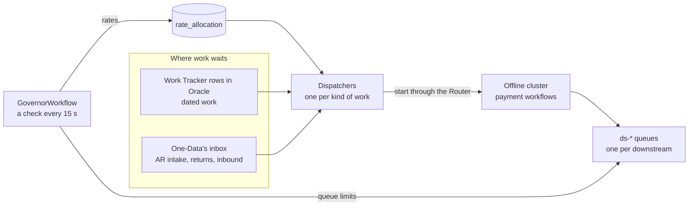
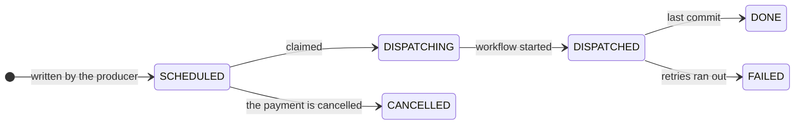

import Lead from '@site/src/components/Lead';

# Pacing

<Lead>A million US payments fall due at midnight, and returns can arrive at 100 a second. Most of that work doesn't need to run the moment it lands. Pacing is how it waits outside Temporal, then flows in at a rate the system can carry, without ever slowing down a customer who is waiting.</Lead>

The design rests on one rule: pace at the door. Big bursts never wait inside Temporal. Work that is due later waits in Oracle, work nobody is waiting for waits in One-Data's inbox, and dispatchers let it into the Offline cluster at a rate the governor resets every 15 seconds.

## The Work Tracker

One narrow table in Oracle, `work_tracker`, holds every piece of dated work. A row is written in the same commit as the state change that creates it, so a scheduled payment and its row can never disagree. Its primary key is a business key such as `exec:{paymentId}`, so a retried insert can't create duplicate work. The columns are listed on [Build → Database](../build/database.md).

| Type | One row per | Due at | Started by |
| --- | --- | --- | --- |
| `SCHED_EXEC` | Scheduled payment, corporate parents included | The market's execution time on the due date | Scheduled-payments dispatcher |
| `ALLOC_REQUEST` | Corporate payment | Its fetch time | Allocation-request dispatcher |
| `ALLOC_LEG` | Allocation leg | When the leg is written, never before its parent is `ACCEPTED` | Leg dispatcher |
| `REPRESENT` | Representment | The date the market's rules set | Representment dispatcher |

A row moves through a short lifecycle:

| Status | Set by |
| --- | --- |
| `SCHEDULED` | The producer, in the same commit as the domain row. For a leg, that is `ReceiveAllocationsWorkflow` or the leg dispatcher's release, whichever writes it |
| `DISPATCHING` | The dispatcher's claim |
| `DISPATCHED` | The dispatcher, after a successful start |
| `DONE` or `FAILED` | The workflow's last commit |
| `CANCELLED` | `CancelPaymentWorkflow`, in the commit that cancels the payment |

Workflow IDs aren't stored: each one is the payment ID plus its suffix. No row waits on another: a leg is written only once its parent is `ACCEPTED`, so its row starts `SCHEDULED`. Daily partitions are dropped 15 days after they fall due, so finished rows never pile up.

## Dispatchers

There is one dispatcher per kind of work. Each releases its work into Temporal at the governor's rate, spread evenly, through the Router. Each has its own Schedule, its own control queue and its own budget, so one kind of work can never hold up another.

| Dispatcher | Claims | Runs | Starts |
| --- | --- | --- | --- |
| Scheduled payments, one per market per day | `SCHED_EXEC` rows due in that market | A Schedule at the market's execution time; drains, sweeps stragglers, then ends | `ExecuteScheduledPaymentWorkflow` |
| Allocation requests | `ALLOC_REQUEST` rows at their fetch time | A Schedule every minute | `RequestAllocationsWorkflow` |
| Allocation legs | `ALLOC_LEG` rows, fair across parents | A Schedule every minute | `ExecuteSplitPaymentWorkflow` |
| Representments, one per market | `REPRESENT` rows due | A Schedule every few minutes | `ProcessRepresentmentWorkflow` |
| AR intake | `READY` AR requests in One-Data's inbox, payments and refunds | A Schedule every minute | `CreateScheduledPaymentWorkflow`, `CreateBalanceRefundWorkflow` |
| Returns | `READY` returns in One-Data's inbox | A Schedule every minute | `ProcessReturnedPaymentWorkflow` |
| Inbound | `READY` inbound payments in One-Data's inbox | A Schedule every minute | `ProcessInboundPaymentWorkflow` |

### One tick

A dispatcher run is a loop of ticks, each about 20 seconds of work at the current rate.

1. The tick size is the allowed rate times 20 seconds. At 50 TPS that is 1,000 items.
2. One activity, `claimAndStart`, runs on the dispatcher's control queue. It claims up to that many rows as `DISPATCHING`, stamped with the run ID. It starts one workflow per row through the Router and a token bucket (50 TPS is one start every 20 ms). Every 50 or so starts it re-reads the allowed rate and checks the in-flight count. It heartbeats its position every 2 to 3 seconds, including while it waits on the cap or the bucket. At the end it marks the rows `DISPATCHED` and returns the counts.
3. The workflow adds up the counts and loops. An empty claim triggers a sweep of this run's `DISPATCHING` rows, and then the run ends.
4. The run continues-as-new whenever the SDK suggests it.

Each start sets the deterministic workflow ID, reuse policy `REJECT_DUPLICATE`, the task queue, the priority and fairness keys, and the search attributes.

### The inbox dispatchers

The AR intake, returns and inbound dispatchers run the same tick against One-Data's inbox. `ReadStartRequests.v1` takes the place of the claim, and `UpdateStartRequests.v1` marks the requests `DONE` once they have started, or `REJECTED` when the Router can't admit them. Nothing needs claiming, because each of these dispatchers has one run at a time (overlap SKIP) and a repeated start counts as done. The workflow ID comes from the request itself.

They have no in-flight cap, because no Work Tracker row counts their work. The governor's rate paces them instead, and it drops to zero while RTF calls fail or a downstream they call is out.

### Backpressure

The Work Tracker dispatchers cap their in-flight work, and the reason is a little arithmetic. In-flight work equals rate times the time each payment takes. At 50 TPS and 6 seconds a payment, about 300 payments are open at once. If a downstream slows to 30 seconds a call, that becomes 1,500 and keeps climbing, and every one of them is history rows in the Offline database.

With a cap, the activity waits instead, and the real rate settles at the cap divided by the time per payment: 1,000 ÷ 30 s is about 33 TPS. The execution cap starts at 1,000 and is tuned in the load test.

### Changing the rate

The activity reads its row in `rate_allocation` every few seconds, so a new rate takes effect within seconds, with no signals and no extra workflow history. Operators can override the governor (pause, resume, or cap the rate) by writing a row in `rate_allocation` through an ops API, and an override always wins. Pausing a Schedule stops new runs too.

### Crash safety

A worker that dies mid-tick trips the 10-second heartbeat timeout, and the retried activity resumes from its last heartbeat. A repeated start fails as already started and counts as done, and `REJECT_DUPLICATE` stops a second execution. Rows that were claimed but never started are caught by the sweep, or by the next run.

### The leg dispatcher's two extra jobs

- Release. Once a parent payment is marked released, the leg dispatcher writes the legs of every batch that arrived for it before then, 1,000 rows at a time, heartbeating its position as it goes. A batch is written once, whether the release or its own `ReceiveAllocationsWorkflow` gets to it first.
- Completion. Every 60 seconds it counts legs by status for parents in `PROCESSING`. Once a parent is `ALLOCATED`, every batch has its legs, and every leg is `PROCESSED` or `PAID`, it sends the parent's RTF event and Raven message, then moves the parent to `PROCESSED`.

### What it costs

A tick costs about 5 Temporal writes. Releasing a million payments at 50 TPS takes about 1,000 ticks, so about 5,000 writes in all, against the millions the payments themselves write. One activity can issue a few hundred starts a second. Past that, a dispatcher splits into lanes, each owning a hash bucket of `ref_id` at the rate divided by the number of lanes.

## Execution windows

| Window | Starts (UTC, winter) | Starts (local) | Volume | Cutoff | Rate needed |
| --- | --- | --- | --- | --- | --- |
| SEPA (DE, IT) | 23:00 | Midnight CET, 6 PM ET | Up to 500K | 3 to 4 hours | 46 TPS for 3 hours; the governor aims at about 56 |
| US | 05:00 | Midnight ET | Up to 1M | None | 50 TPS floor (5.6 hours); 100 TPS takes 2.8 hours |

In summer both windows start an hour earlier in UTC. They never overlap, so one Offline cluster serves them in turn, and the US window sets its size. SEPA runs during the US evening, which makes it the window most likely to be slowed down to protect online traffic. Its floor is there for its cutoff: it aims to finish the run 30 minutes early, but online traffic still comes first.

## The governor

`GovernorWorkflow` sets every offline rate every 15 seconds. It raises rates slowly while every signal is healthy, cuts fast when any of them degrades, and hands the budget out by priority.

### The signals, where the worst one wins

| Signal | Raise if | Hold if | Cut if |
| --- | --- | --- | --- |
| Offline Aurora CPU (Enhanced Monitoring, 1 to 5 s) | Under 50% | 50 to 60% | Over 60% |
| Offline persistence p99 | Under 1.5× baseline | 1.5 to 2× | Over 2× |
| Offline schedule-to-start | Flat | Rising | Rising for a minute |
| Online p99 (`POST /payments`, SLO 500 ms) | Under 70% of the SLO | 70 to 90% | Over 90% |
| Oracle commit latency and errors | Near baseline | Rising | Over 2× baseline, or errors |

CPU over 70%, or online p99 over its SLO, halves the budget outright. Persistence p99 is the fastest honest signal of database strain; the standard per-minute CloudWatch CPU is too slow to steer by. The load test sets the final bands, and the hold band sits just below the knee where persistence p99 starts to climb.

### The budget

- Raise by 5%, but only after two calm checks in a row, because the metrics lag by about 30 seconds. Cut by multiplying by 0.8.
- The budget is in Temporal writes per second, not workflow starts, because the database is the constraint. Each class is charged its measured cost per workflow: about 45 writes for a scheduled execution, 30 for a leg, 20 for a return.
- The PAID drain costs only about 20 Temporal writes per batch of 500 payments, but its weight falls on Oracle instead. So its rate is in payments a second, and the Oracle signals cut it first.
- The ceiling is the writes per second the load test measured at 60% CPU.

### Handing it out, in order

1. Online first. If online p99 or the shared Oracle degrade, every offline class is cut, execution included.
2. The SEPA cutoff floor: remaining payments ÷ (time left − 30 minutes), for each SEPA market in its window, so the run finishes 30 minutes before its cutoff.
3. The US execution floor: 50 TPS.
4. AR intake: its demand, the requests waiting in One-Data's inbox.
5. The rest by priority, up to demand: SEPA and US execution above their floors, then corporate (split evenly across the active corporate payments), then inbound, then representments, then returns, and the PAID drain last.

Every class is also capped by the downstream systems it calls (see [Throttling](./throttling.md)). The inbox dispatchers have no in-flight cap, so while RTF calls fail or a downstream they call is out, they get no rate at all.

### The cutoff alert

Projected finish = now + remaining ÷ current rate. The governor alerts when that passes the cutoff minus 15 minutes, or when the floor no longer fits in the budget, which gives operations time to raise a downstream limit or set a rate override.

### Guardrails

- If metrics go missing, the governor holds its rates. Still missing after 5 minutes, it drops to the floors.
- If the governor itself stops, dispatchers fall back to their floors once `rate_allocation` is 5 minutes stale.
- Manual overrides always win.
- Every decision goes to `governor_decision` with its inputs, so any rate can be explained later.

The governor runs as the workflow `governor` on the Offline cluster, and a Schedule with overlap policy SKIP starts it again if it isn't running. One activity per check reads Prometheus and Oracle, then writes `rate_allocation`, the downstream queue limits (only when they change) and the decision row. It continues-as-new every hour and costs about 20 Temporal writes a minute.
