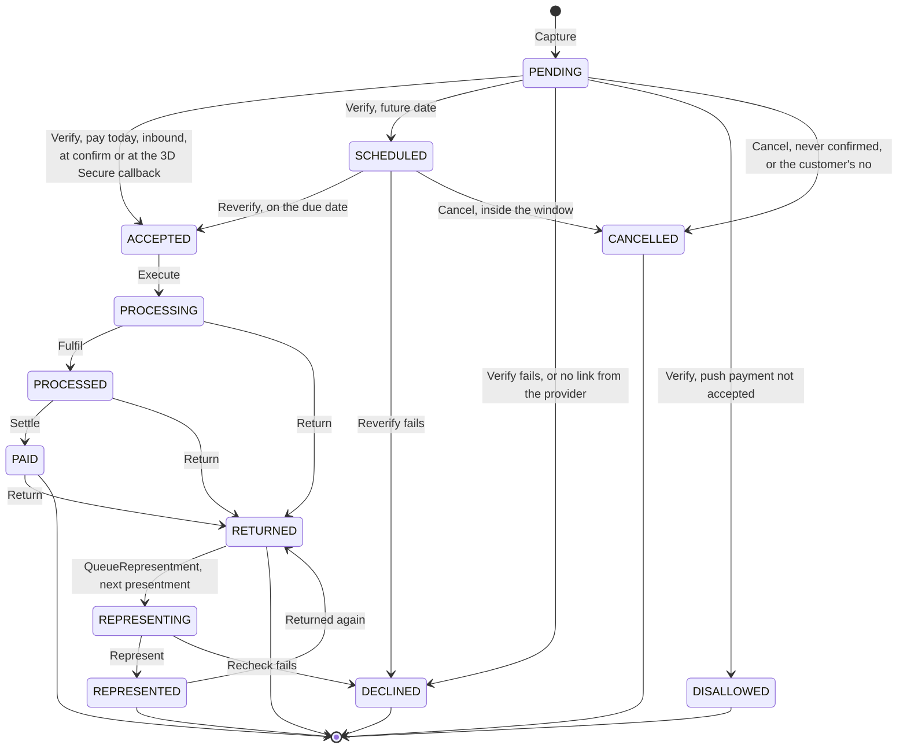
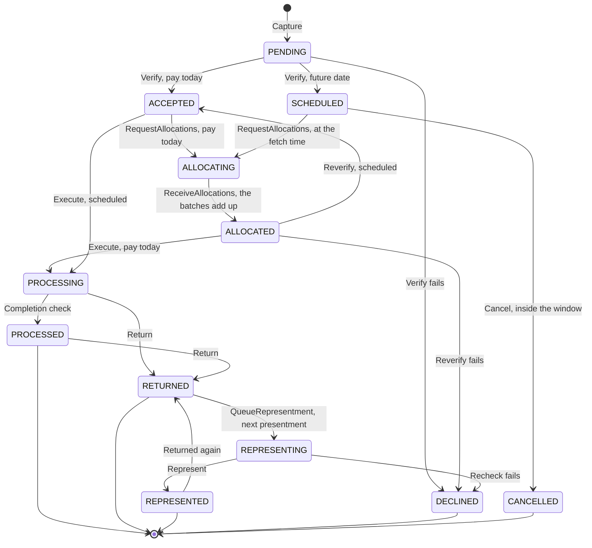

import Tabs from '@theme/Tabs';
import TabItem from '@theme/TabItem';
import Lead from '@site/src/components/Lead';
import StateLegend from '@site/src/components/StateLegend';

# Payment State Model

<Lead>Every payment, consumer or corporate, moves through one set of states, and a status changes only through a guarded update in Oracle. Each state means the same thing in every market, so reporting, operations and downstream systems can read any payment the same way.</Lead>

## The lifecycle

Each arrow is a move one stage makes, and the label names the stage. Consumer and corporate payments share one set of states. A corporate payment adds two, `ALLOCATING` and `ALLOCATED`, while its allocations are fetched, and the toggle shows the path each kind takes. A payment that waits for a date spends that time as `SCHEDULED`, a row in Oracle with nothing running in Temporal. A payment that waits for the customer, to confirm at their bank or to authenticate their debit card, stays `PENDING`, with its own workflow waiting on a timer, until the caller confirms it, the card provider calls back, the customer says no, or the window closes.

`PENDING` also blocks the card account. While one payment on it is `PENDING`, One-Data declines any new create from a channel before Billpay sees it. The block lifts as soon as the payment is decided, whichever of `ACCEPTED`, `SCHEDULED`, `DECLINED` or `CANCELLED` it reaches, because billpay-core then calls One-Data's delete API.

<Tabs groupId="payment-type" className="toggle-tabs">
<TabItem value="consumer" label="Consumer" default>



</TabItem>
<TabItem value="corporate" label="Corporate">



A corporate payment fetches its allocations before it moves money. Paid today, it asks right after `ACCEPTED`. Scheduled, it asks at the market's fetch time and is reverified once `ALLOCATED`. The parent clears once and reaches `PROCESSED` through the leg dispatcher's completion check instead of Fulfil, and stays there: its legs turn `PAID`, never the parent. [Corporate payments](#corporate-payments) below has the rules.

</TabItem>
</Tabs>

<StateLegend />

There is no path from `ACCEPTED` to `CANCELLED`. Once a payment has left `SCHEDULED` it can no longer be cancelled, and a corporate payment leaves it when its allocations are requested.

## What each state means

| State | Meaning | Terminal? |
| --- | --- | --- |
| `PENDING` | Captured in Billpay, idempotency checked, waiting for validation; or waiting for the customer to confirm their bank details, to authenticate their debit card with 3D Secure, While a payment is `PENDING`, One-Data declines any other create on its card account. | No |
| `SCHEDULED` | Validated and waiting in Oracle for its due date, as a Work Tracker row. | No |
| `ACCEPTED` | Validated (on the day, for a scheduled payment) and ready to move money. A corporate payment paid today requests its allocations first. | No |
| `ALLOCATING` | A corporate payment whose allocations have been requested from the allocations manager. Batches may be arriving. | No |
| `ALLOCATED` | A corporate payment whose batches add up to its amount, ready to execute: at once if it was paid today, at its execution time if it was scheduled. | No |
| `PROCESSING` | Being executed: clearing with the bank, the Accounts Receivable (AR) balance reduced, open-to-buy raised. A Pay with Bank Transfer or debit card payment has no clearing, because its money has already moved: Execute sends One-Data the settlement event Billpay creates instead. | No |
| `PROCESSED` | Clearing, AR, open-to-buy, accounting, eBNC, risk, the Transaction Notification Engine (TFNE), the legacy Payments History Database (GPHDB) and B2Notifier have all succeeded, and the lifecycle event (RTF) and the customer's message (Raven) have gone out. | No |
| `REPRESENTING` | The next presentment of a returned payment: a new row, numbered one higher, waiting for the date the market's rules set. | No |
| `PAID` | Settled with the bank and posted to Accounts Receivable. For a Pay with Bank Transfer or debit card payment, the settlement is the event Billpay created in Execute. | Yes, unless a return arrives |
| `RETURNED` | The presentment did not settle; the customer's bank sent the funds back. | Yes. A representment is a new row |
| `REPRESENTED` | The next presentment of a returned payment, sent to the bank. | Yes, unless it is returned again |
| `DECLINED` | Failed validation, or a representment failed its recheck; or the bank-confirmation provider gave no redirect link, or the card provider gave no answer; or the card's bank declined the authorization; or a held create arrived after its market was taken out of service. | Yes |
| `CANCELLED` | Withdrawn while `SCHEDULED`, inside the market's cancellation window; or never confirmed before the market's confirmation window closed; or a debit card payment whose 3D Secure callback didn't come within 2 minutes; or the customer said no to a payment waiting for bank confirmation. | Yes |
| `DISALLOWED` | A push payment (an inbound payment a third party sends) that American Express did not accept. Only push payments end here. | Yes |

`PROCESSED` is a higher bar than it looks. A payment reaches it only after every must-succeed system has answered and the customer has been told, which is why an outage at RTF or Raven holds payments at `PROCESSING` rather than letting them through with a gap.

## Which stage makes each move

| From | To | By |
| --- | --- | --- |
| Input | `PENDING` | Capture |
| `PENDING` | `ACCEPTED`, `SCHEDULED` or `DECLINED` | Verify |
| `PENDING` (inbound: a push payment) | `ACCEPTED` or `DISALLOWED` | Verify |
| `PENDING` (bank confirmation or 3D Secure) | `DECLINED` | RequestConfirmation, when the bank provider gives no redirect link, or the card provider gives no answer (Proposed) |
| `PENDING` (bank confirmation or 3D Secure) | `ACCEPTED` or `DECLINED` | Verify, once the caller confirms or the card provider calls back. For a debit card, `ACCEPTED` means the authorization has debited the customer's account |
| `PENDING` (bank confirmation or 3D Secure) | `CANCELLED` | Cancel, once the confirmation window closes unconfirmed or the 2-minute authentication window closes with no callback, or on the customer's no |
| `PENDING` (a held create whose market was taken out of service) | `DECLINED` | Verify, in a workflow that only captures and declines |
| `SCHEDULED` | `ACCEPTED` or `DECLINED` | Reverify, on the due date; a corporate payment goes through `ALLOCATED` first |
| `SCHEDULED` | `CANCELLED` | Cancel, inside the cancellation window only |
| `SCHEDULED` (corporate) | `ALLOCATING` | RequestAllocations, at the market's fetch time |
| `ACCEPTED` (corporate, pay today) | `ALLOCATING` | RequestAllocations, at once |
| `ALLOCATING` | `ALLOCATED` | ReceiveAllocations, once the batches add up to the payment amount |
| `ALLOCATED` (scheduled) | `ACCEPTED` or `DECLINED` | Reverify, at the execution time |
| `ALLOCATED` (pay today) | `PROCESSING` | Execute |
| `ACCEPTED` | `PROCESSING` | Execute |
| `PROCESSING` | `PROCESSED` | Fulfil; for a corporate parent, the leg dispatcher's completion check; for a consumer split's parent, the parent itself once every leg has finished |
| `PROCESSED` | `PAID` | Settle, in `ProcessPaidEventsWorkflow`; for a split payment, each leg, never the parent |
| `PROCESSING`, `PROCESSED` or `PAID` | `RETURNED` | Return |
| `RETURNED` | The next presentment, a new row in `REPRESENTING`; the returned row stays `RETURNED` | QueueRepresentment |
| `REPRESENTING` | `REPRESENTED` or `DECLINED` | Represent |
| `REPRESENTED` | `RETURNED` | Return, when it is returned again |

The [stages](./component-model/stages.md) page says what each stage calls on the way.

## Presentments

A payment can go to the customer's bank more than once. Each time is a presentment, numbered by `presentmentSequence` from 1, and each one is its own row in `trans_dtl`.

When a return comes in, Return moves the presentment that came back to `RETURNED`, and that row stays `RETURNED`. If the payment can be presented again, QueueRepresentment writes the next presentment as a new row, numbered one higher, in `REPRESENTING`, with the representment date as its clearing date. On that date, Represent sends it to the bank and it turns `REPRESENTED`. If that one comes back too, it turns `RETURNED`, and the next presentment is number 3. If a representment fails its recheck, nothing is sent: its own row turns `DECLINED`, and the presentment before it stays `RETURNED`.

| Presentment | Its row's states, for a payment returned twice |
| --- | --- |
| 1 | `PENDING` through `PAID`, then `RETURNED` |
| 2 | `REPRESENTING` → `REPRESENTED` → `RETURNED` |
| 3 | `REPRESENTING` → `REPRESENTED` |

Every presentment keeps the payment's ID and its confirmation code. The diagrams above show the states in order: from `REPRESENTING` on, each one belongs to a later presentment's row.

## Guarded updates

Two things can try to move the same payment at once, such as a customer's cancel and the payment's execution, right at the edge of the cancellation window. Billpay settles that race in Oracle instead of in code.

Every status change is a conditional update on the current status:

```sql
UPDATE trans_dtl SET status = 'CANCELLED'
 WHERE payment_id = :id AND status = 'SCHEDULED'
```

A payment that has been represented has a row per presentment, so Return's guard names the presentment too. When two writers race, one updates the row and the other sees zero rows updated. At the edge of the cancellation window either Cancel or Reverify wins, never both. A cancel that loses gets 409, or its earlier answer again if the payment is already `CANCELLED`. The loser backs off, and nothing has to be undone.

A corporate payment's allocation request races a cancel the same way. Both are guarded on `SCHEDULED`, so a payment is either cancelled or asked for its allocations, never both. A confirm doesn't race the end of the confirmation window, or a no from another tab, in the database: the payment's own workflow takes one answer, and a confirm or a no that comes after it, or once the workflow no longer waits, gets 409. Its commits are still guarded on `PENDING`, like every other.

## Split payments

A split payment divides one amount into legs. Each leg is its own record, with the ID `{paymentId}_{seq}` and the card account it pays, and it starts at `ACCEPTED`: a leg is only ever made from a parent that Verify has already passed. From there a leg moves through the same states as any payment, `PROCESSING`, `PROCESSED` and on.

`PAID` is set on legs, never on the parent. The bank settles a split payment once, as a whole, while Accounts Receivable posts each leg on its own. So each leg turns `PAID` once its own posting and its parent's settlement are both in, and the parent stays `PROCESSED`. That holds for consumer and corporate splits alike.

The [Domain Model](./domain-model.md) shows how the code models a leg as its own set of classes.

## Corporate payments

A corporate payment is paid once, as one amount, and the allocations manager supplies its breakdown into allocations. Billpay fetches that breakdown before the payment moves money, and `ALLOCATING` and `ALLOCATED` record how far it has got. The two kinds differ only until the payment is `ALLOCATED`:

| | Pay today | Scheduled |
| --- | --- | --- |
| States | `ACCEPTED` → `ALLOCATING` → `ALLOCATED` → `PROCESSING` | `SCHEDULED` → `ALLOCATING` → `ALLOCATED` → `ACCEPTED` → `PROCESSING` |
| Allocations requested | At once | At the market's fetch time: on the due date, or a set number of hours or days before it |
| Executed | At once, once `ALLOCATED` | At the execution time on the due date, once `ALLOCATED`, after Reverify |

No workflow waits for the allocations, and no workflow starts the next step itself. Each step is a Work Tracker row in Oracle that a dispatcher picks up, and from `ALLOCATED` on both kinds take the same steps:

- The parent clears once, at payment level. If its allocations are late, it waits in `ALLOCATING`, and an alert fires at the market's alert point.
- Once its allocations are requested, the payment is no longer `SCHEDULED`, so a cancel or an update gets 409.
- Legs are written when the parent's Execute commits, from the batches stored in `allocation_batch`. A declined parent never gets legs.
- The parent turns `PROCESSED`, by a guarded update, once it has cleared and every leg is `PROCESSED` or `PAID`, and its own RTF event and Raven message have gone out. The leg dispatcher checks this every 60 seconds; there is no Fulfil for a corporate parent.
- Legs turn `PAID` one by one, each once the parent has settled and the leg's own AR posting is in. The parent stays `PROCESSED`.
- A leg whose retries run out goes on the exception list, and its parent stays `PROCESSING` until operations resolve it.

[Corporate Allocations](./corporate-allocations.md) follows the flow step by step. [Core Workflows](./component-model/workflows/core.md) lists which workflow drives each move, and the [sequence diagrams](./sequence-diagrams.md) trace the same flows call by call.
