import Lead from '@site/src/components/Lead';

# Sequence Diagrams

<Lead>Thirteen flows traced end to end, from the call or Schedule that starts each one to the stages that do the work and the commits they make. Each one shows which cluster runs every step, and when RTF and Raven hear about it.</Lead>

How to read these diagrams

- The group on the left is whoever starts the flow: a One-Data contract such as `CreatePayment.v3`, or One-Data's inbox when Billpay pulls the work. The light-blue group is the Billpay Platform.
- Every payment workflow starts through the Router, and its note names the hops: admit, pin the plan key, then place the work on a cluster. The PAID drain and the missing-events check start from Schedules instead.
- A Bright Blue band is the Online cluster, where a caller is waiting. A Deep Blue band is the Offline cluster, where dispatchers pace the work. A grey, dashed band is time when nothing runs in Temporal, because the work is waiting in Oracle or in One-Data's inbox.
- The participants are the workflow and its stages, such as Capture, Verify and Execute. The systems a stage calls, such as clearing and Accounts Receivable, appear in its notes rather than as participants.
- A pale-blue chip, such as `state → ACCEPTED`, is a commit through `PaymentStore`: the guarded state change and its timeline entry in one transaction, with any Work Tracker rows.
- RTF and Raven are drawn because their timing matters. Each change is announced to RTF, and to Raven where the customer is told, after the commit that makes it. Fulfil is the exception: it tells both before it commits `PROCESSED`.
- The wider diagrams carry an expand control in the top right, which opens a full-window view. Escape closes it.

## 1. Pay today, one instruction

The caller is waiting for one answer: did the payment go through? So the workflow replies as soon as Verify commits, and only then announces the change and moves the money. Execute and Fulfil finish on Online after the reply, and Fulfil tells RTF and Raven before it commits `PROCESSED`, so nothing is marked processed until both know.

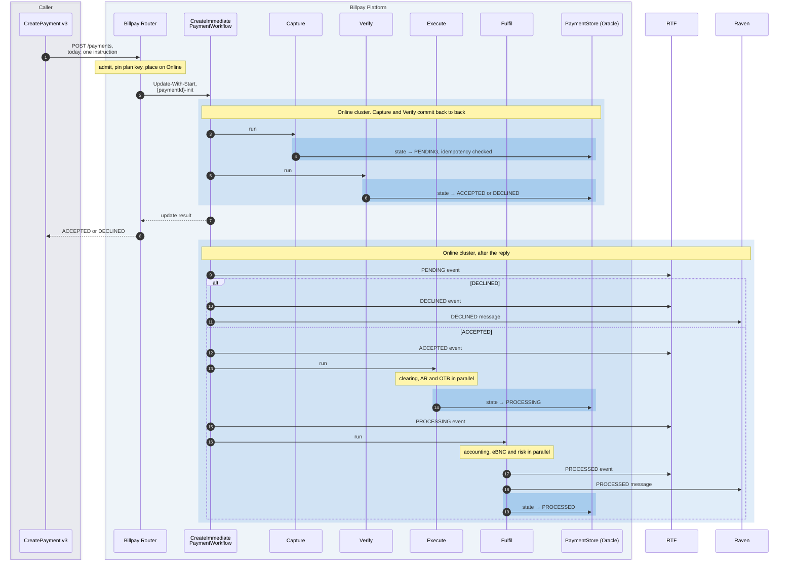

## 2. Scheduled payment, created today and executed later

A scheduled payment costs Temporal nothing while it waits. Intake on Online commits `SCHEDULED` together with a `SCHED_EXEC` row, replies and ends, and the row sits in Oracle for up to 30 days. On the due date the market's dispatcher routes the payment again, with that day's config, and starts `ExecuteScheduledPaymentWorkflow` on Offline. Reverify's guarded update settles any race with a late cancel.

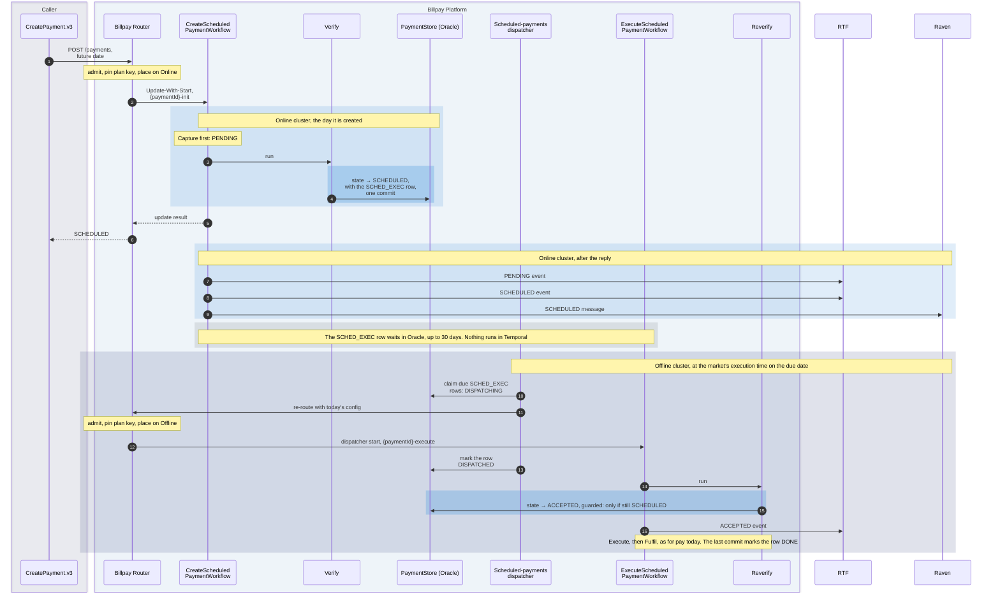

## 3. Corporate payment, pay today

A corporate payment runs on two tracks. The parent clears once, as one payment, while its allocations are requested from the allocations manager and arrive later by callback. Paid today, the parent is released at once, so each leg is `SCHEDULED` as soon as it is written and the leg dispatcher starts it. Every 60 seconds a completion check moves the parent to `PROCESSED` once it has cleared and every leg is `PROCESSED` or `PAID`.

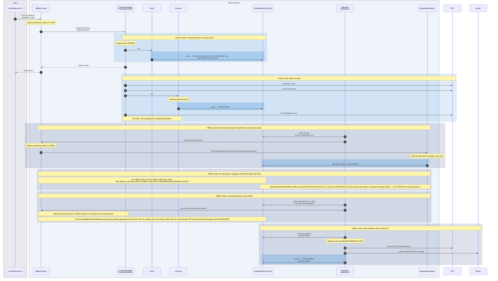

## 4. Corporate payment, scheduled

Scheduled, the allocations can arrive days before the parent executes, so the legs wait. Their rows are written `HELD`, which keeps them out of the claim index, until Reverify makes the parent `ACCEPTED` on its due date and sets `legs_released_at`. The leg dispatcher then moves the rows to `SCHEDULED` in chunks of 5,000 and starts the legs as it does for pay today.

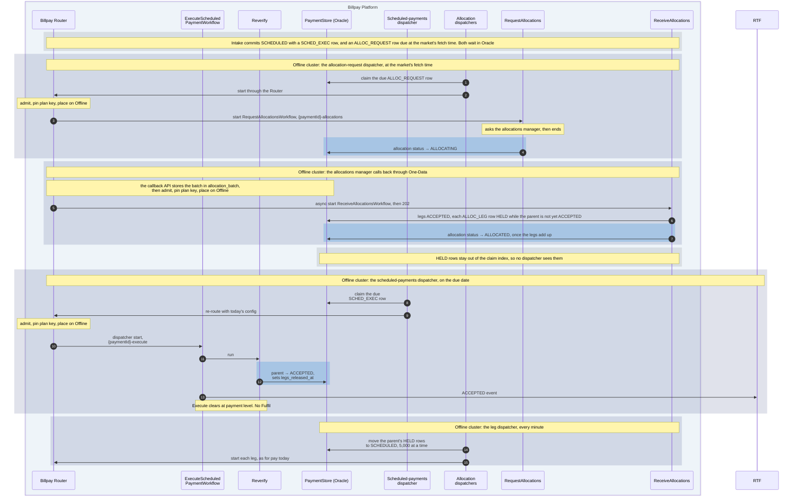

## 5. Update a scheduled payment

An update is a cancel followed by a new payment. The cancel is guarded, so it only lands while the payment is still `SCHEDULED` and inside its cancellation window. A child `CreateScheduledPaymentWorkflow` then creates the replacement under a new ID, with the same confirmation number. Too late, and the caller gets 409.

## 6. Cancel a payment

A cancel is one guarded update. It sets `CANCELLED` only if the payment is still `SCHEDULED`, and cancels the payment's Work Tracker rows in the same commit, so no dispatcher can start a cancelled payment. Asking twice is safe: a payment that is already `CANCELLED` returns that result again. Anything else that loses the race, or arrives outside the window, gets 409.

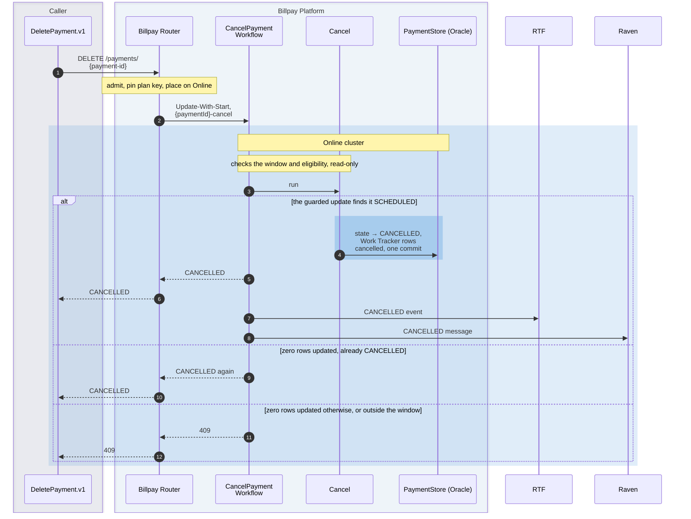

## 7. Return

Returns come in bursts, so none is started straight from its event. One-Data stores each return in its inbox and acknowledges it once that commit is done. The returns dispatcher pulls the oldest at the governor's rate and starts each one through the Router at priority 5. Return commits `RETURNED`, and if the payment can be represented, QueueRepresentment commits `REPRESENTING` with a `REPRESENT` row due on the representment date.

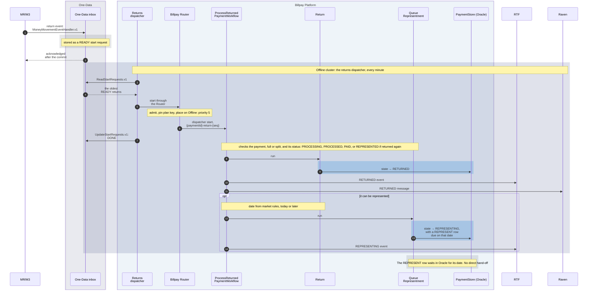

## 8. Representment

On the representment date, the market's representment dispatcher claims the row and starts the workflow at priority 4. Represent rechecks eligibility before anything goes to clearing. If the recheck passes, the payment is presented again and becomes `REPRESENTED`; if it fails, the payment is `DECLINED` and the customer is told.

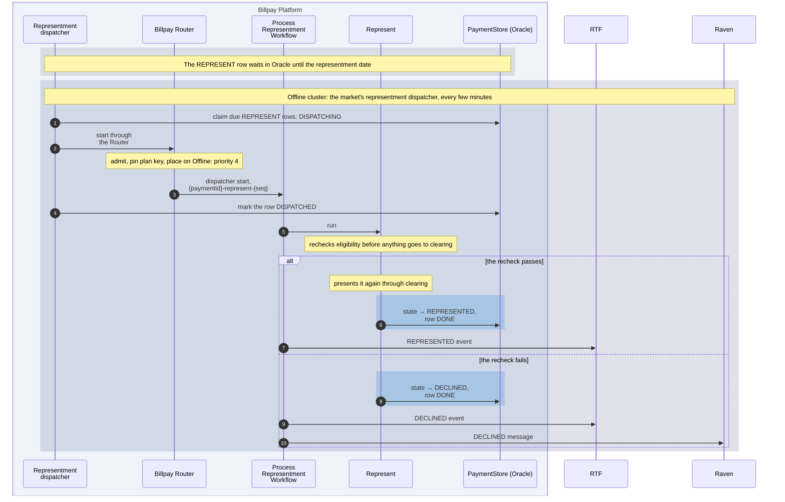

## 9. Inbound payment

Inbound payments come from third parties. One-Data stores each one and replies 202, so the sender never waits on Billpay. The inbound dispatcher starts it on Offline at priority 3, and Verify either accepts it or marks it `DISALLOWED`.

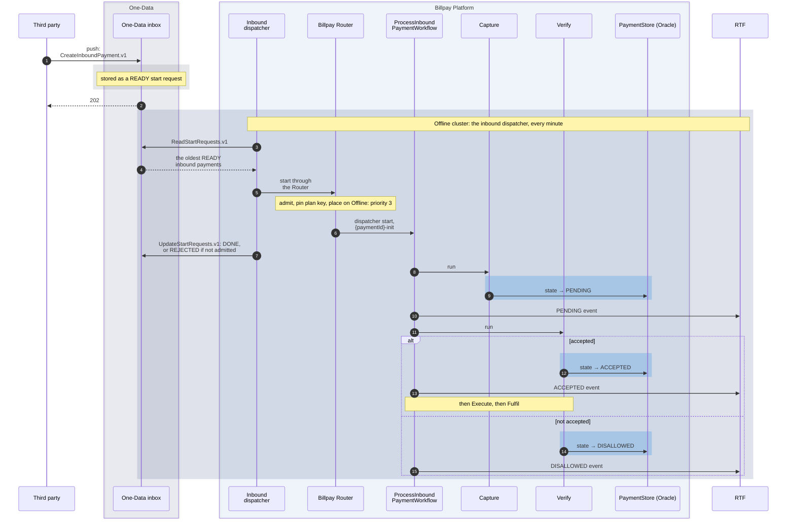

## 10. Paid events

A payment is paid once two events are in: the settlement from MR/M3 and the AR posting from GAR. One-Data's inbox keeps one row per payment or leg, and whichever event arrives second sets the row `READY`. Every 30 seconds a Schedule starts `ProcessPaidEventsWorkflow`, which settles up to 500 rows in one transaction, tells RTF, and marks each row `DONE` if it turned `PAID`, or `UNMATCHED` if it didn't.

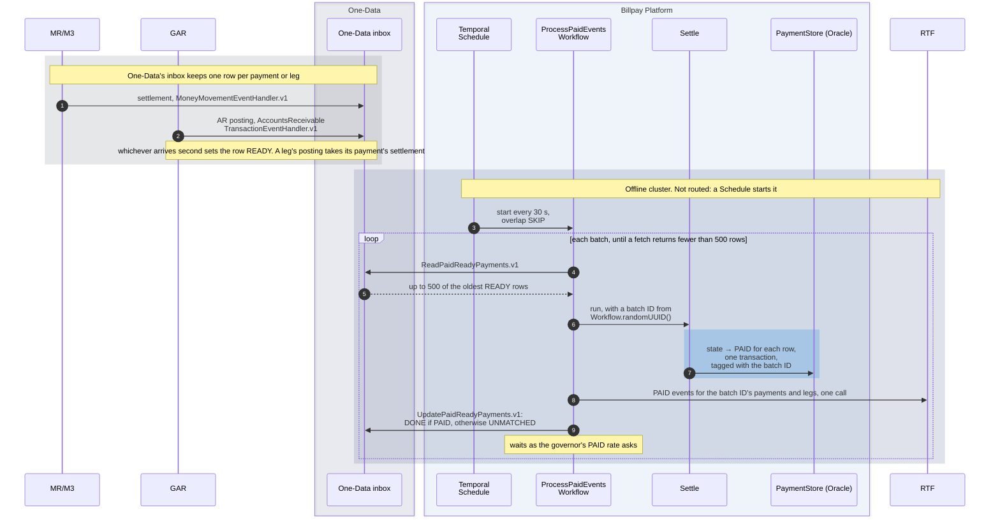

## 11. Missing paid events

Sometimes one of the two events never arrives. `ProcessMissingPaidEventsWorkflow` looks for payments and legs still `PROCESSED` after 48 hours, asks MR/M3 and GAR for what is missing, and sends anything it finds through the usual One-Data handler, so the event reaches the inbox the one way events do. Whatever it can't find raises an alert.

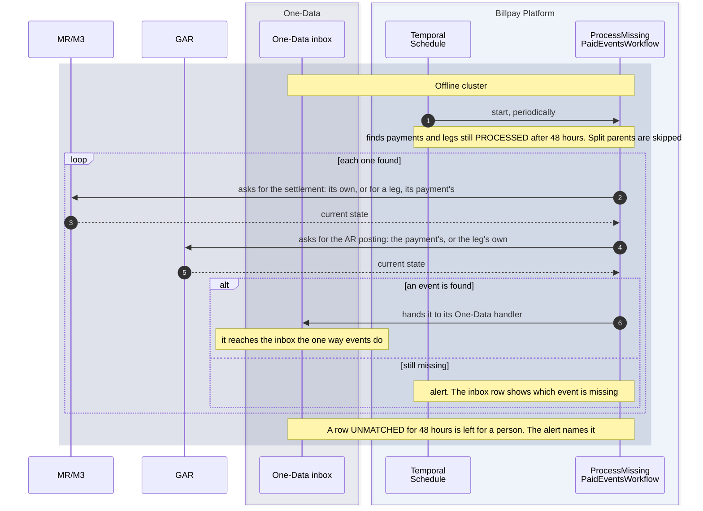

## 12. Pay & Plan

Pay & Plan is a composite. It starts on Online, runs the payment as a child `CreateImmediatePaymentWorkflow` on the same cluster, then calls the Installments API and, when asked, updates Autopay.

## 13. Allocations callback

The allocations manager sends a corporate payment's allocations in numbered batches. Billpay stores each batch in `allocation_batch`, starts `ReceiveAllocationsWorkflow` with only the payment ID and batch number, and replies 202 once the workflow exists. It is the only async start in Billpay, and the only start that can get 429, because an async start must stay inside its traffic class's budget.

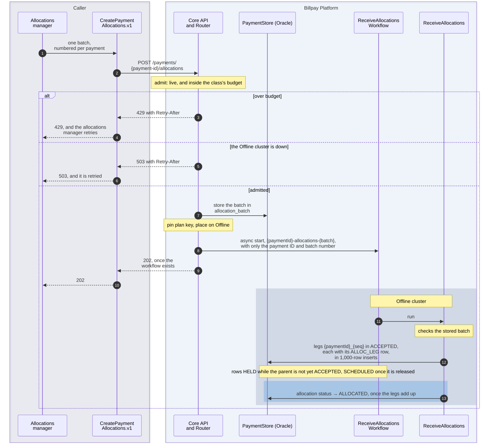
