import Lead from '@site/src/components/Lead';

# Sequence Diagrams

<Lead>Sixteen flows traced end to end, from the call or Schedule that starts each one to the stages that do the work and the commits they make. Each one shows which cluster runs every step, and when RTF and Raven hear about it.</Lead>

How to read these diagrams

- The group on the left is whoever starts the flow: a One-Data contract such as `CreatePayment.v3`, or One-Data's inbox when Billpay pulls the work. The light-blue group is the Billpay Platform.
- Every payment workflow starts through the Router, and its note names the hops: admit, pin the resolved profile, then choose the run site on a cluster. The PAID drain and the missing-events check start from Schedules instead.
- A Bright Blue band is the Online cluster, where a caller is waiting. A Deep Blue band is the Offline cluster, where dispatchers pace the work. A grey, dashed band is time when nothing runs, because the work is waiting in Oracle, in One-Data's inbox, or on a workflow's timer.
- The participants are the workflow and its stages, such as Capture, Verify and Execute. The systems a stage calls, such as clearing and Accounts Receivable, appear in its notes rather than as participants.
- A pale-blue chip, such as `state → ACCEPTED`, is a commit through `PaymentStore`: the guarded state change and its timeline entry in one transaction, with any Work Tracker rows.
- RTF and Raven are drawn because their timing matters. Each change is announced to RTF, and to Raven where the customer is told, after the commit that makes it. Fulfil is the exception: it tells both before it commits `PROCESSED`.
- The wider diagrams carry an expand control in the top right, which opens a full-window view. Escape closes it.

## 1. Pay today, one instruction

The caller is waiting for one answer: did the payment go through? So the workflow replies as soon as Verify commits, Temporal's early-return pattern, and only then announces the change and moves the money. Capture, Verify's calls and its commit run as local activities, inside the worker, so the answer comes out of the workflow's first task. Execute and Fulfil finish on Online after the reply, and Fulfil tells RTF and Raven before it commits `PROCESSED`, so nothing is marked processed until both know.

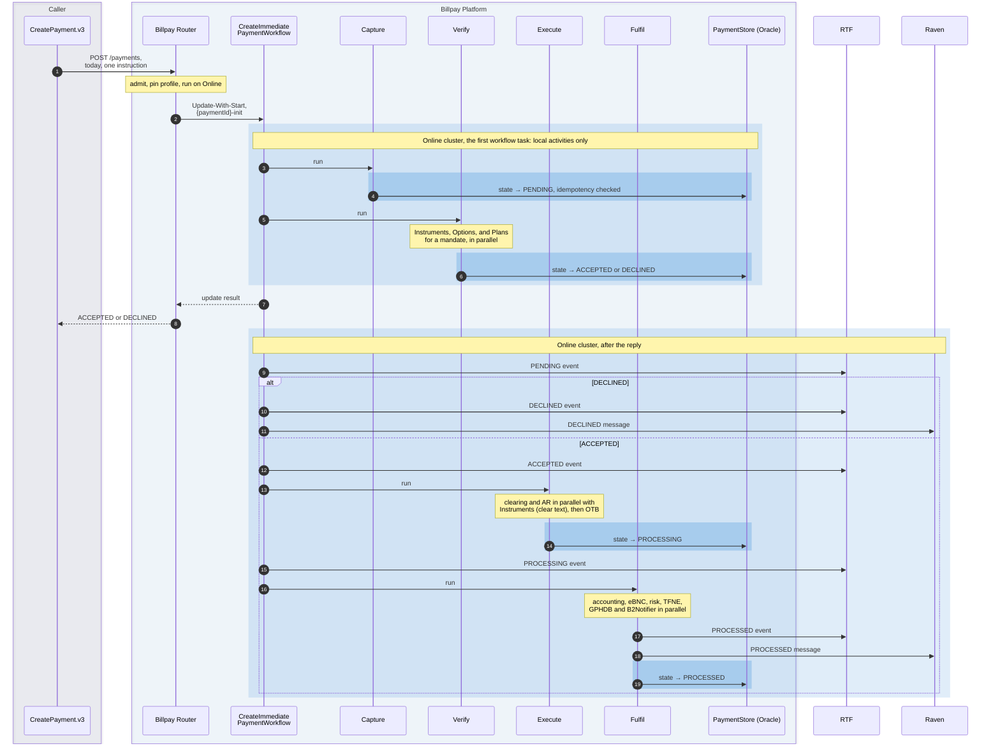

## 2. Scheduled payment, created today and executed later

A scheduled payment costs Temporal nothing while it waits. Intake on Online commits `SCHEDULED` together with a `SCHED_EXEC` row, replies and ends, and the row sits in Oracle for up to 30 days. On the due date the market's dispatcher routes the payment again, with that day's config, and starts `ExecuteScheduledPaymentWorkflow` on Offline. Reverify's guarded update settles any race with a late cancel.

## 3. Corporate payment, pay today

A corporate payment paid today gets its answer the way any payment does: the workflow replies once Verify commits `ACCEPTED`. After that, no workflow waits for anything. Verify's commit writes an `ALLOC_REQUEST` row due at once, and each later step starts from a row in Oracle that a dispatcher picks up: the request for the allocations, the execution once they add up, and one leg per allocation. Execute clears the parent once, at payment level. A completion check every 60 seconds moves the parent to `PROCESSED` once every leg is `PROCESSED` or `PAID`.

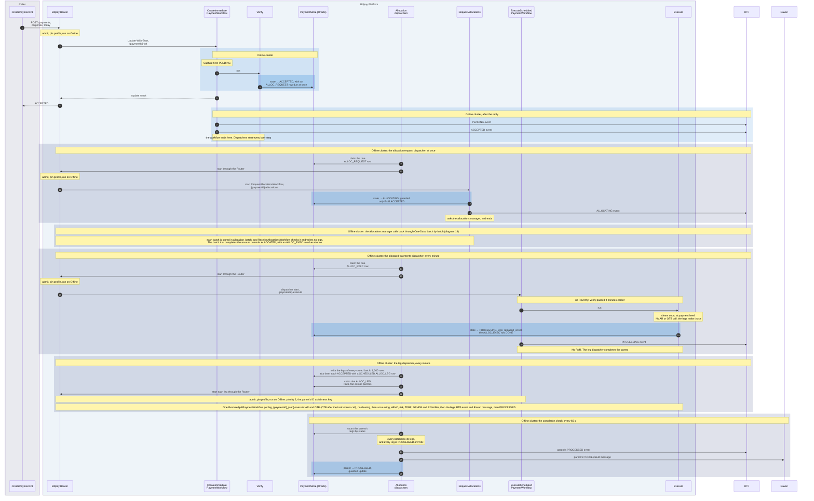

## 4. Corporate payment, scheduled

A scheduled corporate payment runs the same steps as one paid today, from the same kinds of row. Only the timing differs. Intake commits `SCHEDULED` with an `ALLOC_REQUEST` row due at the market's fetch time: on the due date, or a set number of hours or days before it. The request moves the payment to `ALLOCATING`, and from then on a cancel or an update gets 409. The batch that completes the amount writes the `ALLOC_EXEC` row, due at the execution time on the due date. Then Reverify checks the payment again, Execute clears it, and the legs run as they do for pay today.

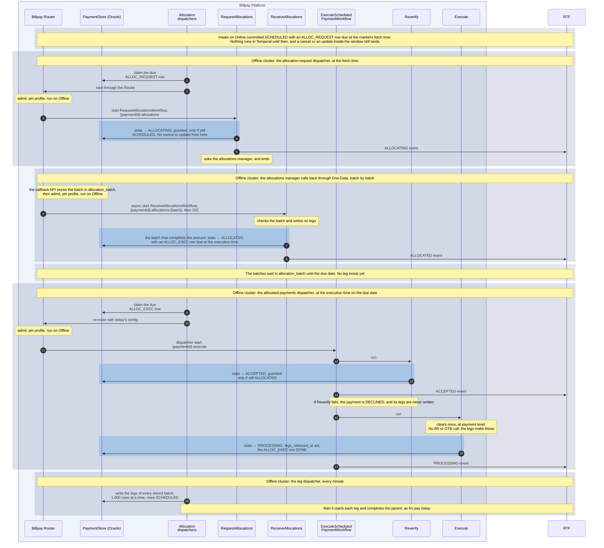

## 5. Update a scheduled payment

An update is a cancel followed by a new payment. The cancel is guarded, so it only lands while the payment is still `SCHEDULED` and inside its cancellation window. A corporate payment leaves `SCHEDULED` once its allocations are requested. A child `CreateScheduledPaymentWorkflow` then creates the replacement under a new ID, with the same confirmation number. Too late, and the caller gets 409.

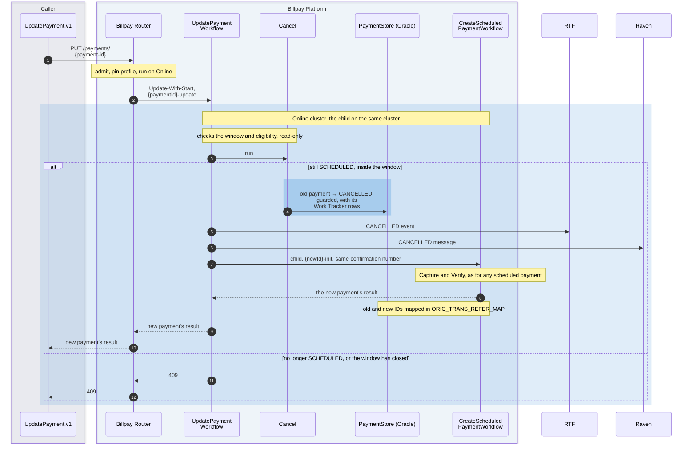

## 6. Cancel a payment

A cancel is one guarded update. It sets `CANCELLED` only if the payment is still `SCHEDULED`, which a corporate payment stops being once its allocations are requested. It cancels the payment's Work Tracker rows in the same commit, so no dispatcher can start a cancelled payment. Asking twice is safe: a payment that is already `CANCELLED` returns that result again. Anything else that loses the race or arrives outside the window gets 409. The same workflow also takes a customer's no to a payment that waited for a go-ahead, guarded on `PENDING` instead and with no window check (diagram 15).

## 7. Return

Returns come in bursts, so none is started straight from its event. One-Data stores each return in its inbox and acknowledges it once that commit is done. The returns dispatcher pulls the oldest at the governor's rate and starts each one through the Router at priority 5. Return commits `RETURNED` on the presentment that came back. If the payment can be represented, QueueRepresentment writes the next [presentment](./payment-state-model.md#presentments) as a new row, numbered one higher, in `REPRESENTING`, with the representment date as its clearing date and a `REPRESENT` row due that day.

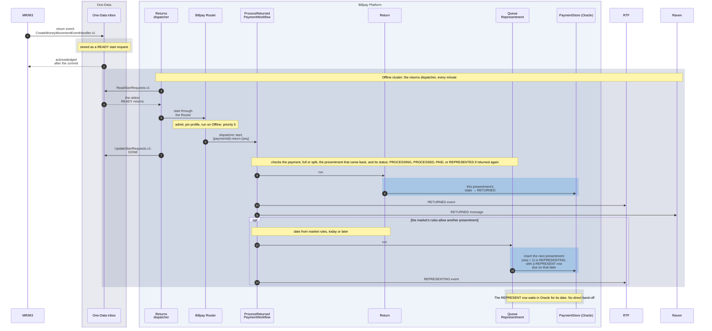

## 8. Representment

On the representment date, the market's representment dispatcher claims the row and starts the workflow at priority 4. Represent rechecks eligibility before anything goes to clearing. The workflow ID carries the new presentment's number. If the recheck passes, that presentment goes to the bank and becomes `REPRESENTED`; if it fails, nothing is sent, the presentment is `DECLINED` and the customer is told.

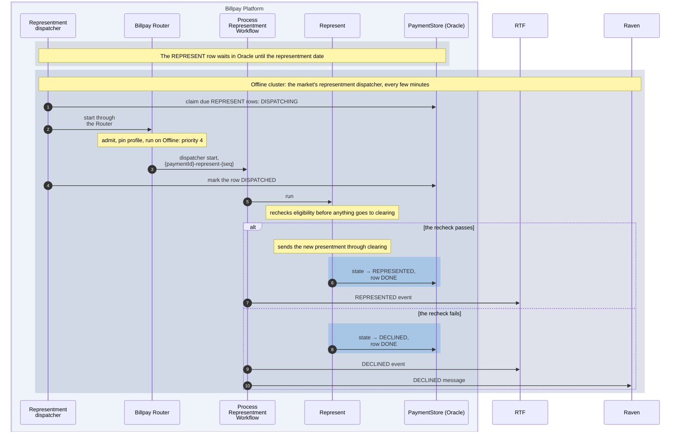

## 9. Inbound payment

Inbound payments are push payments: a third party sends the money in. One-Data stores each one and replies 202, so the sender never waits on Billpay. The inbound dispatcher starts it on Offline at priority 3, and Verify either accepts it or marks it `DISALLOWED`.

## 10. Paid events

A payment is paid once two events are in: the settlement from MR/M3 and the AR posting from GAR. A Pay with Bank Transfer or debit card payment has no clearing, so no settlement comes for it, and the posting alone makes its row `READY`. One-Data's inbox keeps one row per payment or leg, and whichever event arrives second sets the row `READY`. Every 30 seconds a Schedule starts `ProcessPaidEventsWorkflow`, which settles up to 500 rows in one transaction, tells RTF, and marks each row `DONE` if it turned `PAID`, or `UNMATCHED` if it didn't.

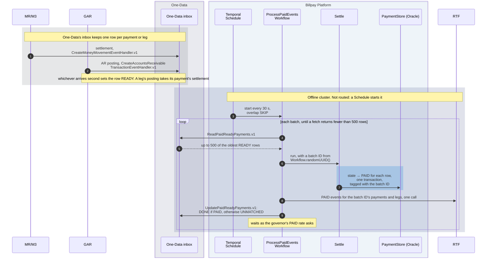

## 11. Missing paid events

Sometimes one of the two events never arrives. `ProcessMissingPaidEventsWorkflow` looks for payments and legs still `PROCESSED` after 48 hours, asks MR/M3 and GAR for what is missing, and sends anything it finds through the usual One-Data handler, so the event reaches the inbox the one way events do. Whatever it can't find raises an alert.

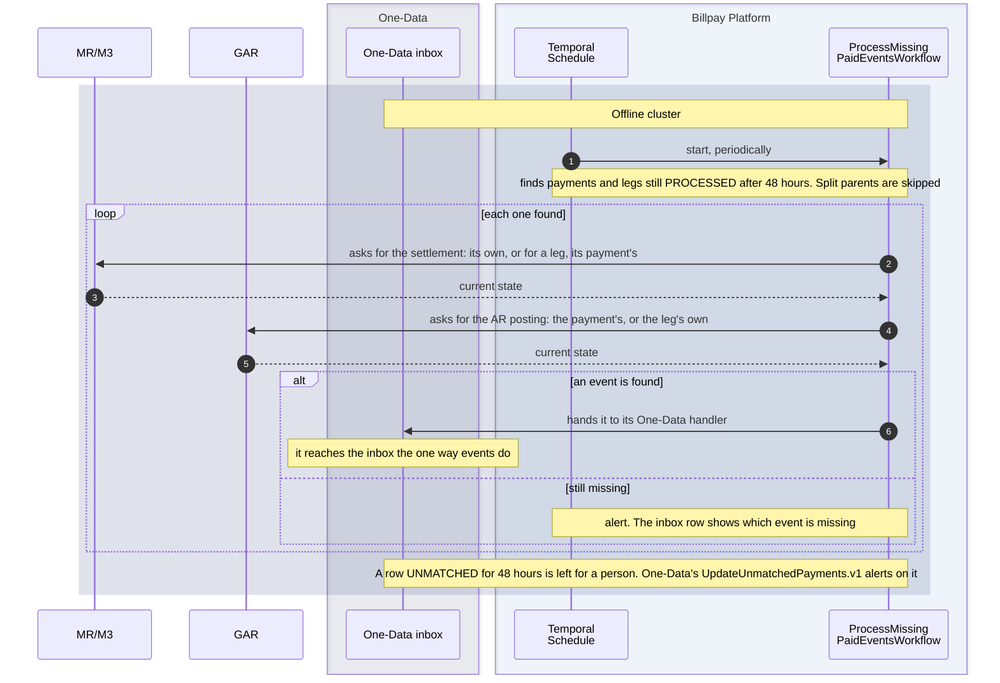

## 12. Pay & Plan

Pay & Plan is a composite. It starts on Online, runs the payment as a child `CreateImmediatePaymentWorkflow` on the same cluster, then calls the Installments API and, when asked, updates Autopay.

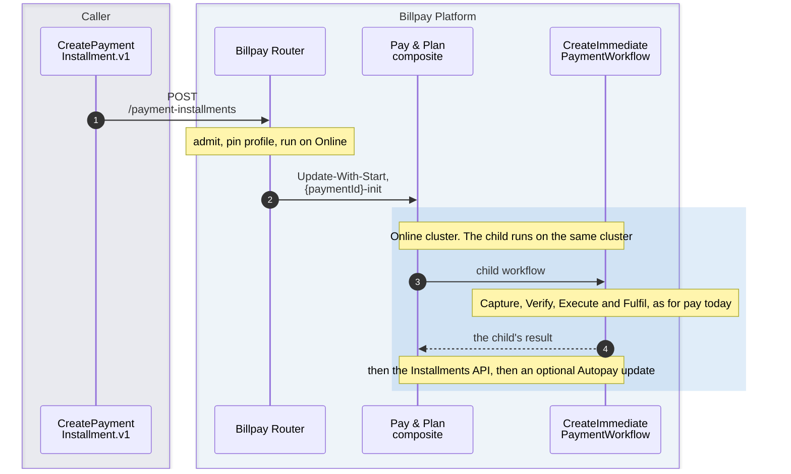

## 13. Allocations callback

The allocations manager sends a corporate payment's allocations in numbered batches. Billpay stores each batch in `allocation_batch`, starts `ReceiveAllocationsWorkflow` with only the payment ID and batch number, and replies 202 once the workflow exists. It is the only async start in Billpay, and the only start that can get 429, because an async start must stay inside its traffic class's budget. The workflow writes no legs. The batch that completes the amount moves the payment to `ALLOCATED` and writes its `ALLOC_EXEC` row in the same commit, and the allocated-payments dispatcher takes it from there.

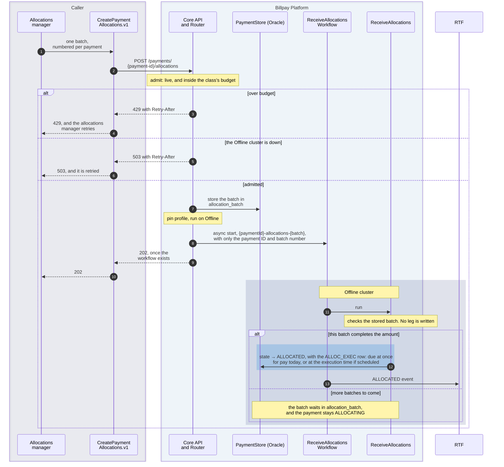

## 14. Pay by bank: create and confirm

Some payments wait for the customer to confirm their bank details on a provider's site, such as Plaid in the US or Pay with Bank Transfer in the UK. One workflow, `CreatePaymentIntentWorkflow`, holds the payment from the create to its end. The create's update ends at `PENDING` with the provider's redirect link, or at `DECLINED` when the provider gives no link, so no payment waits without one. The workflow then waits on its timer. The caller's confirm is an update to that same workflow: Verify decides, the confirm's reply carries the decision, and Execute and Fulfil follow in the same workflow. For Pay with Bank Transfer the money moves at the bank, during the customer's bank connection, so Execute makes no clearing call. A repeated confirm carries the same update ID and gets the same answer, or the payment's current state once the workflow has closed. If no confirm comes before the window and its grace have passed, the timer fires and the workflow cancels the payment itself.

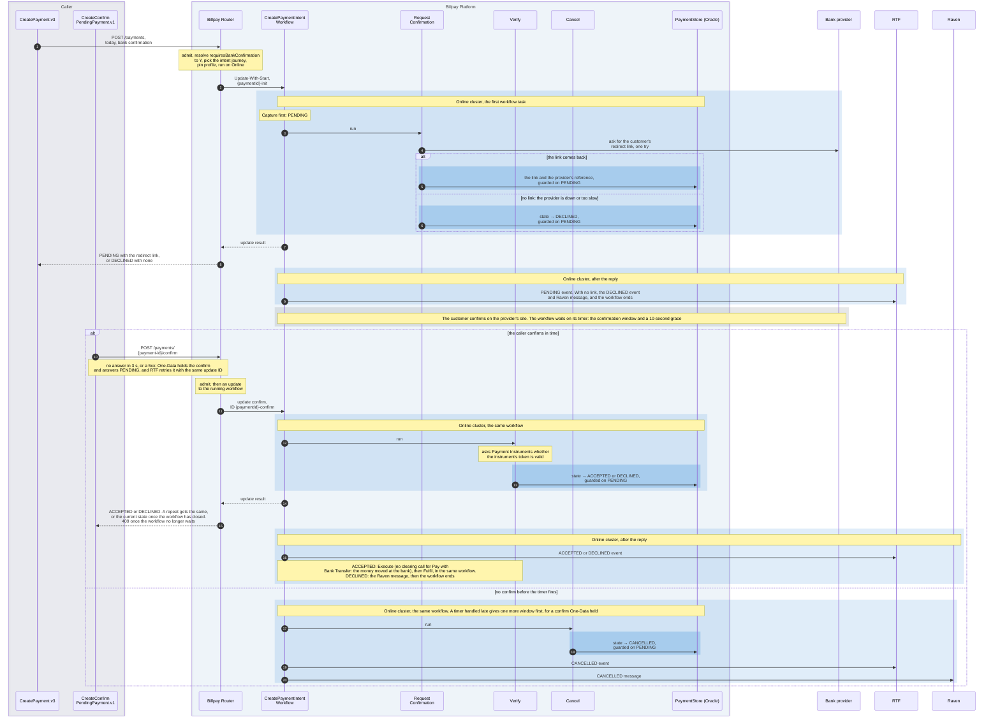

## 15. A new payment while another is pending

One-Data checks every new payment against the card account's pending payments in Redis, in the same call that adds the new one to the list and stores the create. When the account already has a pending payment, One-Data sends its ID with the create. In a market that has the go-ahead turned on, the Router starts `CreatePaymentIntentWorkflow`, Capture stores the IDs the customer is shown along with the payment, and One-Data adds the pending payments to the reply. With the setting off, the default, the Router ignores the IDs and the payment runs as in diagram 1. The customer's yes and no are both updates to that workflow, so the first one it accepts wins and the other gets 409. If neither comes before the window and its grace have passed, the timer fires and the workflow cancels the payment, as in diagram 14. The workflow calls One-Data's delete API twice: after its reply, which leaves the account's entry in place while the payment waits, and at its end, which removes it.

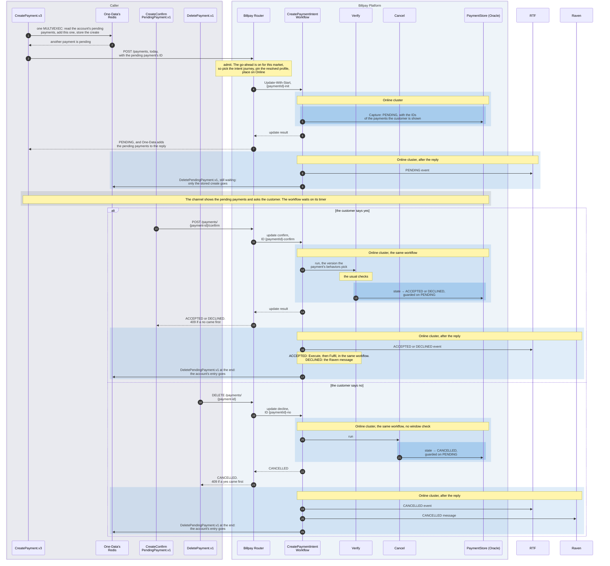

## 16. Pay by Debit card: create, 3D Secure and authorization

A debit card payment needs 3D Secure, the card schemes' check that the customer is the cardholder, and then an authorization that takes the money. One workflow, `CreatePaymentIntentWorkflow`, holds the payment throughout. RequestConfirmation asks the market's card provider (Checkout.com in the UK) to start 3D Secure and gives it Billpay's callback URL. The create's update ends at `PENDING` with the challenge link, or with no link when the card's bank needs no challenge. The provider then calls billpay-core directly, not through One-Data, and the callback is an update to the same workflow. Verify runs its usual checks, then authorizes the payment last: the authorization debits the customer's account if it holds enough money, and the card's bank declines it if not. The callback's reply carries the decision. Execute makes no clearing call, because the money has already moved. If no callback comes within 2 minutes and the grace, the timer cancels the payment, and nothing was taken.

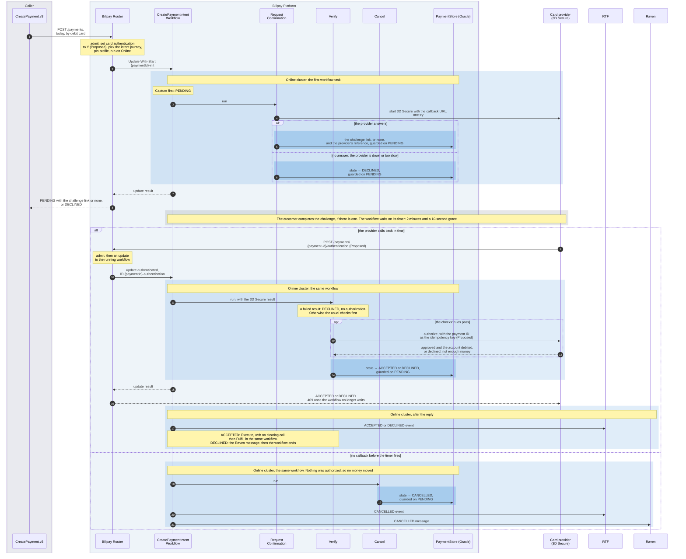
