import Lead from '@site/src/components/Lead';

# Sequence Diagrams

<Lead>Sixteen flows traced end to end, from the call or Schedule that starts each one to the stages that do the work and the commits they make. Each one shows which cluster runs every step, and when RTF and Raven hear about it.</Lead>

How to read these diagrams

- Every step is numbered, in order.
- A numbered label such as **1 · Create** names each phase. Each phase's label has its own colour, so you can tell neighbouring phases apart.
- The field behind a phase says which side runs it: pale blue for the Online side (billpay-online and its cluster, where a caller is usually waiting), pale navy for the Offline side (billpay-offline and its cluster, where dispatchers pace the work). No field means the step happens outside Billpay. The key under each diagram repeats this.
- A grey note between phases is time when nothing runs, because the work is waiting in Oracle, in One-Data's inbox, or on a workflow's timer.
- A pink arrow is where something outside starts or resumes the payment: an update or a signal to its running workflow, a dispatcher or a callback starting the next workflow, or the events One-Data pairs before `PAID`. [All Journeys](./journeys/all-journeys.md) marks the same steps with pink flags.
- An arrow to `PaymentStore` is a commit: the guarded state change and its timeline entry in one transaction, with any Work Tracker rows.
- Every payment workflow starts through the Router, which admits the request and pins the resolved profile. The PAID drain and the missing-events check start from Schedules instead.
- RTF and Raven are drawn because their timing matters. Each change is announced to RTF, and to Raven where the customer is told, after the commit that makes it. Fulfil is the exception: it tells both before it commits `PROCESSED`, except for a Pay with Bank Transfer or debit card payment, whose `PROCESSED` goes to neither.
- The wider diagrams carry an expand control in the top right, which opens a full-window view. Escape closes it.

## 1. Pay today, one instruction

The caller is waiting for one answer: did the payment go through? So the workflow replies as soon as Verify commits, Temporal's early-return pattern, and only then announces the change and moves the money. Capture, Verify's calls and its commit run as local activities, inside the worker, so the answer comes out of the workflow's first task. Execute and Fulfil finish on Online after the reply, and Fulfil tells RTF and Raven before it commits `PROCESSED`, so nothing is marked processed until both know. Once Verify has decided, the workflow also calls One-Data's delete API, so the account can take its next payment (diagram 15).

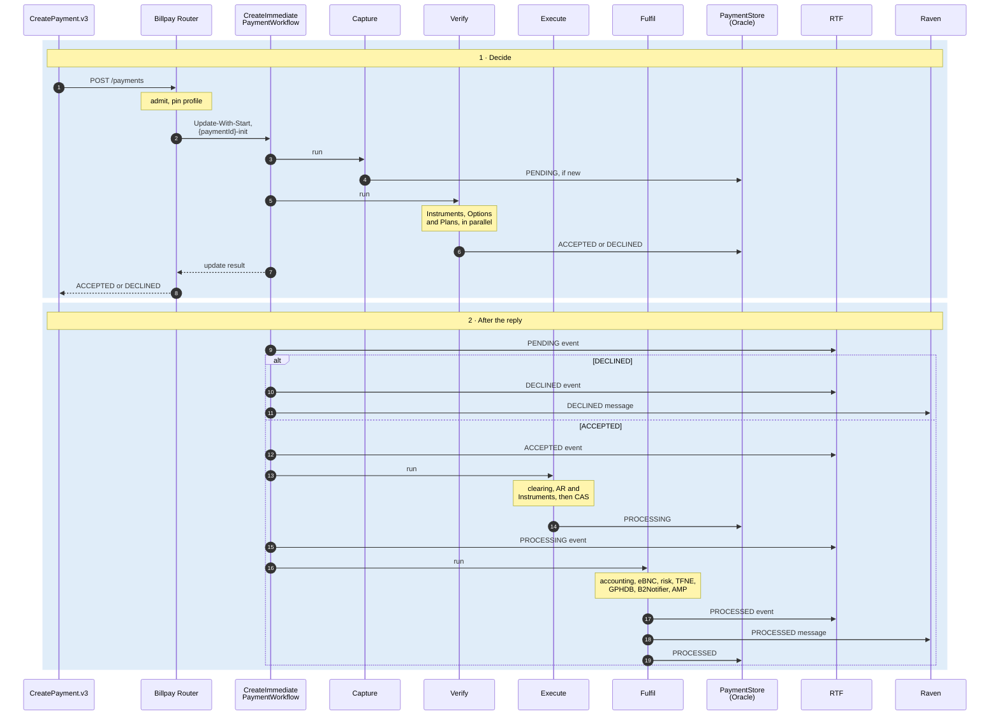

## 2. Scheduled payment, created today and executed later

A scheduled payment costs Temporal nothing while it waits. Intake on Online commits `SCHEDULED` together with a `SCHED_EXEC` row, replies and ends, and the row sits in Oracle until the due date. On the due date the market's dispatcher routes the payment again, with that day's config, and starts `ExecuteScheduledPaymentWorkflow` on Offline. Reverify reads the options again through `ReadPaymentOptions.v1`: the card still owes, the option still holds, and a balance option takes its amount again. Its guarded update settles any race with a late cancel.

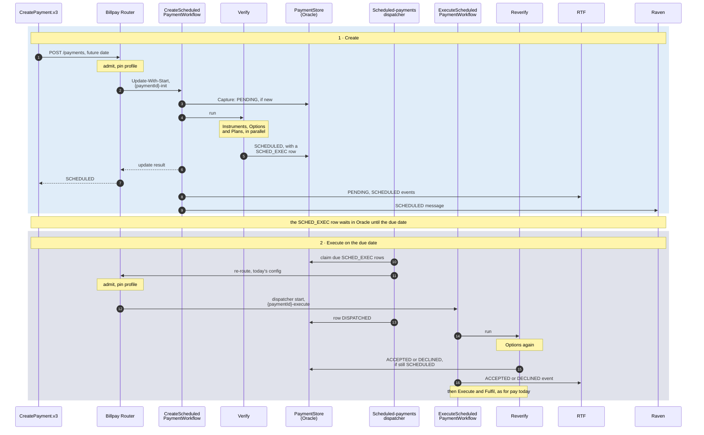

## 3. Corporate payment, pay today

A corporate payment paid today gets its answer the way any payment does: the workflow replies once Verify commits `ACCEPTED`. After that, no workflow waits for anything. Verify's commit writes an `ALLOC_REQUEST` row due at once, and each later step starts from a row in Oracle that a dispatcher picks up: the request for the allocations, the execution once they add up, and one leg per allocation. Execute clears the parent once, at payment level. There is no Reverify, since Verify passed minutes earlier, and the parent gets no Fulfil and no AR or OTB call: the legs make those. Each leg runs as its own `ExecuteSplitPaymentWorkflow` at priority 2, with the parent's ID as its fairness key: AR and OTB (OTB after the Instruments call) with no clearing, then accounting, eBNC, risk, TFNE, GPHDB and B2Notifier, the leg's RTF event and Raven message, and `PROCESSED`. A completion check every 60 seconds moves the parent to `PROCESSED` once every batch has its legs and every leg is `PROCESSED` or `PAID`.

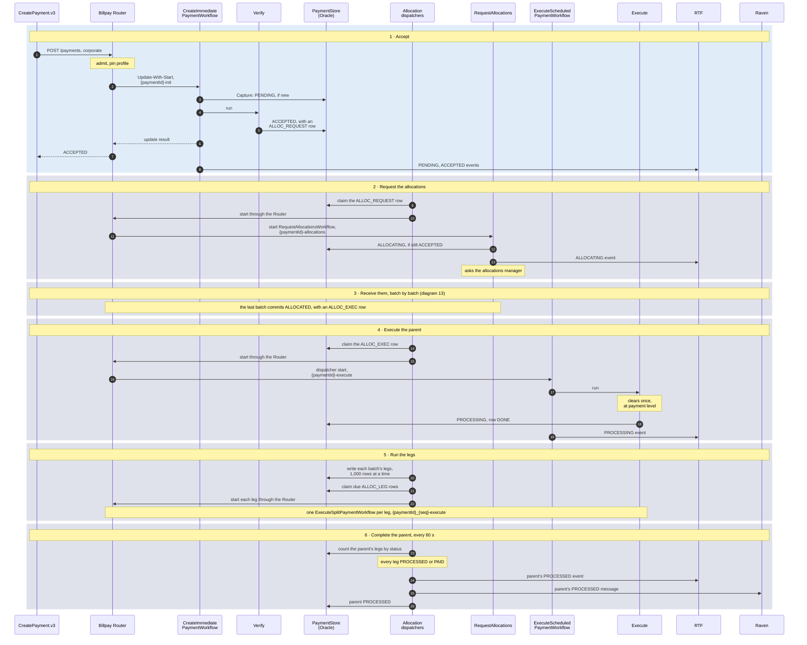

## 4. Corporate payment, scheduled

A scheduled corporate payment runs the same steps as one paid today, from the same kinds of row. Only the timing differs. Intake commits `SCHEDULED` with an `ALLOC_REQUEST` row due at the market's fetch time: on the due date, or a set number of hours or days before it. The request moves the payment to `ALLOCATING`, and from then on a cancel or an update gets 409. The batch that completes the amount writes the `ALLOC_EXEC` row, due at the execution time on the due date. Then Reverify checks the payment again, Execute clears it, and the legs run as they do for pay today. If Reverify fails, the payment is `DECLINED` and its legs are never written.

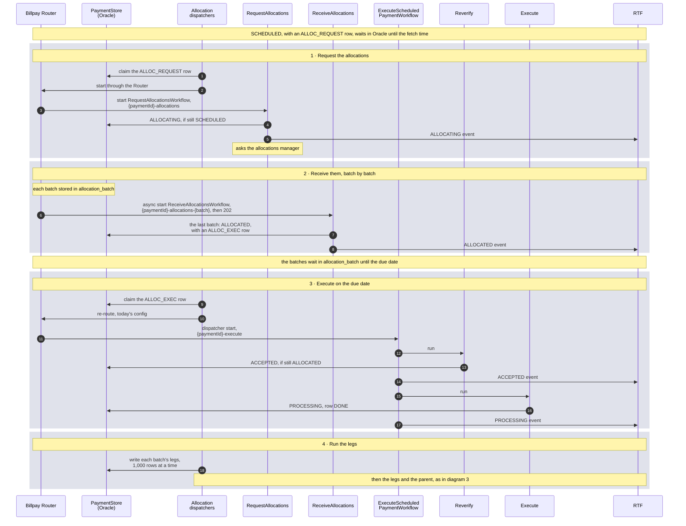

## 5. Update a scheduled payment

An update is a cancel followed by a new payment. The cancel is guarded, so it only lands while the payment is still `SCHEDULED` and inside its cancellation window. A corporate payment leaves `SCHEDULED` once its allocations are requested. A child `CreateScheduledPaymentWorkflow` then creates the replacement under a new ID, with the same confirmation number. Too late, and the caller gets 409.

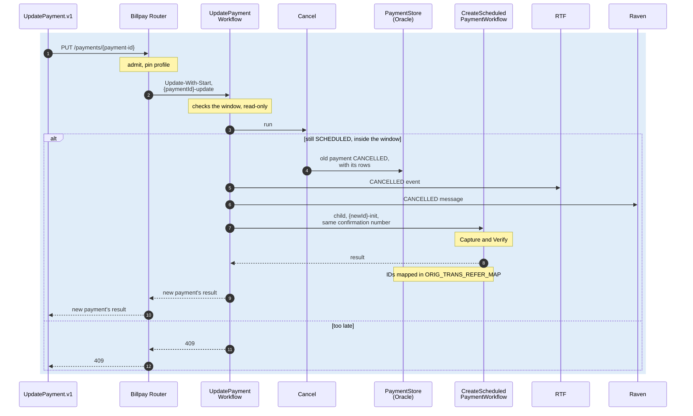

## 6. Cancel a payment

A cancel is one guarded update. It sets `CANCELLED` only if the payment is still `SCHEDULED`, which a corporate payment stops being once its allocations are requested. It cancels the payment's Work Tracker rows in the same commit, so no dispatcher can start a cancelled payment. Asking twice is safe: a payment that is already `CANCELLED` returns that result again. Anything else that loses the race or arrives outside the window gets 409. A customer's no to a payment that waits for bank confirmation goes elsewhere: it is an update to that payment's own `CreatePaymentIntentWorkflow`, guarded on `PENDING` and with no window check.

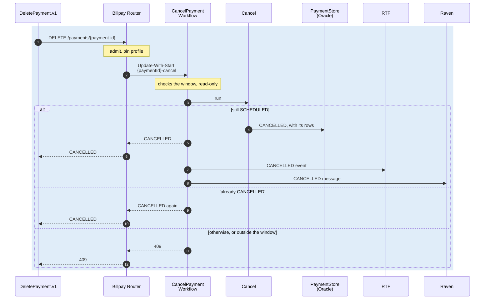

## 7. Return

Returns come in bursts, so none is started straight from its event. One-Data stores each return in its inbox and acknowledges it once that commit is done. The returns dispatcher pulls the oldest at the governor's rate and starts each one through the Router at priority 5. The workflow first checks the payment, full or split, and that the presentment that came back is `PROCESSING`, `PROCESSED`, `PAID`, or `REPRESENTED` if it came back again. Return then commits `RETURNED` on it. If the payment can be represented, QueueRepresentment writes the next [presentment](./payment-state-model.md#presentments) as a new row, numbered one higher, in `REPRESENTING`, with the representment date as its clearing date and a `REPRESENT` row due that day.

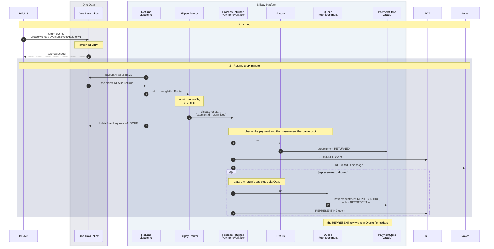

## 8. Representment

On the representment date, the market's representment dispatcher claims the row and starts the workflow at priority 4. Represent rechecks eligibility before anything goes to clearing. The workflow ID carries the new presentment's number. If the recheck passes, that presentment goes to the bank and becomes `REPRESENTED`; if it fails, nothing is sent, the presentment is `DECLINED` and the customer is told.

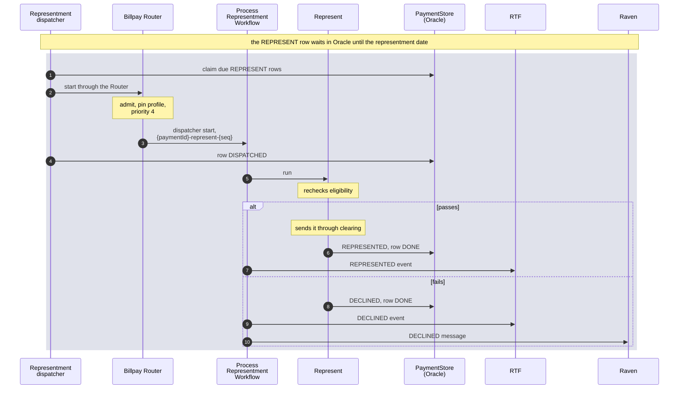

## 9. Inbound payment

Inbound payments are push payments: a third party sends the money in. One-Data stores each one and replies 202, so the sender never waits on Billpay. The inbound dispatcher starts it on Offline at priority 3, and Verify either accepts it or marks it `DISALLOWED`. An accepted one runs Execute with no clearing call, then Fulfil. One that is split runs a leg for each card account: a consumer's request names them, and a corporate payment's come from the allocations manager, as on [Corporate Allocations](./corporate-allocations.md).

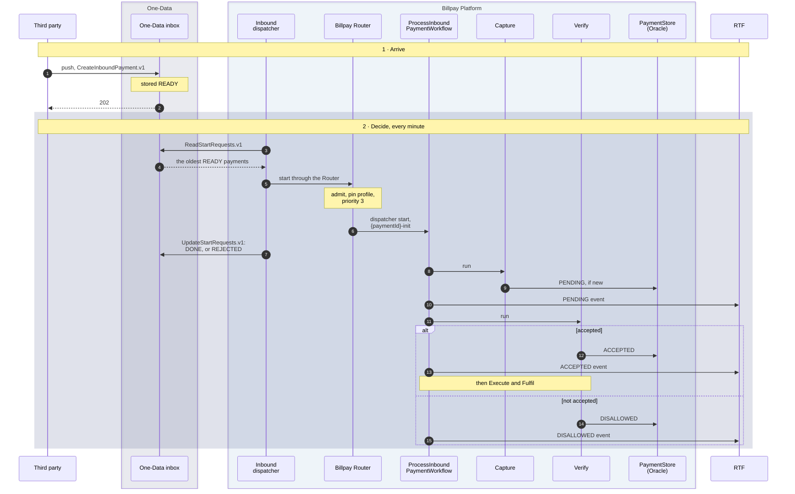

## 10. Paid events

A payment is paid once two events are in: the settlement from MR/M3 and the AR posting from GAR. A debit card payment has no clearing, so MR/M3 sends no settlement for it. Billpay creates that event itself: Execute hands it to the same handler MR/M3 uses, dated when the money moved, so its row pairs the same way. A Pay with Bank Transfer payment has no clearing either, but M3 reports its settlement, and that notice is the settlement. M3 sends it to One-Data's `CreateBillpaySettlementEvent.v1`, which records it for the pairing (Proposed). MR Points and inbound payments have no clearing either, and Billpay creates their settlement events as it does a debit card's (agreed 2026-11-23). One-Data's inbox keeps one row per payment or leg, and whichever event arrives second sets the row `READY`. A corporate leg's posting takes its payment's settlement, and a consumer split's leg has its own. Every 30 seconds a Schedule starts `ProcessPaidEventsWorkflow`, with no routing, which settles up to 500 rows in one transaction, tells RTF, and marks each row `DONE` if it turned `PAID`, or `UNMATCHED` if it didn't.

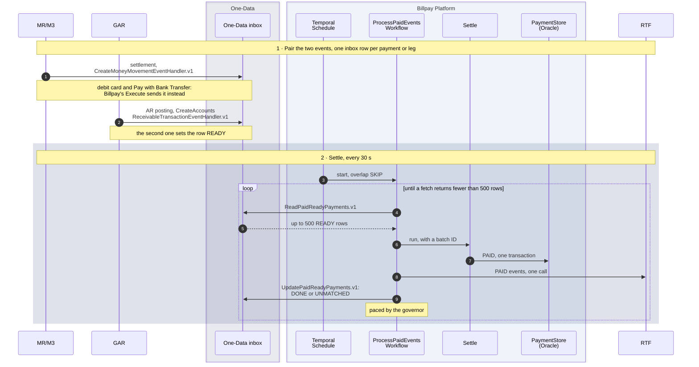

## 11. Missing paid events

Sometimes one of the two events never arrives. `ProcessMissingPaidEventsWorkflow` looks for payments and legs still `PROCESSED` after 48 hours, asks MR/M3 and GAR for what is missing (for a corporate leg, the settlement is its payment's; the posting is the leg's own), and sends anything it finds through the usual One-Data handler, so the event reaches the inbox the one way events do. MR/M3 never settles a debit card payment, so for one the check asks GAR alone, and always hands over Billpay's own settlement event again, since Billpay can't read the inbox to see whether it has it (Proposed). M3 does report a Pay with Bank Transfer payment's settlement, so whether the check asks it about one waits on how M3's notice reaches the pairing (open). Whatever it can't find raises an alert, and the inbox row shows which event is missing.

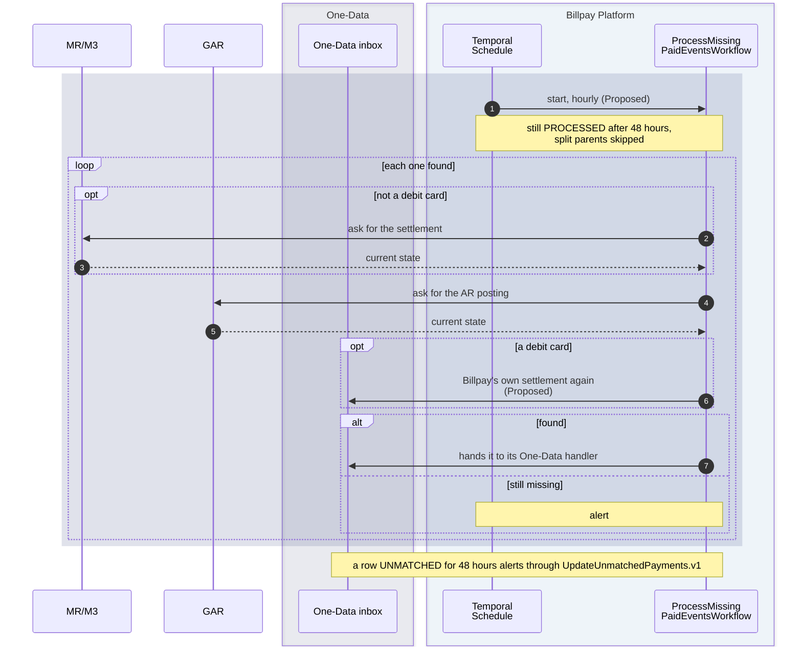

## 12. Pay & Plan

Pay & Plan is a composite. It starts on Online as `{paymentId}-plan` and captures and verifies the payment itself, because a child that decided would be heard only when it ended (agreed 2026-11-07). For an `ACCEPTED` payment it calls the Installments API and, when asked, updates Autopay, and the reply waits for all three: the decision, the plan and the Autopay update (agreed 2026-11-07). A child on the same cluster, `CreateImmediatePaymentWorkflow` started with the decision, runs Execute and Fulfil as `{paymentId}-init`, and the composite calls One-Data's delete. A declined payment gets no plan (Proposed). One-Data runs the same pending check first, as in diagram 15, so a request on an account with a payment already `PENDING` never gets here.

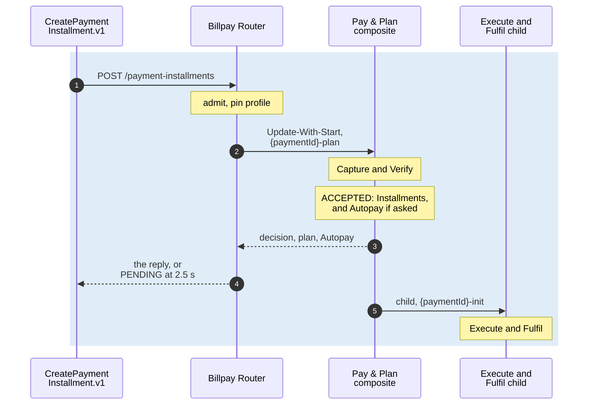

## 13. Allocations callback

The allocations manager sends a corporate payment's allocations in numbered batches. Billpay stores each batch in `allocation_batch`, starts `ReceiveAllocationsWorkflow` with only the payment ID and batch number, and replies 202 once the workflow exists. It is the only async start in Billpay, and the only start that can get 429, because an async start must stay inside its traffic class's budget. The workflow writes no legs. The batch that completes the amount moves the payment to `ALLOCATED` and writes its `ALLOC_EXEC` row in the same commit, and the allocated-payments dispatcher takes it from there.

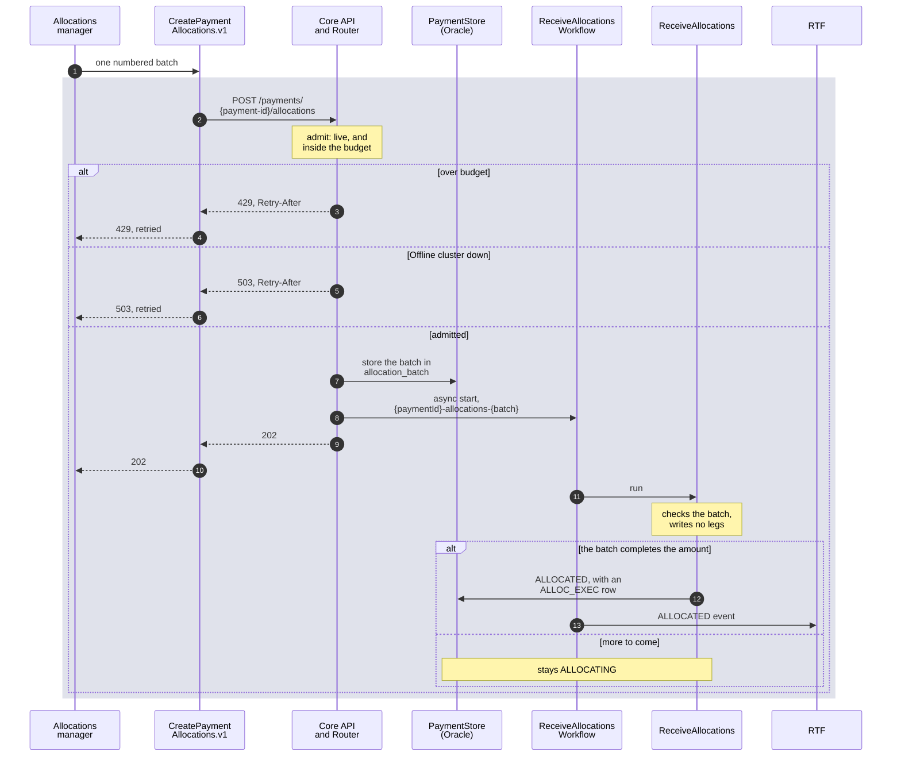

## 14. Pay by bank: create, submission, confirmation and settlement

Some payments wait for the customer to approve the payment at their bank. Billpay talks to one service for that, Amex Pay with Bank Transfer, which works with each market's provider, Plaid in the US among them. One workflow, `CreatePaymentIntentWorkflow`, holds the payment from the create to its end, in three phases. The first two are sync: the channel waits for the reply.

1. **Create a payment intent.** Capture writes the payment to the PaymentStore as `PENDING`, only if its ID is new, which is the idempotency check. Amex's own check runs next, Payment Options for the option the customer picked, then RequestConfirmation calls Amex Pay with Bank Transfer's `initiatePayment` for the redirect link and stores it on the payment. The channel gets `PENDING` with the link.
2. **Channel submission.** Once the payer's bank routes the customer back, the channel calls `POST /payments/{payment-id}/submission`, the Channel Submission Event. Billpay submits the payment through Amex Pay with Bank Transfer's `PaymentSubmission` once, and replies with its answer: `PENDING`, `ACCEPTED` or `DECLINED`. The channel shows the customer that status, and its part ends there.
3. **Async process.** Nobody waits from here on. If the channel never called, Amex Pay with Bank Transfer sends its own answer, the PwBT Confirmation Event: it calls One-Data's `UpdatePaymentConfirmation.v1`, and One-Data passes it on to billpay-online's `POST /payments/{payment-id}/confirmation`. While neither answer has come, Billpay asks `GET /payment-status` itself as the fallback, with a gap that starts at 2 minutes and doubles up to 30, until the answer is success or failure. Once the market's wait of 24 to 48 hours has passed since the create, a payment still pending is `DECLINED` with `CONFIRMATION_NOT_RECEIVED`. Then M3's notice that the bank has settled the money, the Bank Settled Event via M3, lets Execute and Fulfil run, with no clearing call. Fulfil tells accounting, TFNE, GPHDB and AMP, and sends nothing to RTF or Raven for `PROCESSED`. M3 sends it to One-Data's `CreateBillpaySettlementEvent.v1`, and One-Data passes it on to billpay-online's `POST /payments/{payment-id}/settlement`.

Pink arrows are the events and Temporal messages that reach the waiting workflow from outside.

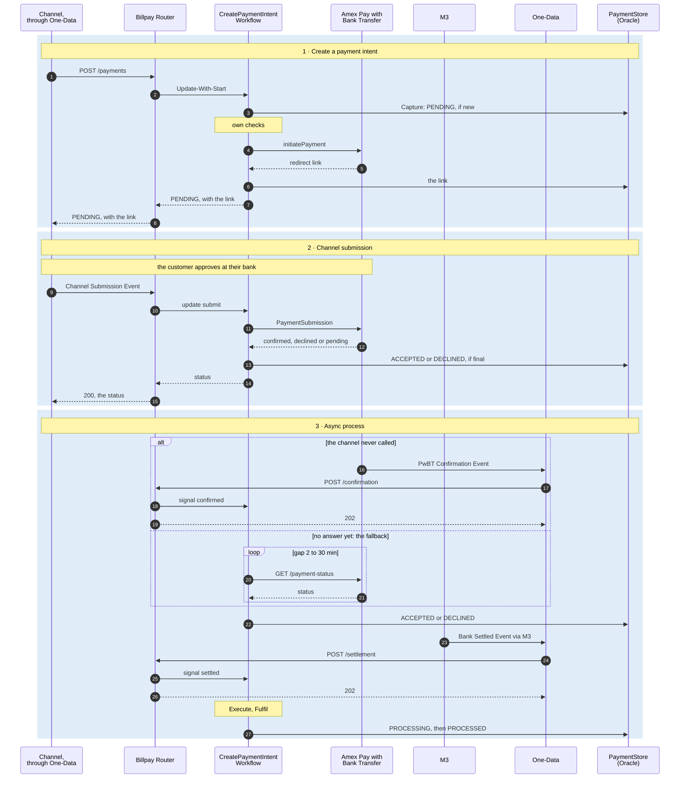

What the picture leaves out, so it stays readable:

- **Declines at the create.** A failed own check, or no link from Amex Pay with Bank Transfer, makes the payment `DECLINED` in one commit guarded on `PENDING`, and the channel gets `DECLINED` with no link.
- **A failed submission.** If `PaymentSubmission` times out or gets a 5xx, the reply is `PENDING`, and Amex Pay with Bank Transfer's confirmation or the fallback status calls decide the payment later.
- **After the reply.** The customer sees the payment's final state later in their list of payments, which the channel reads through `ReadPayments.v1`. RTF gets every state change as an event but `PROCESSED`, and Raven sends the customer the market's messages, none for `PROCESSED`.
- **A late confirmation.** Amex Pay with Bank Transfer sends its answer whether or not the channel called, so a payment already `ACCEPTED` ignores it. A confirmed answer on a payment already `DECLINED` or `CANCELLED` goes on the exception list with an alert (Proposed).
- **No answer at all.** The fallback status calls start 2 minutes after the create. The 2 minutes is still TBD, and so are the timeouts of `PaymentSubmission` and the status call.
- **The market's wait ends.** If the answer is still pending 24 to 48 hours after the create, the payment is `DECLINED` with `CONFIRMATION_NOT_RECEIVED`, and the asking stops.
- **A repeated submission.** It attaches to the same update and gets the same answer.
- **M3 first.** If M3's notice comes while the payment is still `PENDING`, it accepts the payment on its own, the calls stop, Billpay logs it, and Execute moves it to `PROCESSING`.
- **No notice.** An `ACCEPTED` payment whose notice never comes goes on the exception list, with an alert. How long it waits is still TBD.
- **A failed settlement.** M3's notice can say Amex never received the money from the payer's bank. The payment stays `ACCEPTED`, nothing executes, and a manual exception process moves it later.
- **The customer's no.** It cancels the payment at any point until it is decided, as in [Cancel a payment](./journeys/all-journeys.md#cancel-a-payment).
- **The delete.** Once the payment is decided, the workflow calls One-Data's delete API, so the account can take its next payment (diagram 15).

M3's notice that arrives after the payment was declined means money moved on a `DECLINED` payment. Billpay puts it on the exception list and raises an alert.

## 15. A new payment while another is pending

One-Data checks every create from a channel before billpay-online sees it. In one atomic call to Redis, a Lua script (Proposed), it reads the card account's pending payments and, if there are none, adds the new payment and stores the create. A Pay with Bank Transfer, Plaid or debit card create is checked, added and stored the same way (agreed 2026-11-08). If the account already has a payment in `PENDING`, One-Data answers 200 with `DECLINED` and a reason, such as `ANOTHER_PAYMENT_PENDING` (the name is Proposed), and never calls billpay-online, so no payment exists in Billpay for the attempt. When Redis is down, One-Data asks `ReadPayments.v1` instead, which then reads billpay-online alone, so a create billpay-online hasn't captured yet can be missed. A payment keeps its entry only until it is decided: then its workflow calls One-Data's delete API, after the reply, and the account can take its next payment. Payments AR raises, push payments from third parties and refunds skip the check.

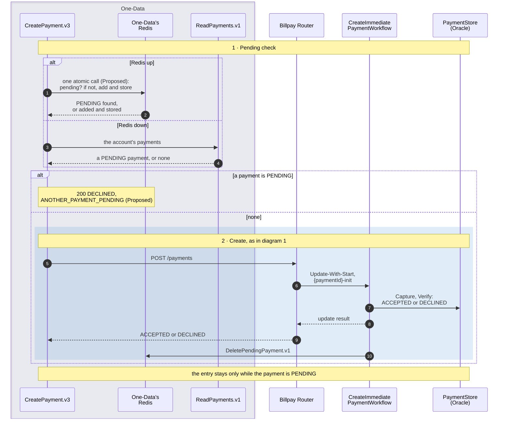

## 16. Pay by Debit card: create, 3D Secure and authorization

A debit card payment needs 3D Secure, the card schemes' check that the customer is the cardholder, and then an authorization that takes the money. One workflow, `CreatePaymentIntentWorkflow`, holds the payment throughout. Amex's own checks run first, on the instrument and the payment option, and a payment that fails them is `DECLINED` before 3D Secure starts. RequestConfirmation then asks the market's card provider (Checkout.com in the UK) to start 3D Secure and gives it Billpay's callback URL. The create's update ends at `PENDING` with the challenge link, or with no link when the card's bank needs no challenge. The provider then calls billpay-online directly, not through One-Data, and the callback is an update to the same workflow. Verify then only authorizes the payment: the authorization debits the customer's account if it holds enough money, and the card's bank declines it if not. The callback's reply carries the decision, and the callback itself is authenticated by mutual TLS. Execute makes no clearing call, because the money has already moved, and hands One-Data the settlement event Billpay creates, dated when the money moved. Once the payment is decided, the workflow calls One-Data's delete API, as in diagram 14. If no callback comes within 2 minutes and the grace, the timer cancels the payment, and nothing was taken.

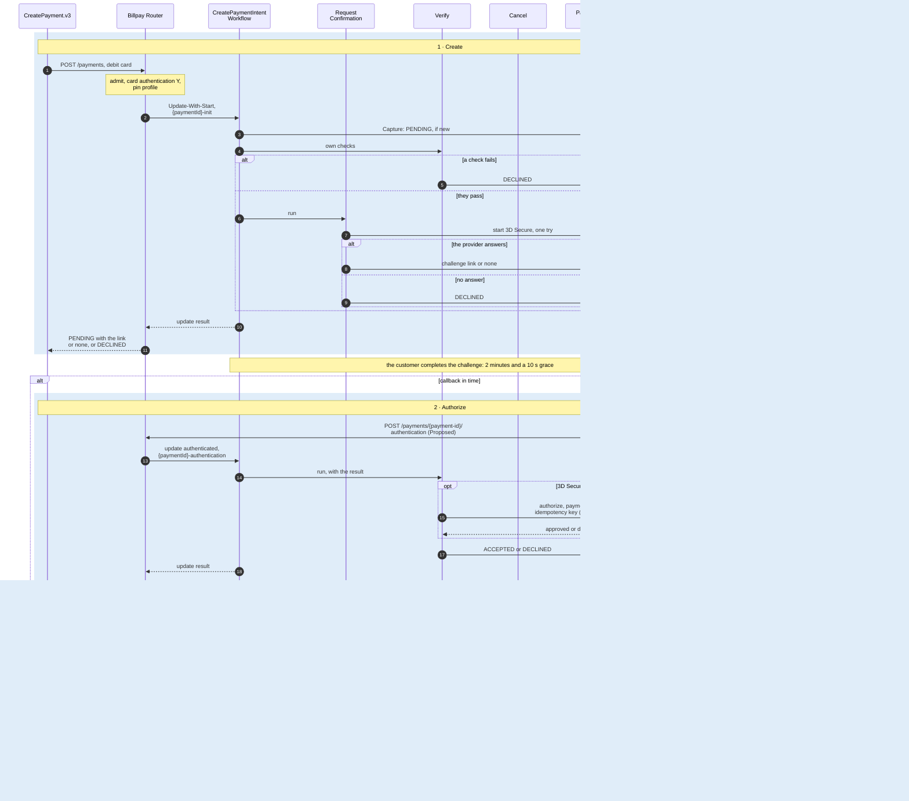
